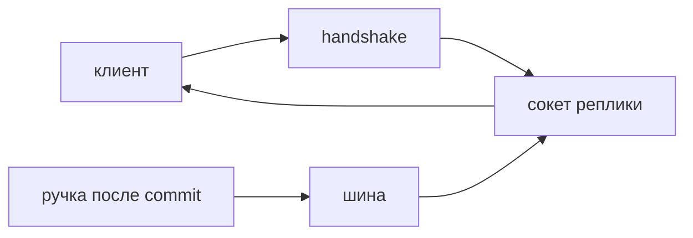

## Введение

WebSocket начинается как обычный HTTP-запрос и после рукопожатия становится двусторонним каналом кадров поверх одного соединения. Клиент и сервер могут писать друг другу, не открывая новый запрос на каждую реплику. Это полезно, когда сервер сам инициирует сообщение: лента статусов, совместное редактирование, ход игры, тикер. Это вредно, когда им заменяют обычные команды «создай», «прочитай», «измени». У команды есть метод, код ошибки, повтор и кэш. У кадра этого набора нет, пока вы не изобретёте его заново.

На собеседовании достаточно правила выбора и трёх эксплуатационных фактов. Канал авторизуют на рукопожатии. Соединение занимает память процесса, и вторая копия API его не видит без общей шины. Обрыв — нормальный режим, а не исключение, которое «не должно случаться». Успешная отправка кадра не заменяет запись в Postgres.

Выпуск держится на ленте статусов заявки. Команда «создать заявку» остаётся POST. Лента «статус сменился» может быть сокетом, если человеку важно увидеть смену без обновления страницы. Если достаточно обновлять страницу или спросить раз в несколько секунд, сокет — лишняя машина состояний.

## Раздел: Рукопожатие, доступ и жизнь соединения

Рукопожатие — последний момент, где у вас ещё есть обычный HTTP. Токен, куку сессии и право на конкретную ленту проверяют здесь. Откладывать проверку «до первого JSON» значит уже держать сокет человека, которому смотреть ленту нельзя, и надеяться, что он вежливо не станет слушать. После отказа соединение закрывают с понятной причиной, не оставляют полуоткрытым.

Сокет хранит состояние в процессе: объект соединения, подписки на заявки, буфер. Это не строка в базе. Рестарт процесса обрывает всех. Второй экземпляр API, который принял событие «статус сменился», не видит сокеты первого. Пока приложение в одном процессе, список соединений в памяти честен. Как только реплик две, публикацию несут через Redis или другой брокер: событие приходит в шину, каждая реплика пишет своим клиентам. Без шины пользователь, попавший на другую реплику, молчит, и это выглядит как «иногда лента живая».

Обрыв бывает из-за сети, сна ноутбука, прокси и выкладки. Клиент переподключается и заново проходит рукопожатие. Сервер шлёт ping и закрывает сокет, который не ответил pong: мёртвое соединение занимает слот и даёт клиенту ложное чувство связи, хотя кадры уже никто не читает. Таймаут лучше явный. «Повисим, вдруг оживёт» копит мёртвые сокеты до исчерпания памяти.

Кадр — не транзакция. Вы отправили JSON «статус закрыт», клиент его мог не обработать, вкладка могла быть в фоне, соединение могло порваться на следующем байте. Факт «заявка закрыта» хранит база. При переподключении клиент спрашивает текущее состояние обычным GET или получает снимок первым кадром, а не доверяет тому, что «вчера кадр точно дошёл».

Масштаб. Тысяча висящих сокетов — это тысяча объектов и тысяча проверок пульса. Если обновление нужно раз в минуту, дешевле короткий опрос. Сокет окупается на частых событиях и на ощущении «само пришло». Его не выбирают «потому что современнее».

## Раздел: Что оставить в REST

Создание заявки, смена статуса по кнопке человека, загрузка файла, оплата — команды. У них есть тело, код, идемпотентность и журнал. Провести их кадром значит самому придумать соответствие ошибок, повторов и прав. Обычно это хуже уже готового HTTP.

Чтение текущего состояния тоже хорошо ложится на GET. Сокет поверх этого — подписка на изменения, а не замена ресурса. Клиент открыл страницу, один раз прочитал заявку, подписался на её id. Дальше кадры доносят изменения. Если сокет молчит, на экране всё ещё есть данные последнего GET, а не пустота.

Опрос раз в несколько секунд — честный средний путь. Он проще в отладке, переживает рестарт без шины и не держит соединение. Его стыдно только если интервал маленький, клиентов много и большинство опросов пустые. Тогда считают цену и сравнивают с ценой шины и пульса, а не спорят о вкусе.

Авторизация команды не становится слабее от того, что рядом есть сокет. PATCH всё равно проверяет право на сервере. Подписка на ленту проверяет право видеть эту заявку. Это две проверки. Подписка на «все заявки компании» без фильтра — способ утечки, если в общий канал пишут чужие id.

## Раздел: Разбор на примере

Страница заявки. При открытии `GET /tickets/42` отдаёт статус «в работе». Рядом клиент открывает `/ws/tickets/42`, в рукопожатии передаёт токен. Сервер проверяет токен и что этот пользователь может видеть заявку 42. Если нет — закрывает рукопожатие. Если да — регистрирует сокет в локальном наборе «кто слушает 42».

Сотрудник другим запросом переводит заявку в «жду ответа». Ручка пишет статус в базу, коммитит и публикует в шину событие `{ticket_id: 42, status}`. Каждая реплика API, у которой есть подписчики, шлёт кадр. Реплика без подписчиков просто пропускает событие. Клиент, который был отключён, при возврате снова делает GET и видит «жду ответа», даже если кадр потерялся.

Ping раз в тридцать секунд. Нет pong — сокет удаляют из набора. Клиент видит обрыв и пробует снова с паузой, без плотного цикла, который положит сервер.

Что не делают. Не шлют через этот сокет команду «закрой заявку» с клиента, чтобы «не плодить ручки». Команда остаётся PATCH с проверкой роли. Не считают send() доказательством, что в базе уже новый статус: публикация стоит после commit, не до него. Иначе подписчик увидит статус, которого откат ещё может не оставить.

## Раздел: Где это ломается

Проверка доступа в первом сообщении, а не на рукопожатии. Чужой успевает подписаться на ленту или хотя бы занять ресурс.

Список сокетов только в памяти при двух подах. Половина пользователей «не получает события». Лечится шиной, не «надо больше логов».

Нет пульса. Прокси молча рвёт тихие соединения, сервер думает, что клиент жив, клиент думает, что подписан.

Весь API на сокетах. Пропадают коды, кэш GET, нормальный повтор команды и понятный контракт для Postman. Отладка превращается в чтение бесконечного кадра.

Отправка до commit. Подписчик бежит обновлять экран, транзакция откатывается, на экране ложь до следующего GET.

Один общий канал на всех без проверки id. Утечка названий чужих заявок. Подписка узкая: конкретный объект, на который есть право.

## Раздел: Ответ вслух

Канал нужен, когда сервер инициирует сообщение чаще, чем клиенту удобно спрашивать. Авторизую на рукопожатии, до кадров. Держу соединение с таймаутом и снимаю мёртвые по отсутствию pong. Если реплик несколько, событие публикую в общую шину, иначе его увидит только процесс, который его породил. Факт храню в базе и публикую после commit. Команды оставляю в REST. При переподключении клиент заново читает снимок, а не верит истории кадров.

## Раздел: Плохой ответ

Плохой ответ: «сделаем весь API на сокетах, так быстрее». Вы теряете кэш, коды ошибок и нормальный повтор запроса, а скорость на редких командах и так не была проблемой. Второй плохой ответ: «сокет сам доставляет надёжно, базу можно не спрашивать». Кадр не транзакция. Надёжность факта — в Postgres, канал только будит экран.

## Раздел: Термины

Рукопожатие — handshake, смена протокола с HTTP на кадры. Кадр — frame. Обрыв — disconnect. Пульс — ping и ответ pong. Широковещание — broadcast, в нескольких репликах оно идёт через шину, а не через общий список в памяти. Подписка — subscription на конкретный объект. Опрос — polling, клиент сам повторяет GET.

## Лаба

**Цель.** Выбрать транспорт для ленты и не перенести в него команды.

**Шаги.**

1. Для трёх потребностей выберите REST, опрос раз в несколько секунд или WebSocket: создать заявку, увидеть чужую смену статуса на открытой карточке, скачать файл.
2. Для сокета напишите, что проверяется на рукопожатии: кто пользователь и может ли он видеть этот id.
3. Опишите, что делает клиент после обрыва: пауза, новое рукопожатие, GET снимка.
4. Опишите две реплики API и где между ними едет событие.
5. Одной фразой напишите, почему send не заменяет commit и почему событие публикуют после фиксации.

**Готово, если…**

- [ ] Создание заявки не уехало в кадр
- [ ] Доступ проверяется до приёма сообщений
- [ ] Для двух процессов названа шина
- [ ] Переподключение включает чтение текущего состояния из базы

## Схема: Кто говорит первым

## Тест

### Когда WebSocket уместнее POST?

**Ответ:** сервер сам шлёт события

**Пояснение:** Команда клиента хорошо ложится на обычный запрос.

### Где проверять право открыть канал?

**Ответ:** на рукопожатии

**Пояснение:** После открытия сокета отказ уже дороже.

### Два процесса API. Почему второй клиент не слышит событие первого?

**Ответ:** память сокетов локальна

**Пояснение:** Нужна общая шина, иначе broadcast видит только свой процесс.

### Ping завис. Что делать серверу?

**Ответ:** закрыть соединение

**Пояснение:** Мёртвый сокет держит слот и даёт клиенту ложное чувство связи.

### Успешный send заменяет commit в базу?

**Ответ:** нет

**Пояснение:** Кадр могли не обработать. Факт хранит Postgres.

## Шпаргалка

<ul><li>Канал для инициативы сервера</li><li>Доступ на handshake</li><li>Реплики API требуют шину</li><li>Обрыв заложен в протокол</li><li>Снимок состояния берут GET-ом</li></ul>

## Anki

### Front: Что такое handshake WebSocket?

Back: HTTP-запрос, который переключает соединение на кадры.

### Front: Куда класть проверку токена?

Back: В рукопожатие, до приёма сообщений.

### Front: Почему broadcast ломается на двух подах?

Back: Список сокетов живёт в памяти одного процесса.

### Front: Зачем ping?

Back: Отличить живой канал от зависшего и закрыть мёртвый.

### Front: send успешен. Данные уже в базе?

Back: Нет. Кадр и транзакция — разные подтверждения.

### Front: Чем плох «весь API на сокетах»?

Back: Теряются коды HTTP, идемпотентность запроса и простой повтор.

## Мнемоника

### link: Живое соединение

**Задание:** Чем сокет отличается от ещё одного POST.

**Элементы:**
- рукопожатие
- кадр
- пинг
- закрытие

**Подсказка:** Без пинга прокси решит, что клиент умер.

**Ответ:** handshake → frame → ping → close

## Итоги

- Сокет — подписка на события, не замена ресурса REST
- Доступ проверяют до первого кадра
- Несколько копий API без шины не составляют один эфир
- После обрыва клиент читает факт из базы
- Публикация стоит после commit

## Ссылки

- [Asyncio](/game/learn/py-oop-advanced-mro)
- [JWT](/game/learn/sec-authn-authz)
