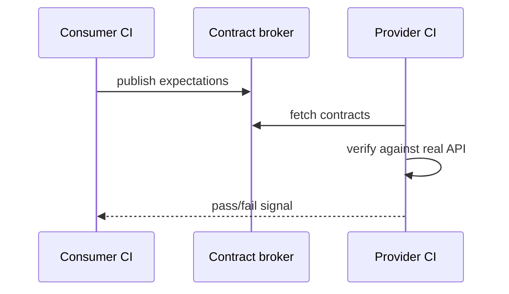
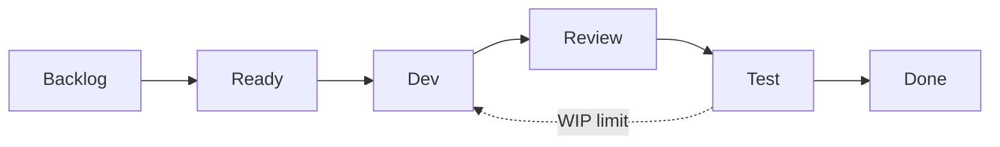

## Введение

Блок M10, M26–29, M96–97 и senior-отголоски S9, S29: как тестировать API системно, чем mock отличается от stub, зачем контракты, что смотреть в автотестах и когда load/stress. Клиентские примеры — **Python `requests`**; нагрузка — концепты JMeter/k6/Locust.

Термины и определения согласованы с **ISTQB CTFL v4** и [глоссарием ISTQB](https://glossary.istqb.org/); номера J/M/S — опциональный индекс типовых вопросов собеса.

**Agile для тестировщика:.** M30–33 и S3–4: на middle ждут не лозунги Agile, а как методология меняет работу QA — ритм поставки, DoD, где тестирование в потоке и какие препятствия типичны. Ниже — рабочие формулировки для собеса и лаба на DoD команды.

Термины и определения согласованы с **ISTQB CTFL v4** и [глоссарием ISTQB](https://glossary.istqb.org/); номера J/M/S — опциональный индекс типовых вопросов собеса.

## Раздел: Как отвечать одним блоком

Этот выпуск собрал соседние короткие темы трека: «API-автоматизация, контракты», «Agile для тестировщика:». Раньше каждая занимала отдельную карточку на несколько минут, а на собеседовании их спрашивают одним блоком. Ниже у каждой темы свой раздел, затем общие лабы, один тест и одна колода карточек. В ответе сначала назовите, какую тему спросили, потом определение и один пример. Не проговаривайте все разделы, если спросили один. Лабы можно пройти по порядку исходного трека. Если времени мало, сделайте первую и последнюю: первая ставит язык, последняя проверяет, что соседние темы вы не перепутали.

## Раздел: API-автоматизация, контракты: Моки, стабы, инструменты, контракты

**Stub** — «заглушка» с заготовленным ответом (фиксированный JSON). **Mock** — объект с ожиданиями вызовов (проверили, что клиент дернул нужный метод/URL). На практике границы размыты; на собесе: stub подменяет зависимость для изоляции, mock ещё и верифицирует взаимодействие.

**WireMock / mockserver / httpx mock / pytest responses** — внешний HTTP; unit-моки — внутри процесса. Не мокайте систему, которую доказываете: мок платёжного шлюза уместен для UI-магазина, но не заменяет сертификационные тесты самого шлюза.

**Инструменты API-тестирования:** Postman/Insomnia (ручные коллекции), REST-assured (Java), **pytest + requests/httpx**, Karate, Playwright APIRequest. Критерий выбора: язык команды, CI, переиспользование моделей данных.

**Contract testing.** Потребитель и поставщик согласуют схему (Pact, OpenAPI-валидация, JSON Schema). Consumer-driven: потребитель фиксирует ожидания, провайдер прогоняет их в CI — ловит breaking changes до интеграции. Это не полный E2E и не замена бизнес-сценариев.

```python
import jsonschema
import requests

ORDER_SCHEMA = {
    "type": "object",
    "required": ["id", "status", "total"],
    "properties": {
        "id": {"type": "string"},
        "status": {"enum": ["new", "paid", "cancelled"]},
        "total": {"type": "number", "minimum": 0},
    },
}


def test_order_contract(base_url: str, auth_headers: dict) -> None:
    response = requests.get(f"{base_url}/orders/demo", headers=auth_headers, timeout=10)
    assert response.status_code == 200
    jsonschema.validate(response.json(), ORDER_SCHEMA)
```

## Раздел: API-автоматизация, контракты: Что проверять в API auto, load и stress

**В API-автоматизации проверяйте:**

- статус-коды и идемпотентность (PUT/DELETE)
- схему/контракт тела и заголовков (`Content-Type`, pagination)
- бизнес-инварианты (баланс не отрицательный)
- авторизацию/роли (401/403)
- валидацию входа (400 + понятные ошибки)
- производительность «на уровне smoke» (p95 < порог) — опционально
- побочные эффекты в БД/очередях (если доступ есть)
- отрицательные: сломанный токен, большой payload, SQL/XSS в полях (по политике)

```python
def test_create_order_unauthorized(base_url: str) -> None:
    response = requests.post(f"{base_url}/orders", json={"sku": "A1"}, timeout=10)
    assert response.status_code == 401
```

**Performance / load / stress (инструменты):** JMeter, Gatling, k6, Locust (Python), облачные (k6 cloud, BlazeMeter). Выбирайте по скриптованию, протоколам (HTTP/gRPC), интеграциям CI.

**Load strategy.** Цель (SLA: RPS, latency p95/p99, error rate) → модель нагрузки (constant / ramp / spike) → данные и окружение, близкие к проду → наблюдаемость (APM, логи, БД) → анализ узких мест. Нагрузка на пустой БД врёт.

**Когда stress:** понять предел и поведение деградации (таймауты, очередь, circuit breaker), не «уронить прод». Soak/endurance — утечки памяти; spike — Black Friday. S29-уровень: согласовать с SRE blast radius и never на прод без явного разрешения.

## Раздел: API-автоматизация, контракты: Частые вопросы с собеседования

**Вопрос.** Чем уровень тестирования отличается от типа (вида) тестирования?

**Ответ.** Уровень отвечает на «где режем систему»: модуль, стык, продукт целиком, приёмка. Тип — «с какой целью гоняем»: smoke, regression, exploratory, security и т.д. На собесе покажите пример: один checkout можно проверить на integration (API+БД) и оформить прогон как regression после фикса — оси независимы.

**Вопрос.** Когда на собеседовании уместен smoke, а когда полный regression?

**Ответ.** Smoke — узкий «жив ли билд»: логин, критичный платёж, главная. Падает smoke — глубже не идём. Regression — шире: уже работавшее после изменений. Sanity — точечно после маленького патча. Ошибка junior: называть любой повторный прогон regression.

**Вопрос.** Зачем на собесе спрашивают equivalence partitioning и граничные значения?

**Ответ.** EP сжимает бесконечные входы в классы «ведут себя одинаково»; BVA бьёт по стыкам классов — там чаще ломается сравнение и валидация. Для поля 18–99 достаточно классов «ниже», «внутри», «выше» и точек 17–18–19, 98–99–100; не нужно 82 случайных числа.

**Вопрос.** Severity и priority в баг-репорте — одно и то же?

**Ответ.** Нет. Severity — ущерб для продукта и пользователя (crash vs опечатка). Priority — когда чинить в очереди команды. Критичный по severity баг может ждать, если воспроизводится только на стенде без пользователей; наоборот, мелкий UI-bug в checkout может быть P1 перед релизом.

**Вопрос.** Что имеют в виду под «пирамидой тестирования» на собеседовании?

**Ответ.** Много быстрых дешёвых проверок внизу (unit, контракт API), меньше медленных UI/e2e наверху. Цель — быстрая обратная связь в CI, а не «всё через Selenium». Пирамида не запрет на e2e: сквозные сценарии оставляют на критичные деньги-потоки.

## Раздел: Agile для тестировщика:: Scrum vs Kanban, роли, ритуалы, ценности

**Scrum** — итерации фиксированной длины (sprint), backlog, цели спринта, роли Product Owner / Scrum Master / Developers (QA обычно внутри Developers). Ритуалы: planning, daily, review, retrospective; часто refinement.

**Kanban** — поток continuous delivery, WIP-лимиты, визуализация колонок, метрики lead/cycle time; роли и каденции гибче. Хорош для поддержки/потока задач разного размера без искусственных sprint-deadlines.

| | Scrum | Kanban |
|--|-------|--------|
| Ритм | спринты | непрерывный поток |
| Объём | commitment на спринт | pull по WIP |
| Изменения scope | осторожно внутри спринта | проще переприоритизировать |
| Фокус QA | успеть вложить тест в инкремент | уменьшить время в колонке Test |

**Ценности (Scrum Guide дух):** commitment, focus, openness, respect, courage — для QA это смелость поднять риск, открытость по статусу среды, фокус на инкременте, а не на «своей очереди кейсов».

**Влияние методологии на качество.** Короткий feedback loop → быстрее ловим регресс; DoD без «протестируем потом» снижает leakage; WIP-лимиты не дают завалить QA кучей Dev-Done. Антипаттерн: «Agile», но тест — отдельная фаза после «настоящей работы».

## Раздел: Agile для тестировщика:: Sprint zero, препятствия, Definition of Done

**Sprint zero / подготовка окружения.** Не обязательно формальный спринт: поднять стенды, пайплайн, тестовые данные, доступы, мониторинг, договорённости по веткам и DoD. Без этого первый «боевой» спринт превращается в админку вместо ценности. На собесе: список concrетных артефактов (CI job, seed БД, feature flag стенд, каналы алертов).

**Препятствия Agile-тестера:**

- требования плывут до конца спринта, тест сжимается
- нет testability / id / логов
- одна среда на всех, вечные конфликты данных
- «автотесты напишем потом», регресс ручной и хрупкий
- QA как gatekeeper вместо встроенного качества
- игнор non-functional до прода

Ответы: shift-left (уточнение AC на refinement), парное тестирование с dev, контрактные проверки, DoD с автоматизацией критичного пути, отдельный quality backlog.

**Definition of Done.** Общий чеклист инкремента: код в main, ревью, unit/API/UI по политике, AC выполнены, миграции применены, документация/changelog, нет open Sev1, feature flag выключен/включён по плану. DoD ≠ DoR (ready): Ready — можно брать в работу; Done — можно считать поставленным.

Плохой DoD: «протестировано» без уточнения кто/чем. Хороший: измеримые пункты, включая «smoke CI green на стенде X».

## Раздел: Agile для тестировщика:: Частые вопросы с собеседования

**Вопрос.** Чем уровень тестирования отличается от типа (вида) тестирования?

**Ответ.** Уровень отвечает на «где режем систему»: модуль, стык, продукт целиком, приёмка. Тип — «с какой целью гоняем»: smoke, regression, exploratory, security и т.д. На собесе покажите пример: один checkout можно проверить на integration (API+БД) и оформить прогон как regression после фикса — оси независимы.

**Вопрос.** Зачем на собесе спрашивают equivalence partitioning и граничные значения?

**Ответ.** EP сжимает бесконечные входы в классы «ведут себя одинаково»; BVA бьёт по стыкам классов — там чаще ломается сравнение и валидация. Для поля 18–99 достаточно классов «ниже», «внутри», «выше» и точек 17–18–19, 98–99–100; не нужно 82 случайных числа.

**Вопрос.** Severity и priority в баг-репорте — одно и то же?

**Ответ.** Нет. Severity — ущерб для продукта и пользователя (crash vs опечатка). Priority — когда чинить в очереди команды. Критичный по severity баг может ждать, если воспроизводится только на стенде без пользователей; наоборот, мелкий UI-bug в checkout может быть P1 перед релизом.

**Вопрос.** Что имеют в виду под «пирамидой тестирования» на собеседовании?

**Ответ.** Много быстрых дешёвых проверок внизу (unit, контракт API), меньше медленных UI/e2e наверху. Цель — быстрая обратная связь в CI, а не «всё через Selenium». Пирамида не запрет на e2e: сквозные сценарии оставляют на критичные деньги-потоки.

**Вопрос.** Почему flaky e2e — отдельная тема на middle/senior QA?

**Ответ.** Flaky — тест то зелёный, то красный без изменения кода: тайминги, данные, сеть, параллельность. Команда перестаёт верить CI. Лечат изоляцией данных, явными ожиданиями, стабильными селекторами, отсечением внешних сервисов; иногда понижают уровень — проверяют API вместо хрупкого UI.

## Лаба

**API-автоматизация, контракты.**

**Цель.** Набор API-тестов на публичном или учебном API + черновик нагрузочного плана.

**Шаги.**
1. Напишите 5 pytest+requests: happy, 401, валидация 400, схема JSON, идемпотентный повтор.
2. Поднимите stub (например `responses` или WireMock) для зависимости «плата» и проверьте, что заказ создаётся при 200 от стаба.
3. Опишите consumer-contract: 3 обязательных поля ответа, которые нельзя ломать.
4. Сформулируйте load: целевой RPS, ramp 0→N за 5 мин, pass criteria error rate &lt; 1%, p95 &lt; X мс.
5. Укажите, зачем вам отдельный stress-прогон и какой сигнал «хватит».

**В группу:** почему контракт зелёный, а E2E красный — какие дыры между ними?

**Готово, если…**
- [ ] Отличаете mock/stub на своём примере
- [ ] Есть schema assert в коде
- [ ] Load plan с метриками, не «посмотрим как дышит»

**Agile для тестировщика:.**

**Цель.** Собрать DoD и карту потока для учебной команды из 1 PO, 3 dev, 1 QA.

**Шаги.**
1. Опишите, когда выберете Scrum, а когда Kanban (по 3 аргумента).
2. Для Scrum распишите участие QA в каждом ритуале (1–2 предложения).
3. Составьте DoD из 8 пунктов, из них ≥2 про качество/тест.
4. Составьте DoR из 5 пунктов (AC, зависимости, тестовые данные…).
5. Список sprint-zero: среда, CI, данные, доступы, мониторинг — с владельцем каждой задачи.
6. Выберите 2 препятствия из раздела и напишите конкретный эксперимент на ретро (гипотеза → метрика → срок).

**В группу:** может ли задача быть Done без UI-автотеста, если есть API-контракт и ручной AC?

**Готово, если…**
- [ ] Таблица Scrum/Kanban своими словами
- [ ] DoD проверяем, не декларативный
- [ ] Sprint zero не «купим Jira», а технические готовности

## Схема: API-автоматизация, контракты: Consumer-driven contract



## Схема: Agile для тестировщика:: Поток с WIP и колонкой Test



## Тест

### Чем mock отличается от stub на собеседовании?

**Ответ:** stub отдаёт заготовленный ответ; mock дополнительно проверяет факт и характер вызова

**Пояснение:** оба изолируют зависимость; mock про взаимодействие, stub про состояние/данные.

### Чем Kanban принципиально отличается от Scrum для QA?

**Ответ:** упор на поток и WIP, без обязательных спринтов и sprint commitment

**Пояснение:** QA оптимизирует cycle time в Test и баланс колонок; в Scrum — вписывает проверки в цель итерации.

### Что даёт contract testing, чего не даёт Postman-smoke?

**Ответ:** автоматический сигнал о breaking changes между потребителем и провайдером в CI

**Пояснение:** коллекция Postman проверяет сценарий сейчас; контракт ловит несовместимость версий сервисов.

### Что должно быть в Definition of Done про тестирование?

**Ответ:** конкретные виды проверок/гейты (например CI smoke green, AC пройдены, критичные баги закрыты)

**Пояснение:** слово «протестировано» без критериев не работает как DoD.

### Когда нужен stress, а не только load под SLA?

**Ответ:** чтобы найти точку отказа и проверить деградацию сверх ожидаемой нагрузки

**Пояснение:** load подтверждает SLA; stress исследует пределы и защитные механизмы — на изолированном контуре.

## Шпаргалка

<ul><li>status, schema, auth, business asserts, negatives</li><li>requests/httpx + pytest; схема через jsonschema/OpenAPI</li><li>Load → SLA; Stress → пределы; Soak → утечки</li><li>Инструменты: k6, JMeter, Locust, Gatling</li><li>Роли: PO, SM, Developers (QA внутри)</li><li>Ритуалы: planning, daily, review, retro, refinement</li><li>WIP-лимиты, lead/cycle time, continuous flow</li></ul>

## Anki

### Front: Что такое consumer-driven contract?

Back: потребитель задаёт ожидания API; провайдер проверяет их у себя в CI до интеграции

### Front: Назовите пять ценностей Scrum

Back: commitment, focus, openness, respect, courage

### Front: Какие метрики обычно входят в pass criteria нагрузки?

Back: RPS/throughput, latency percentiles (p95/p99), error rate, иногда CPU/RAM/DB

### Front: Что такое WIP limit?

Back: ограничение числа задач в колонке/состоянии, чтобы не копить незавершёнку и не душить QA

### Front: Что проверить в API-автотесте кроме status_code == 200?

Back: тело/схему, заголовки, бизнес-правила, права доступа, негативные коды

### Front: DoD vs Acceptance Criteria?

Back: AC — условия конкретной фичи; DoD — стандарт качества любого инкремента команды

## Мнемоника

### acronym: Контракт API

**Задание:** Четыре проверки ответа, кроме «пришёл 200».

**Элементы:**
- Статус
- Схема
- Тело
- Время

**Подсказка:** 200 с пустым телом — дефект контракта.

**Ответ:** status, schema, body, time

## Итоги

- Моки/стабы ускоряют и изолируют, но не заменяют проверку реальной интеграции там, где риск
- Контракты ловят поломку совместимости сервисов раньше E2E
- API-автоматизация сильнее UI на стабильности и скорости обратной связи
- Load доказывает SLA; stress — поведение за краем — только осознанно и безопасно
- Scrum и Kanban по-разному ритмируют работу QA, но оба требуют встроенного качества, не фазы «в конце»
- DoD/DoR — главные артефакты разговора о «когда достаточно протестировано»
- Sprint zero и борьба с препятствиями — практический middle, а не теория манифеста
- Смелость эскалировать риск — ценность, а не конфликтность

## Ссылки

- [ISTQB Glossary](https://glossary.istqb.org/)
- [CTFL v4 — Certified Tester Foundation Level](https://istqb.org/certifications/certified-tester-foundation-level-ctfl-v4-0/)
- [OWASP API Security Top 10](https://owasp.org/www-project-api-security/)
- [QA-interview-250](https://github.com/Konstantine23/QA-interview-250)
- [Learn](/game/learn)
- [Scrum Guide](https://scrumguides.org/scrum-guide.html)
- [Infra Linux containers](/game/learn/qa-infra-linux-containers)
