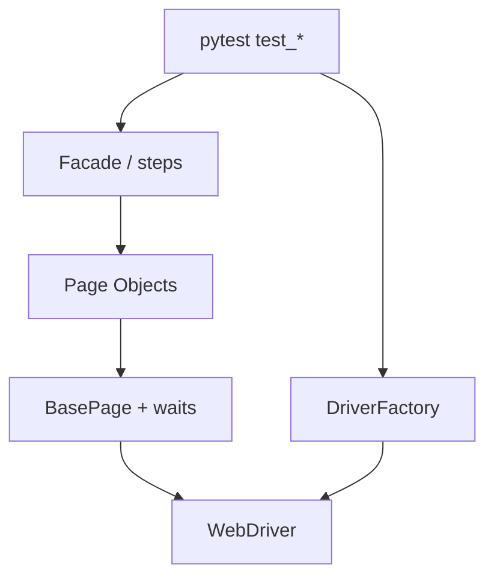
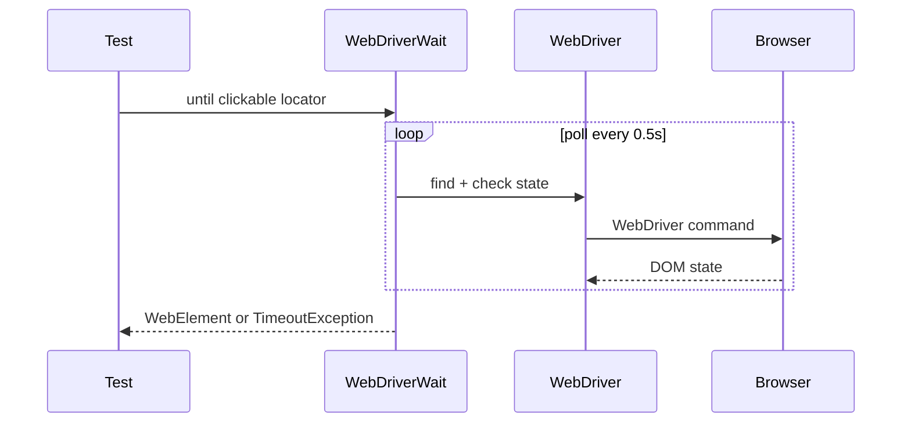

## Введение

После ручной базы на собеседовании ждут мост в AQA: ООП, SOLID, DRY/KISS/YAGNI, зачем Page Object и чем он отличается от «навалили селекторы в тест». Вопросы J36–45 часто звучат на Java, но смысл универсален — ниже ответы своими словами и лабы на **Python** (pytest + Selenium). Java — короткий блок для типовых формулировок.

Термины и определения согласованы с **ISTQB CTFL v4** и [глоссарием ISTQB](https://glossary.istqb.org/); номера J/M/S — опциональный индекс типовых вопросов собеса.

**Selenium WebDriver на Python.** Selenium WebDriver — классика UI-автоматизации и блок J46–62 / M35–38, M41–42. На собесе ждут: чем драйвер отличается от IDE, какие локаторы стабильнее, почему `time.sleep` — запах, что такое Grid и как кликнуть в iframe. Ниже — ответы и код на **Python Selenium 4**.

Термины и определения согласованы с **ISTQB CTFL v4** и [глоссарием ISTQB](https://glossary.istqb.org/); номера J/M/S — опциональный индекс типовых вопросов собеса.

## Раздел: Как отвечать одним блоком

Этот выпуск собрал соседние короткие темы трека: «AQA принципы», «Selenium WebDriver на Python». Раньше каждая занимала отдельную карточку на несколько минут, а на собеседовании их спрашивают одним блоком. Ниже у каждой темы свой раздел, затем общие лабы, один тест и одна колода карточек. В ответе сначала назовите, какую тему спросили, потом определение и один пример. Не проговаривайте все разделы, если спросили один. Лабы можно пройти по порядку исходного трека. Если времени мало, сделайте первую и последнюю: первая ставит язык, последняя проверяет, что соседние темы вы не перепутали.

## Раздел: AQA принципы: OOP, interface vs abstract, SOLID

**Инкапсуляция** — прячем внутренности за методами/свойствами: тест говорит `login_page.submit()`, а не кликает по CSS. **Наследование** — общий `BasePage` с `find`, `wait`, `click`. **Полиморфизм** — один интерфейс `DriverFactory.create()`, разная реализация Chrome/Firefox. **Абстракция** — выделяем «страница логина», а не набор WebElement.

**Java-заметка (часто спрашивают).** `interface` — контракт без реализации (с Java 8 — и default-методы); класс может реализовать несколько. `abstract class` — частичная реализация + состояние; наследуется один раз. В Python аналог контракта — `abc.ABC` / Protocol; duck typing сильнее формальных интерфейсов.

**SOLID коротко для тестов:**

| Буква | Смысл в AQA |
|-------|-------------|
| S | Один класс страницы — одна зона UI |
| O | Новый локатор/шаг — расширение, не правка всех тестов |
| L | Подкласс драйвера/page не ломает ожидания базового API |
| I | Не тащите в Page методы чужих экранов |
| D | Тест зависит от абстракции `Browser`, не от `ChromeDriver()` напрямую |

**DRY / KISS / YAGNI.** DRY — общий wait/assert вынести, не копипастить. KISS — простой Page без «фреймворка на 20 слоёв». YAGNI — не пишите Parallel Grid и Allure-listener, пока нет задачи.

**GoF кратко.** Для AQA чаще всего: **Factory** (драйвер), **Singleton** (осторожно: shared driver в параллели — боль), **Builder** (сложные payload), **Strategy** (разные assert/отчёты), **Facade** (бизнес-шаг поверх нескольких page). Не зубрите все 23 — назовите 3–4 и где применили.

## Раздел: AQA принципы: Page Object / PageFactory и Java-блок

**Page Object** — класс, который знает локаторы и действия экрана; тест описывает сценарий. Плюсы: смена id кнопки правится в одном месте, читаемость, меньше дублирования.

```python
# page_objects/login_page.py
from selenium.webdriver.common.by import By
from selenium.webdriver.remote.webdriver import WebDriver


class LoginPage:
    USER = (By.ID, "username")
    PASS = (By.ID, "password")
    SUBMIT = (By.CSS_SELECTOR, "button[type=submit]")

    def __init__(self, driver: WebDriver) -> None:
        self.driver = driver

    def open(self, base_url: str) -> "LoginPage":
        self.driver.get(f"{base_url}/login")
        return self

    def login(self, username: str, password: str) -> None:
        self.driver.find_element(*self.USER).send_keys(username)
        self.driver.find_element(*self.PASS).send_keys(password)
        self.driver.find_element(*self.SUBMIT).click()
```

```python
# tests/test_login.py
def test_login_ok(driver, base_url):
    LoginPage(driver).open(base_url).login("qa", "secret")
    assert "/dashboard" in driver.current_url
```

**PageFactory (Java).** Аннотации `@FindBy` + `PageFactory.initElements(driver, this)` — ленивая инициализация элементов. В Python Selenium официального PageFactory нет; близкий стиль — хранить кортежи `(By, value)` или обёртки. Не путайте PageFactory с Page Object: первое — способ инициализации, второе — паттерн.

**Короткий Java-блок собеса (J44–45 стиль).**

- **Collections:** `List`/`ArrayList`, `Set`/`HashSet`, `Map`/`HashMap`; когда порядок/уникальность/ключ-значение.
- **Thread:** поток выполнения; для Selenium Grid/параллели важно не шарить один `WebDriver` между потоками без синхронизации.
- **String:** immutable; `==` vs `equals`; пул строк — частая ловушка.
- **final:** переменная/метод/класс нельзя переопределить/переназначить (для класса — нельзя наследовать).

## Раздел: AQA принципы: Частые вопросы с собеседования

**Вопрос.** Чем уровень тестирования отличается от типа (вида) тестирования?

**Ответ.** Уровень отвечает на «где режем систему»: модуль, стык, продукт целиком, приёмка. Тип — «с какой целью гоняем»: smoke, regression, exploratory, security и т.д. На собесе покажите пример: один checkout можно проверить на integration (API+БД) и оформить прогон как regression после фикса — оси независимы.

**Вопрос.** Когда на собеседовании уместен smoke, а когда полный regression?

**Ответ.** Smoke — узкий «жив ли билд»: логин, критичный платёж, главная. Падает smoke — глубже не идём. Regression — шире: уже работавшее после изменений. Sanity — точечно после маленького патча. Ошибка junior: называть любой повторный прогон regression.

**Вопрос.** Зачем на собесе спрашивают equivalence partitioning и граничные значения?

**Ответ.** EP сжимает бесконечные входы в классы «ведут себя одинаково»; BVA бьёт по стыкам классов — там чаще ломается сравнение и валидация. Для поля 18–99 достаточно классов «ниже», «внутри», «выше» и точек 17–18–19, 98–99–100; не нужно 82 случайных числа.

**Вопрос.** Severity и priority в баг-репорте — одно и то же?

**Ответ.** Нет. Severity — ущерб для продукта и пользователя (crash vs опечатка). Priority — когда чинить в очереди команды. Критичный по severity баг может ждать, если воспроизводится только на стенде без пользователей; наоборот, мелкий UI-bug в checkout может быть P1 перед релизом.

**Вопрос.** Что имеют в виду под «пирамидой тестирования» на собеседовании?

**Ответ.** Много быстрых дешёвых проверок внизу (unit, контракт API), меньше медленных UI/e2e наверху. Цель — быстрая обратная связь в CI, а не «всё через Selenium». Пирамида не запрет на e2e: сквозные сценарии оставляют на критичные деньги-потоки.

## Раздел: Selenium WebDriver на Python: Драйверы, локаторы, waits, исключения

**WebDriver** — API управления браузером через протокол (W3C WebDriver). **Драйвер** (chromedriver и т.п.) — бинарник-мост; в Selenium 4 часто `Selenium Manager` подтягивает его сам. **Selenium IDE** — запись/playback, не замена фреймворку.

**Локаторы (от более хрупких к устойчивым по смыслу):** id → name → CSS → XPath. Избегайте абсолютного XPath и индексов `tr[3]`. Предпочитайте data-testid, если фронт даёт.

```python
from selenium.webdriver.common.by import By
from selenium.webdriver.support.ui import WebDriverWait
from selenium.webdriver.support import expected_conditions as EC

driver.find_element(By.CSS_SELECTOR, "[data-testid=login]")
driver.find_elements(By.XPATH, "//table[@id='orders']//tr")
```

**Waits.** Implicit — глобальный timeout на find (смешивать с explicit опасно). Explicit — `WebDriverWait` + `expected_conditions`. Fluent — polling с ignored exceptions. **Никогда** не заменяйте стабильный wait слепым `sleep`, кроме отладки.

```python
wait = WebDriverWait(driver, 10)
btn = wait.until(EC.element_to_be_clickable((By.ID, "submit")))
btn.click()
```

**Типичные исключения:** `NoSuchElementException`, `TimeoutException`, `StaleElementReferenceException` (DOM перерисовался — перенайдите элемент), `ElementClickInterceptedException`, `NoSuchFrameException`, `UnhandledAlertException`.

**JavaScriptExecutor** — когда нативный клик не проходит (оверлей) или нужно читать/писать storage:

```python
driver.execute_script("arguments[0].scrollIntoView(true);", el)
driver.execute_script("arguments[0].click();", el)
value = driver.execute_script("return localStorage.getItem('token');")
```

## Раздел: Selenium WebDriver на Python: Actions, таблицы, frames, cookies, Grid, capabilities

**Actions (ActionChains):** hover, drag-and-drop, chord клавиш.

```python
from selenium.webdriver.common.action_chains import ActionChains
from selenium.webdriver.common.keys import Keys

ActionChains(driver).move_to_element(menu).pause(0.2).click(item).perform()
ActionChains(driver).key_down(Keys.CONTROL).send_keys("a").key_up(Keys.CONTROL).perform()
```

**Таблицы.** Найти строку по тексту ячейки, кликнуть кнопку в той же `tr` — через XPath `ancestor::tr` или обход `find_elements`.

**Frames / iframes.** `driver.switch_to.frame(el_or_index_or_name)` → работа → `switch_to.default_content()`. Вложенные — по цепочке. **Windows/tabs:** `window_handles`, `switch_to.window`.

**Cookies / storage.** `add_cookie` / `get_cookies` после открытия домена; для localStorage/sessionStorage — JSExecutor. Полезно для «залогиненного» состояния без UI-логина (осторожно с CSRF/expiry).

**Capabilities / Options.** `ChromeOptions`: headless, window-size, prefs загрузок, disable-gpu, args `--incognito`. В Selenium 4 — W3C capabilities через Options, не устаревший DesiredCapabilities как основной путь.

**Selenium Grid.** Hub/Router раздаёт сессии Node'ам: параллель, разные ОС/браузеры. Локально: Remote WebDriver на URL Grid.

```python
from selenium import webdriver
from selenium.webdriver.chrome.options import Options

options = Options()
options.add_argument("--headless=new")
driver = webdriver.Remote(
    command_executor="http://localhost:4444/wd/hub",
    options=options,
)
```

**Когда UI-автоматизация уместна (M):** критичные user journeys, регрессия после релиза, кроссбраузер smoke. Не автоматизировать всё подряд: нестабильный UI, одноразовые проверки, чисто визуальные мелочи без контракта.

## Раздел: Selenium WebDriver на Python: Частые вопросы с собеседования

**Вопрос.** Чем уровень тестирования отличается от типа (вида) тестирования?

**Ответ.** Уровень отвечает на «где режем систему»: модуль, стык, продукт целиком, приёмка. Тип — «с какой целью гоняем»: smoke, regression, exploratory, security и т.д. На собесе покажите пример: один checkout можно проверить на integration (API+БД) и оформить прогон как regression после фикса — оси независимы.

**Вопрос.** Зачем на собесе спрашивают equivalence partitioning и граничные значения?

**Ответ.** EP сжимает бесконечные входы в классы «ведут себя одинаково»; BVA бьёт по стыкам классов — там чаще ломается сравнение и валидация. Для поля 18–99 достаточно классов «ниже», «внутри», «выше» и точек 17–18–19, 98–99–100; не нужно 82 случайных числа.

**Вопрос.** Severity и priority в баг-репорте — одно и то же?

**Ответ.** Нет. Severity — ущерб для продукта и пользователя (crash vs опечатка). Priority — когда чинить в очереди команды. Критичный по severity баг может ждать, если воспроизводится только на стенде без пользователей; наоборот, мелкий UI-bug в checkout может быть P1 перед релизом.

**Вопрос.** Что имеют в виду под «пирамидой тестирования» на собеседовании?

**Ответ.** Много быстрых дешёвых проверок внизу (unit, контракт API), меньше медленных UI/e2e наверху. Цель — быстрая обратная связь в CI, а не «всё через Selenium». Пирамида не запрет на e2e: сквозные сценарии оставляют на критичные деньги-потоки.

**Вопрос.** Почему flaky e2e — отдельная тема на middle/senior QA?

**Ответ.** Flaky — тест то зелёный, то красный без изменения кода: тайминги, данные, сеть, параллельность. Команда перестаёт верить CI. Лечат изоляцией данных, явными ожиданиями, стабильными селекторами, отсечением внешних сервисов; иногда понижают уровень — проверяют API вместо хрупкого UI.

## Лаба

**AQA принципы.**

**Цель.** Собрать мини-каркас: `BasePage` + `LoginPage` + один pytest-тест без хардкода селекторов в тесте.

**Шаги.**
1. Создайте пакет `pages/`: `base_page.py` с методами `find`, `click`, `type_text` и явным wait.
2. `LoginPage` наследует `BasePage`, инкапсулирует три локатора и метод `login`.
3. Фикстура `driver` в `conftest.py` создаёт Chrome и закрывает после теста.
4. Напишите негативный кейс: неверный пароль → на странице виден текст ошибки (assert через page-метод `error_message()`).
5. Рефакторинг: вынесите URL в `pytest.ini` / env, не в тест.

**В группу:** где граница между Page Object и Helper/Facade? Когда «толстый» page становится антипаттерном?

**Готово, если…**
- [ ] Тест не содержит `By.CSS_SELECTOR`
- [ ] Объясняете S из SOLID на своём LoginPage
- [ ] Можете одной фразой сказать разницу interface vs abstract class в Java

**Selenium WebDriver на Python.**

**Цель.** Стабильный сценарий: логин → таблица заказов → фильтр → assert строки; плюс работа с iframe и cookie.

**Шаги.**
1. Explicit wait до кликабельности кнопки входа; запретите `time.sleep` в финальном коде.
2. Переключитесь в iframe help-виджета, прочитайте заголовок, вернитесь в default_content.
3. Сохраните session cookie после логина, перезапустите браузер, подставьте cookie, откройте /orders без формы логина.
4. Наведите меню Actions → откройте пункт; обработайте `StaleElementReferenceException` повторным поиском.
5. (Опционально) Поднимите Selenium Grid в Docker и прогоните тот же тест через `Remote`.

**В группу:** почему смесь implicit 10s + explicit 10s даёт «странные» таймауты?

**Готово, если…**
- [ ] Нет sleep в коммите
- [ ] Умеете объяснить stale element
- [ ] Показываете switch_to.frame и cookie inject

## Схема: AQA принципы: Слои AQA-каркаса



## Схема: Selenium WebDriver на Python: Explicit wait



## Тест

### Чем Page Object отличается от PageFactory?

**Ответ:** Page Object — паттерн изоляции UI; PageFactory — механизм инициализации элементов (типично Java `@FindBy`)

**Пояснение:** можно иметь PO без PageFactory; в Python чаще кортежи локаторов, чем аннотации.

### Чем explicit wait лучше time.sleep(5)?

**Ответ:** ждёт условие до N секунд и идёт дальше сразу; sleep всегда блокирует фиксированно

**Пояснение:** sleep замедляет suite и всё равно флакает на медленных стендах; EC привязан к готовности UI.

### Зачем принцип Dependency Inversion в тестах?

**Ответ:** тест зависит от абстракции браузера/API-клиента, а не от конкретной реализации

**Пояснение:** проще подменить Chrome на headless/Firefox и мокать HTTP-клиент без переписывания сценариев.

### Что делать со StaleElementReferenceException?

**Ответ:** заново найти элемент в DOM и повторить действие; не хранить WebElement через перерисовку

**Пояснение:** ссылка на узел протухла после AJAX/React reconcile — Page Object метод должен искать элемент в момент действия.

### Что нарушает YAGNI в начинающем AQA-фреймворке?

**Ответ:** заранее тащить Grid, кастомный runner и 5 слоёв абстракций «на вырост»

**Пояснение:** сначала стабильные waits + PO + отчёт; сложность — по реальной боли команды.

## Шпаргалка

<ul><li>ООП в тестах = читаемые модели экранов, не «классы ради классов»</li><li>SOLID: S и D чаще всего спасают фреймворк</li><li>DRY/KISS/YAGNI — противовес оверинжинирингу</li><li>Page Object хранит локаторы и действия; тест — сценарий</li><li>By.ID / NAME / CSS_SELECTOR / XPATH</li><li>data-testid &gt; хрупкий абсолютный XPath</li><li>Timeout / NoSuchElement / Stale / ClickIntercepted / NoSuchFrame</li></ul>

## Anki

### Front: Чем interface отличается от abstract class в Java?

Back: interface — контракт (можно несколько); abstract class — общая реализация и поля (одно наследование)

### Front: Implicit vs explicit wait?

Back: implicit — глобально на find; explicit — ждать конкретное условие через WebDriverWait

### Front: Что такое Page Object?

Back: класс экрана с локаторами и действиями; тест не знает селекторы

### Front: Как работать с iframe в Selenium?

Back: switch_to.frame(...), затем switch_to.default_content()

### Front: Расшифруйте DRY и YAGNI для автотестов

Back: DRY — не копировать локаторы/waits; YAGNI — не строить лишнюю инфраструктуру до потребности

### Front: Как выполнить JS в контексте страницы?

Back: driver.execute_script("...", element) — JSExecutor

## Мнемоника

### acronym: Каркас автотеста

**Задание:** Четыре части, которые не смешивают.

**Элементы:**
- Локатор в странице
- Сценарий в тесте
- Ожидание явное
- Данные снаружи

**Подсказка:** Селектор в тесте — уже поломка каркаса.

**Ответ:** page, test, wait, data

## Итоги

- ООП и SOLID отвечают на вопрос «как не утонуть в селекторах», а не «как сдать теорию учебника»
- Page Object — must-have формулировка junior AQA; PageFactory — уточнение про Java
- DRY/KISS/YAGNI помогают отказать от зоопарка абстракций на первом проекте
- Краткий Java-блок (Collections/Thread/String/final) закрывает типовые J-вопросы без ухода в backend
- Стабильность UI-тестов = правильные локаторы + explicit waits, не sleep
- Frames, alerts, windows и cookies — обязательный junior/middle блок
- Actions и JSExecutor — инструменты обхода, не замена нормальным кликам
- Grid и capabilities выводят прогон за пределы «у меня на ноутбуке зелёный»

## Ссылки

- [ISTQB Glossary](https://glossary.istqb.org/)
- [CTFL v4 — Certified Tester Foundation Level](https://istqb.org/certifications/certified-tester-foundation-level-ctfl-v4-0/)
- [Test pyramid — Martin Fowler](https://martinfowler.com/bliki/TestPyramid.html)
- [QA-interview-250](https://github.com/Konstantine23/QA-interview-250)
- [Learn](/game/learn)
- [Playwright Python](https://playwright.dev/python/)
- [pytest, CI, Git](/game/learn/qa-pytest-ci-git)
