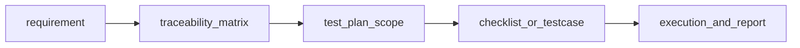
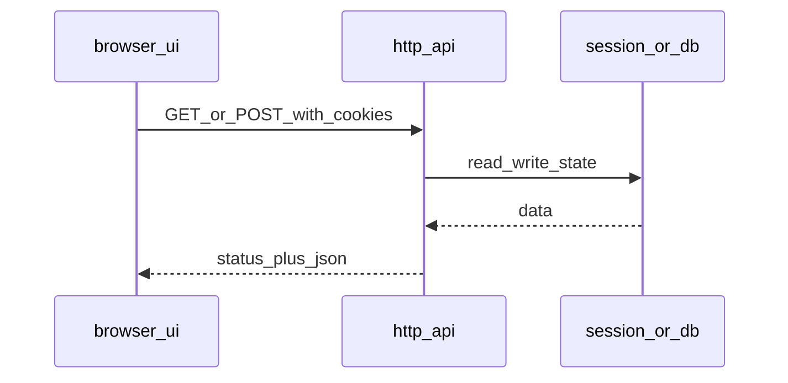

## Введение

На собесе junior-а спрашивают не только «как кликать», но и какие артефакты вы оставляете команде. Этот выпуск закрывает J18, J31–35, J119, J121: RTM, виды документов, тест-план, чеклист vs кейс и признаки сильного тест-кейса.

Термины и определения согласованы с **ISTQB CTFL v4** и [глоссарием ISTQB](https://glossary.istqb.org/); номера J/M/S — опциональный индекс типовых вопросов собеса.

**Web и HTTP для QA.** Большинство продуктов для junior QA — веб и API. Вопросы J76–103 проверяют, понимаете ли вы клиент-сервер, HTTP, REST, статусы, cookies и как смотреть сеть в DevTools. Этот выпуск даёт рабочие формулировки для собеса и повседневной отладки.

Термины и определения согласованы с **ISTQB CTFL v4** и [глоссарием ISTQB](https://glossary.istqb.org/); номера J/M/S — опциональный индекс типовых вопросов собеса.

## Раздел: Как отвечать одним блоком

Этот выпуск собрал соседние короткие темы трека: «Документы QA», «Web и HTTP для QA». Раньше каждая занимала отдельную карточку на несколько минут, а на собеседовании их спрашивают одним блоком. Ниже у каждой темы свой раздел, затем общие лабы, один тест и одна колода карточек. В ответе сначала назовите, какую тему спросили, потом определение и один пример. Не проговаривайте все разделы, если спросили один. Лабы можно пройти по порядку исходного трека. Если времени мало, сделайте первую и последнюю: первая ставит язык, последняя проверяет, что соседние темы вы не перепутали.

## Раздел: Документы QA: Документы и RTM

Типовые артефакты тестирования:
- **Test policy / strategy** (часто на уровне организации) — принципы, виды тестов, инструменты;
- **Test plan** — что, когда, кто, чем, критерии, риски для конкретного релиза/проекта;
- **Test cases / checklists** — конкретные проверки;
- **Bug reports / test summary report** — дефекты и итог прогона;
- **RTM (Requirements Traceability Matrix)** — матрица «требование ↔ тест(ы) ↔ статус».

Зачем RTM: видно покрытие требований тестами, пробелы («требование без кейса»), и влияние изменения требования на набор проверок. На junior уровне достаточно объяснить столбцы: ID требования, описание, ID кейсов, результат последнего прогона.

## Раздел: Документы QA: Тест-план, чеклист и хороший кейс

**Тест-план** обычно включает: scope / out of scope, объекты тестирования, подходы (виды/уровни), окружения, данные, роли и ответственность, расписание, риски и митигации, entry/exit, критерии приостановки, инструменты, deliverables.

**Чеклист** — короткий список проверок без детальных шагов («логин под admin», «оплата картой Visa»). Быстр в поддержке, хорош для smoke и опытной команды.

**Тест-кейс** — формализованный сценарий: ID, title, preconditions, steps, test data, expected result, иногда postconditions и приоритет. Нужен для онбординга, аудита, автоматизации и сложных потоков.

Признаки **хорошего** кейса:
- один основной смысл (не «проверить весь кабинет»);
- воспроизводим независимым человеком;
- ожидаемый результат проверяем и однозначен;
- данные конкретны;
- связан с требованием/риском;
- независим по возможности (не требует тайного предыдущего кейса без preconditions).

Плохой кейс: «проверить оплату» без шагов, карты, суммы и ожидаемого статуса заказа.

## Раздел: Документы QA: Практика корзины и карты оплаты

Для **корзины** чеклист-пример:
- добавить товар / несколько штук / один SKU дважды;
- изменить количество, удалить позицию, очистить корзину;
- цена и сумма сходятся; промокод; недоступный остаток;
- пустая корзина → переход к checkout заблокирован.

Для **оплаты картой** (учебно, без реальных ПДн):
- валидная тестовая карта → успех и статус заказа Paid;
- declined / insufficient funds;
- неверный CVV, истекший срок, неполный PAN;
- двойной submit кнопки «Оплатить»;
- возврат назад из платёжного виджета;
- таймаут 3-D Secure (если есть).

На собесе по J119/J121 ждут структуру мышления: сначала критичные пути, потом негатив и граничные данные.

## Раздел: Документы QA: Частые вопросы с собеседования

**Вопрос.** Чем уровень тестирования отличается от типа (вида) тестирования?

**Ответ.** Уровень отвечает на «где режем систему»: модуль, стык, продукт целиком, приёмка. Тип — «с какой целью гоняем»: smoke, regression, exploratory, security и т.д. На собесе покажите пример: один checkout можно проверить на integration (API+БД) и оформить прогон как regression после фикса — оси независимы.

**Вопрос.** Когда на собеседовании уместен smoke, а когда полный regression?

**Ответ.** Smoke — узкий «жив ли билд»: логин, критичный платёж, главная. Падает smoke — глубже не идём. Regression — шире: уже работавшее после изменений. Sanity — точечно после маленького патча. Ошибка junior: называть любой повторный прогон regression.

**Вопрос.** Severity и priority в баг-репорте — одно и то же?

**Ответ.** Нет. Severity — ущерб для продукта и пользователя (crash vs опечатка). Priority — когда чинить в очереди команды. Критичный по severity баг может ждать, если воспроизводится только на стенде без пользователей; наоборот, мелкий UI-bug в checkout может быть P1 перед релизом.

**Вопрос.** Что имеют в виду под «пирамидой тестирования» на собеседовании?

**Ответ.** Много быстрых дешёвых проверок внизу (unit, контракт API), меньше медленных UI/e2e наверху. Цель — быстрая обратная связь в CI, а не «всё через Selenium». Пирамида не запрет на e2e: сквозные сценарии оставляют на критичные деньги-потоки.

**Вопрос.** Почему flaky e2e — отдельная тема на middle/senior QA?

**Ответ.** Flaky — тест то зелёный, то красный без изменения кода: тайминги, данные, сеть, параллельность. Команда перестаёт верить CI. Лечат изоляцией данных, явными ожиданиями, стабильными селекторами, отсечением внешних сервисов; иногда понижают уровень — проверяют API вместо хрупкого UI.

## Раздел: Web и HTTP для QA: Клиент-сервер, REST/SOAP, CRUD и методы

**Клиент-сервер:** браузер/приложение (клиент) запрашивает ресурс; сервер отвечает данными и статусом. Тестировщик смотрит оба конца: UI мог соврать, а API вернуть правду (и наоборот).

**HTTP-методы (часто):**
- **GET** — получить ресурс, без тела запроса в классике, идемпотентен, не должен менять состояние;
- **POST** — создать/инициировать действие, не идемпотентен;
- **PUT** — заменить ресурс целиком (идемпотентен в идеале);
- **PATCH** — частичное обновление;
- **DELETE** — удаление.

**CRUD:** Create → POST (иногда PUT), Read → GET, Update → PUT/PATCH, Delete → DELETE.

**GET vs POST на собесе:** GET для чтения и параметров в URL (осторожно с секретами); POST для тел, файлов, операций с побочным эффектом. Кэш и логи прокси по-разному относятся к методам.

**REST** — стиль: ресурсы и URI, стандартные методы, без состояния сервера между запросами (состояние — в токене/БД), обычно JSON.  
**SOAP** — протокол на XML, контракт WSDL, строже по схеме, часто в enterprise/банках; транспорт обычно HTTP, но модель другая.

**JSON** — лёгкий текстовый формат объектов/массивов. **XML** — теги, атрибуты, схемы; тяжелее, но привычен в SOAP и старых интеграциях.

## Раздел: Web и HTTP для QA: Статус-коды, cookies, session, cache

Группы кодов:
- **1xx** — информационные;
- **2xx** — успех (`200 OK`, `201 Created`, `204 No Content`);
- **3xx** — перенаправление (`301`, `302`, `304`);
- **4xx** — ошибка клиента (`400`, `401`, `403`, `404`, `409`, `422`, `429`);
- **5xx** — ошибка сервера (`500`, `502`, `503`, `504`).

На собесе отличайте **401 Unauthorized** (нет/невалидна аутентификация) и **403 Forbidden** (аутентифицирован, но нет прав).

**Cookie** — пара имя=значение, которую сервер просит хранить и присылать обратно (часто с флагами HttpOnly, Secure, SameSite).  
**Session** — серверное (или token-based) состояние пользователя между запросами; идентификатор сессии может жить в cookie.  
**Cache** — хранение ответа ближе к клиенту/прокси, чтобы не ходить на origin; заголовки `Cache-Control`, `ETag`, `304`.

Для QA: после логаута cookie/session должны инвалидироваться; чувствительные ответы — без агрессивного публичного кэша.

## Раздел: Web и HTTP для QA: DevTools, HTML/CSS/JS, frames и AJAX

В Chrome DevTools тестировщику esp. полезны:
- **Network** — метод, URL, статус, timing, request/response headers и body;
- **Application** — cookies, localStorage, sessionStorage;
- **Console** — JS-ошибки;
- **Elements** — DOM и быстрая проверка атрибутов.

**HTML** — структура страницы; **CSS** — оформление; **JavaScript** — поведение на клиенте. Junior не обязан верстать, но должен понимать, что UI-баг может быть в разметке, стилях или скрипте.

**iframe / frames** — вложенный документ; локаторы и безопасность (same-origin) усложняются.  
**AJAX** (и fetch/XHR) — асинхронные запросы без полной перезагрузки страницы: UI обновляется после ответа API. Баг «кнопка крутится вечно» часто виден в Network как pending/failed.

Практика отладки: воспроизвели → Network → статус и тело → сверили с UI-сообщением → Application (сессия) → при необходимости повторили запрос через Postman/Insomnia.

## Раздел: Web и HTTP для QA: Частые вопросы с собеседования

**Вопрос.** Чем уровень тестирования отличается от типа (вида) тестирования?

**Ответ.** Уровень отвечает на «где режем систему»: модуль, стык, продукт целиком, приёмка. Тип — «с какой целью гоняем»: smoke, regression, exploratory, security и т.д. На собесе покажите пример: один checkout можно проверить на integration (API+БД) и оформить прогон как regression после фикса — оси независимы.

**Вопрос.** Когда на собеседовании уместен smoke, а когда полный regression?

**Ответ.** Smoke — узкий «жив ли билд»: логин, критичный платёж, главная. Падает smoke — глубже не идём. Regression — шире: уже работавшее после изменений. Sanity — точечно после маленького патча. Ошибка junior: называть любой повторный прогон regression.

**Вопрос.** Зачем на собесе спрашивают equivalence partitioning и граничные значения?

**Ответ.** EP сжимает бесконечные входы в классы «ведут себя одинаково»; BVA бьёт по стыкам классов — там чаще ломается сравнение и валидация. Для поля 18–99 достаточно классов «ниже», «внутри», «выше» и точек 17–18–19, 98–99–100; не нужно 82 случайных числа.

**Вопрос.** Severity и priority в баг-репорте — одно и то же?

**Ответ.** Нет. Severity — ущерб для продукта и пользователя (crash vs опечатка). Priority — когда чинить в очереди команды. Критичный по severity баг может ждать, если воспроизводится только на стенде без пользователей; наоборот, мелкий UI-bug в checkout может быть P1 перед релизом.

**Вопрос.** Что имеют в виду под «пирамидой тестирования» на собеседовании?

**Ответ.** Много быстрых дешёвых проверок внизу (unit, контракт API), меньше медленных UI/e2e наверху. Цель — быстрая обратная связь в CI, а не «всё через Selenium». Пирамида не запрет на e2e: сквозные сценарии оставляют на критичные деньги-потоки.

## Лаба

**Документы QA.**

**Цель.** Составить фрагмент тест-плана на checkout и набор: 8 пунктов чеклиста корзины + 3 детальных кейса оплаты.

**Шаги.**
1. Напишите scope / out of scope для тестирования корзины и оплаты (1 страница буллетов).
2. Сделайте мини-RTM: 5 требований → ID кейсов/пунктов чеклиста.
3. Оформите 3 кейса оплаты в полном формате (preconditions, steps, data, expected).
4. Отметьте, какие пункты лучше оставить чеклистом, а какие — кейсами, и почему.

**В группу:** партнёр проходит ваш кейс «вслепую» и отмечает двусмысленные шаги.

**Готово, если…**
- [ ] Объясняете RTM и зачем он менеджеру/QA
- [ ] Чётко отличаете checklist и test case
- [ ] Кейсы оплаты содержат конкретные данные и ожидаемый статус

**Web и HTTP для QA.**

**Цель.** Разобрать один пользовательский сценарий логина через DevTools и описать API-вызовы своими словами.

**Шаги.**
1. Откройте учебный сайт, включите Network → Preserve log, выполните логин.
2. Найдите запрос аутентификации: метод, URL, статус, есть ли Set-Cookie.
3. Запишите 5 статус-кодов с примером, когда QA их увидит.
4. Сравните GET списка сущностей и POST создания: что в URL, что в body, какой ожидаемый код.

**В группу:** покажите запись Network коллеге и объясните, почему 401, а не 403, в вашем примере.

**Готово, если…**
- [ ] Объясняете REST vs SOAP без воды
- [ ] Называете методы CRUD и отличие GET/POST
- [ ] Умеете найти проблемный XHR в DevTools и прочитать статус/тело

## Схема: Документы QA: От требования к прогону

## Схема: Web и HTTP для QA: Запрос браузера

## Тест

### Зачем нужна RTM?

**Ответ:** связать требования с тестами и видеть покрытие/пробелы

**Пояснение:** при изменении требования сразу видно, какие проверки обновить; на статусе — что ещё не закрыто.

### Чем REST отличается от SOAP на уровне идеи?

**Ответ:** REST — стиль вокруг ресурсов и HTTP; SOAP — XML-протокол с контрактом WSDL

**Пояснение:** REST обычно JSON и проще для веба; SOAP строже по схеме и чаще в тяжёлых интеграциях.

### Чем чеклист отличается от тест-кейса?

**Ответ:** чеклист — краткие пункты; кейс — детальные шаги, данные и ожидаемый результат

**Пояснение:** чеклист быстрее писать и держать; кейс надёжнее для сложных сценариев и передачи знаний.

### Когда уместен 401, а когда 403?

**Ответ:** 401 — не аутентифицирован; 403 — аутентифицирован, но запрещено

**Пояснение:** пустой/битый токен → 401; валидный user без роли admin на admin-URL → 403.

### Что должно быть в тест-плане обязательно по смыслу?

**Ответ:** scope, подход, окружение, критерии входа/выхода, риски, ответственность

**Пояснение:** план отвечает «что проверяем, как, чем и когда достаточно», а не дублирует все кейсы целиком.

## Шпаргалка

<ul><li>RTM: requirement ↔ tests ↔ status</li><li>Plan = рамки и договорённости релиза</li><li>Checklist — быстро; Test case — подробно и однозначно</li><li>Хороший кейс: один фокус, данные, ожидаемый результат</li><li>Клиент ↔ HTTP ↔ сервер; состояние в токене/БД, не «магия UI»</li><li>CRUD ↔ POST/GET/PUT|PATCH/DELETE</li><li>2xx успех, 4xx клиент, 5xx сервер</li><li>Cookie/session/cache влияют на безопасность и флаки</li></ul>

## Anki

### Front: Что такое RTM?

Back: матрица трассировки требований к тест-артефактам и статусам покрытия

### Front: Идемпотентен ли GET?

Back: да — повторный GET не должен менять состояние ресурса (в корректном API)

### Front: Когда достаточно чеклиста?

Back: для опытной команды, smoke и простых повторяемых проверок без сложной логики шагов

### Front: Что такое AJAX для тестировщика?

Back: асинхронные запросы из страницы без полной перезагрузки; проверяем Network и итоговый UI

### Front: Признак плохого тест-кейса?

Back: размытый ожидаемый результат, нет данных, несколько несвязанных целей в одном кейсе

### Front: JSON vs XML?

Back: JSON компактнее для REST; XML типичен для SOAP и схемных интеграций

## Мнемоника

### link: От требования к кейсу

**Задание:** Порядок артефактов.

**Элементы:**
- требование
- риск
- кейс
- ожидаемый результат

**Подсказка:** Кейс без ожидаемого результата нельзя провалить честно.

**Ответ:** требование → риск → кейс → ожидание

## Итоги

- Документы делают тестирование прозрачным для команды и релиза
- RTM — мост между «что обещали» и «что проверили»
- Умение выбрать checklist vs case — признак практического junior
- HTTP-грамотность отделяет «кликера» от тестировщика веб/API
- Статусы, методы и DevTools — база баг-репортов с доказательствами
- Cookies/session/cache — частый источник «у меня воспроизводится через раз»

## Ссылки

- [ISTQB Glossary](https://glossary.istqb.org/)
- [CTFL v4 — Certified Tester Foundation Level](https://istqb.org/certifications/certified-tester-foundation-level-ctfl-v4-0/)
- [QA-interview-250](https://github.com/Konstantine23/QA-interview-250)
- [Learn](/game/learn)
- [MDN HTTP](https://developer.mozilla.org/en-US/docs/Web/HTTP)
- [SQL и БД](/game/learn/qa-sql-db-basics)
