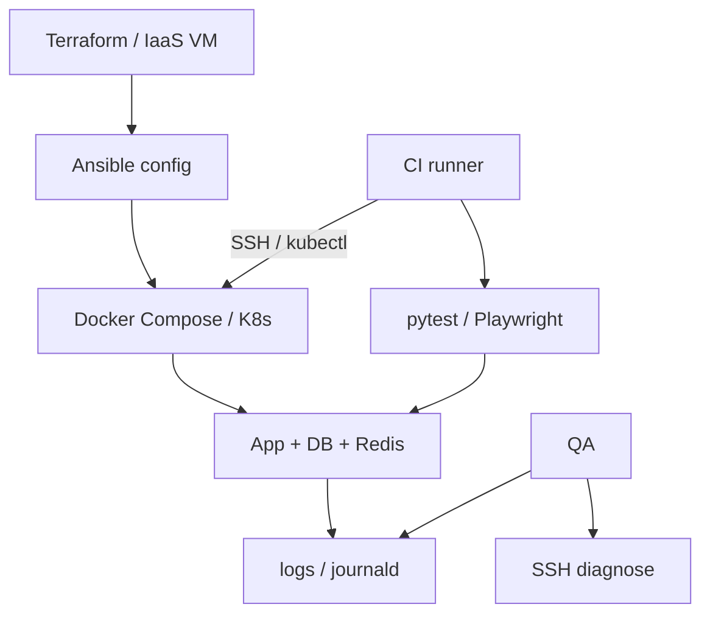
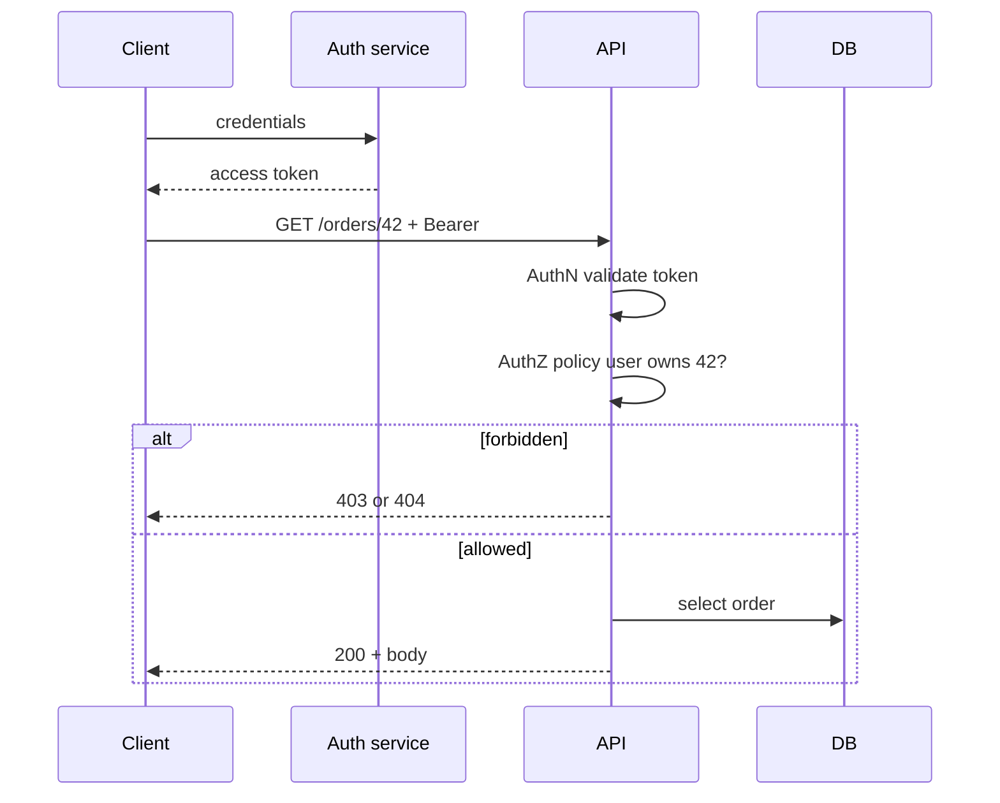

## Введение

M43–52: middle QA часто сам поднимает стенды, читает логи на Linux, ходит по SSH и отличает «упал контейнер» от «упала ВМ». Ниже — рабочие ответы для собеса: виртуализация vs эмуляция, контейнеры, облачные модели, config management и бытовой shell.

Термины и определения согласованы с **ISTQB CTFL v4** и [глоссарием ISTQB](https://glossary.istqb.org/); номера J/M/S — опциональный индекс типовых вопросов собеса.

**Middle web, mobile и SQL:.** M53–71 и M72–84: плотный middle-блок про веб-безопасность на уровне осознанности, HTTP-семантику, SQL чуть глубже junior и мобильную диагностику. Цель — связный рассказ на собесе, а не список терминов.

Термины и определения согласованы с **ISTQB CTFL v4** и [глоссарием ISTQB](https://glossary.istqb.org/); номера J/M/S — опциональный индекс типовых вопросов собеса.

## Раздел: Как отвечать одним блоком

Этот выпуск собрал соседние короткие темы трека: «Инфраструктура QA: VM,», «Middle web, mobile и SQL:». Раньше каждая занимала отдельную карточку на несколько минут, а на собеседовании их спрашивают одним блоком. Ниже у каждой темы свой раздел, затем общие лабы, один тест и одна колода карточек. В ответе сначала назовите, какую тему спросили, потом определение и один пример. Не проговаривайте все разделы, если спросили один. Лабы можно пройти по порядку исходного трека. Если времени мало, сделайте первую и последнюю: первая ставит язык, последняя проверяет, что соседние темы вы не перепутали.

## Раздел: Инфраструктура QA: VM,: VM, simulator, emulator и контейнеры

**Виртуальная машина (VM)** — гостевая ОС на гипервизоре (KVM, Hyper-V, VMware). Полная изоляция ядра/драйверов, свой диск и сеть. Тяжелее по RAM/CPU, зато максимально близка к «железному» окружению.

**Simulator** — программная модель поведения системы *без* полного воспроизведения железа (iOS Simulator на Mac: API и UI близки, но CPU/GPU/сеть не как на устройстве). Быстро для функционала, слабо для перф и редких драйверных багов.

**Emulator** — имитирует другое железо/архитектуру (Android Emulator, эмулятор платежного терминала). Медленнее симулятора, полезен когда нужен «как на железе», но всё ещё не заменяет реальные девайсы для финальной приёмки.

| | VM | Simulator | Emulator | Container |
|--|----|-----------|----------|-----------|
| Изоляция | сильная (своя ОС) | слабая/средняя | средняя | процесс + namespaces |
| Вес | высокий | низкий | средний–высокий | низкий |
| Старт | минуты | секунды | секунды–минуты | секунды |
| Для QA | полные стенды, legacy | UI smoke mobile | кросс-архитектура | CI, сервисы, изоляция тестов |

**Container vs VM.** Контейнер (Docker) делит ядро хоста, упаковывает приложение + зависимости в образ. Лёгкий, воспроизводимый, идеален для CI и микросервисов. VM — когда нужна другая ОС, ядро, драйверы или жёсткая изоляция (sandbox вредоносного ПО, чужой kernel).

**Где в автоматизации:** Selenium Grid / Playwright browsers в контейнерах; тестовая БД из `docker compose`; эфемерные окружения в CI; Appium + эмулятор для mobile smoke. Правило: контейнер = одинаковый runtime; реальные устройства/ВМ — для рисков, которые контейнер не ловит.

## Раздел: Инфраструктура QA: VM,: IaaS, PaaS, provisioning и shell

**IaaS** (AWS EC2, Azure VM, Yandex Compute) — арендуете ВМ, сеть, диски; ОС и стек на вас. QA: полный контроль стенда, сами патчите и мониторите.

**PaaS** (Heroku-like, Cloud Run, Elastic Beanstalk) — платформа даёт runtime/деплой; вы кладёте код. QA: меньше возни с ОС, больше зависимость от лимитов платформы (логи, масштабирование, версии runtime).

**Config management** — Ansible, Puppet, Chef, Salt: декларативно/императивно приводят хосты к нужному состоянию (пакеты, пользователи, конфиги). Отличие от «один раз руками настроили»: идемпотентность и повторяемость стендов.

**Provisioning** — создание ресурсов с нуля (Terraform, CloudFormation, Pulumi): сеть, ВМ, балансировщики, DNS. Часто связка: Terraform поднимает железо → Ansible конфигурирует → Docker/K8s деплоит приложение. Для QA важно уметь *прочитать* IaC и понять, что именно отличается между `dev` и `stage`.

**Linux: найти логи.** Типичные места: `/var/log/`, journald (`journalctl -u service`), stdout контейнера (`docker logs`). Поиск:

```bash
find /var/log -name '*.log' -mtime -1
grep -R "ERROR" /var/log/app/ --include='*.log' | tail -n 50
journalctl -u nginx --since "1 hour ago"
docker logs --tail 200 my-api
```

**Windows CMD: IP.** `ipconfig` / `ipconfig /all` — адреса интерфейсов; `ping`, `tracert`, `nslookup` — сеть. В PowerShell удобнее `Get-NetIPAddress`.

**SSH.** Удалённый shell по ключу/паролю: `ssh user@host`, туннели `-L`/`-R`, копирование `scp`/`rsync`. Для автотестов: ключ в CI secrets, jump-host, не хранить пароли в репо. `StrictHostKeyChecking` и known_hosts — частая боль пайплайнов.

**Bash vs batch.** Bash (Linux/macOS CI): пайпы, `set -euo pipefail`, функции. Batch/PowerShell (Windows агенты): установка драйверов, пути с пробелами. В кроссплатформенной AQA предпочитайте Python/`make`/Docker, а shell — тонкая обёртка.

## Раздел: Инфраструктура QA: VM,: Частые вопросы с собеседования

**Вопрос.** Чем уровень тестирования отличается от типа (вида) тестирования?

**Ответ.** Уровень отвечает на «где режем систему»: модуль, стык, продукт целиком, приёмка. Тип — «с какой целью гоняем»: smoke, regression, exploratory, security и т.д. На собесе покажите пример: один checkout можно проверить на integration (API+БД) и оформить прогон как regression после фикса — оси независимы.

**Вопрос.** Когда на собеседовании уместен smoke, а когда полный regression?

**Ответ.** Smoke — узкий «жив ли билд»: логин, критичный платёж, главная. Падает smoke — глубже не идём. Regression — шире: уже работавшее после изменений. Sanity — точечно после маленького патча. Ошибка junior: называть любой повторный прогон regression.

**Вопрос.** Зачем на собесе спрашивают equivalence partitioning и граничные значения?

**Ответ.** EP сжимает бесконечные входы в классы «ведут себя одинаково»; BVA бьёт по стыкам классов — там чаще ломается сравнение и валидация. Для поля 18–99 достаточно классов «ниже», «внутри», «выше» и точек 17–18–19, 98–99–100; не нужно 82 случайных числа.

**Вопрос.** Severity и priority в баг-репорте — одно и то же?

**Ответ.** Нет. Severity — ущерб для продукта и пользователя (crash vs опечатка). Priority — когда чинить в очереди команды. Критичный по severity баг может ждать, если воспроизводится только на стенде без пользователей; наоборот, мелкий UI-bug в checkout может быть P1 перед релизом.

**Вопрос.** Что имеют в виду под «пирамидой тестирования» на собеседовании?

**Ответ.** Много быстрых дешёвых проверок внизу (unit, контракт API), меньше медленных UI/e2e наверху. Цель — быстрая обратная связь в CI, а не «всё через Selenium». Пирамида не запрет на e2e: сквозные сценарии оставляют на критичные деньги-потоки.

## Раздел: Middle web, mobile и SQL:: Auth, HTTP, OWASP, perf и sniffers

**Authentication vs authorization.** AuthN — «кто ты» (логин, SSO, токен, сертификат). AuthZ — «что тебе можно» (роли, scopes, ACL, политики). Баг «залогинен, но видит чужие заказы» — почти всегда authZ (IDOR), не «сломался пароль».

**Статус-коды (ориентиры для QA):**

| Код | Смысл для теста |
|-----|-----------------|
| 200/201/204 | успех / создано / пустое тело |
| 301/302/307 | редиректы — проверить Location и метод |
| 400 | клиентская ошибка валидации |
| 401 | не аутентифицирован |
| 403 | аутентифицирован, но запрещено |
| 404 | нет ресурса (или «скрыли» 403) |
| 409 | конфликт состояния |
| 429 | rate limit |
| 500/502/503 | сервер/шлюз/недоступность |

**Responsive.** Одна вёрстка под ширины viewport: breakpoints, touch targets, ориентация. Проверки: DevTools device mode + реальные телефоны; не путать с отдельным mobile-приложением.

**WebSocket.** Долгоживущее двустороннее соединение поверх HTTP upgrade. Тест: connect/auth, heartbeat, reconnect, порядок сообщений, нагрузка на число сокетов, поведение при обрыве сети. Инструменты: браузер, Postman, k6 ws, собственные клиенты.

**OWASP intro (для middle).** Знать Top risks как карту атак: injection, broken auth, XSS, CSRF, insecure design, misconfig, vulnerable components, integrity failures, logging/monitoring gaps, SSRF. Защиты на уровне QA: негативные кейсы ввода, проверка заголовков (`CSP`, `HttpOnly`, `SameSite`), роли, отсутствие секретов в URL/логах, обновление зависимостей. Детали Top и обороны — в QA21.

**Клиентские инструменты perf:** Lighthouse, WebPageTest, DevTools Performance/Network (waterfall, TTFB, LCP/CLS/INP). Это *фронтовые* метрики; серверный load — отдельно (k6/JMeter).

**Sniffers / прокси:** Charles, Fiddler, mitmproxy, Wireshark. Перехват HTTPS — с установкой MITM-сертификата (только на своих стендах). Смотрим утечки токенов, лишние PII, неожиданные third-party вызовы.

**GET / POST / PUT / PATCH.** GET — чтение, идемпотентен, без тела-эффектов (в идеале). POST — создание/действие, не идемпотентен. PUT — полная замена ресурса, идемпотентен. PATCH — частичное обновление. На тесте ловите «GET меняет баланс» и «повтор POST создаёт дубликаты».

## Раздел: Middle web, mobile и SQL:: SQL mid, GraphQL, OLTP/OLAP и mobile middle

**DROP vs TRUNCATE vs DELETE.** `DELETE` — построчно, с WHERE, триггеры, можно rollback в транзакции. `TRUNCATE` — быстрая очистка таблицы, сброс identity (зависит от СУБД), обычно DDL-семантика, осторожно с FK. `DROP` — уничтожает объект целиком. На проде/стейдже без бэкапа — катастрофа; в тестах используйте транзакции и фикстуры.

**GraphQL schema.** Типы, Query/Mutation/Subscription, аргументы, nullability. Тест: introspection (если открыта — риск), глубину запросов, N+1, авторизацию на поле, валидацию ошибок в `errors[]`, лимиты complexity. Схема — контракт, как OpenAPI для REST.

**OLTP vs OLAP.** OLTP — много коротких транзакций (заказы, оплаты). OLAP — аналитика, агрегаты, витрины. Для QA: разные SLA, индексы, допустимость блокировок; тяжёлый отчёт не должен валить checkout.

**Self join.** Таблица соединяется сама с собой (иерархия сотрудников, «товар похож на товар»). В тесте проверяйте корректность связей и отсутствие дублей от неверного JOIN.

**Cursor.** (1) UI/DB курсор пагинации; (2) серверный cursor в процедурах/результатах. Важно: стабильная сортировка, поведение при удалении строк «посередине», сравнение offset vs keyset pagination.

**Mobile middle:**

- **Manifest** (Android `AndroidManifest.xml` / iOS Info.plist): permissions, deep links, cleartext traffic, orientation — сверяйте с требованиями и threat model.
- **Traffic capture:** proxy на устройстве + cert; certificate pinning ломает MITM — нужен debug-build или Frida (только на тестовых билдах).
- **Local storage:** SharedPreferences/DataStore, Keychain/Keystore, SQLite/Room, файлы кэша — не хранить токены в plaintext.
- **Activity lifecycle (Android):** create/start/resume/pause/stop/destroy; тест поворот экрана, уход в фон, low memory kill, restore state.
- **TestFlight / внутренний deploy:** iOS TestFlight, Android Internal/Closed testing; версии build number, expiry TestFlight, чеклист «что в этом билде».
- **Deploy:** каналы, staged rollout, feature flags, откат; QA смотрит smoke после выкладки и мониторинг крэшей.

## Раздел: Middle web, mobile и SQL:: Частые вопросы с собеседования

**Вопрос.** Когда на собеседовании уместен smoke, а когда полный regression?

**Ответ.** Smoke — узкий «жив ли билд»: логин, критичный платёж, главная. Падает smoke — глубже не идём. Regression — шире: уже работавшее после изменений. Sanity — точечно после маленького патча. Ошибка junior: называть любой повторный прогон regression.

**Вопрос.** Зачем на собесе спрашивают equivalence partitioning и граничные значения?

**Ответ.** EP сжимает бесконечные входы в классы «ведут себя одинаково»; BVA бьёт по стыкам классов — там чаще ломается сравнение и валидация. Для поля 18–99 достаточно классов «ниже», «внутри», «выше» и точек 17–18–19, 98–99–100; не нужно 82 случайных числа.

**Вопрос.** Severity и priority в баг-репорте — одно и то же?

**Ответ.** Нет. Severity — ущерб для продукта и пользователя (crash vs опечатка). Priority — когда чинить в очереди команды. Критичный по severity баг может ждать, если воспроизводится только на стенде без пользователей; наоборот, мелкий UI-bug в checkout может быть P1 перед релизом.

**Вопрос.** Что имеют в виду под «пирамидой тестирования» на собеседовании?

**Ответ.** Много быстрых дешёвых проверок внизу (unit, контракт API), меньше медленных UI/e2e наверху. Цель — быстрая обратная связь в CI, а не «всё через Selenium». Пирамида не запрет на e2e: сквозные сценарии оставляют на критичные деньги-потоки.

**Вопрос.** Почему flaky e2e — отдельная тема на middle/senior QA?

**Ответ.** Flaky — тест то зелёный, то красный без изменения кода: тайминги, данные, сеть, параллельность. Команда перестаёт верить CI. Лечат изоляцией данных, явными ожиданиями, стабильными селекторами, отсечением внешних сервисов; иногда понижают уровень — проверяют API вместо хрупкого UI.

## Лаба

**Инфраструктура QA: VM,.**

**Цель.** Поднять учебный стек в Docker и отработать диагностику «как на собесе».

**Шаги.**
1. Опишите таблицей, когда выберете VM, эмулятор, симулятор и контейнер для: API-стенда, Android UI smoke, изоляции вредоносного плагина.
2. Напишите `docker-compose.yml` с API + Postgres (достаточно черновика) и команды: up, logs, exec в контейнер БД.
3. Составьте Ansible-плейбук из 5 задач «заготовка» (user, packages, clone, systemd, firewall) — без обязательного запуска.
4. На Linux-стенде (или WSL) найдите свежие `.log`, отфильтруйте ERROR и сохраните 20 строк в файл.
5. Подключитесь по SSH (локальный контейнер SSH или учебный хост), выполните `uptime` и `df -h`, зафиксируйте вывод.
6. Напишите bash-скрипт smoke: curl healthcheck → exit 0/1; и batch/PowerShell-аналог идеи для Windows-агента.

**В группу:** почему «всё зелёное в Docker на ноутбуке» не доказывает прод на VM за балансировщиком?

**Готово, если…**
- [ ] Чётко отличаете VM / container / emulator / simulator
- [ ] Можете объяснить IaaS vs PaaS на примере стенда
- [ ] Есть рабочий набор команд для логов и SSH

**Middle web, mobile и SQL:.**

**Цель.** Сквозная проверка web API + SQL + «мобильный» чеклист на учебном приложении.

**Шаги.**
1. Для эндпоинта заказов распишите матрицу: без токена → 401; чужой id → 403/404; своя роль → 200.
2. В DevTools снимите waterfall логина; отметьте TTFB и самый тяжёлый ресурс.
3. Через mitmproxy/Charles (учебный стенд) найдите, уходит ли access-токен в query string.
4. Напишите SQL: self join «сотрудник → менеджер»; отдельно объясните, когда TRUNCATE опаснее DELETE.
5. Опишите GraphQL-запрос с 3 полями и негатив: запрос чужого `user { email }` без прав.
6. Mobile-чеклист из 10 пунктов: manifest permissions, lifecycle rotate, offline, storage, TestFlight/Internal build.

```python
# Pyodide-friendly: матрица ожидаемых кодов AuthN/AuthZ
cases = [
    ("no_token", "GET", "/orders/42", 401),
    ("other_user", "GET", "/orders/42", 403),  # или 404 по threat model
    ("owner", "GET", "/orders/42", 200),
    ("owner", "PATCH", "/orders/42", 200),
]
for who, method, path, expected in cases:
    print(f"{who:12} {method:6} {path} → expect {expected}")

sql_payloads = ["' OR '1'='1", "1; DROP TABLE users--", "x" * 80]
for payload in sql_payloads:
    # на стенде: requests.get(..., params={"q": payload}) — никогда в прод
    print("sql probe:", repr(payload)[:50])
```

**В группу:** почему 404 вместо 403 на чужом ресурсе иногда считают фичей безопасности?

**Готово, если…**
- [ ] AuthN/AuthZ разделены на примерах
- [ ] Знаете семантику GET/POST/PUT/PATCH и DROP/TRUNCATE
- [ ] Есть осмысленный mobile middle-чеклист

## Схема: Инфраструктура QA: VM,: Стенд QA — от IaC до теста



## Схема: Middle web, mobile и SQL:: AuthN → AuthZ → ресурс



## Тест

### Чем контейнер принципиально отличается от VM?

**Ответ:** контейнер делит ядро хоста и изолирует процесс; VM поднимает гостевую ОС со своим ядром

**Пояснение:** поэтому контейнеры легче и быстрее стартуют, но не заменяют ВМ, когда нужна другая ОС или жёсткая изоляция ядра.

### Чем authentication отличается от authorization?

**Ответ:** authentication устанавливает личность; authorization проверяет права на действие/ресурс

**Пояснение:** можно пройти AuthN и получить 403 — это ожидаемо при недостаточных правах.

### Когда QA выбирает IaaS, а не PaaS?

**Ответ:** когда нужен полный контроль ОС, сети, агентов и кастомной установки (драйверы, спецПО, зеркала)

**Пояснение:** PaaS ускоряет деплой кода, но ограничивает доступ к инфраструктуре и диагностике на уровне ОС.

### Когда использовать PUT, а когда PATCH?

**Ответ:** PUT — полная замена ресурса; PATCH — частичное обновление полей

**Пояснение:** идемпотентность PUT важна для ретраев; PATCH тестируют на «незатронутые поля не обнулились».

### Как быстро найти ошибки в логах Linux-сервиса?

**Ответ:** `journalctl -u service --since …` и/или `grep`/`find` по `/var/log`, для Docker — `docker logs`

**Пояснение:** на собесе ждут конкретные команды и понимание, куда сервис пишет stdout vs файлы.

## Шпаргалка

<ul><li>VM — своя ОС; container — namespaces/cgroups на ядре хоста</li><li>Simulator — модель API; emulator — имитация железа</li><li>IaaS = машины; PaaS = платформа под код</li><li>Terraform provision → Ansible config → Docker run</li><li>401 = кто ты?; 403 = тебе нельзя</li><li>GET без сайд-эффектов; POST осторожен к дублям</li><li>OWASP Top — карта рисков, не чеклист «прогнали раз»</li><li>DELETE ≠ TRUNCATE ≠ DROP</li><li>OLTP — транзакции; OLAP — аналитика</li><li>GraphQL: схема + auth на поля + лимит глубины</li></ul>

## Anki

### Front: Container vs VM — одно предложение

Back: контейнер изолирует процесс на общем ядре; VM — полноценная гостевая ОС

### Front: 401 vs 403

Back: 401 — не аутентифицирован; 403 — аутентифицирован, но нет прав

### Front: IaaS vs PaaS для тест-стенда?

Back: IaaS — контроль ОС и сети; PaaS — быстрый деплой с ограничениями платформы

### Front: Зачем WebSocket тестировать reconnect?

Back: мобильные сети рвутся; без reconnect и идемпотентности сообщений теряются события

### Front: Три команды найти ERROR в логах Linux

Back: grep -R ERROR /var/log; journalctl -u svc; docker logs

### Front: Self join — зачем?

Back: связать строки одной таблицы (иерархии, пары «похожих» сущностей)

## Мнемоника

### link: Где смотреть сервис

**Задание:** Порядок, если стенд «не открывается».

**Элементы:**
- процесс
- порт
- лог
- контейнер

**Подсказка:** Порт слушает не тот процесс — частая путаница.

**Ответ:** process → port → log → container

## Итоги

- VM, эмулятор, симулятор и контейнер решают разные классы рисков — не взаимозаменяемы
- Контейнеры ускоряют CI и воспроизводимость; ВМ/девайсы закрывают «железные» дыры
- IaaS/PaaS и связка Terraform+Ansible — язык middle про стенды
- Shell, SSH и чтение логов — обязательный бытовой навык автоматизатора
- AuthN/AuthZ и коды ответа — база middle web
- OWASP и sniffers дают язык рисков до senior security-глубокого погружения
- SQL mid и GraphQL schema — про контракты данных, не только SELECT *
- Mobile middle: manifest, трафик, storage, lifecycle, каналы поставки

## Ссылки

- [ISTQB Glossary](https://glossary.istqb.org/)
- [CTFL v4 — Certified Tester Foundation Level](https://istqb.org/certifications/certified-tester-foundation-level-ctfl-v4-0/)
- [Docker documentation](https://docs.docker.com/)
- [QA-interview-250](https://github.com/Konstantine23/QA-interview-250)
- [Learn](/game/learn)
- [OWASP Top 10](https://owasp.org/www-project-top-ten/)
- [Strategy metrics](/game/learn/qa-strategy-metrics)
