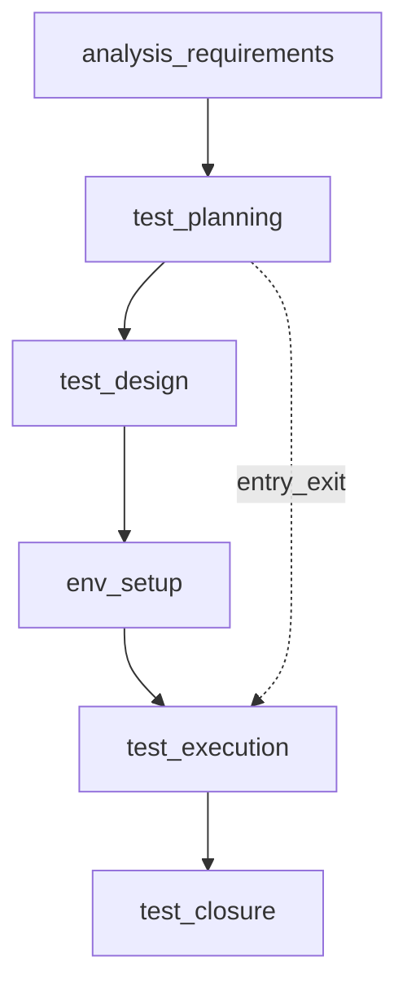

## Введение

На junior-собесе по QA почти всегда начинают с базы: что такое тестирование, зачем оно нужно и как устроен цикл работ. Этот выпуск закрывает вопросы J1–3, J25 и J30 своими формулировками — без копипаста чужих шпаргалок.

Термины и определения согласованы с **ISTQB CTFL v4** и [глоссарием ISTQB](https://glossary.istqb.org/); номера J/M/S — опциональный индекс типовых вопросов собеса.

## Раздел: Что такое тестирование и зачем оно нужно

Тестирование — это процесс оценки продукта относительно ожиданий: требований, договорённостей с заказчиком, здравого смысла пользователя и рисков бизнеса. Цель не «найти все баги» (это невозможно), а снизить риск релиза: выявить критичные дефекты раньше, дать факты для решения «выпускаем / чиним / откладываем».

Зачем тестирование бизнесу:
- меньше потерь от сбоев в проде (деньги, репутация, штрафы);
- быстрее обратная связь разработчикам — дешевле чинить на ранних этапах;
- прозрачность качества: «что проверено, что осознанно не проверено»;
- обучение команды: тесты и баги уточняют требования.

На собесе полезно сказать: тестирование — это деятельность по обеспечению качества через поиск расхождений, а QA шире — процессы, метрики, предотвращение дефектов, культура качества.

## Раздел: Этапы тестирования и STLC

Жизненный цикл тестирования (STLC) описывает этапы работы тестировщика относительно жизненного цикла разработки:

1. **Анализ требований** — читаем ТЗ/user stories, ищем неясности, противоречия, пробелы; задаём вопросы.
2. **Планирование** — стратегия, объём, риски, ресурсы, критерии входа/выхода, окружения.
3. **Дизайн тестов** — чеклисты, кейсы, данные, матрица трассировки к требованиям.
4. **Подготовка окружения** — стенды, доступы, тестовые данные, инструменты.
5. **Выполнение** — прогон, логирование результатов, заведение дефектов.
6. **Закрытие цикла** — отчёт, метрики, уроки, архив артефактов.

Entry criteria (критерии входа) — условия, без которых этап не стартуем: стабильная сборка, доступный стенд, согласованные требования, готовые кейсы для текущего scope.

Exit criteria (критерии выхода) — когда можно остановиться: критичные баги закрыты/приняты, запланированные кейсы пройдены (или осознанно отложены), покрытие рисков достаточное, отчёт согласован.

## Раздел: Verification vs Validation

**Verification** («делаем ли продукт правильно?») — проверка артефактов и соответствия спецификации: ревью требований, статический анализ, сверка реализации с дизайн-доком без обязательного запуска «как пользователь».

**Validation** («делаем ли правильный продукт?») — проверка, что продукт решает задачу пользователя/бизнеса: функциональные прогоны, UAT, сценарии реального использования.

На практике оба нужны: можно идеально пройти verification по неверной спецификации и провалить validation. Хороший ответ на собесе: verification чаще статичен и про соответствие артефактам; validation — динамичен и про ценность для пользователя.

## Раздел: Принципы тестирования (обзор CTFL)

Семь принципов ISTQB — не чеклист «галочек», а язык для решений на собесе:

1. **Тестирование показывает дефекты** — снижает вероятность, но не доказывает их отсутствие.
2. **Исчерпывающее тестирование невозможно** — выбирают риск, техники и exit criteria.
3. **Раннее тестирование** — дешевле ловить проблемы в требованиях и дизайне, чем в проде.
4. **Скопление дефектов** — усиливайте проверки там, где уже «сыпалось» или код сложный.
5. **Парадокс пестицида** — одни и те же тесты со временем слабеют; набор обновляют.
6. **Тестирование зависит от контекста** — e-commerce, медицина и внутренний админ требуют разного баланса.
7. **Заблуждение об отсутствии ошибок** — «ноль багов» не равно «продукт полезен и безопасен».

Свяжите принципы с STLC: раннее тестирование — это участие QA в анализе; exit criteria — ответ на «исчерпывающее невозможно».

## Раздел: Частые вопросы с собеседования

**Вопрос.** Чем уровень тестирования отличается от типа (вида) тестирования?

**Ответ.** Уровень отвечает на «где режем систему»: модуль, стык, продукт целиком, приёмка. Тип — «с какой целью гоняем»: smoke, regression, exploratory, security и т.д. На собесе покажите пример: один checkout можно проверить на integration (API+БД) и оформить прогон как regression после фикса — оси независимы.

**Вопрос.** Когда на собеседовании уместен smoke, а когда полный regression?

**Ответ.** Smoke — узкий «жив ли билд»: логин, критичный платёж, главная. Падает smoke — глубже не идём. Regression — шире: уже работавшее после изменений. Sanity — точечно после маленького патча. Ошибка junior: называть любой повторный прогон regression.

**Вопрос.** Зачем на собесе спрашивают equivalence partitioning и граничные значения?

**Ответ.** EP сжимает бесконечные входы в классы «ведут себя одинаково»; BVA бьёт по стыкам классов — там чаще ломается сравнение и валидация. Для поля 18–99 достаточно классов «ниже», «внутри», «выше» и точек 17–18–19, 98–99–100; не нужно 82 случайных числа.

**Вопрос.** Severity и priority в баг-репорте — одно и то же?

**Ответ.** Нет. Severity — ущерб для продукта и пользователя (crash vs опечатка). Priority — когда чинить в очереди команды. Критичный по severity баг может ждать, если воспроизводится только на стенде без пользователей; наоборот, мелкий UI-bug в checkout может быть P1 перед релизом.

**Вопрос.** Что имеют в виду под «пирамидой тестирования» на собеседовании?

**Ответ.** Много быстрых дешёвых проверок внизу (unit, контракт API), меньше медленных UI/e2e наверху. Цель — быстрая обратная связь в CI, а не «всё через Selenium». Пирамида не запрет на e2e: сквозные сценарии оставляют на критичные деньги-потоки.

## Лаба

**Цель.** Сформулировать устный ответ на 90 секунд: «Что такое тестирование, STLC и чем verification отличается от validation?»

**Шаги.**
1. Выпишите 5 буллетов: цель тестирования, 3 риска без тестов, отличие QA и тестирования.
2. Нарисуйте STLC в 6 блоков и подпишите по одному артефакту на этап (план, кейсы, отчёт…).
3. Для вымышленного релиза логина задайте 3 entry и 3 exit criteria.
4. Приведите по одному примеру verification и validation для той же фичи.

**В группу:** зачитайте ответ на таймер; коллега спрашивает «а если требований нет?» и «когда выходить из теста раньше плана».

**Готово, если…**
- [ ] Объясняете цель тестирования без фразы «найти все баги»
- [ ] Называете этапы STLC и смысл entry/exit
- [ ] Чётко различаете verification и validation на примере

## Схема: STLC и критерии

## Тест

### Зачем бизнесу тестирование, если «разработчики и так проверяют»?

**Ответ:** снизить риск релиза и дать независимую оценку качества

**Пояснение:** разработчик проверяет «как задумал»; тестировщик — «как пойдёт у пользователя и что ломается на стыках»; бизнесу нужны факты до прода.

### Что такое entry criteria?

**Ответ:** условия старта этапа тестирования

**Пояснение:** без стабильной сборки, стенда и понятного scope прогон будет хаотичным и даст ложные выводы.

### Чем validation отличается от verification?

**Ответ:** validation — правильный продукт для пользователя; verification — соответствие спецификации/артефактам

**Пояснение:** можно «верно» реализовать неверные требования (verification ок, validation нет).

### Чем тестирование (testing) отличается от обеспечения качества (QA)?

**Ответ:** testing — проверка продукта; QA — процессы и предотвращение дефектов

**Пояснение:** по ISTQB testing фокусируется на обнаружении дефектов; QA шире — метрики, стандарты, улучшение жизненного цикла.

### Можно ли «протестировать всё»?

**Ответ:** нет — исчерпывающее тестирование невозможно

**Пояснение:** это принцип ISTQB: бесконечные комбинации входов и состояний; выбирают риск, приоритеты и exit criteria.

## Шпаргалка

<h3>Суть</h3>
<ul>
<li>Тестирование снижает риск, а не гарантирует ноль дефектов</li>
<li>STLC: анализ → план → дизайн → окружение → прогон → закрытие</li>
<li>Entry/Exit — договорённости «когда начинаем» и «когда достаточно»</li>
<li>Verification = правильно ли сделано; Validation = то ли сделано</li>
</ul>
<h3>Фразы на собесе</h3>
<pre><code>не «все баги», а риск и информация
STLC параллелен SDLC, не вместо него
exit criteria согласуем до горящего дедлайна
</code></pre>

## Anki

### Front: Что такое тестирование одной фразой?

Back: оценка продукта относительно ожиданий с целью снизить риск релиза и дать факты для решения

### Front: Назовите этапы STLC

Back: анализ требований, планирование, дизайн тестов, подготовка окружения, выполнение, закрытие

### Front: Verification vs Validation?

Back: verification — соответствие спецификации/артефактам; validation — ценность и корректность для пользователя/бизнеса

### Front: Назовите цель тестирования по смыслу ISTQB

Back: найти дефекты и дать информацию о качестве для решений о релизе

### Front: Что такое exit criteria?

Back: согласованные условия, при которых можно завершить тестирование этапа/релиза

### Front: STLC и SDLC — как связаны?

Back: STLC вложен в SDLC: тестирование идёт параллельно разработке, не после «всего»

## Итоги

- Тестирование — про риск и информацию, не про миф «100% багов»
- STLC даёт структуру работы; entry/exit делают остановку осознанной
- Verification и validation — разные вопросы; на собесе ждут пример

## Ссылки

- [ISTQB Glossary](https://glossary.istqb.org/)
- [CTFL v4 — Certified Tester Foundation Level](https://istqb.org/certifications/certified-tester-foundation-level-ctfl-v4-0/)
- Опционально: [QA-interview-250](https://github.com/Konstantine23/QA-interview-250) — полный список формулировок вопросов
- Learn | /game/learn
- Далее: [Типы и уровни тестирования](/game/learn/qa-types-levels)
