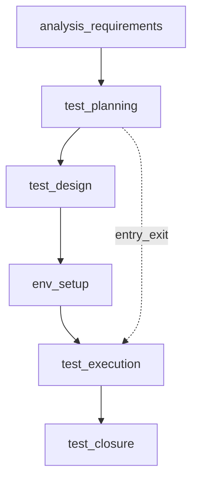
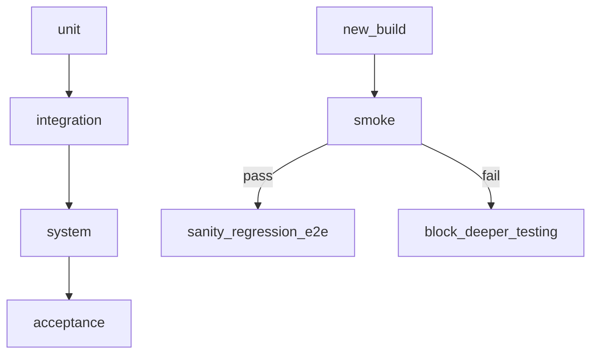

## Введение

На junior-собесе по QA почти всегда начинают с базы: что такое тестирование, зачем оно нужно и как устроен цикл работ. Этот выпуск закрывает вопросы J1–3, J25 и J30 своими формулировками — без копипаста чужих шпаргалок.

Термины и определения согласованы с **ISTQB CTFL v4** и [глоссарием ISTQB](https://glossary.istqb.org/); номера J/M/S — опциональный индекс типовых вопросов собеса.

**Типы и уровни тестирования.** После «что такое тестирование» на junior-собесе ждут карту видов и уровней: component → system, smoke vs sanity, regression vs re-testing, black/grey/white box. Ниже — формулировки в терминах ISTQB CTFL; номера J4–5, J9–10, J12–13, J15–17, J19–23, J100 — опциональный индекс вопросов.

Термины и определения согласованы с **ISTQB CTFL v4** и [глоссарием ISTQB](https://glossary.istqb.org/); номера J/M/S — опциональный индекс типовых вопросов собеса.

## Раздел: Как отвечать одним блоком

Этот выпуск собрал соседние короткие темы трека: «Тестирование на собесе», «Типы и уровни тестирования». Раньше каждая занимала отдельную карточку на несколько минут, а на собеседовании их спрашивают одним блоком. Ниже у каждой темы свой раздел, затем общие лабы, один тест и одна колода карточек. В ответе сначала назовите, какую тему спросили, потом определение и один пример. Не проговаривайте все разделы, если спросили один. Лабы можно пройти по порядку исходного трека. Если времени мало, сделайте первую и последнюю: первая ставит язык, последняя проверяет, что соседние темы вы не перепутали.

## Раздел: Тестирование на собесе: Что такое тестирование и зачем оно нужно

Тестирование — это процесс оценки продукта относительно ожиданий: требований, договорённостей с заказчиком, здравого смысла пользователя и рисков бизнеса. Цель не «найти все баги» (это невозможно), а снизить риск релиза: выявить критичные дефекты раньше, дать факты для решения «выпускаем / чиним / откладываем».

Зачем тестирование бизнесу:
- меньше потерь от сбоев в проде (деньги, репутация, штрафы);
- быстрее обратная связь разработчикам — дешевле чинить на ранних этапах;
- прозрачность качества: «что проверено, что осознанно не проверено»;
- обучение команды: тесты и баги уточняют требования.

На собесе полезно сказать: тестирование — это деятельность по обеспечению качества через поиск расхождений, а QA шире — процессы, метрики, предотвращение дефектов, культура качества.

## Раздел: Тестирование на собесе: Этапы тестирования и STLC

Жизненный цикл тестирования (STLC) описывает этапы работы тестировщика относительно жизненного цикла разработки:

1. **Анализ требований** — читаем ТЗ/user stories, ищем неясности, противоречия, пробелы; задаём вопросы.
2. **Планирование** — стратегия, объём, риски, ресурсы, критерии входа/выхода, окружения.
3. **Дизайн тестов** — чеклисты, кейсы, данные, матрица трассировки к требованиям.
4. **Подготовка окружения** — стенды, доступы, тестовые данные, инструменты.
5. **Выполнение** — прогон, логирование результатов, заведение дефектов.
6. **Закрытие цикла** — отчёт, метрики, уроки, архив артефактов.

Entry criteria (критерии входа) — условия, без которых этап не стартуем: стабильная сборка, доступный стенд, согласованные требования, готовые кейсы для текущего scope.

Exit criteria (критерии выхода) — когда можно остановиться: критичные баги закрыты/приняты, запланированные кейсы пройдены (или осознанно отложены), покрытие рисков достаточное, отчёт согласован.

## Раздел: Тестирование на собесе: Verification vs Validation

**Verification** («делаем ли продукт правильно?») — проверка артефактов и соответствия спецификации: ревью требований, статический анализ, сверка реализации с дизайн-доком без обязательного запуска «как пользователь».

**Validation** («делаем ли правильный продукт?») — проверка, что продукт решает задачу пользователя/бизнеса: функциональные прогоны, UAT, сценарии реального использования.

На практике оба нужны: можно идеально пройти verification по неверной спецификации и провалить validation. Хороший ответ на собесе: verification чаще статичен и про соответствие артефактам; validation — динамичен и про ценность для пользователя.

## Раздел: Тестирование на собесе: Принципы тестирования (обзор CTFL)

Семь принципов ISTQB — не чеклист «галочек», а язык для решений на собесе:

1. **Тестирование показывает дефекты** — снижает вероятность, но не доказывает их отсутствие.
2. **Исчерпывающее тестирование невозможно** — выбирают риск, техники и exit criteria.
3. **Раннее тестирование** — дешевле ловить проблемы в требованиях и дизайне, чем в проде.
4. **Скопление дефектов** — усиливайте проверки там, где уже «сыпалось» или код сложный.
5. **Парадокс пестицида** — одни и те же тесты со временем слабеют; набор обновляют.
6. **Тестирование зависит от контекста** — e-commerce, медицина и внутренний админ требуют разного баланса.
7. **Заблуждение об отсутствии ошибок** — «ноль багов» не равно «продукт полезен и безопасен».

Свяжите принципы с STLC: раннее тестирование — это участие QA в анализе; exit criteria — ответ на «исчерпывающее невозможно».

## Раздел: Тестирование на собесе: Частые вопросы с собеседования

**Вопрос.** Чем уровень тестирования отличается от типа (вида) тестирования?

**Ответ.** Уровень отвечает на «где режем систему»: модуль, стык, продукт целиком, приёмка. Тип — «с какой целью гоняем»: smoke, regression, exploratory, security и т.д. На собесе покажите пример: один checkout можно проверить на integration (API+БД) и оформить прогон как regression после фикса — оси независимы.

**Вопрос.** Когда на собеседовании уместен smoke, а когда полный regression?

**Ответ.** Smoke — узкий «жив ли билд»: логин, критичный платёж, главная. Падает smoke — глубже не идём. Regression — шире: уже работавшее после изменений. Sanity — точечно после маленького патча. Ошибка junior: называть любой повторный прогон regression.

**Вопрос.** Зачем на собесе спрашивают equivalence partitioning и граничные значения?

**Ответ.** EP сжимает бесконечные входы в классы «ведут себя одинаково»; BVA бьёт по стыкам классов — там чаще ломается сравнение и валидация. Для поля 18–99 достаточно классов «ниже», «внутри», «выше» и точек 17–18–19, 98–99–100; не нужно 82 случайных числа.

**Вопрос.** Severity и priority в баг-репорте — одно и то же?

**Ответ.** Нет. Severity — ущерб для продукта и пользователя (crash vs опечатка). Priority — когда чинить в очереди команды. Критичный по severity баг может ждать, если воспроизводится только на стенде без пользователей; наоборот, мелкий UI-bug в checkout может быть P1 перед релизом.

**Вопрос.** Что имеют в виду под «пирамидой тестирования» на собеседовании?

**Ответ.** Много быстрых дешёвых проверок внизу (unit, контракт API), меньше медленных UI/e2e наверху. Цель — быстрая обратная связь в CI, а не «всё через Selenium». Пирамида не запрет на e2e: сквозные сценарии оставляют на критичные деньги-потоки.

## Раздел: Типы и уровни тестирования: Уровни и основные типы

**Уровни (по «высоте» системы):**
- **Unit** — модуль/функция изолированно (часто разработчики, с моками).
- **Integration** — стыки модулей, API, БД, очереди.
- **System** — система целиком по требованиям.
- **Acceptance (UAT)** — приёмка бизнесом/пользователем.

**По объекту и цели (часто спрашивают «виды»):**
- функциональное — «делает ли то, что обещано»;
- нефункциональное — perf, security, usability, compatibility, reliability;
- позитивное / негативное — валидные и невалидные данные и сценарии;
- статическое (ревью, анализ без запуска) / динамическое (с запуском).

**Smoke** — быстрая проверка «сборка жива»: ключевые пути (логин, главная, критичный CRUD). Если smoke падает — глубже не идём.

**Sanity** — узкая проверка после небольшого фикса/патча: «эта конкретная область ведёт себя разумно», без полного регресса.

**Regression** — повторная проверка уже работавшего функционала после изменений (не «только новый код»).

**Confirmation (re-test)** — повторный прогон именно тех кейсов, что ловили баг, после фикса — убедиться, что дефект закрыт.

**E2E** — сквозной сценарий пользователя через несколько слоёв (UI → API → БД → уведомление). Дорог и хрупок; берут критичные бизнес-потоки.

## Раздел: Типы и уровни тестирования: Black / Grey / White box и подходы

**Black box** — без знания внутренней реализации: входы/выходы, UI, API-контракт. Типично для system/acceptance.

**White box** — с кодом: ветки, условия, покрытие путей, unit/integration у разработчиков и AQA.

**Grey box** — частичное знание: схема БД, логи, архитектура, но без построчного чтения всего кода. Удобно для интеграции и поиска «дыр» на стыках.

**Exploratory** — одновременное изучение, дизайн и выполнение; опирается на эвристики и заметки (session-based). Не «рандомный клик», а осознанный поиск при неясных требованиях или сжатых сроках.

**Risk-based** — приоритет по вероятности × ущерб: сначала то, что чаще ломается или дороже стоит бизнесу.

**Security (intro)** — проверка на несанкционированный доступ, инъекции, утечки данных, слабые сессии; на junior уровне — понимание угроз и базовые проверки (роли, прямые URL, чувствительные поля).

**Performance (intro)** — как система ведёт себя под нагрузкой: время ответа, пропускная способность, стабильность. Junior должен отличать load/stress/spike на уровне определений и знать, что нужны метрики и инструмент (JMeter/k6 и т.п.), а не «я кликал и было медленно».

## Раздел: Типы и уровни тестирования: Веб-специфика и «только для веба»

Для веб часто отдельно называют:
- UI / UX — интерфейс и удобство;
- compatibility — браузеры, разрешения, ОС;
- cross-browser / responsive;
- accessibility (a11y) — доступность;
- localization / internationalization;
- cookie/session/cache-поведение (глубже в QA06).

На собесе полезно связать тип теста с риском: «для платёжного флоу — e2e + security + regression критичных путей; для текста на кнопке — точечный confirmation».

## Раздел: Типы и уровни тестирования: Частые вопросы с собеседования

**Вопрос.** Зачем на собесе спрашивают equivalence partitioning и граничные значения?

**Ответ.** EP сжимает бесконечные входы в классы «ведут себя одинаково»; BVA бьёт по стыкам классов — там чаще ломается сравнение и валидация. Для поля 18–99 достаточно классов «ниже», «внутри», «выше» и точек 17–18–19, 98–99–100; не нужно 82 случайных числа.

**Вопрос.** Severity и priority в баг-репорте — одно и то же?

**Ответ.** Нет. Severity — ущерб для продукта и пользователя (crash vs опечатка). Priority — когда чинить в очереди команды. Критичный по severity баг может ждать, если воспроизводится только на стенде без пользователей; наоборот, мелкий UI-bug в checkout может быть P1 перед релизом.

**Вопрос.** Почему flaky e2e — отдельная тема на middle/senior QA?

**Ответ.** Flaky — тест то зелёный, то красный без изменения кода: тайминги, данные, сеть, параллельность. Команда перестаёт верить CI. Лечат изоляцией данных, явными ожиданиями, стабильными селекторами, отсечением внешних сервисов; иногда понижают уровень — проверяют API вместо хрупкого UI.

## Лаба

**Тестирование на собесе.**

**Цель.** Сформулировать устный ответ на 90 секунд: «Что такое тестирование, STLC и чем verification отличается от validation?»

**Шаги.**
1. Выпишите 5 буллетов: цель тестирования, 3 риска без тестов, отличие QA и тестирования.
2. Нарисуйте STLC в 6 блоков и подпишите по одному артефакту на этап (план, кейсы, отчёт…).
3. Для вымышленного релиза логина задайте 3 entry и 3 exit criteria.
4. Приведите по одному примеру verification и validation для той же фичи.

**В группу:** зачитайте ответ на таймер; коллега спрашивает «а если требований нет?» и «когда выходить из теста раньше плана».

**Готово, если…**
- [ ] Объясняете цель тестирования без фразы «найти все баги»
- [ ] Называете этапы STLC и смысл entry/exit
- [ ] Чётко различаете verification и validation на примере

**Типы и уровни тестирования.**

**Цель.** Для учебного интернет-магазина составить матрицу: уровень × тип × 1 пример кейса.

**Шаги.**
1. Выберите 5 фич: каталог, корзина, оплата, личный кабинет, поиск.
2. Для каждой укажите smoke-проверку и один regression-кандидат.
3. Опишите один exploratory-сеанс на 30 минут (чартер + что будете исследовать).
4. Отметьте 3 риска и какой тип теста их закрывает (security / perf / e2e).

**В группу:** сравните матрицы; найдите, где коллега перепутал sanity и regression.

**Готово, если…**
- [ ] Чётко отличаете smoke, sanity, regression, confirmation
- [ ] Приводите примеры black/grey/white box
- [ ] Объясняете risk-based приоритезацию на примере магазина

## Схема: Тестирование на собесе: STLC и критерии

## Схема: Типы и уровни тестирования: Уровни и быстрые фильтры

## Тест

### Зачем бизнесу тестирование, если «разработчики и так проверяют»?

**Ответ:** снизить риск релиза и дать независимую оценку качества

**Пояснение:** разработчик проверяет «как задумал»; тестировщик — «как пойдёт у пользователя и что ломается на стыках»; бизнесу нужны факты до прода.

### Чем smoke отличается от sanity?

**Ответ:** smoke шире, sanity уже

**Пояснение:** smoke — «сборка жива, можно тестировать дальше»; sanity — узкая проверка области после мелкой правки.

### Что такое entry criteria?

**Ответ:** условия старта этапа тестирования

**Пояснение:** без стабильной сборки, стенда и понятного scope прогон будет хаотичным и даст ложные выводы.

### Regression и confirmation — это одно и то же?

**Ответ:** нет, разные цели

**Пояснение:** confirmation — ретест исправленного бага; regression — влияние изменений на уже работавший функционал.

### Чем validation отличается от verification?

**Ответ:** validation — правильный продукт для пользователя; verification — соответствие спецификации/артефактам

**Пояснение:** можно «верно» реализовать неверные требования (verification ок, validation нет).

## Шпаргалка

<ul><li>Тестирование снижает риск, а не гарантирует ноль дефектов</li><li>STLC: анализ → план → дизайн → окружение → прогон → закрытие</li><li>Entry/Exit — договорённости «когда начинаем» и «когда достаточно»</li><li>Verification = правильно ли сделано; Validation = то ли сделано</li><li>Уровни: unit → integration → system → acceptance</li><li>Smoke / sanity / regression / confirmation — разные цели</li><li>Box: black (снаружи), white (код), grey (частично)</li><li>Exploratory и risk-based — про мышление, не про «отсутствие плана»</li></ul>

## Anki

### Front: Что такое тестирование одной фразой?

Back: оценка продукта относительно ожиданий с целью снизить риск релиза и дать факты для решения

### Front: Что проверяет smoke?

Back: минимальный набор критичных путей — жива ли сборка для дальнейшего тестирования

### Front: Назовите этапы STLC

Back: анализ требований, планирование, дизайн тестов, подготовка окружения, выполнение, закрытие

### Front: Black box vs white box?

Back: black — без знания кода, по входам/выходам; white — с анализом структуры и путей кода

### Front: Verification vs Validation?

Back: verification — соответствие спецификации/артефактам; validation — ценность и корректность для пользователя/бизнеса

### Front: Зачем risk-based testing?

Back: сначала закрывать сценарии с высоким ущербом и/или вероятностью сбоя при ограниченных ресурсах

## Итоги

- Тестирование — про риск и информацию, не про миф «100% багов»
- STLC даёт структуру работы; entry/exit делают остановку осознанной
- Verification и validation — разные вопросы; на собесе ждут пример
- Виды и уровни — язык, на котором договариваются о scope
- Smoke/sanity/regression/confirmation часто путают — держите чёткие определения
- Exploratory и риск — способ думать, когда чеклиста мало

## Ссылки

- [ISTQB Glossary](https://glossary.istqb.org/)
- [CTFL v4 — Certified Tester Foundation Level](https://istqb.org/certifications/certified-tester-foundation-level-ctfl-v4-0/)
- [QA-interview-250](https://github.com/Konstantine23/QA-interview-250)
- [Learn](/game/learn)
- [Test pyramid — Martin Fowler](https://martinfowler.com/bliki/TestPyramid.html)
- [Техники тест-дизайна](/game/learn/qa-test-design)
