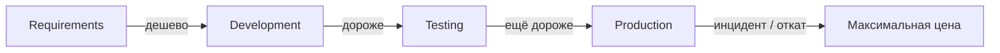
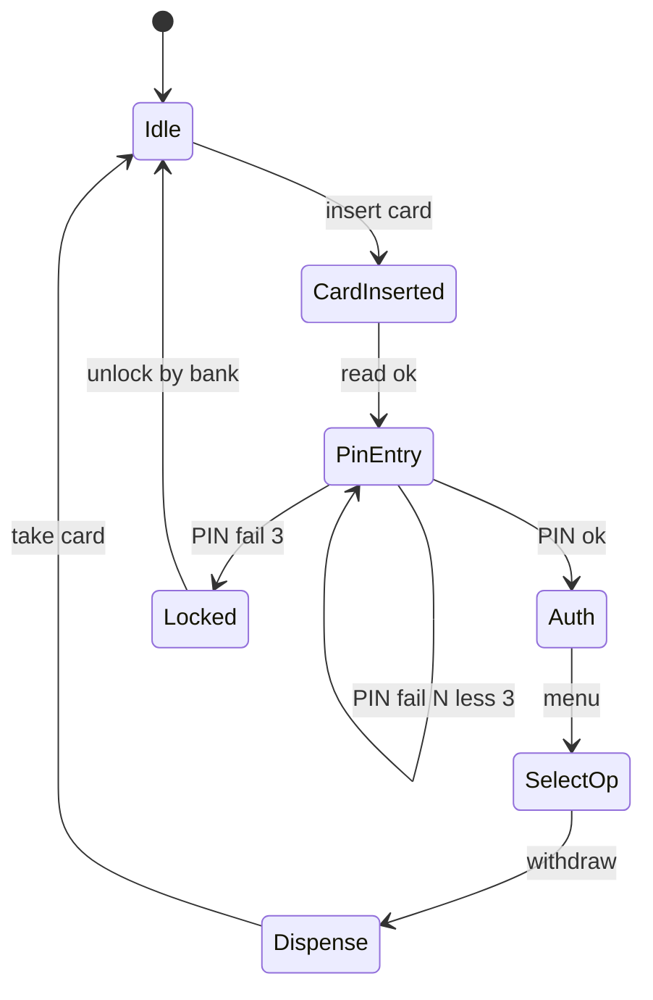

## Введение

Middle-уровень (M1, M4, M14, M17–22) проверяет не знание терминов, а зрелость процесса: что делает QA в команде, когда начинать и останавливать тест, как говорить о риске релиза и когда кейсы вредят. Ответы — практические, без копипаста учебника.

Термины и определения согласованы с **ISTQB CTFL v4** и [глоссарием ISTQB](https://glossary.istqb.org/); номера J/M/S — опциональный индекс типовых вопросов собеса.

**Продвинутый тест-дизайн:.** Углубление тест-дизайна (M3, M11, M23–25, M93, M101 + J138–140): когда комбинаторика взрывается, как режут pairwise, чем полезны state-машины и как метрики DDP/DRE и risk-based связывают тестирование с бизнесом. Лаба — тарифы карандашей (ценовые тиры).

Термины и определения согласованы с **ISTQB CTFL v4** и [глоссарием ISTQB](https://glossary.istqb.org/); номера J/M/S — опциональный индекс типовых вопросов собеса.

## Раздел: Как отвечать одним блоком

Этот выпуск собрал соседние короткие темы трека: «Процесс QA middle: роли,», «Продвинутый тест-дизайн:». Раньше каждая занимала отдельную карточку на несколько минут, а на собеседовании их спрашивают одним блоком. Ниже у каждой темы свой раздел, затем общие лабы, один тест и одна колода карточек. В ответе сначала назовите, какую тему спросили, потом определение и один пример. Не проговаривайте все разделы, если спросили один. Лабы можно пройти по порядку исходного трека. Если времени мало, сделайте первую и последнюю: первая ставит язык, последняя проверяет, что соседние темы вы не перепутали.

## Раздел: Процесс QA middle: роли,: Обязанности QA, entry/exit, цена дефекта

**Обязанности QA (шире, чем «кликать по билду»):** анализ требований и рисков, стратегия и план, проектирование проверок, выполнение, отчётность, коммуникация блокеров, улучшение качества процесса (ретро, flaky, тестовые данные), иногда поддержка AQA и production-мониторинг сигналов.

Не обязанность QA — единолично «разрешить релиз» без критериев продукта/бизнеса; решение — совместное, QA даёт **информацию о рисках**.

**Entry criteria (вход в тестирование):** сборка установлена на стенд, smoke предыдущего слоя зелёный, есть тестовые данные/учётки, известен scope (что вошло в билд), доступны зависимости (API/mock), понятны критерии приёмки.

**Exit criteria (выход):** запланированный scope пройден или явно срезан, критичные/блокеры закрыты или приняты бизнесом, метрики согласованы (например нет open Sev1), отчёт отдан, известны остаточные риски.

**Цена дефекта.** Чем позже найден — тем дороже: требования → код → тест → прод (инцидент, репутация, хотфикс, откат). На собесе связывайте с shift-left: дешёвые находки на ревью требований и API-контракте, дорогие — в проде у платежного сценария.

## Раздел: Процесс QA middle: роли,: Pos/neg, пререлиз, leakage, кейсы и трудное

**Позитив / негатив.** Позитив — штатный путь и валидные данные; негатив — невалидный ввод, отказы зависимостей, права, лимиты. «Правильное» соотношение не 50/50 и не догма 1:3: зависит от риска. Для платежей и auth негатива больше; для внутреннего read-only отчёта — упор на позитив и границы данных. Называйте **риск**, а не магическую цифру.

**Пререлизное тестирование.** Freeze scope → regression критичных journey → sanity на release-candidate → проверка миграций/конфигов → мониторинг чеклист после выкладки. Не путать с бесконечным «ещё часик покликаем» без плана.

**Bug leakage vs решение релизить.** Leakage — дефекты, ушедшие в прод (или найденные клиентом), которые могли/должны были быть пойманы на вашем уровне. Анализ leakage ≠ «QA виноват»: смотрите пробелы покрытия, среды, флаки, сжатые сроки, неясные требования. Релиз с известными багами возможен, если риск принят (workaround, feature flag, мониторинг) и задокументирован — это не то же самое, что утечка сюрпризом.

**Когда не писать подробные тест-кейсы:**

- исследование/новый UI без стабильных требований (сначала чеклист/сессия)
- одноразовая проверка на выброшенном прототипе
- полностью покрыто надёжными автотестами с читаемыми сценариями
- время уходит в документацию вместо риска (согласовать с тимлидом)

**Труднотестируемые фичи:** случайность (рандом, ML), внешние провайдеры без sandbox, timing/race, аппаратные датчики, закрытые SDK, «красивый» UI без id. Стратегии: testability (логи, хуки, seed), контрактные моки, телеметрия, feature flags, исследовательские сессии, усиленный мониторинг вместо ложной уверенности.

## Раздел: Процесс QA middle: роли,: Частые вопросы с собеседования

**Вопрос.** Зачем на собесе спрашивают equivalence partitioning и граничные значения?

**Ответ.** EP сжимает бесконечные входы в классы «ведут себя одинаково»; BVA бьёт по стыкам классов — там чаще ломается сравнение и валидация. Для поля 18–99 достаточно классов «ниже», «внутри», «выше» и точек 17–18–19, 98–99–100; не нужно 82 случайных числа.

**Вопрос.** Severity и priority в баг-репорте — одно и то же?

**Ответ.** Нет. Severity — ущерб для продукта и пользователя (crash vs опечатка). Priority — когда чинить в очереди команды. Критичный по severity баг может ждать, если воспроизводится только на стенде без пользователей; наоборот, мелкий UI-bug в checkout может быть P1 перед релизом.

**Вопрос.** Что имеют в виду под «пирамидой тестирования» на собеседовании?

**Ответ.** Много быстрых дешёвых проверок внизу (unit, контракт API), меньше медленных UI/e2e наверху. Цель — быстрая обратная связь в CI, а не «всё через Selenium». Пирамида не запрет на e2e: сквозные сценарии оставляют на критичные деньги-потоки.

## Раздел: Продвинутый тест-дизайн:: Decision table, pairwise, ATM states

**Decision table.** Строки — условия и действия; столбцы — правила. Удобно для бизнес-логики с несколькими if/else (скидки, роли, флаги). Сначала компактная таблица → вычёркивание невозможных комбинаций → кейсы из оставшихся столбцов.

Пример (логин):

| Условие | R1 | R2 | R3 | R4 |
|---------|----|----|----|-----|
| Логин валиден | T | T | F | F |
| Пароль валиден | T | F | T | F |
| Вход разрешён | Y | N | N | N |

**Pairwise (попарное).** Предпосылка: большинство дефектов — от взаимодействия **двух** параметров, не всех сразу. Инструменты (PICT и аналоги) строят набор, где каждая пара значений параметров встречается ≥1 раз. Не замена риск-анализу: критичные тройки/бизнес-сценарии добавляйте вручную.

Параметры: браузер × ОС × язык × роль — полный перебор огромен; pairwise даёт обозримый smoke матрицы.

**State transition (ATM-пример).** Состояния: Idle → CardInserted → PinEntry → Auth → SelectOp → Dispense → Idle; плюс Locked после N неверных PIN. Кейсы: валидные переходы, невалидные (событие в неверном состоянии), граничные (3-й неверный PIN), восстановление. Диаграмма состояний ловит дыры, которые «список кейсов» пропускает.

## Раздел: Продвинутый тест-дизайн:: Цикломатика, DDP/DRE, risk-based

**Цикломатическая сложность (McCabe).** Приблизительно: число независимых путей ≈ `E - N + 2P` или «количество решений + 1». Для QA: высокая сложность модуля → больше basises / внимательнее к ветвлениям; аргумент для рефакторинга и unit-тестов разработчика, не только UI-регресса.

**DDP / DRE.**

- **DRE (Defect Removal Efficiency)** ≈ дефекты найдённые до релиза / (до + после). Чем выше — тем лучше «сетка» до прода.
- **DDP (Defect Detection Percentage)** в ряде компаний синонимичен или считается по фазам (доля, пойманная на этапе). Уточняйте формулу работодателя. Смысл на собесе: связать leakage с измеримой эффективностью, не с эмоцией.

**Risk-based testing (RBT).** Риск ≈ вероятность × влияние. Модели: матрица 3×3, риск-каталог фич, Failure Mode мысли по сценариям. Приоритет тестов: сначала высокий риск (платежи, PII, миграции), низкий — сэмпл/мониторинг. Пересматривайте после инцидентов и изменений архитектуры.

Углубление границ/эквивалентности (J138–140): классы + границы на стыке тиров цен, округлений, timezone, валют — типичные mid-уровень ловушки.

## Раздел: Продвинутый тест-дизайн:: Частые вопросы с собеседования

**Вопрос.** Чем уровень тестирования отличается от типа (вида) тестирования?

**Ответ.** Уровень отвечает на «где режем систему»: модуль, стык, продукт целиком, приёмка. Тип — «с какой целью гоняем»: smoke, regression, exploratory, security и т.д. На собесе покажите пример: один checkout можно проверить на integration (API+БД) и оформить прогон как regression после фикса — оси независимы.

**Вопрос.** Severity и priority в баг-репорте — одно и то же?

**Ответ.** Нет. Severity — ущерб для продукта и пользователя (crash vs опечатка). Priority — когда чинить в очереди команды. Критичный по severity баг может ждать, если воспроизводится только на стенде без пользователей; наоборот, мелкий UI-bug в checkout может быть P1 перед релизом.

**Вопрос.** Что имеют в виду под «пирамидой тестирования» на собеседовании?

**Ответ.** Много быстрых дешёвых проверок внизу (unit, контракт API), меньше медленных UI/e2e наверху. Цель — быстрая обратная связь в CI, а не «всё через Selenium». Пирамида не запрет на e2e: сквозные сценарии оставляют на критичные деньги-потоки.

**Вопрос.** Почему flaky e2e — отдельная тема на middle/senior QA?

**Ответ.** Flaky — тест то зелёный, то красный без изменения кода: тайминги, данные, сеть, параллельность. Команда перестаёт верить CI. Лечат изоляцией данных, явными ожиданиями, стабильными селекторами, отсечением внешних сервисов; иногда понижают уровень — проверяют API вместо хрупкого UI.

## Лаба

**Процесс QA middle: роли,.**

**Цель.** Для учебного продукта (интернет-магазин или ваш стенд) оформить one-pager процесса релиза.

**Шаги.**
1. Выпишите 5 обязанностей QA на спринт и 2 зоны, где QA только консультирует.
2. Сформулируйте entry/exit для regression перед релизом (измеримые пункты).
3. Оцените 3 бага на разных стадиях: «цена» в условных единицах усилий + риск для бизнеса.
4. Предложите pos:neg акцент для модуля оплаты vs модуля «о компании».
5. Опишите 1 фичу, которую невыгодно покрывать детальными кейсами, и альтернативу (чеклист/авто/мониторинг).

**В группу:** кто подписывает релиз при открытом Sev2 с workaround — продукт, tech lead или QA?

**Готово, если…**
- [ ] Entry/exit без воды («всё готово»)
- [ ] Объясняете leakage vs accepted risk
- [ ] Есть пример труднотестируемого и testability-запрос к разработке

**Продвинутый тест-дизайн:.**

**Цель.** Прайс карандашей: тиры `1–9 шт → 10₽`, `10–49 → 8₽`, `50+ → 6₽`, опция «подарочная коробка +50₽», роль опт/розница (опт даёт ещё −1₽ за штуку только от 50).

**Шаги.**
1. Постройте decision table: тир количества × коробка × роль → итог/ошибка.
2. Выпишите границы: 0, 1, 9, 10, 49, 50, отрицательные, нечисло.
3. Сожмите комбинации pairwise по параметрам (кол-во-класс, коробка, роль) и сравните с полным перебором.
4. Нарисуйте state machine оформления заказа: Cart → Address → Pay → Done / FailedPay → retry.
5. Оцените риск: ошибка цены для опта 10k штук vs косметика UI коробки — куда больше кейсов.

**В группу:** когда pairwise опасен (маскирует обязательную тройную комбинацию)?

**Готово, если…**
- [ ] Таблица без противоречивых правил
- [ ] Границы тиров покрыты
- [ ] Есть формула DRE своими словами на примере цифр

## Схема: Процесс QA middle: роли,: Стоимость дефекта по стадиям

## Схема: Продвинутый тест-дизайн:: ATM state transition

## Тест

### Чем entry criteria отличаются от exit criteria?

**Ответ:** entry — готовность начать тест; exit — условия закончить этап и передать дальше/релизить

**Пояснение:** без entry тестирование превращается в отладку среды; без exit — бесконечный цикл без решения о качестве.

### Зачем decision table, если есть if в голове аналитика?

**Ответ:** явно показывает комбинации условий и дыры/противоречия правил

**Пояснение:** таблица — артефакт согласования с бизнесом и источник кейсов без пропущенных столбцов.

### Почему нельзя назвать универсальную долю негативных кейсов?

**Ответ:** доля зависит от риска домена и стоимости ошибки, а не от формулы

**Пояснение:** auth/платежи требуют больше негатива; простой контентный экран — иначе перерасход времени.

### Что гарантирует pairwise, а что — нет?

**Ответ:** покрытие всех пар значений параметров; не гарантирует все тройные и бизнес-критичные полные сценарии

**Пояснение:** добавляйте обязательные комбинации вручную поверх генератора.

### Когда осознанный релиз с багом — не bug leakage?

**Ответ:** когда дефект известен, риск принят стейкхолдерами и есть mitigation

**Пояснение:** leakage — сюрприз в проде из-за пробела процесса; accepted debt — управляемое решение.

## Шпаргалка

<ul><li>QA информирует о рисках; релиз — командное/продуктовое решение</li><li>Обязанности: анализ, дизайн, выполнение, отчёт, улучшение процесса</li><li>Entry: билд, данные, scope, зависимости</li><li>Exit: scope, блокеры, отчёт, остаточный риск</li><li>Не писать: нестабильный research, дубль авто, разовый прототип</li><li>Трудно: nondeterminism, внешние системы → testability + моки</li><li>Decision table — правила бизнес-логики</li><li>Pairwise — сжатие комбинаторики пар</li><li>State transition — события и запрещённые переходы</li><li>Сначала high impact × high likelihood</li><li>Низкий риск — сэмпл, не игнор навсегда</li></ul>

## Anki

### Front: Что такое bug leakage?

Back: дефекты, дошедшие до продакшена (или клиента), которые целевой уровень тестирования должен был поймать

### Front: Что такое pairwise testing?

Back: набор тестов, где каждая пара значений параметров встречается минимум один раз

### Front: Почему дефект в проде дороже найденного на code review?

Back: затрагивает пользователей, требует хотфикса/отката, репутационные и операционные издержки

### Front: Зачем state transition для ATM?

Back: ловит неверные переходы (операция без PIN, блокировка после N ошибок) лучше плоского списка кейсов

### Front: Когда подробные тест-кейсы вредят?

Back: когда требования плывут или время на документ съедает исследование риска — лучше чеклист/сессия

### Front: Defect Removal Efficiency?

Back: доля дефектов, устранённых/найденных до релиза относительно всех учтённых (до+после)

## Мнемоника

### peg: QA в команде

**Задание:** Три решения, которые отличают middle.

**Элементы:**
- когда начать
- когда остановить
- какой риск назвать

**Подсказка:** «Протестирую всё» — отказ выбирать.

**Ответ:** 1 старт · 2 стоп · 3 риск

## Итоги

- Middle QA говорит языком критериев, риска и стоимости, а не только «прошёл/не прошёл»
- Pos/neg и объём кейсов подчиняются риску домена
- Leakage анализируют системно; релиз с known issues возможен при принятии риска
- Testability — часть диалога с разработкой по «неудобным» фичам
- Таблицы решений и состояния закрывают «логику», pairwise — взрыв параметров
- Цикломатика — мост к разговору с разработкой о сложности
- DDP/DRE и RBT переводят тестирование в язык менеджмента риска
- Лаба с тарифами тренирует границы + комбинаторику на одной задаче

## Ссылки

- [ISTQB Glossary](https://glossary.istqb.org/)
- [CTFL v4 — Certified Tester Foundation Level](https://istqb.org/certifications/certified-tester-foundation-level-ctfl-v4-0/)
- [QA-interview-250](https://github.com/Konstantine23/QA-interview-250)
- [Learn](/game/learn)
- [API contract and perf](/game/learn/qa-api-contract-perf)
