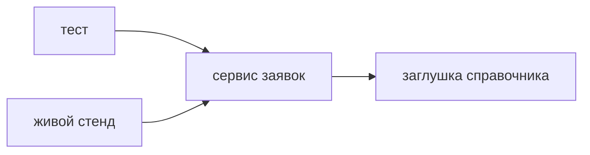

## Введение

Вакансии называют WireMock, мок-сервер и заглушки рядом с API-тестированием. Нужны они, когда соседний сервис ещё не готов, платный, нестабильный или нарочно должен ответить ошибкой, которую в бою ловить долго. Правила короткие, и их как раз ждут на собеседовании. Подменяют зависимость. Не подменяют систему, которую оценивают. Форму ответа берут из контракта, не из удобного минимума. Описание заглушки лежит в репозитории вместе с тестом. Главный путь хотя бы раз подтверждают без мока, если живой сосед на стенде есть.

Зелёный прогон, который ходит только в собственные фантазии, врёт о качестве. Стабильность сама по себе не цель. Цель — управляемый ответ соседа и честная проверка своего сервиса. Этот выпуск разбирает сервис заявок, который ходит в справочник клиентов: найден, не найден, справочник недоступен, и что из этого нельзя закрыть только заглушкой.

## Раздел: Граница заглушки

Система под тестом — та, чьё поведение вы утверждаете. Её поднимают по-настоящему: тот код, та конфигурация, та база, которую вы готовы защищать. Тест ходит в неё обычным клиентом, как пошёл бы продукт или другой сервис. Если вместо неё тоже стоит заглушка, утверждения относятся к заглушке. Такой прогон можно использовать как черновик контракта, но нельзя называть проверкой сервиса заявок.

Зависимость — чужой справочник, платёж, почта, биллинг. Её подменяют, чтобы задать ответ: клиент есть, клиента нет, сервис ответил 503, ответ пришёл слишком поздно. WireMock и похожие инструменты поднимают HTTP-двойник: метод, путь, код, тело, задержка. Двойник не «упрощает JSON». Он повторяет договорённый контракт. Поле, которое боевой справочник всегда шлёт, в заглушке тоже есть. Иначе свой сервис научится жить без поля и упадёт в бою.

Ответ «всегда 200 и пустое тело» прячет ветку ошибки. Отдельным сценарием ставят 503 и таймаут и смотрят две вещи: что видит пользователь или вызывающий сервис и что пишется в журнал. Молчаливый обрыв без записи — тоже дефект, его заглушка как раз делает воспроизводимым. Задержку ставят, когда важен таймаут клиента. Мгновенный 503 и зависший сосед — разные ветки.

Контрактный тест сверяет форму сообщения с ожидаемой схемой. Широкий мок рисует удобный ответ и может годами расходиться с соседом. Если есть потребительский контракт или хотя бы пример из спецификации соседа, заглушку сверяют с ним при изменении. Расхождение чинят обновлением двойника, не подгонкой своего сервиса под старую фантазию, пока живой контракт не подтвердит иное.

Заглушку версионируют рядом с тестом. Ответ, который помнит один человек на своём ноутбуке, прогон не повторяет. Коллега и CI поднимают тот же двойник из репозитория. Секреты боевого соседа в описание заглушки не кладут: там пример, не боевой ключ.

На приёмке критичный путь хотя бы раз идёт без мока, на стенде с живым соседом, если он есть. Так ловят поле, которое заглушка забыла, и код, который сосед начал отдавать по-новому. Если соседа ещё нет в природе, честно говорят: путь проверен только на двойнике, риск интеграции открыт. Это лучше, чем зелёный отчёт без оговорки.

## Раздел: Разбор на примере

Сервис заявок при создании спрашивает справочник: существует ли клиент. Свой сервис поднят настоящий, с тестовой базой. Справочник — WireMock.

Первый ответ двойника: 200 и тело клиента по контракту, все обязательные поля. Ожидание своего сервиса: заявка создана, в ней сохранён идентификатор клиента. Тест говорит с сервисом заявок, не со справочником напрямую, когда проверяет итог. Отдельным узким запросом можно убедиться, что двойник получил путь, который вы согласовали, если это важно для регрессии маршрута.

Второй ответ: 404, клиента нет. Ожидание: заявка не создана, вызывающему вернулся понятный отказ, в базе нет «висячей» заявки. Это поведение своего сервиса. Его не проверяют, подменив сам сервис заявок ответом 404.

Третий ответ: 503 или задержка дольше таймаута клиента. Ожидание: заявка не считается успешно созданной, пользователь или вызывающий код видит повтор или отказ, в журнале есть запись без лишних персональных данных. Счастливый мок этого не покажет.

Без мока на стенде, где справочник живой, один раз создают заявку на тестового клиента. Этот прогон короче набора двойников и нужен как подтверждение, что контракт ещё тот. Его не размножают на все ветки ошибок: живой справочник плохо просят «будь 503 по расписанию». Ошибки остаются на заглушке, главный успех дублируют живьём перед релизом.

Что хранится в репозитории: три сопоставления метод-путь-ответ, без адреса прода. Адрес двойника приходит из окружения теста, как адрес стенда в Postman.

## Раздел: Где это ломается

Мокают систему под тестом. Тест зелёный, в прод уехал другой код. Граница: двойник только у соседа.

Урезанный JSON. Нет поля, которое бывает пустым, нет вложенного объекта. Свой парсер падает на бою. Берут пример из спецификации соседа.

Один счастливый ответ на все тесты. Ветка недоступности не существует в наборе, а в инциденте оказывается единственной. Ошибка — отдельный сценарий.

Заглушка только в памяти автора. CI её не поднимает, «у меня проходит». Описание в репозитории, подъём в фикстуре.

Забывают снять двойник и ходят им в приёмку, думая, что сосед живой. Отчёт обязан говорить, где стояла заглушка. Иначе релизная уверенность липовая.

Задержка не проверяется, хотя клиентский таймаут заявлен. Мгновенные ответы не доказывают, что по таймауту нет двойной заявки. Если идемпотентность на этом пути важна, медленный сосед — обязательный двойник.

В заглушку кладут боевой токен «чтобы похоже». Секрет утекает в репозиторий теста. Пример обезличен.

## Раздел: Ответ вслух

Я подменяю зависимость, чтобы управлять её ответом: успех, отказ, задержка. Контракт заглушки беру из спецификации соседа, не из удобного минимума. Сам сервис под тестом хожу настоящим клиентом. Описание двойника лежит рядом с тестом, его поднимает CI. Перед релизом главный сценарий подтверждаю без заглушки, если стенд это позволяет. Если не позволяет, в отчёте прямо написано, что интеграция проверена только на двойнике. «Замокать всё ради стабильности» я не называю стратегией.

## Раздел: Плохой ответ

Плохой ответ: «замокаем всё, так стабильнее». Стабильный зелёный прогон, который не видит настоящий контракт, врёт о качестве. Второй плохой ответ: «мок и есть контрактный тест». Контрактный тест сверяет форму с договорённостью. Удобный мок может врать годами и оставаться зелёным.

## Раздел: Термины

Заглушка, stub — заранее заданный ответ. Мок в быту часто значит любую подмену; в узком смысле мок ещё проверяет, как его вызвали. Подмена зависимости — test double. Система под тестом — SUT, system under test. Контрактный тест — сверка формы сообщения. WireMock — один из HTTP-двойников, не единственное слово для приёма.

## Лаба

**Цель.** Описать два ответа соседа и один путь без двойника.

**Шаги.**

1. Сервис заявок ходит в справочник клиентов. Зафиксируйте, кто SUT: сервис заявок, не справочник.
2. Опишите ответ заглушки «клиент найден»: код, обязательные поля по контракту, что обязана сделать заявка.
3. Опишите ответ «справочник недоступен»: 503 или таймаут, что видит вызывающий, чего не должно остаться в базе.
4. Напишите, какой путь проверите без мока на стенде с живым справочником и почему ошибки туда не переносите.
5. Укажите, где лежит описание заглушки и чего в нём нет: боевого секрета и адреса прода.
6. Одной фразой объясните, чем это отличается от подмены самого сервиса заявок.

**Готово, если…**

- [ ] Подменяют только справочник
- [ ] Есть ветка отказа, не только 200
- [ ] Главный успех назван кандидатом на живой стенд
- [ ] Описание повторяемо из репозитория

## Схема: Кого подменяют

## Тест

### Что нельзя подменять двойником?

**Ответ:** систему под тестом

**Пояснение:** Иначе утверждения относятся к двойнику, не к продукту.

### Зачем отдельный ответ 503?

**Ответ:** проверить ветку отказа

**Пояснение:** Счастливый мок не показывает таймаут и сообщение человеку.

### Откуда брать форму JSON заглушки?

**Ответ:** из контракта зависимости

**Пояснение:** Удобный урезанный JSON расходится с боевым сервисом.

### Когда прогон без мока обязателен?

**Ответ:** на приёмке главного пути

**Пояснение:** Только живой сосед подтверждает, что контракт ещё тот.

### Заглушка только на машине одного тестировщика. Чем плохо?

**Ответ:** прогон нельзя повторить

**Пояснение:** Ответ должен лежать в репозитории вместе с тестом.

## Шпаргалка

<ul><li>Мокают соседа</li><li>Не мокают продукт</li><li>Тело по контракту</li><li>Есть ветка ошибки и задержки</li><li>Главный путь без мока на стенде</li></ul>

## Anki

### Front: Кого подменяет WireMock?

Back: Внешнюю зависимость, не проверяемый сервис.

### Front: Что зафиксировать у заглушки?

Back: Метод, путь, код и тело по контракту.

### Front: Зачем мок с задержкой?

Back: Увидеть таймаут и поведение клиента при медленном соседе.

### Front: Почему «всегда 200» опасен?

Back: Прячет ошибки, которые будут в бою.

### Front: Где хранить описание заглушки?

Back: В репозитории теста, чтобы прогон повторялся.

### Front: Чем контрактный тест отличается от широкого мока?

Back: Он сверяет форму сообщения, а не рисует удобный ответ.

## Мнемоника

### peg: Когда подмена

**Задание:** Три повода поставить мок и один запрет.

**Элементы:**
- чужой сервис нестабилен
- граничный ответ
- ещё не готов
- не мокать то, что проверяете

**Подсказка:** Мок своего же правила оплаты прячет дефект.

**Ответ:** 1 чужой · 2 край · 3 нет сервиса · 4 не свои правила

## Итоги

- Заглушка управляет соседом, не подменяет продукт
- Ошибка и медленный ответ — отдельные сценарии
- Форма JSON берётся из контракта
- Описание двойника повторяемо в CI
- Живой стенд хотя бы раз подтверждает главный путь

## Ссылки

- [API и контракты](/game/learn/qa-api-contract-perf)
- [Postman](/game/learn/sa-postman)
