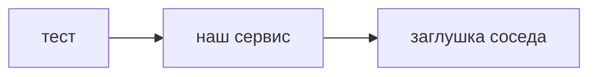

## Введение

Вакансии называют WireMock и мок-сервисы. Нужны они, когда соседний сервис ещё не готов, платный или нарочно должен ответить ошибкой. Правила короткие.

## Раздел: Граница заглушки

Мокают зависимость: платёж, почту, чужой справочник. Не мокают систему, которую оценивают. Иначе тест зелёный на вашей фантазии.

Контракт заглушки совпадает с договорённым JSON: поля, коды, задержка. Ответ «всегда 200 и пустое тело» прячет ветку ошибки. Отдельным сценарием ставят 503 и таймаут и смотрят, что видит пользователь и что пишется в лог.

Заглушку версионируют рядом с тестом. Ручной ответ в памяти одного человека пропадает. На приёмке критичный путь хотя бы раз гоняют без мока, на стенде с живым соседом, если он есть.

## Раздел: Ответ вслух

Я подменяю зависимость, чтобы управлять её ответом: успех, отказ, задержка. Контракт заглушки беру из спецификации, не из удобного минимума. Сам сервис под тестом хожу настоящим клиентом. Перед релизом один главный сценарий подтверждаю без заглушки, если стенд это позволяет.

## Раздел: Плохой ответ

Плохой ответ: «замокаем всё, так стабильнее». Стабильный зелёный прогон, который не видит настоящий контракт, врёт о качестве.

## Раздел: Термины

Заглушка — stub. Мок — mock, в быту часто говорят про любую подмену. Подмена зависимости — test double. Контрактный тест — contract test.

## Лаба

**20 минут.** Сервис заявок ходит в справочник клиентов. Опишите два ответа заглушки: клиент найден и справочник недоступен. Напишите, что в каждом случае обязана сделать заявка, и какой путь вы проверите без мока.

## Схема: Кого подменяют

## Тест

### Что нельзя подменять двойником?

**Ответ:** систему под тестом

**Пояснение:** Иначе утверждения относятся к двойнику, не к продукту.

### Зачем отдельный ответ 503?

**Ответ:** проверить ветку отказа

**Пояснение:** Счастливый мок не показывает таймаут и сообщение человеку.

### Откуда брать форму JSON заглушки?

**Ответ:** из контракта зависимости

**Пояснение:** Удобный урезанный JSON расходится с боевым сервисом.

### Когда прогон без мока обязателен?

**Ответ:** на приёмке главного пути

**Пояснение:** Только живой сосед подтверждает, что контракт ещё тот.

### Заглушка только на машине одного тестировщика. Чем плохо?

**Ответ:** прогон нельзя повторить

**Пояснение:** Ответ должен лежать в репозитории вместе с тестом.

## Шпаргалка

<ul><li>Мокают соседа</li><li>Не мокают продукт</li><li>Есть ветка ошибки</li><li>Главный путь без мока на стенде</li></ul>

## Anki

### Front: Кого подменяет WireMock?

Back: Внешнюю зависимость, не проверяемый сервис.

### Front: Что зафиксировать у заглушки?

Back: Метод, путь, код и тело по контракту.

### Front: Зачем мок с задержкой?

Back: Увидеть таймаут и поведение клиента при медленном соседе.

### Front: Почему «всегда 200» опасен?

Back: Прячет ошибки, которые будут в бою.

### Front: Где хранить описание заглушки?

Back: В репозитории теста, чтобы прогон повторялся.

### Front: Чем контрактный тест отличается от широкого мока?

Back: Он сверяет форму сообщения, а не рисует удобный ответ.

## Итоги

- Заглушка управляет соседом
- Ошибка соседа — отдельный сценарий
- Живой стенд хотя бы раз подтверждает главный путь

## Ссылки

- [API и контракты](/game/learn/qa-api-contract-perf)
- [Postman](/game/learn/sa-postman)
