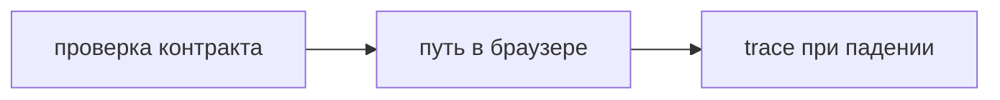

## Введение

Вакансии manual+auto всё чаще пишут Playwright рядом с pytest. На собесе отличают его от Selenium по ожиданию и по тому, какой сценарий вообще стоит гонять в браузере.

## Раздел: Как устроен прогон

Локатор указывает роль, текст или тестовый id. Жёсткий xpath по вёрстке ломается раньше продукта. Playwright ждёт действие сам: клик по ещё не готовой кнопке не нужно оборачивать в свой sleep.

Сценарий короткий: открыл, сделал шаг, увидел результат. Трассировка падения — скрин, сеть, шаг. Её смотрят до того, как переписывать локатор. На Python тест живёт рядом с pytest, отчёт можно отдать в Allure.

Браузерный прогон дорогой. Проверку поля и кода ответа оставляют на API. В браузер попадает склейка, которую API не показывает.

## Раздел: Ответ вслух

Я выбираю локатор по роли и имени. Таймаут с запасом на сеть, не sleep на всякий случай. В прогоне один основной путь и отдельный на ошибку, которую видит человек. Падение открываю в trace. Selenium не ругаю: если проект на нём, я поддерживаю его, а новый контур собираю на Playwright из-за ожидания и трассировки.

## Раздел: Плохой ответ

Плохой ответ: «перепишем все 400 кейсов Selenium на Playwright». Сначала новый критичный путь. Массовая переписка не находит дефекты.

## Раздел: Термины

Локатор — locator. Автоожидание — auto-wait. Трассировка — trace. Сквозной тест — end-to-end. Идентификатор для теста — data-testid.

## Лаба

**25 минут.** Опишите сценарий «создать заметку и увидеть её в списке» тремя шагами. Для каждого шага укажите локатор по роли, не по классу. Напишите, какую проверку вы сознательно оставите на API.

## Схема: Что идёт в браузер

## Тест

### Чем локатор по роли лучше xpath по div?

**Ответ:** переживает смену вёрстки

**Пояснение:** Имя кнопки меняется реже, чем путь по дереву.

### Зачем автоожидание?

**Ответ:** не кликать раньше готовности

**Пояснение:** Свой sleep либо короткий и мигает, либо длинный и тормозит прогон.

### Что смотреть в trace первым?

**Ответ:** шаг, экран и сеть

**Пояснение:** Часто запрос упал, а локатор ни при чём.

### Какой кейс оставить на API?

**Ответ:** код и тело ответа

**Пояснение:** Браузер нужен, где важен видимый результат склейки.

### Стоит ли переписывать весь старый набор сразу?

**Ответ:** нет, начать с критичного пути

**Пояснение:** Перенос без нового сигнала не повышает качество.

## Шпаргалка

<ul><li>Роль и имя</li><li>Без sleep</li><li>Мало сценариев</li><li>Trace до правки локатора</li></ul>

## Anki

### Front: Что такое locator в Playwright?

Back: Способ найти элемент и дождаться его готовности к действию.

### Front: Почему не time.sleep?

Back: Он не связан с готовностью элемента и сети.

### Front: Что хранит trace?

Back: Шаги, снимки и сеть упавшего прогона.

### Front: data-testid когда уместен?

Back: Когда у элемента нет устойчивого имени для пользователя.

### Front: Playwright заменяет API-тесты?

Back: Нет. Контракт дешевле проверять без браузера.

### Front: Как связать с pytest?

Back: Тест — обычная функция pytest, фикстура поднимает браузер.

## Итоги

- Браузер проверяет путь человека
- Ожидание встроено в действие
- Старый набор Selenium не выбрасывают пачкой

## Ссылки

- [Selenium](/game/learn/qa-selenium-webdriver)
- [Тесты UI](/game/learn/fe-ui-testing)
