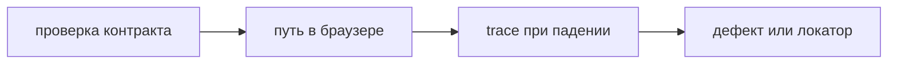

## Введение

Вакансии, где рядом manual и автоматизация, всё чаще пишут Playwright рядом с pytest. На собеседовании отличают его от Selenium не лозунгом «он современнее», а двумя свойствами прогона: действие само ждёт готовность элемента, и падение оставляет трассировку шага, снимка и сети. Второе, о чём спрашивают сразу после инструмента, — какой сценарий вообще стоит гонять в браузере. Проверка кода ответа и тела JSON в браузере дорогая. Браузер оставляют склейке, которую API не показывает: человек открыл страницу, сделал шаг, увидел результат.

Playwright не обязан вытеснить четыреста старых кейсов Selenium в один квартал. Массовая переписка не находит дефекты, она переносит локаторы. Новый критичный путь собирают на Playwright. Старый контур поддерживают, пока он ловит регрессию. В резюме честно звучит «поддерживаю Selenium, новый контур веду на Playwright из-за ожидания и trace», а не «Selenium устарел, я его не открою».

Выпуск разбирает сценарий «создать заметку и увидеть её в списке»: локатор по роли, отсутствие `sleep`, один аварийный путь, разбор trace до правки локатора и связь с pytest.

## Раздел: Как устроен прогон

Локатор указывает, как найти элемент и дождаться, что с ним можно действовать. Роль и имя — первый выбор: кнопка «Сохранить», поле «Заголовок». Они совпадают с тем, что видит человек и проверка доступности. Тестовый идентификатор ставят, когда устойчивого имени нет: ячейка, иконка без текста, холст. Жёсткий xpath от корня документа по цепочке `div` ломается от перестановки вёрстки раньше, чем ломается продукт. Его оставляют редким случаем, когда другого крючка нет, и сразу говорят, почему.

Автоожидание вшито в действие. Клик по кнопке, которой ещё нет, подождёт в пределах таймаута, а не упадёт на первом кадре и не потребует отдельного `sleep`. Свой `sleep` либо короткий и мигает на загруженном CI, либо длинный и растягивает весь набор, даже когда страница уже готова. Таймаут локатора ставят с запасом на сеть стенда, но это предел ожидания условия, не пауза «на всякий случай» в каждой строке.

Сценарий короткий. Открыл адрес, сделал один осмысленный шаг, увидел наблюдаемый результат. Длинный сказ на двадцать шагов падает в середине по несвязанной причине и плохо говорит, что сломалось. Лучше три коротких пути, чем один комбайн. Данные готовит сам тест или фикстура, а не «то, что вчера осталось в базе». Общий мусор в стенде делает прогон зелёным только в одном порядке.

Трассировка падения хранит шаги, снимки экрана и сеть. Её смотрят до того, как переписывать локатор. Часто запрос вернул 500 или 403, кнопки честно не было, локатор ни при чём. Переписанный вслепую xpath зелёным не станет, зато спрячет дефект сервера. Скрин без сети показывает симптом. Сеть без шага не показывает, какое действие его вызвало. Смотрят связку.

На Python тест — функция pytest. Фикстура поднимает браузер и контекст, закрывает их после теста, даже если утверждение упало. Отчёт шагов можно отдать в Allure: прогон живёт там, кейс живёт в TMS, дефект — в трекере. Playwright не заменяет эту тройку, он наполняет прогон вложением.

Браузерный прогон дорогой по минутам и по лицензии внимания: его чинят первым, когда он красный, иначе набор перестают запускать. Поэтому в браузер попадает склейка. Поле обязательности и код 422 оставляют на API-тесте. Дубль «и в API, и в браузере тот же JSON» удваивает сопровождение. В браузере проверяют, что человек увидел текст ошибки, если это обещание интерфейса, а не структуру тела.

## Раздел: Разбор на примере

Сценарий создания заметки. Шаг первый: открыть страницу списка. Локатор заголовка страницы по роли, чтобы понять, что открыли нужный маршрут, а не страницу входа. Если вместо списка виден вход, это дефект сессии фикстуры, не локатора кнопки. Шаг второй: найти поле по роли и имени «Заголовок», ввести «Молоко». Шаг третий: нажать кнопку «Сохранить» по роли и имени. Ожидание: в списке есть текст «Молоко». Отдельное сильное ожидание — обновить страницу и увидеть пункт снова, если продукт обещает сохранение, а не только память вкладки.

Проверку «сервер вернул 201 и поле id» в этот браузерный тест не кладут. Её делает API-тест дешевле и точнее. В браузере достаточно видимого результата. Если пункт не появился, trace покажет, ушёл ли запрос и какой код вернулся. Тогда заводят дефект на сервер или на экран, а не меняют локатор на более длинный xpath.

Аварийный путь отдельный и короткий: сохранить пустой заголовок и увидеть текст ошибки у поля. Его не склеивают со счастливым в одном тесте через много `if`. Упало счастье — неясно, проверялась ли ошибка.

Старый набор Selenium на соседнем контуре не трогают этим изменением. Новый путь заметок ведут на Playwright. Когда старый путь умирает по продукту, кейс удаляют, а не переписывают из чувства порядка. Перенос имеет смысл, если сценарий ещё нужен и старый прогон уже нечем сопровождать: мигающие sleep, нет trace, локаторы не чинятся.

Запуск в CI изолирован. Один упавший тест не оставляет браузер-зомби следующему. Повторный прогон упавшего уместен один раз на сетевой сбой и опасен, если им маскируют настоящую гонку. Стабильность добывают ожиданием условия и чистыми данными, не тремя ретраями подряд.

## Раздел: Где это ломается

Переписывают все кейсы сразу. Месяц уходит на паритет локаторов, новые дефекты продукта не ищут. Начинают с одного критичного пути и отчёта, который команда реально открывает.

Ставят `sleep` «чтобы не мигало». Набор медленно зелёный локально и красный в CI, или наоборот. Ждут локатор и текст.

Чинт xpath, не открыв сеть. Дефект 500 живёт дальше, тест подгоняют под пустую страницу ошибочным ожиданием. Trace первый.

Делят один логин на всю пачку без изоляции и зависят от порядка. Второй тест не находит заметку, которую удалил первый. Фикстура данных на тест.

Гоняют в браузере таблицу кодов ответа. Это медленный дубль API. Браузер показывает текст и маршрут.

Забывают отрицательный путь, видимый человеку. API проверяет 422, а экран молчит. Один браузерный шаг на текст ошибки окупается.

Считают Playwright заменой тест-дизайна. Инструмент не придумает, какой путь критичный. Критичность по-прежнему из риска продукта, не из того, что «браузер умеет».

## Раздел: Ответ вслух

Я выбираю локатор по роли и имени, тестовый id ставлю только без имени. Таймаут — предел ожидания условия, не sleep в каждой строке. В прогоне один основной путь и отдельный на ошибку, которую видит человек. Код и тело ответа оставляю API. Падение открываю в trace: шаг, экран, сеть, и только потом трогаю локатор. Selenium не объявляю мёртвым: старый контур поддерживаю, новый собираю на Playwright из-за ожидания и трассировки. Массово четыреста кейсов не переписываю.

## Раздел: Плохой ответ

Плохой ответ: «перепишем все кейсы Selenium на Playwright». Сначала новый критичный путь. Перенос без нового сигнала не повышает качество. Второй плохой ответ: «браузерный тест надёжнее, им заменим API». Он дороже и хуже видит контракт поля. Надёжность даёт узкий слой, а не максимальное число кликов.

## Раздел: Термины

Локатор — locator. Автоожидание — auto-wait. Трассировка — trace. Сквозной тест — end-to-end. Идентификатор для теста — data-testid. Фикстура pytest поднимает браузер и данные. Мигающий тест — flake, чаще от сна, грязных данных и порядка, чем от «просто CI».

## Лаба

**Цель.** Собрать один путь человека и сознательно оставить контракт API снаружи.

**Шаги.**

1. Опишите сценарий «создать заметку и увидеть её в списке» тремя шагами. Для каждого шага укажите локатор по роли и имени, не по классу и не по xpath.
2. Добавьте четвёртый шаг-обновление страницы, если продукт обещает сохранение. Напишите, какой дефект он ловит: данные только в памяти вкладки.
3. Опишите отдельный короткий путь пустого заголовка и видимый текст ошибки.
4. Напишите, какую проверку оставляете на API: код и тело, не текст на экране.
5. Опишите порядок разбора падения: trace, сеть, и только потом локатор.
6. Одной фразой сформулируйте, почему не переписываете старый набор целиком на этой неделе.

**Готово, если…**

- [ ] В локаторах нет пути по div
- [ ] Счастливый и пустой ввод разведены
- [ ] Контракт JSON не продублирован в браузере
- [ ] Trace назван раньше правки локатора

## Схема: Что идёт в браузер

## Тест

### Чем локатор по роли лучше xpath по div?

**Ответ:** переживает смену вёрстки

**Пояснение:** Имя кнопки меняется реже, чем путь по дереву.

### Зачем автоожидание?

**Ответ:** не кликать раньше готовности

**Пояснение:** Свой sleep либо короткий и мигает, либо длинный и тормозит прогон.

### Что смотреть в trace первым?

**Ответ:** шаг, экран и сеть

**Пояснение:** Часто запрос упал, а локатор ни при чём.

### Какой кейс оставить на API?

**Ответ:** код и тело ответа

**Пояснение:** Браузер нужен, где важен видимый результат склейки.

### Стоит ли переписывать весь старый набор сразу?

**Ответ:** нет, начать с критичного пути

**Пояснение:** Перенос без нового сигнала не повышает качество.

## Шпаргалка

<ul><li>Роль и имя</li><li>Без sleep</li><li>Мало сценариев</li><li>Trace до правки локатора</li><li>Контракт дешевле без браузера</li></ul>

## Anki

### Front: Что такое locator в Playwright?

Back: Способ найти элемент и дождаться его готовности к действию.

### Front: Почему не time.sleep?

Back: Он не связан с готовностью элемента и сети.

### Front: Что хранит trace?

Back: Шаги, снимки и сеть упавшего прогона.

### Front: data-testid когда уместен?

Back: Когда у элемента нет устойчивого имени для пользователя.

### Front: Playwright заменяет API-тесты?

Back: Нет. Контракт дешевле проверять без браузера.

### Front: Как связать с pytest?

Back: Тест — обычная функция pytest, фикстура поднимает браузер.

## Итоги

- Браузер проверяет путь человека, не форму JSON
- Ожидание встроено в действие
- Падение читают по trace до смены локатора
- Старый набор Selenium не выбрасывают пачкой
- Изоляция данных важнее повторного прогона наудачу

## Ссылки

- [Selenium](/game/learn/qa-aqa-principles)
- [Тесты UI](/game/learn/fe-ui-testing)
