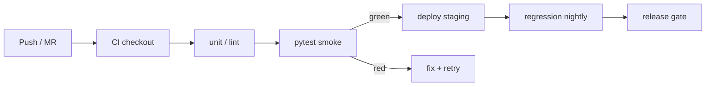
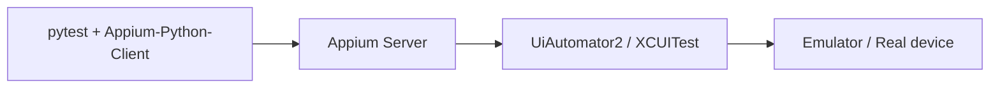

## Введение

Написать тест мало — его нужно запускать одинаково у всех и в пайплайне. J63–75 и M16: зачем runner, чем pytest отличается от TestNG/JUnit, как параллелить, что коммитить в Git и что должно быть в отчёте (Allure). Примеры — **pytest** + кратко про Java-раннеры.

Термины и определения согласованы с **ISTQB CTFL v4** и [глоссарием ISTQB](https://glossary.istqb.org/); номера J/M/S — опциональный индекс типовых вопросов собеса.

**Мобильное тестирование и.** Мобильный блок J109–118 и обзор M72–84: не «умею Appium на проде», а понимание платформ, сборок, логов, жестов и чем мобильный тест отличается от веба. Автоматизация — концепт Appium + пример Desired Capabilities; лаба — ручной чеклист + ADB.

Термины и определения согласованы с **ISTQB CTFL v4** и [глоссарием ISTQB](https://glossary.istqb.org/); номера J/M/S — опциональный индекс типовых вопросов собеса.

## Раздел: Как отвечать одним блоком

Этот выпуск собрал соседние короткие темы трека: «pytest, Git и CI для», «Мобильное тестирование и». Раньше каждая занимала отдельную карточку на несколько минут, а на собеседовании их спрашивают одним блоком. Ниже у каждой темы свой раздел, затем общие лабы, один тест и одна колода карточек. В ответе сначала назовите, какую тему спросили, потом определение и один пример. Не проговаривайте все разделы, если спросили один. Лабы можно пройти по порядку исходного трека. Если времени мало, сделайте первую и последнюю: первая ставит язык, последняя проверяет, что соседние темы вы не перепутали.

## Раздел: pytest, Git и CI для: Runners, pytest, assertions, parallel

**Зачем test runner.** Открывает discovery тестов, setup/teardown, ретраи, маркеры, отчёты, код возврата для CI. Без runner — «скрипт, который кто-то запускает руками».

**pytest (Python)** — discovery `test_*.py`, фикстуры вместо классического класса-setup, плагины, простой assert с интроспекцией.

**TestNG / JUnit (Java, кратко).** JUnit 5 — стандарт unit; TestNG — удобные suite/groups/dependencies, часто в Selenium-Java проектах. На собесе: «у нас Python → pytest; в Java-мире чаще JUnit5 или TestNG».

```python
import pytest
import requests


@pytest.fixture
def api_base() -> str:
    return "https://httpbin.org"


def test_status_ok(api_base: str) -> None:
    response = requests.get(f"{api_base}/status/200", timeout=10)
    assert response.status_code == 200


@pytest.mark.parametrize("code", [200, 201, 204])
def test_accepts_codes(api_base: str, code: int) -> None:
    assert requests.get(f"{api_base}/status/{code}", timeout=10).status_code == code
```

**Assertions.** В pytest — обычный `assert`; для коллекций — `pytest.approx`, сравнение наборов. В UI — assert текста/URL через page. Мягкие assert (несколько проверок подряд) — плагины или ручной сбор ошибок; не путайте с «проглотили exception».

**Параллель.** `pytest-xdist` (`-n auto`): изолированные процессы. Правила: нет shared WebDriver, уникальные тестовые данные, независимый порядок. На Grid — каждая сессия свой браузер.

```bash
pytest -n 4 -m smoke --alluredir=allure-results
```

## Раздел: pytest, Git и CI для: Git, CI, Allure, CI/CD sequence

**Git для QA.** `clone` → ветка `feature/qa-...` → `add` / `commit` / `push` → Merge Request. Смотрите `diff`, не коммитьте секреты, `__pycache__`, локальные отчёты. Конфликты в локаторах — норма; решайте с автором UI.

Минимум команд: `status`, `diff`, `branch`, `checkout -b`, `pull`, `log`, `stash` (временно убрать локальные правки). Практика stash/веток без диска: [/game/git](/game/git), дальше [GIT03](/game/learn/git-commit-anatomy).

**CI integration.** Job: checkout → Python + deps → сервисы (БД/mock) → `pytest` → публикация отчёта → артефакты скриншотов при fail. Падение тестов валит пайплайн (или отдельный quality-gate nightly).

**Что в Allure / отчёте ждут (M16):**

- название и статус кейса, время
- шаги (steps), параметры
- вложения: скриншот, page source, request/response
- история flaky, категории ошибок, environment (браузер, стенд, commit SHA)

**CI/CD sequence overview.** Commit → CI build → unit → API/UI smoke → deploy to staging → regression → (manual/explore) → prod + мониторинг. Автотесты — ворота, не замена релизного решения.

```yaml
# .gitlab-ci.yml (фрагмент-идея)
test_smoke:
  image: python:3.12
  script:
    - pip install -r requirements.txt
    - pytest -m smoke --alluredir=allure-results
  artifacts:
    when: always
    paths: [allure-results, screenshots]
```

## Раздел: pytest, Git и CI для: Частые вопросы с собеседования

**Вопрос.** Зачем на собесе спрашивают equivalence partitioning и граничные значения?

**Ответ.** EP сжимает бесконечные входы в классы «ведут себя одинаково»; BVA бьёт по стыкам классов — там чаще ломается сравнение и валидация. Для поля 18–99 достаточно классов «ниже», «внутри», «выше» и точек 17–18–19, 98–99–100; не нужно 82 случайных числа.

**Вопрос.** Severity и priority в баг-репорте — одно и то же?

**Ответ.** Нет. Severity — ущерб для продукта и пользователя (crash vs опечатка). Priority — когда чинить в очереди команды. Критичный по severity баг может ждать, если воспроизводится только на стенде без пользователей; наоборот, мелкий UI-bug в checkout может быть P1 перед релизом.

**Вопрос.** Что имеют в виду под «пирамидой тестирования» на собеседовании?

**Ответ.** Много быстрых дешёвых проверок внизу (unit, контракт API), меньше медленных UI/e2e наверху. Цель — быстрая обратная связь в CI, а не «всё через Selenium». Пирамида не запрет на e2e: сквозные сценарии оставляют на критичные деньги-потоки.

## Раздел: Мобильное тестирование и: Платформы, типы приложений, сборки

**Платформы.** Android (Google Play / APK/AAB, фрагментация устройств и API levels) и iOS (App Store / TestFlight, IPA, жёстче экосистема и подписи). На собесе уточняйте: real device vs emulator/simulator.

**Типы приложений:**

| Тип | Суть | Что тестировать особо |
|-----|------|------------------------|
| Native | UIKit/Swift / Kotlin/Java | Жесты, системные диалоги, permissions |
| Web | мобильный браузер | Viewport, touch, сеть |
| Hybrid | WebView внутри оболочки | Переключение native ↔ web context |
| Cross-platform | Flutter/RN и т.п. | Свои иерархии элементов, иногда другие инспекторы |

**APK / IPA.** APK — пакет Android; IPA — iOS-архив (нужна подпись/провижн). Для теста: debug vs release, flavor/стенд, deep links, версии OS.

**Отличия от web-QA:** прерывания (звонок, push), фон/убитый процесс, ориентация, offline, батарея/thermal throttling, permissions, магазинные политики, разные размеры экранов и notch.

## Раздел: Мобильное тестирование и: ADB, логи, биометрия, Appium

**ADB (Android Debug Bridge).** Установка/удаление, логи, скриншоты, ввод текста, clear data.

```bash
adb devices
adb install -r app-debug.apk
adb logcat | grep -i "MyApp\|FATAL"
adb shell pm clear com.example.app
adb shell input tap 200 400
```

**Логи.** Android — logcat; iOS — Console / device logs через Xcode. В баг-репорт: модель, OS, версия приложения, шаги, скрин/видео, релевантный stacktrace, сеть (proxy).

**Биометрия.** Face ID / Touch ID / fingerprint: системные диалоги, fallback на PIN, отмена, негатив «не распознано». На эмуляторе — симуляция биометрии; на CI часто мок/флаг test-build. Проверяйте privacy prompts и повторный запрос permissions.

**Appium (концепт).** Клиент-сервер: ваши тесты (Python client) → Appium Server → UiAutomator2 / XCUITest → устройство. Локаторы: accessibility id, xpath, id; контексты `NATIVE_APP` / `WEBVIEW_...`.

```python
from appium import webdriver
from appium.options.android import UiAutomator2Options

options = UiAutomator2Options()
options.platform_name = "Android"
options.device_name = "Pixel_7"
options.app = "/path/to/app-debug.apk"
options.automation_name = "UiAutomator2"

driver = webdriver.Remote("http://127.0.0.1:4723", options=options)
driver.find_element("accessibility id", "login_button").click()
driver.quit()
```

**Middle-обзор (M72–84 идеи):** жесты (swipe/pinch), background/foreground, install/upgrade/reinstall, interrupt calls, battery saver, локаль/timezone, soft keyboard, notifications, deep link cold/warm start. Автоматизировать — после стабилизации ручного чеклиста критичных сценариев.

## Раздел: Мобильное тестирование и: Частые вопросы с собеседования

**Вопрос.** Чем уровень тестирования отличается от типа (вида) тестирования?

**Ответ.** Уровень отвечает на «где режем систему»: модуль, стык, продукт целиком, приёмка. Тип — «с какой целью гоняем»: smoke, regression, exploratory, security и т.д. На собесе покажите пример: один checkout можно проверить на integration (API+БД) и оформить прогон как regression после фикса — оси независимы.

**Вопрос.** Когда на собеседовании уместен smoke, а когда полный regression?

**Ответ.** Smoke — узкий «жив ли билд»: логин, критичный платёж, главная. Падает smoke — глубже не идём. Regression — шире: уже работавшее после изменений. Sanity — точечно после маленького патча. Ошибка junior: называть любой повторный прогон regression.

**Вопрос.** Зачем на собесе спрашивают equivalence partitioning и граничные значения?

**Ответ.** EP сжимает бесконечные входы в классы «ведут себя одинаково»; BVA бьёт по стыкам классов — там чаще ломается сравнение и валидация. Для поля 18–99 достаточно классов «ниже», «внутри», «выше» и точек 17–18–19, 98–99–100; не нужно 82 случайных числа.

**Вопрос.** Severity и priority в баг-репорте — одно и то же?

**Ответ.** Нет. Severity — ущерб для продукта и пользователя (crash vs опечатка). Priority — когда чинить в очереди команды. Критичный по severity баг может ждать, если воспроизводится только на стенде без пользователей; наоборот, мелкий UI-bug в checkout может быть P1 перед релизом.

**Вопрос.** Что имеют в виду под «пирамидой тестирования» на собеседовании?

**Ответ.** Много быстрых дешёвых проверок внизу (unit, контракт API), меньше медленных UI/e2e наверху. Цель — быстрая обратная связь в CI, а не «всё через Selenium». Пирамида не запрет на e2e: сквозные сценарии оставляют на критичные деньги-потоки.

## Лаба

**pytest, Git и CI для.**

**Цель.** Репозиторий с pytest, маркерами smoke/regression, xdist на API-тестах и выгрузкой Allure-результатов.

**Шаги.**
1. `conftest.py` с фикстурой session-scoped `base_url` из env.
2. Два модуля: `test_api_health.py`, `test_api_crud.py`; пометьте `@pytest.mark.smoke` критичное.
3. Запустите `pytest -m smoke` и полный suite; сравните время с `pytest -n 2`.
4. Добавьте allure step/attach на fail (текст response body).
5. Опишите в README job CI: какие стадии, что артефакты, кого пинговать при красном smoke.

**В группу:** когда красный UI-регресс не должен блокировать merge библиотечного hotfix?

**Готово, если…**
- [ ] Объясняете роль runner одной фразой
- [ ] Параллель без шаринга состояния
- [ ] Называете 5 артефактов хорошего отчёта

**Тренажёр Git:** [stash-roundtrip](/game/git?task=stash-roundtrip) · [GIT03](/game/learn/git-commit-anatomy).

**Мобильное тестирование и.**

**Цель.** Прогнать мобильный smoke-чеклист на эмуляторе или реальном Android и собрать артефакты для баг-репорта.

**Шаги.**
1. Установите APK через `adb install`; зафиксируйте versionName/versionCode.
2. Пройдите: первый запуск (permissions) → логин → уход в background → возврат → logout.
3. Поверните экран на двух ключевых экранах; проверьте обрезку UI.
4. Включите авиарежим на запросе списка; оцените сообщение об ошибке и ретрай.
5. Снимите `adb logcat` вокруг краша/бага; приложите к черновику бага.
6. (Опционально) Поднимите Appium Inspector, найдите accessibility id кнопки входа.

**В группу:** что важнее на релизе — матрица 20 дешёвых Android или 3 топ-устройства + актуальный iPhone?

**Готово, если…**
- [ ] Называете разницу native / hybrid / web
- [ ] Умеете adb install + logcat
- [ ] Описываете биометрию: success / fail / fallback

## Схема: pytest, Git и CI для: CI с автотестами



## Схема: Мобильное тестирование и: Appium-стек



## Тест

### Зачем нужен test runner, если можно вызвать python file.py?

**Ответ:** discovery, фикстуры, маркеры, отчёты и exit code для CI

**Пояснение:** единый способ запуска у разработчика и пайплайна; иначе «у меня работало» без стандарта.

### Чем hybrid-приложение отличается от native для тестировщика?

**Ответ:** есть WebView и смена контекста; часть UI — DOM, часть — native-дерево

**Пояснение:** баги часто на границе: клавиатура, скролл, локаторы «пропали» после switch context.

### Чем pytest assert удобнее assertEquals из старых фреймворков?

**Ответ:** обычный Python assert + детальный diff при падении

**Пояснение:** меньше API для заучивания; интроспекция показывает значения выражений.

### Зачем ADB тестировщику Android?

**Ответ:** ставить сборки, чистить данные, снимать логи и воспроизводить жесты/интенты без магазина

**Пояснение:** ускоряет цикл баг → фикс → проверка и даёт артефакты разработчику.

### Что обязательно приложить к упавшему UI-тесту в Allure?

**Ответ:** скриншот, URL/environment, шаги до падения; желательно HTML/source и логи

**Пояснение:** без вложений отчёт — список красных имён, а не инструмент разбора.

## Шпаргалка

<ul><li>branch → commit → push → MR</li><li>не коммитить .env, отчёты, драйверы</li><li>smoke на MR; полный регресс на nightly/релизе</li><li>артефакты: allure-results, screenshots, logs</li><li>Native / Web / Hybrid / Cross-platform</li><li>APK (Android), IPA (iOS + подпись)</li><li>Client → Server → UiAutomator2/XCUITest → device</li><li>Capabilities: platform, device, app, automationName</li></ul>

## Anki

### Front: Зачем pytest-xdist?

Back: параллельный прогон в нескольких процессах; нужна изоляция данных и драйверов

### Front: APK vs IPA?

Back: APK — пакет Android; IPA — пакет iOS, обычно требует подписи и провижна

### Front: pytest vs TestNG одной фразой

Back: pytest — экосистема Python; TestNG — популярный runner в Java Selenium-проектах с suites/groups

### Front: Какие контексты бывают в hybrid Appium?

Back: NATIVE_APP и WEBVIEW_*; нужно переключаться для поиска элементов

### Front: Где в CI/CD стоят smoke-автотесты?

Back: после сборки/unit, до или сразу после выкладки на staging — как quality gate

### Front: Что проверить в биометрии кроме успешного входа?

Back: отказ/cancel, fallback PIN, повтор permissions, поведение при блокировке ОС

## Итоги

- Runner = стандарт запуска и контракт с CI
- pytest закрывает junior Python AQA; JUnit/TestNG — для Java-вакансий
- Параллель ускоряет, но требует изоляции
- Git + Allure превращают «красные тесты» в воспроизводимый сигнал для команды
- Мобильный QA = платформа + тип приложения + прерывания и permissions, не только «те же кейсы что в вебе»
- ADB и логи — must-have junior Android
- Appium — WebDriver-подобная модель с mobile capabilities и жестами
- Чеклист smoke на устройстве важнее преждевременной автоматизации всех экранов

## Ссылки

- [ISTQB Glossary](https://glossary.istqb.org/)
- [CTFL v4 — Certified Tester Foundation Level](https://istqb.org/certifications/certified-tester-foundation-level-ctfl-v4-0/)
- [pytest documentation](https://docs.pytest.org/)
- [QA-interview-250](https://github.com/Konstantine23/QA-interview-250)
- [Learn](/game/learn)
- [Playwright Python — mobile emulation](https://playwright.dev/python/docs/emulation)
- [Middle process](/game/learn/qa-middle-process)
