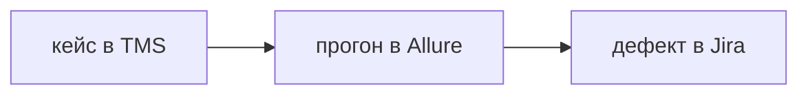

## Введение

В вакансиях рядом стоят Allure, Zephyr или другой TMS и Jira. Это не синонимы. На собесе их раскладывают по вопросу «что здесь хранится».

## Раздел: Три вопроса

TMS хранит кейс: шаги, данные, ожидаемый результат, связь с требованием. Кейс живёт между релизами.

Allure хранит прогон: какой сборкой, какой кейс прошёл, упал, сколько длился, вложение с трассировкой. Завтрашний прогон — новая запись, не правка вчерашней.

Jira хранит дефект и часто задачу. У дефекта есть серьёзность для продукта и приоритет для очереди. Это разные поля. Баг ссылается на прогон и на кейс, но не заменяет их.

Дубль бага ищут до заведения. Закрытие бага без проверки на сборке, где его чинили, оставляет дыру.

## Раздел: Ответ вслух

Кейс лежит в TMS, результат прогона — в Allure, дефект — в Jira. В баге есть шаги, ожидание, факт, сборка и серьёзность. Приоритет ставит очередь, не мой испуг. Повторно открываю баг, если на исправленной сборке симптом жив, а не правлю старый текст до неузнаваемости.

## Раздел: Плохой ответ

Плохой ответ: «все кейсы ведём комментариями в Jira». Через месяц нельзя ответить, какой набор гоняли на релизе.

## Раздел: Термины

Система управления тестированием — TMS. Отчёт прогона — report. Дефект — defect. Серьёзность — severity. Приоритет — priority.

## Лаба

**20 минут.** Один упавший шаг разложите на три записи: пункт кейса, строка отчёта Allure, поля бага. Серьёзность и приоритет заполните разными значениями и объясните разницу одной фразой.

## Схема: Три учёта

## Тест

### Где живёт шаг, который гоняют каждый релиз?

**Ответ:** в TMS

**Пояснение:** Прогон лишь ссылается на шаг и пишет результат.

### Что добавит Allure к зелёному CI?

**Ответ:** историю шагов и вложения

**Пояснение:** Зелёный статус не показывает, какой сценарий шёл.

### Серьёзность высокая, приоритет низкий. Так бывает?

**Ответ:** да, если чинить не в этом спринте

**Пояснение:** Вред для пользователя и место в очереди не одно поле.

### Баг без сборки. Чего не хватает?

**Ответ:** где симптом воспроизвели

**Пояснение:** Исправление проверяют на названной сборке, не «где-нибудь».

### Зачем искать дубль перед созданием?

**Ответ:** не плодить одну причину

**Пояснение:** Два тикета на один дефект расходятся в статусах.

## Шпаргалка

<ul><li>Кейс, прогон, дефект</li><li>Severity не равно priority</li><li>Сборка указана</li><li>Дубль ищут сразу</li></ul>

## Anki

### Front: Что хранит TMS?

Back: Кейсы и их связь с требованиями.

### Front: Что хранит Allure?

Back: Результат конкретного прогона и вложения.

### Front: Что хранит Jira в контуре QA?

Back: Дефект и работу по нему, не библиотеку кейсов.

### Front: Severity и priority?

Back: Вред и место в очереди. Это разные шкалы.

### Front: Когда переоткрывать баг?

Back: Когда на сборке с фиксом симптом повторился.

### Front: Почему кейсы в комментариях Jira плохи?

Back: Нельзя собрать набор релиза и увидеть покрытие.

## Итоги

- Три системы отвечают на три вопроса
- Баг указывает сборку и факт
- Очередь и вред не склеивают в одно слово

## Ссылки

- [Баг-репорт](/game/learn/qa-bugs-reports)
- [План и кейсы](/game/learn/qa-docs-plan-cases)
