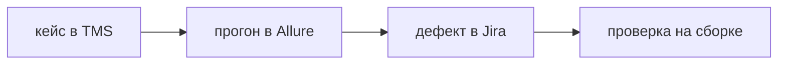

## Введение

В вакансиях тестировщика рядом стоят Allure, система управления тестированием вроде Zephyr, TestIT или Qase, и Jira. На собеседовании их легко склеить в «таск-трекер, куда мы всё пишем». Это три разных вопроса. Где живёт шаг, который гоняют каждый релиз. Где видно, чем закончился вчерашний прогон конкретной сборки. Где лежит дефект, который кто-то чинит. Если ответ на все три — «комментарий в эпике», через месяц нельзя сказать, какой набор шёл на релизе и какой баг ещё открыт.

Кейс переживает релизы. Прогон — снимок одного запуска. Дефект — работа по симптому. Смешение превращает отчёт в склад задач или задачи в плохонький отчёт. Ссылки между ними нужны, копии текста — нет. Этот выпуск раскладывает один упавший шаг на пункт кейса, строку Allure и поля бага, и отдельно держит серьёзность и приоритет.

## Раздел: Три вопроса

TMS хранит кейс: предусловие, шаги, данные, ожидаемый результат, связь с требованием или историей. Кейс — библиотека. Его правят, когда меняется ожидаемое поведение продукта, а не когда сегодня упал прогон. Прогон лишь ссылается на кейс и пишет результат. Если править шаги внутри отчёта вчерашнего запуска, завтрашний релиз не узнает о новом ожидаемом результате.

Allure хранит прогон: какая сборка, какой набор, какой кейс прошёл или упал, сколько длился, вложение с трассировкой, скрином, логом. Завтрашний прогон — новая запись. Править вчерашнюю, чтобы «стало зелёным», значит стереть историю. Зелёный статус CI без шагов не показывает, какой сценарий вообще шёл. Allure как раз добавляет историю шагов к факту «сборка собралась». Он не заменяет библиотеку кейсов: в отчёте неудобно жить требованиям, и он не обязан быть открыт через полгода как спецификация.

Jira хранит дефект и часто задачу на исправление. У дефекта есть шаги, ожидание, факт, сборка, окружение, серьёзность и приоритет. Серьёзность — вред для пользователя и данных: данные портятся, основной путь закрыт, косметика. Приоритет — место в очереди команды: чинить в этом спринте или нет. Высокий вред и низкий приоритет совместны: ломается редкий отчёт, который нужен через месяц, а сейчас горит другой инцидент. Одно поле на оба смысла заставляет спорить словами «это критикал» вместо двух шкал.

Баг ссылается на прогон и на кейс, но не заменяет их. В баге факт «на сборке 1.4.2 шаг 3 показал пустой список». В кейсе ожидание «список содержит созданную заметку». В отчёте вложение trace. Дубль ищут до создания. Два тикета на одну причину расходятся в статусах: один закрыли, второй остался, и релизный отчёт врёт.

Закрытие бага без проверки на сборке, где его чинили, оставляет дыру. Проверяют названную сборку, не «у меня локально вроде нет». Если симптом жив, баг переоткрывают. Если исправление сменило смысл, старый текст не переписывают до неузнаваемости: фиксируют проверку и при необходимости заводят следствие. История тикета должна читаться.

## Раздел: Разбор на примере

Упал шаг «после сохранения заметка видна в списке». В TMS это пункт кейса «создание заметки», ожидаемый результат назван заранее, кейс связан с историей. В Allure у прогона сборки `1.4.2` этот кейс красный, во вложении trace: запрос сохранения вернул 500. В Jira заводят дефект, если такого ещё нет: заголовок про 500 на сохранении, шаги короткие, факт, ожидание, сборка `1.4.2`, серьёзность высокая, потому что основной путь создания закрыт, приоритет высокий, потому что чинить надо до релиза. Если релиз уже выехал и путь редкий, приоритет могли бы снизить, не снижая серьёзности. Здесь оба высокие, и это нормально, когда шкалы совпали. Совпадение не делает их одним полем.

Поиск дубля: уже есть тикет «500 на POST /notes». Новый прогон не рождает второй тикет. В старый добавляют, что на `1.4.2` симптом повторился, и ссылку на свежий отчёт. Иначе разработчик чинит один, тестировщик ждёт другой.

После фикса проверяют сборку `1.4.3`, ту, что названа в тикете. Зелёный шаг в новом прогоне Allure — основание закрыть. Комментарий «проверил у себя» без сборки не основание. Если на `1.4.3` снова 500, тикет переоткрывают, не заводят «ещё один такой же» и не правят ожидание в кейсе так, будто 500 — новое нормальное поведение.

Отчёт релиза ссылается на набор кейсов и на прогон, не пересказывает все шаги в описании эпика. Эпик закроют, описание устареет. Прогон останется снимком.

## Раздел: Где это ломается

Все кейсы ведут комментариями в Jira. Нельзя собрать набор релиза, нельзя увидеть покрытие требования, нельзя отличить упавший шаг от идеи задачи. Через месяц это переписка, не библиотека.

Серьёзность и приоритет склеили. Любой заметный баг становится «блокер», очередь не сортируется. Или наоборот, косметике ставят низкий вред и ею забивают спринт, потому что приоритет выкрутили голосом.

Баг без сборки и без факта. «Не работает список». Воспроизвести нельзя, закрывают как «у меня работает», симптом возвращается. Минимум — сборка, шаг, факт, ожидание.

Закрыли по фиксу в ветке, не проверив сборку. В ветке починили, в сборку не попало, на проде симптом жив. Проверка привязана к артефакту.

Вчерашний отчёт Allure правят, чтобы презентация была зелёной. История запуска уничтожена. Новый прогон честнее слайда.

Нет поиска дубля. Пять тикетов на один 500, разработчик смотрит первый, остальные висят, метрика «открытых багов» шумит.

Кейс переписывают под фактический баг, вместо того чтобы завести дефект. Ожидание ползёт к сломанному поведению, регрессию больше не поймать.

## Раздел: Ответ вслух

Кейс лежит в TMS и переживает релизы. Результат конкретного прогона — в Allure, со сборкой и вложениями. Дефект — в Jira: шаги, ожидание, факт, сборка, серьёзность и отдельно приоритет. Дубль ищу до создания. После исправления проверяю названную сборку и переоткрываю баг, если симптом жив. Кейсы комментариями в эпике не веду: так нельзя ответить, какой набор гоняли. Вчерашний отчёт не перекрашиваю, запускаю новый прогон.

## Раздел: Плохой ответ

Плохой ответ: «все кейсы ведём комментариями в Jira». Через месяц нельзя собрать набор релиза. Второй плохой ответ: «приоритет и есть серьёзность, зачем два поля». Вред для пользователя и место в очереди решают разные люди и в разное время. Одно слово прячет спор.

## Раздел: Термины

Система управления тестированием — TMS. Отчёт прогона — report, у нас его носит Allure. Дефект — defect, баг. Серьёзность — severity, вред. Приоритет — priority, очередь. Сборка — build, артефакт, на котором видели симптом и на котором будут проверять фикс. Дубль — duplicate. Трассировка учёта — ссылка кейса, прогона и дефекта, не пересказ одного текста в трёх местах.

## Лаба

**Цель.** Разложить один упавший шаг на три записи и не склеить шкалы.

**Шаги.**

1. Возьмите шаг «заметка после сохранения видна в списке» и сборку `1.4.2`, на которой шаг упал с пустым списком и 500 в сети.
2. Опишите пункт кейса в TMS: ожидание, связь с историей. Не вписывайте туда сегодняшний 500 как норму.
3. Опишите строку прогона: сборка, красный результат, вложение trace.
4. Заполните баг: факт, ожидание, шаги, сборка. Серьёзность — высокая. Приоритет в первом варианте тоже высокий.
5. Вторым абзацем смените только приоритет на низкий и объясните ситуацию, где это честно: редкий отчёт, вред тот же, очередь занята инцидентом. Серьёзность не снижайте.
6. Опишите проверку фикса: какая сборка, что будет, если симптом жив.

**Готово, если…**

- [ ] Кейс, прогон и дефект описаны отдельно
- [ ] В баге есть сборка
- [ ] Severity и priority хотя бы в одном варианте различаются
- [ ] Дубль не предлагается заводить повторно
- [ ] Закрытие привязано к проверке на сборке

## Схема: Три учёта

## Тест

### Где живёт шаг, который гоняют каждый релиз?

**Ответ:** в TMS

**Пояснение:** Прогон лишь ссылается на шаг и пишет результат.

### Что добавит Allure к зелёному CI?

**Ответ:** историю шагов и вложения

**Пояснение:** Зелёный статус не показывает, какой сценарий шёл.

### Серьёзность высокая, приоритет низкий. Так бывает?

**Ответ:** да, если чинить не в этом спринте

**Пояснение:** Вред для пользователя и место в очереди не одно поле.

### Баг без сборки. Чего не хватает?

**Ответ:** где симптом воспроизвели

**Пояснение:** Исправление проверяют на названной сборке, не «где-нибудь».

### Зачем искать дубль перед созданием?

**Ответ:** не плодить одну причину

**Пояснение:** Два тикета на один дефект расходятся в статусах.

## Шпаргалка

<ul><li>Кейс, прогон, дефект</li><li>Severity не равно priority</li><li>Сборка указана</li><li>Дубль ищут сразу</li><li>Вчерашний отчёт не перекрашивают</li></ul>

## Anki

### Front: Что хранит TMS?

Back: Кейсы и их связь с требованиями.

### Front: Что хранит Allure?

Back: Результат конкретного прогона и вложения.

### Front: Что хранит Jira в контуре QA?

Back: Дефект и работу по нему, не библиотеку кейсов.

### Front: Severity и priority?

Back: Вред и место в очереди. Это разные шкалы.

### Front: Когда переоткрывать баг?

Back: Когда на сборке с фиксом симптом повторился.

### Front: Почему кейсы в комментариях Jira плохи?

Back: Нельзя собрать набор релиза и увидеть покрытие.

## Мнемоника

### acronym: Баг-репорт

**Задание:** Пять полей, без которых тикет возвращают.

**Элементы:**
- Шаги
- Факт
- Ожидание
- Окружение
- Серьёзность

**Подсказка:** Серьёзность — про влияние, не про громкость.

**Ответ:** steps, actual, expected, env, severity

## Итоги

- Три системы отвечают на три вопроса
- Баг указывает сборку, факт и ожидание
- Очередь и вред не склеивают в одно слово
- Проверяют ту сборку, которую чинили
- История прогона неприкосновенна: новый запуск вместо правки старого

## Ссылки

- [Баг-репорт](/game/learn/qa-test-design)
- [План и кейсы](/game/learn/qa-docs-plan-cases)
