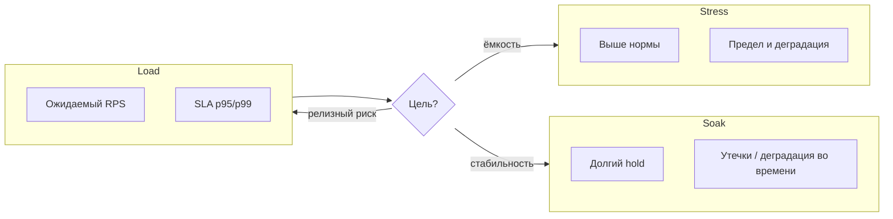
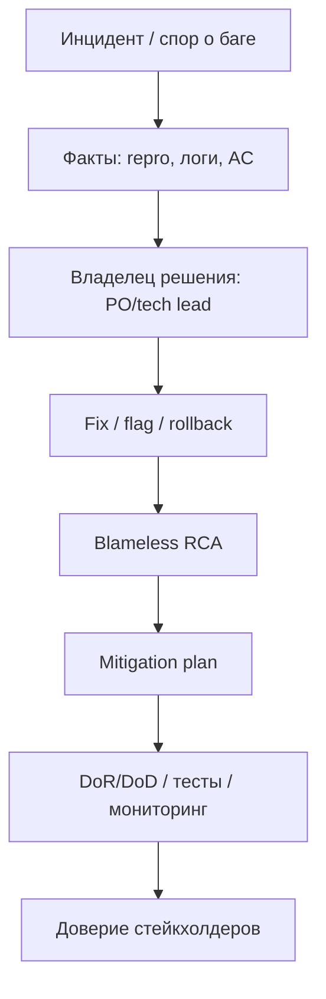

## Введение

S26, S28–29: senior-уровень безопасности и перформанса. Не «слышали про XSS», а как защищаться и как доказывать устойчивость под нагрузкой и на сокетах — руками и в автоматизации.

Термины и определения согласованы с **ISTQB CTFL v4** и [глоссарием ISTQB](https://glossary.istqb.org/); номера J/M/S — опциональный индекс типовых вопросов собеса.

**Лидерство QA: конфликты,.** M85–87, S6, S8, S31–33: на senior собесе проверяют зрелость коммуникации. Баг «не баг», релизы без QA, выгоревшая команда без документов — нужны рабочие протоколы, а не лозунги «качество важно».

Термины и определения согласованы с **ISTQB CTFL v4** и [глоссарием ISTQB](https://glossary.istqb.org/); номера J/M/S — опциональный индекс типовых вопросов собеса.

## Раздел: Как отвечать одним блоком

Этот выпуск собрал соседние короткие темы трека: «Senior security и», «Лидерство QA: конфликты,». Раньше каждая занимала отдельную карточку на несколько минут, а на собеседовании их спрашивают одним блоком. Ниже у каждой темы свой раздел, затем общие лабы, один тест и одна колода карточек. В ответе сначала назовите, какую тему спросили, потом определение и один пример. Не проговаривайте все разделы, если спросили один. Лабы можно пройти по порядку исходного трека. Если времени мало, сделайте первую и последнюю: первая ставит язык, последняя проверяет, что соседние темы вы не перепутали.

## Раздел: Senior security и: OWASP Top и линии защиты

Ориентир — актуальный [OWASP Top 10](https://owasp.org/www-project-top-ten/). Ниже — рабочие формулировки «риск → как ловим → как закрывают».

| Риск (обобщённо) | Как тестировать | Защита / контроль |
|------------------|-----------------|-------------------|
| Injection (SQLi, cmd) | спецсимволы, OR 1=1, параметризация в коде | prepared statements, ORM, валидация, least privilege БД |
| Broken auth | credential stuffing, session fixation, слабый reset | MFA, lockout, secure cookies, short-lived tokens |
| Broken access (IDOR) | смена id/ролей, горизонтальный доступ | authZ на объект, ACL, тесты матрицы ролей |
| XSS | script в полях, DOM sinks | encoding, CSP, HttpOnly где уместно |
| CSRF | поддельный запрос со сторонней формы | SameSite, CSRF-token, не менять state через GET |
| Security misconfig | default creds, open S3, stack traces | hardening, секреты вне образа, security headers |
| Vulnerable components | SCA (Dependabot, Trivy) | патч-процесс, SBOM |
| Integrity / CI supply chain | подмена артефакта | подписи, pinned deps, protected branches |
| Logging & monitoring gaps | атака без следа | аудит authZ fail, алерты |
| SSRF | URL на metadata/internal | allowlist, block link-local |

**Практика senior QA:** threat model на фичу; негативные наборы в API-сьютах; периодические сканы (DAST) на стейдже; bug bounty / pen-test не заменяют встроенные проверки. Никогда не гоняйте деструктивные сканы на прод без явного разрешения.

**Минимальный security-чеклист релиза:** нет секретов в клиенте; HTTPS везде; cookies флаги; IDOR-кейсы на критических сущностях; зависимость без известных Critical; логин/bruteforce политика.

## Раздел: Senior security и: Сокеты и stress: когда, чем, как проектировать

**Сокеты (WebSocket / TCP raw) — ручное тестирование.**

- Установка соединения, handshake, заголовки auth.
- Подписка/комнаты: видит ли чужие события.
- Heartbeat / ping-pong, idle timeout.
- Обрыв сети, reconnect, дубликаты сообщений.
- Порядок и потеря пакетов (симулировать throttle в прокси).
- Нагрузка числом соединений с одного клиента.
- Закрытие: коды close, утечки на сервере (дескрипторы).

Инструменты руками: браузер DevTools, `wscat`, Postman WS, mitmproxy.

**Автоматизация сокетов.** Клиенты на Python (`websockets`, `socket`), k6 `ws`, Gatling. В pytest: фикстура соединения, assert на JSON-события, таймауты, негатив «без токена». Для TCP-протоколов — свои фреймы; фиксируйте байтовый контракт в фикстурах. Флаки лечат идемпотентными id сообщений и ожиданием по event, не по sleep.

```python
import asyncio
import json
import websockets

async def test_ws_echo_auth(token: str, url: str) -> None:
    headers = {"Authorization": f"Bearer {token}"}
    async with websockets.connect(url, additional_headers=headers) as ws:
        await ws.send(json.dumps({"type": "ping"}))
        raw = await asyncio.wait_for(ws.recv(), timeout=5)
        payload = json.loads(raw)
        assert payload.get("type") == "pong"
```

**Когда нужен stress.** Узнать предел и характер деградации (латентность, ошибки, recovery), проверить автоскейл/circuit breaker, подготовиться к пику (релиз, маркетинг). Не путать со load (ожидаемая нагрузка) и soak (длительная утечка). Stress — контролируемый выход за норму на *тестовом* контуре с мониторингом и stop-условием.

**Выбор инструмента.**

| Инструмент | Сильные стороны |
|------------|-----------------|
| k6 | скрипты JS, CI-friendly, WS |
| JMeter | GUI, много протоколов, плагины |
| Gatling | код, высокая производительность |
| Locust | Python, гибкая логика пользователей |
| облака | масштаб агентов без своего железа |

Критерии: протокол (HTTP/gRPC/WS), язык команды, отчёты, стоимость агентов.

**Дизайн stress-сценария.**

1. Цель и гипотеза («при 5× RPS p99 < 2с или включается degrade mode»).
2. Критические user journeys с весами.

3. Модель: ramp → hold → spike → cool-down.
4. Данные: прогретые кэши vs cold start — оба прогона.
5. Наблюдаемость: RPS, error %, latency, CPU/RAM, DB locks, queue depth.
6. Abort criteria (error storm, диск full).
7. Отчёт: узкое место и рекомендация, не только график.

## Раздел: Senior security и: Частые вопросы с собеседования

**Вопрос.** Чем уровень тестирования отличается от типа (вида) тестирования?

**Ответ.** Уровень отвечает на «где режем систему»: модуль, стык, продукт целиком, приёмка. Тип — «с какой целью гоняем»: smoke, regression, exploratory, security и т.д. На собесе покажите пример: один checkout можно проверить на integration (API+БД) и оформить прогон как regression после фикса — оси независимы.

**Вопрос.** Когда на собеседовании уместен smoke, а когда полный regression?

**Ответ.** Smoke — узкий «жив ли билд»: логин, критичный платёж, главная. Падает smoke — глубже не идём. Regression — шире: уже работавшее после изменений. Sanity — точечно после маленького патча. Ошибка junior: называть любой повторный прогон regression.

**Вопрос.** Зачем на собесе спрашивают equivalence partitioning и граничные значения?

**Ответ.** EP сжимает бесконечные входы в классы «ведут себя одинаково»; BVA бьёт по стыкам классов — там чаще ломается сравнение и валидация. Для поля 18–99 достаточно классов «ниже», «внутри», «выше» и точек 17–18–19, 98–99–100; не нужно 82 случайных числа.

**Вопрос.** Severity и priority в баг-репорте — одно и то же?

**Ответ.** Нет. Severity — ущерб для продукта и пользователя (crash vs опечатка). Priority — когда чинить в очереди команды. Критичный по severity баг может ждать, если воспроизводится только на стенде без пользователей; наоборот, мелкий UI-bug в checkout может быть P1 перед релизом.

**Вопрос.** Что имеют в виду под «пирамидой тестирования» на собеседовании?

**Ответ.** Много быстрых дешёвых проверок внизу (unit, контракт API), меньше медленных UI/e2e наверху. Цель — быстрая обратная связь в CI, а не «всё через Selenium». Пирамида не запрет на e2e: сквозные сценарии оставляют на критичные деньги-потоки.

## Раздел: Лидерство QA: конфликты,: Конфликты, дедлайны и поздний вход

**Конфликт с разработчиком о баге.** Разделяйте факты и интерпретации. Протокол:

1. Воспроизведение, окружение, ожидаемое vs фактическое, логи/скрины.
2. Ссылка на требование/AC/контракт или явную дыру в спецификации.
3. Severity/priority по договорённой шкале, не по эмоциям.
4. Если спор о «так задумано» — эскалация к PO/аналитику с вариантами риска.
5. Тон: «давайте снимем неопределённость», не «вы сломали».

Антипаттерн: война в треде на 40 комментариев. Паттерн: короткий sync + решение владельца продукта.

**Deadline crunch.** Честно сужайте scope тестирования по риску: must-have smoke и деньги/безопасность; остальное — explicit skip с подписью PO. Усильте парное тестирование, feature flags, canary. Не обещайте «успеем всё» — предложите меню: дата / объём / риск. Документируйте принятый residual risk.

**Позднее вовлечение QA.** Симптом: «вот билд, завтра релиз». Ответ senior:

- Немедленно: exploratory критического пути + чеклист рисков.
- Фиксация: без тестability и времени — качество не гарантируем (письменно).
- Системно: DoR включает QA на refinement; DoD — проверки; метрика escaped defects как аргумент.
- Параллельно: шаблоны smoke, контрактные тесты, чтобы следующий раз не начинать с нуля.

Цель — встроить качество в поток, а не стать героем ночного прогона.

## Раздел: Лидерство QA: конфликты,: RCA, mitigation, продажа тестирования, legacy без документов

**RCA (root cause analysis).** После инцидента: что случилось → timeline → contributing factors (не только «человеческий фактор») → root cause(s) → corrective + preventive actions → владельцы и сроки → проверка эффективности. Инструменты: 5 Whys, fishbone, fault tree — выбирайте по сложности. Важно: blameless culture; иначе правду скроют.

**Mitigation plan.** Набор действий, снижающих вероятность/удар: hotfix, rollback, feature flag off, мониторинг, доп. тесты, процессные изменения (чек-листы релиза, парное ревью schema). План = конкретные задачи с датами, не «будем внимательнее».

**Как «продать» тестирование клиенту/заказчику.** Говорите на языке бизнеса: стоимость простоя, штрафы, репутация, скорость безопасных релизов, прозрачный риск. Покажите до/после (escaped defects, время отката). Предложите MVP качества: smoke + мониторинг + критический регресс за понятную цену. Избегайте страшилок без цифр и «нам нужны ещё 10 QA».

**Год проекту, нет документов, команда выгорела.**

1. Признать долг: не обвинять, а инвентаризировать.
2. Быстрая карта системы (C4 L1/L2), критические потоки, владельцы.
3. Собрать «живой» smoke и runbook инцидентов — ценность за неделю.
4. Выборочная документация только hot paths; остальное — по мере изменения.
5. Снизить WIP и героизм: устойчивый ритм, парные сессии знаний.
6. Малые победы и публичное признание — против выгорания.
7. Автоматизировать самый болезненный ручной регресс точечно.
8. Договорённость со стейкхолдерами: качество улучшаем итерациями, не big bang docs.

## Раздел: Лидерство QA: конфликты,: Частые вопросы с собеседования

**Вопрос.** Чем уровень тестирования отличается от типа (вида) тестирования?

**Ответ.** Уровень отвечает на «где режем систему»: модуль, стык, продукт целиком, приёмка. Тип — «с какой целью гоняем»: smoke, regression, exploratory, security и т.д. На собесе покажите пример: один checkout можно проверить на integration (API+БД) и оформить прогон как regression после фикса — оси независимы.

**Вопрос.** Зачем на собесе спрашивают equivalence partitioning и граничные значения?

**Ответ.** EP сжимает бесконечные входы в классы «ведут себя одинаково»; BVA бьёт по стыкам классов — там чаще ломается сравнение и валидация. Для поля 18–99 достаточно классов «ниже», «внутри», «выше» и точек 17–18–19, 98–99–100; не нужно 82 случайных числа.

**Вопрос.** Что имеют в виду под «пирамидой тестирования» на собеседовании?

**Ответ.** Много быстрых дешёвых проверок внизу (unit, контракт API), меньше медленных UI/e2e наверху. Цель — быстрая обратная связь в CI, а не «всё через Selenium». Пирамида не запрет на e2e: сквозные сценарии оставляют на критичные деньги-потоки.

**Вопрос.** Почему flaky e2e — отдельная тема на middle/senior QA?

**Ответ.** Flaky — тест то зелёный, то красный без изменения кода: тайминги, данные, сеть, параллельность. Команда перестаёт верить CI. Лечат изоляцией данных, явными ожиданиями, стабильными селекторами, отсечением внешних сервисов; иногда понижают уровень — проверяют API вместо хрупкого UI.

## Лаба

**Senior security и.**

**Цель.** Security+perf пакет для API чата с WebSocket.

**Шаги.**
1. Threat model: 5 активов, 5 угроз, 5 тестов.
2. Набор из 8 негативных HTTP-кейсов по OWASP (IDOR, XSS в профиле, SQLi в search…).
3. Ручной протокол проверки WS: connect → auth fail → auth ok → message → kill network → reconnect.
4. Черновик k6/Locust: ramp 0→N, hold 10 мин, spike 2× на 2 мин.
5. Abort criteria и список метрик дашборда.
6. Короткий отчёт-шаблон: hypothesis / result / bottleneck / next step.

```python
# Модель ramp → hold → spike (условные RPS по секундам)
def ramp_profile(duration_s: int, target_rps: int) -> list[int]:
    return [int(target_rps * (i + 1) / duration_s) for i in range(duration_s)]

ramp = ramp_profile(10, 50)
hold = [50] * 10
spike = [100] * 5
cool = list(reversed(ramp_profile(5, 50)))
profile = ramp + hold + spike + cool
print("points:", len(profile), "peak:", max(profile), "avg:", sum(profile) // len(profile))

xss_probes = ["<script>alert(1)</script>", '">', "{{7*7}}"]
for probe in xss_probes:
    print("xss probe len:", len(probe), "sample:", probe[:24])
```

**В группу:** заказчик просит «stress на прод ночью» — ваш ответ и альтернатива?

**Готово, если…**
- [ ] OWASP риски связаны с конкретными тестами и защитами
- [ ] WS покрыты ручным чеклистом и ideей авто
- [ ] Stress-план с гипотезой и abort, не «жмём до падения»

**Лидерство QA: конфликты,.**

**Цель.** Разобрать учебный инцидент «оплата прошла дважды» как lead QA.

**Шаги.**
1. Напишите баг-репорт и «скрипт» 3-минутного разговора с dev, который говорит «не баг».
2. Для релиза завтра составьте risk-based scope: in / out / accepted risk (таблица).
3. Timeline RCA на одну страницу + 3 preventive actions.
4. Mitigation plan на 14 дней с владельцами.
5. Письмо заказчику (10–12 предложений): зачем платить за тест-анализ в следующем квартале.
6. 30-дневный план спасения legacy-команды без документов (недельные вехи).

```python
# Risk-based scope под дедлайн: in / out / accepted
items = [
    ("pay_happy_path", "in", 5),
    ("pay_idempotency", "in", 5),
    ("admin_reports_ui", "out", 2),
    ("dark_theme", "accepted", 1),
]
for name, bucket, severity in sorted(items, key=lambda row: -row[2]):
    print(f"[{bucket:8}] Sev{severity} {name}")

timeline = ["detect", "contain", "fix", "rca", "prevent"]
for step, label in enumerate(timeline, start=1):
    print(f"RCA step {step}: {label}")
```

**В группу:** PO давит «подпишите, что протестировано» при срезанном scope — что делаете?

**Готово, если…**
- [ ] Конфликт переведён в факты и владельца решения
- [ ] RCA без blame, с preventive actions
- [ ] Есть язык ценности для заказчика

## Схема: Senior security и: Load vs stress vs soak



## Схема: Лидерство QA: конфликты,: От инцидента к улучшению



## Тест

### Чем broken authentication отличается от broken access control?

**Ответ:** auth — дыры в проверке личности/сессии; access control — дыры в правах на объекты после входа

**Пояснение:** украсть сессию и открыть чужой `/orders/{id}` — разные классы; оба в OWASP, разные тесты.

### Как вести спор «баг / не баг» со senior-разработчиком?

**Ответ:** через воспроизведение, ожидаемое по AC/контракту и эскалацию неопределённости к PO, без перехода на личности

**Пояснение:** цель — снять риск для пользователя; решение о приоритете продукта принадлежит владельцу продукта.

### Когда оправдан stress, а не обычный load?

**Ответ:** когда нужно понять предел системы и поведение за пределами SLA, а не подтвердить целевую нагрузку

**Пояснение:** load проверяет норму; stress исследует край и recovery на безопасном контуре.

### Что должно быть в mitigation plan после инцидента?

**Ответ:** конкретные действия с владельцами и сроками, снижающие вероятность повтора и удар при повторе

**Пояснение:** фразы «улучшим процесс» без задач не являются планом.

### Что обязательно в автотесте WebSocket кроме happy-path?

**Ответ:** отказ в auth, таймауты, корректный close/reconnect и проверка, что нет утечки чужих событий

**Пояснение:** сокеты живут долго — ошибки состояния и авторизации комнат критичнее одноразового echo.

## Шпаргалка

<ul><li>Injection → параметризация; IDOR → object-level authZ</li><li>XSS → encode + CSP; CSRF → SameSite + token</li><li>Misconfig / deps → hardening + SCA</li><li>Auth handshake, rooms, heartbeat, reconnect</li><li>Авто: assert по событиям, не sleep</li><li>Факты → AC → severity → PO</li><li>Scope / дата / риск — меню, не героизм</li><li>Blameless timeline → root cause → corrective + preventive</li><li>Mitigation = задачи с датами</li></ul>

## Anki

### Front: Назовите 4 пункта защиты от XSS

Back: output encoding, CSP, валидация ввода, отказ от опасного innerHTML/eval

### Front: Что сказать вместо «успеем протестировать всё»?

Back: предложить варианты scope с явным residual risk и решением PO

### Front: Abort criteria в stress — зачем?

Back: остановить прогон до разрушения стенда и сохранить интерпретируемые данные

### Front: Blameless RCA — зачем?

Back: чтобы люди говорили правду о системных причинах, а не защищали себя

### Front: SSRF — что проверяет QA?

Back: что сервер не ходит по произвольным URL на internal/metadata по вводу пользователя

### Front: Первый шаг на проекте без документов?

Back: карта критических потоков и рабочий smoke, а не год писать wiki

## Мнемоника

### peg: Две соседние проверки

**Задание:** Что спрашивают у senior QA рядом.

**Элементы:**
- угроза
- нагрузка
- отчёт для решения

**Подсказка:** Нагрузка без порога — не тест, а график.

**Ответ:** 1 threat · 2 load · 3 decision

## Итоги

- OWASP Top — карта рисков с тестами и контролями, не заучивание названий
- Сокеты требуют сценариев состояния, auth и восстановления сети
- Stress проектируют вокруг гипотезы, метрик и abort criteria
- Senior связывает security и perf с мониторингом и безопасным контуром
- Конфликты закрывают фактами и владельцем продукта, не давлением
- Дедлайн — честный trade-off scope/риска
- RCA и mitigation превращают инцидент в системное улучшение
- Ценность QA объясняется языком бизнеса; legacy лечат маленькими победами

## Ссылки

- [ISTQB Glossary](https://glossary.istqb.org/)
- [CTFL v4 — Certified Tester Foundation Level](https://istqb.org/certifications/certified-tester-foundation-level-ctfl-v4-0/)
- [OWASP Top 10](https://owasp.org/www-project-top-ten/)
- [QA-interview-250](https://github.com/Konstantine23/QA-interview-250)
- [Learn](/game/learn)
- [Senior practice drill](/game/learn/qa-senior-practice-drill)
