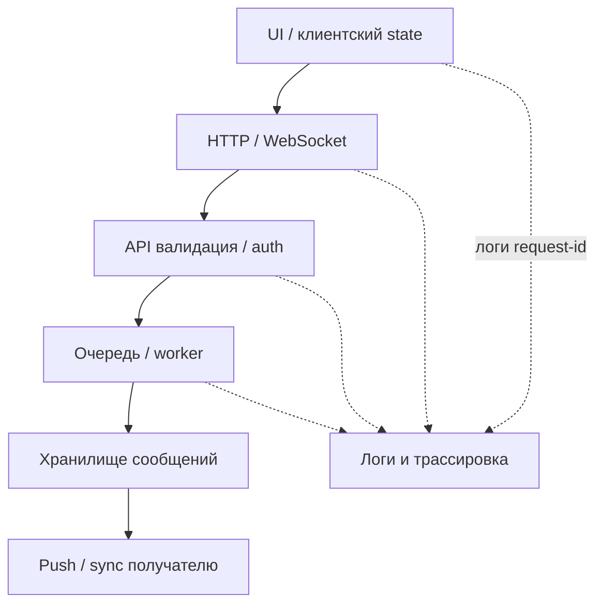
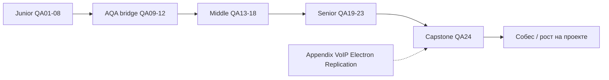

## Введение

S30, S34–38, M88–90, M98–100, M102–103: собес любит «разберите ситуацию». Ниже — оригинальные разборы с порядком действий, которые звучат как опыт lead/senior, а не список теорий.

Термины и определения согласованы с **ISTQB CTFL v4** и [глоссарием ISTQB](https://glossary.istqb.org/); номера J/M/S — опциональный индекс типовых вопросов собеса.

**Capstone QA: чеклист.** Финальный выпуск серии: собрать траекторию Junior → Middle → Senior (+AQA), понять как пользоваться материалами 9to18 Learn и закрыть appendix-темы вне основной цепочки. Это навигатор и честный self-check перед собесом, а не новый учебник с нуля.

Термины и определения согласованы с **ISTQB CTFL v4** и [глоссарием ISTQB](https://glossary.istqb.org/); номера J/M/S — опциональный индекс типовых вопросов собеса.

## Раздел: Как отвечать одним блоком

Этот выпуск собрал соседние короткие темы трека: «Senior practice drill: баги,», «Capstone QA: чеклист». Раньше каждая занимала отдельную карточку на несколько минут, а на собеседовании их спрашивают одним блоком. Ниже у каждой темы свой раздел, затем общие лабы, один тест и одна колода карточек. В ответе сначала назовите, какую тему спросили, потом определение и один пример. Не проговаривайте все разделы, если спросили один. Лабы можно пройти по порядку исходного трека. Если времени мало, сделайте первую и последнюю: первая ставит язык, последняя проверяет, что соседние темы вы не перепутали.

## Раздел: Senior practice drill: баги,: Ответ вслух

Я беру баг и отделяю факт от оценки: шаги, ожидание, что увидели. Потом риск релиза: кого заденет и есть ли обход. Стратегию не читаю с листа, привязываю к этому примеру.

## Раздел: Senior practice drill: баги,: Плохой ответ

«Надо больше тестировать». Нет уровня, нет риска, нет того, что вы предложили не тестировать.

## Раздел: Senior practice drill: баги,: Термины

Риск — risk. Обход — workaround. Ожидание — expected result.

## Раздел: Senior practice drill: баги,: Негативы API, отладка логики, HTTP-ловушки

**Негативный POST создания пользователя.** Проверяйте системно, не одним «пустым телом»:

- обязательные поля отсутствуют / `null` / `""`
- типы: строка вместо числа, слишком длинный email
- дубликат уникального поля → 409/400 по контракту
- XSS/SQL в имени (если политика безопасности)
- без токена → 401; с ролью без права → 403
- лишние поля (mass assignment: `role=admin`)
- unicode, пробелы, email в разном регистре
- идемпотентность: повтор того же запроса
- Content-Type неверный; огромный payload
- ожидание: стабильный код + схема ошибки, без стека и утечки PII

**Отладка «1+1=3».** Симптом: расчёт/сумма неверны. Порядок:

1. Зафиксировать вход, окружение, точный actual.
2. Воспроизвести минимальным кейсом; отделить UI от API от БД.
3. Проверить округление, типы (float vs decimal), таймзоны, валюты.
4. Гонки: два параллельных обновления баланса.
5. Кэш / read replica lag.
6. Неверный JOIN или двойной подсчёт в отчёте.
7. Логи и трейс одного `request-id`.
8. Гипотеза → эксперимент → фикс/баг с доказательствами.

На собесе важно показать *метод*, а не угадать «виноват float».

**Архитектурные HTTP-вопросы.**

- **Auth на GET?** Да, если ресурс не публичный: токен/cookie нужны и для чтения. «GET безопасный» ≠ «GET публичный».
- **401 vs 500.** 401 — клиент не аутентифицирован (или токен протух). 500 — сервер упал; для клиента это не «попробуй залогиниться», а инцидент. Путать их — ломать клиентов и мониторинг.
- **SSL/TLS.** Шифрование канала; проверяйте сертификат, смешанный контент, редирект HTTP→HTTPS, HSTS на проде. QA: expired cert на стейдже ломает автотесты — это тоже сигнал процесса.

## Раздел: Senior practice drill: баги,: Без бэкенда, мёртвый логин, регресс за 2 дня, мессенджер, кроссбраузер

**Проверка формы и БД без доступа к бэкенд-коду.** Есть UI и БД (или только API+БД): создать запись через UI → SELECT по уникальному ключу; проверить тримминг, кодировку, default-значения, мягкое удаление; негатив UI и отсутствие строки; транзакционность (обрыв сети посередине). Контракт поля: маска телефона на UI vs как лежит в БД.

**Кнопка «Войти» ничего не делает.** Чеклист:

1. Консоль браузера: JS exceptions.
2. Network: уходит ли запрос; CORS; 4xx/5xx.
3. Disabled из-за валидации (пустые поля, невидимая ошибка).
4. Перекрытие элемента (z-index, cookie-banner).
5. Неверный type кнопки / preventDefault.
6. Adblock / privacy extension.
7. Staging feature flag / wrong environment.
8. Воспроизведение в чистом профиле.

**Регресс 1000 кейсов за 2 дня.** Невозможно качественно вручную. Стратегия:

- риск-сегментация: money, auth, core journeys first;
- автоматический smoke/API уже в CI — опереться на него;
- выкинуть устаревшие и дубли;
- исследовательские сессии по зонам изменений (diff/релиз-ноты);
- парный прогон критичного;
- явный out-of-scope с подписью PO;
- после релиза — мониторинг и hotfix-окно.

**Мессенджер: сообщение не отправилось.** Слои: UI optimistic update → API/WS → очередь → доставка → статус «доставлено». Проверки: сеть, токен, размер вложения, rate limit, состояние сокета, серверные логи по message id, поведение при офлайне, дубликаты при retry. Сравнить отправителя и получателя (fan-out).

**Кроссбраузер при нехватке времени.** Матрица по аналитике: топ браузеров/ОС клиентов. Обязательно: последний Chrome + Safari iOS (часто болевой) + один Firefox/Edge. Остальное — на критических визуальных страницах или canary. Используйте Playwright multi-project точечно; не обещайте «все версии IE».

## Раздел: Senior practice drill: баги,: Частые вопросы с собеседования

**Вопрос.** Как приоритизировать дефекты перед релизом?
**Ответ.** Сначала блокеры критичного пути и безопасность, затем высокий ущерб при высокой вероятности. Severity — вред, priority — когда чинить.

**Вопрос.** Что такое flaky-тест?
**Ответ.** Тест, который то красный, то зелёный без смены кода. Его стабилизируют или убирают из блокирующего контура, а не игнорируют.

**Вопрос.** Чем exploratory отличается от случайных кликов?
**Ответ.** У сессии есть чартер, время и заметки. Это опытная техника, а не отсутствие дизайна.

## Раздел: Capstone QA: чеклист: Ответ вслух

Я могу назвать уровень теста, одну технику дизайна и что не войдёт в прогон за час до релиза. Smoke критичного пути честнее, чем обещание полного регресса, который не успеть.

## Раздел: Capstone QA: чеклист: Плохой ответ

Прочитать оглавление QA01–QA24. Вопрос будет про выбор на этом релизе.

## Раздел: Capstone QA: чеклист: Термины

Дымовая проверка — smoke. Регресс — regression. Критичный путь — critical path.

## Раздел: Capstone QA: чеклист: Чеклисты уровней и как читать серию

**Как пользоваться серией.**

1. Идите по `order` 401→424 или по пробелам в своём опыте (карта в таблице ниже).
2. Каждый выпуск: теория → лаба → тест → Anki; не пропускайте лабу — на собесе звучит практика.
3. Опирайтесь на термины **ISTQB CTFL v4** и [глоссарий](https://glossary.istqb.org/); опционально — [QA-interview-250](https://github.com/Konstantine23/QA-interview-250) как индекс формулировок вопросов.
4. После Middle (QA18) обязательно пройдите strategy/ROI/security (QA19–21) до drill (QA23).
5. Повторяйте Anki и свой конспект багов/метрик с работы — сильнее любой зубрёжки.

**Чеклист Junior (ориентир QA01–QA08 + мост QA09–QA12).**

- [ ] Объясняет тестирование, STLC, entry/exit без воды
- [ ] Типы/уровни, smoke/sanity, позитив/негатив
- [ ] Эквивалентность, границы, простой bug report
- [ ] Тест-кейс, чеклист, базовый план
- [ ] HTTP/REST руками (DevTools, статус-коды)
- [ ] SQL: SELECT/JOIN/агрегаты на учебном уровне
- [ ] Понимает зачем автоматизация; пишет простые pytest
- [ ] Selenium/Playwright: найти элемент, assert, ожидания
- [ ] Git: branch, commit, PR; читает пайплайн
- [ ] Mobile: отличия, эмулятор vs девайс, базовый чеклист

**Чеклист Middle (QA13–QA18).**

- [ ] Процесс: coverage, leakage, риски фичи
- [ ] Продвинутый дизайн: decision table, pairwise, RBT
- [ ] API: контракты, моки, зачатки load
- [ ] Agile: Scrum/Kanban, DoD, препятствия QA
- [ ] Инфра: Docker, SSH, логи, IaaS/PaaS на уровне разговора
- [ ] AuthN/AuthZ, OWASP intro, WebSocket, SQL mid, mobile middle
- [ ] Самостоятельно ведёт тест-анализ фичи end-to-end

**Чеклист Senior + AQA (QA19–QA23 и углубление QA09–QA11).**

- [ ] Стратегия, exit criteria, метрики без vanity
- [ ] Shift-left, ROI автоматизации, пирамида, CI/CD дисциплина
- [ ] Security/perf: OWASP с защитами, stress с гипотезой
- [ ] Лидерство: конфликты, RCA, стейкхолдеры, legacy
- [ ] Drill: отладка слоями, регресс под давлением
- [ ] Проектирует automation strategy и владение suites
- [ ] Говорит с бизнесом языком риска и денег

**AQA-акцент.** Язык команды (в серии — Python), устойчивые локаторы/API-first, отчёты, параллель, данные, борьба с flaky, вклад в DoD/CI — не «запись кликов».

## Раздел: Capstone QA: чеклист: Appendix и индекс выпусков

**Appendix (вне основной нумерации собеса, знать обзорно).**

**J104–108 · NIC / RTP / SIP (телефония/сеть).** NIC — сетевой интерфейс; для QA VoIP важны задержки, packet loss, jitter. RTP — транспорт медиапотока; SIP — сигнализация сессии (приглашение, ответить, завершить). Тест: регистрация, call setup/teardown, one-way audio, NAT, кодеки. На общем web-собесе достаточно «знать, что это сигнализация vs медиа» и куда смотреть логи.

**M40 · Electron.** Десктоп на Chromium + Node: по сути web UI с доступом к ОС. Риски: XSS → RCE через Node, автообновления, нативные диалоги, разные ОС. Тест: Playwright/Spectron-подобные подходы, установка/обновление, офлайн, права файловой системы.

**M69 · SQL replication.** Primary/replica: асинхронная репликация даёт lag — тест только что записанных данных чтением с replica может «не видеть» строку. Проверяйте read-your-writes, failover, consistency expectations продукта.

**Опциональный индекс вопросов:** [QA-interview-250](https://github.com/Konstantine23/QA-interview-250).

**Индекс серии QA Learn (обзор).**

| Ep | slug | Фокус |
|----|------|--------|
| QA01 | qa-intro-testing | Основы, STLC |
| QA02 | qa-intro-testing | Типы и уровни |
| QA03 | qa-test-design | Дизайн junior |
| QA04 | qa-test-design | Баги |
| QA05 | qa-docs-plan-cases | Документы |
| QA06 | qa-docs-plan-cases | HTTP/API |
| QA07 | qa-sql-db-basics | SQL |
| QA08 | qa-sql-db-basics | Практика junior |
| QA09 | qa-aqa-principles | AQA принципы |
| QA10 | qa-aqa-principles | Selenium |
| QA11 | qa-pytest-ci-git | pytest, CI, Git |
| QA12 | qa-pytest-ci-git | Mobile |
| QA13 | qa-middle-process | Процесс middle |
| QA14 | qa-middle-process | Дизайн middle |
| QA15 | qa-api-contract-perf | API/perf |
| QA16 | qa-api-contract-perf | Agile |
| QA17 | qa-infra-linux-containers | Инфра |
| QA18 | qa-infra-linux-containers | Web/mobile/SQL mid |
| QA19 | qa-strategy-metrics | Стратегия |
| QA20 | qa-strategy-metrics | Shift-left/ROI |
| QA21 | qa-security-perf-senior | Security/stress |
| QA22 | qa-security-perf-senior | Лидерство |
| QA23 | qa-senior-practice-drill | Drill |
| QA24 | qa-senior-practice-drill | Capstone |

## Раздел: Capstone QA: чеклист: Частые вопросы с собеседования

**Вопрос.** Чем smoke отличается от регресса?
**Ответ.** Smoke — узкий набор «сборка жива». Регресс проверяет, что изменения не сломали уже работавшее.

**Вопрос.** Какие техники тест-дизайна назвать первыми?
**Ответ.** Классы эквивалентности, границы, таблица решений и переходы состояний.

**Вопрос.** Зачем чеклист, если темы уже читали?
**Ответ.** Он показывает пробелы: термины, SQL, API и автоматизация должны звучать своими примерами.

## Лаба

**Senior practice drill: баги,.**

**Цель.** Пройти drill как на собесе: таймер и артефакты.

**Шаги.**
1. За 15 минут составьте чеклист негативного POST `/users` (≥12 пунктов) и ожидаемые коды.
2. Напишите план отладки «сумма заказа = 3 при товарах 1+1» из 8 шагов.
3. Таблица: ситуация → 401 или 500 (5 примеров).
4. Сценарий проверки регистрации при доступе только к UI и SQL.
5. Для «1000 кейсов / 2 дня» — one-pager для PO: in/out/risk.
6. Матрица кроссбраузера на 1 спринт при 8 часах бюджета.

```python
# Негативы POST /users → ожидаемый код
negatives = [
    ({}, 400),
    ({"email": "bad", "password": "x"}, 400),
    ({"email": "a@b.c", "password": "ok", "role": "admin"}, 400),  # mass assignment
    ({"email": "a@b.c", "password": "ok"}, 201),
]
for body, code in negatives:
    print(f"body={body!s:55} → {code}")

# 1+1=3: гипотезы слоёв
layers = ["UI state", "promo calc", "API total", "DB line items", "rounding"]
for idx, layer in enumerate(layers, start=1):
    print(f"{idx}. check {layer}")
```

**В группу:** автотесты зелёные, кнопка логина мёртвая у половины пользователей — какие дыры в пирамиде?

**Готово, если…**
- [ ] Негативы API системные, не случайные
- [ ] Отладка гипотезами, не гаданием
- [ ] Регресс под давлением — risk-based с residual risk

**Capstone QA: чеклист.**

**Цель.** Личный gap-analysis и план на 4 недели до собеса.

**Шаги.**
1. Пройдите три чеклиста выше, отметьте ❌/⚠️/✅.
2. Выберите 5 ❌ и привяжите к выпускам серии (slug).
3. Составьте расписание: 3 выпуска/неделя или 2 лабы + Anki.
4. Напишите 60-секундный pitch: «кто я как QA и чем усиливаю команду».
5. Разберите 1 appendix-тему (VoIP / Electron / replication) на полстраницы своими словами.
6. Соберите «папку доказательств»: 3 баг-репорта, 1 тест-анализ, 1 кусок автотеста (ссылки/файлы).

```python
# Gap-analysis → план на 4 недели
series = [
    ("QA01-08", "junior", "basics"),
    ("QA09-12", "aqa", "automation bridge"),
    ("QA13-18", "middle", "process+web+sql"),
    ("QA19-23", "senior", "strategy+leadership"),
    ("QA24", "capstone", "checklist+appendix"),
]
gaps = {"QA15": "api contract", "QA21": "owasp stress", "QA22": "rca"}
for ep, level, topic in series:
    mark = "⚠️" if any(g.startswith(ep[:4]) or g in ep for g in gaps) else "✅"
    print(f"{mark} {ep:8} {level:8} {topic}")

appendix = {"SIP": "signaling", "RTP": "media", "Electron": "Chromium+Node", "replica": "lag"}
for key, value in appendix.items():
    print(f"appendix {key}: {value}")
```

**В группу:** что важнее за месяц до собеса — закрыть все Junior-дыры или один сильный Senior-рассказ про инцидент?

**Готово, если…**
- [ ] Есть письменный gap-list и план
- [ ] Pitch звучит 60 секунд без шпаргалки
- [ ] Знаете, где в серии искать каждую слабую тему

## Схема: Senior practice drill: баги,: Слои отладки «не отправилось»



## Схема: Capstone QA: чеклист: Траектория серии



## Тест

### Почему GET защищённого ресурса всё равно требует auth?

**Ответ:** чтение чужих данных — тоже нарушение конфиденциальности; идемпотентность метода не означает публичность

**Пояснение:** authorization проверяется на любом методе, включая GET/HEAD.

### Чем smoke отличается от полного регресса перед релизом?

**Ответ:** smoke — минимум критичных путей

**Пояснение:** полный регресс шире; smoke решает «можно ли тестировать/выпускать дальше».

### Что делать с регрессом из 1000 кейсов за 2 дня?

**Ответ:** приоритизировать по риску и изменениям, опереться на авто-smoke, согласовать out-of-scope с PO

**Пояснение:** обещание «прогоним всё руками» создаёт ложную уверенность и выгорание.

### Что из appendix важно помнить про read replica?

**Ответ:** lag после записи

**Пояснение:** чтение сразу после write может не увидеть данные — тест-дизайн и consistency.

### С чего начать, если кнопка логина не реагирует?

**Ответ:** консоль JS и вкладка Network — понять, есть ли ошибка скрипта или запрос/ответ

**Пояснение:** дальше валидация, перекрытия, окружение; без Network легко лечить не ту причину.

## Шпаргалка

<ul><li>поля, типы, дубли, authZ, mass assignment, payload size</li><li>стабильная схема ошибок без утечек</li><li>401 ≠ 500; GET может требовать auth</li><li>TLS: cert, redirect, mixed content</li><li>Junior — основы и дисциплина артефактов</li><li>Middle — анализ, API/инфра, осознанный риск</li><li>Senior — стратегия, люди, ROI, инциденты</li><li>order 401–424 · profiles tester · тег собеседование</li><li>Лаба + Anki обязательны</li></ul>

## Anki

### Front: Mass assignment в POST /users — что проверить?

Back: нельзя выставить привилегированные поля (role=admin) через тело запроса

### Front: Порядок блоков серии QA Learn?

Back: Junior → AQA bridge → Middle → Senior → Capstone (QA01…QA24)

### Front: 401 vs 500 для клиента логина

Back: 401 — повторить аутентификацию; 500 — серверная ошибка, нужен инцидент/ретраи с осторожностью

### Front: SIP vs RTP одной фразой

Back: SIP управляет сессией звонка; RTP несёт аудио/видео поток

### Front: Кроссбраузер при малом бюджете

Back: топ по аналитике + мобильный Safari + точечно остальное на критических экранах

### Front: Что положить в «папку доказательств» к собесу?

Back: сильные баг-репорты, пример тест-анализа и фрагмент осмысленной автоматизации

## Итоги

- Практические кейсы решаются методом слоёв и доказательств
- HTTP-семантика и негативы API — частый фильтр senior
- Под давлением сроков работает risk-based прозрачность, не героизм
- Мессенджеры и формы требуют трассировки end-to-end, не только клика UI
- Capstone сшивает Junior→Senior+AQA в проверяемые чеклисты
- Серия + ISTQB glossary = единый словарь; QA-interview-250 — опциональный индекс
- Appendix (VoIP, Electron, replication) — обзор для редких вопросов
- Дальше — практика лаб и свой опыт, а не бесконечное чтение

## Ссылки

- [ISTQB Glossary](https://glossary.istqb.org/)
- [CTFL v4 — Certified Tester Foundation Level](https://istqb.org/certifications/certified-tester-foundation-level-ctfl-v4-0/)
- [OWASP Top 10](https://owasp.org/www-project-top-ten/)
- [QA-interview-250](https://github.com/Konstantine23/QA-interview-250)
- [Learn](/game/learn)
