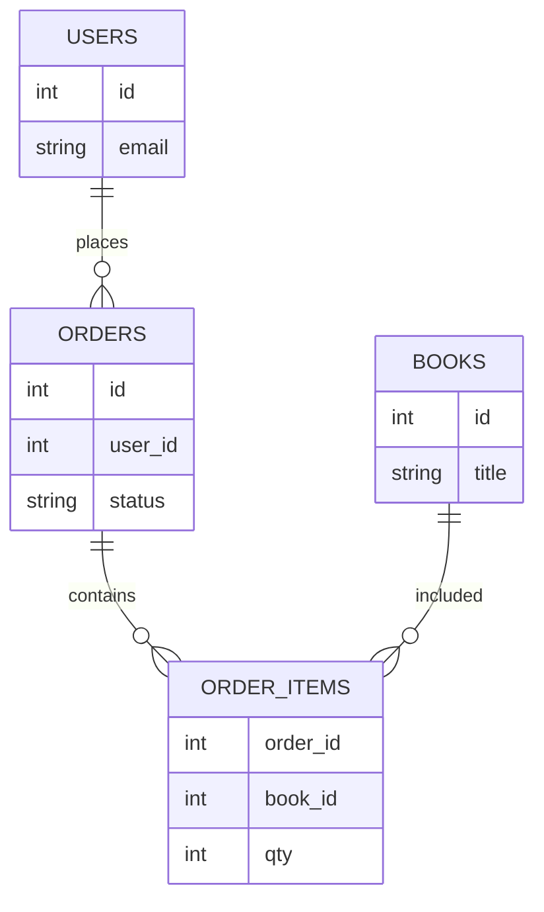
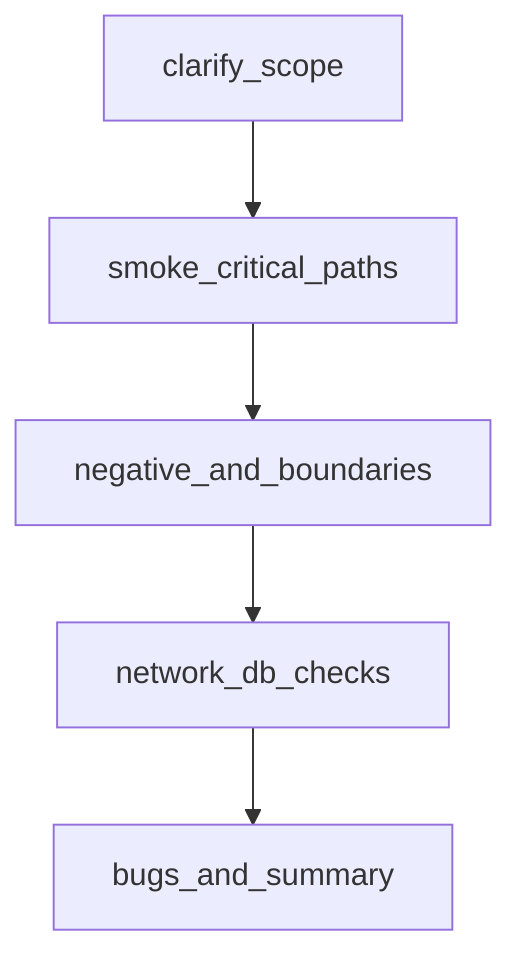

## Введение

Проверка UI без взгляда в данные часто врёт: заказ «оплачен» на экране и `pending` в таблице — классика. Вопросы J87 и J134–136 проверяют типы БД, базовый SELECT и понимание JOIN. В выпуске — теория и лаба на sqlite3 через Python.

Термины и определения согласованы с **ISTQB CTFL v4** и [глоссарием ISTQB](https://glossary.istqb.org/); номера J/M/S — опциональный индекс типовых вопросов собеса.

**Практика junior QA.** Теория без прогона на собесе «сыплется». Вопросы J119–130, J132 и J135 — это умение быстро собрать чеклист, негативные кейсы и smoke. Этот выпуск собирает навыки QA01–QA07 в одну практическую сессию.

Термины и определения согласованы с **ISTQB CTFL v4** и [глоссарием ISTQB](https://glossary.istqb.org/); номера J/M/S — опциональный индекс типовых вопросов собеса.

## Раздел: Как отвечать одним блоком

Этот выпуск собрал соседние короткие темы трека: «SQL и БД для QA», «Практика junior QA». Раньше каждая занимала отдельную карточку на несколько минут, а на собеседовании их спрашивают одним блоком. Ниже у каждой темы свой раздел, затем общие лабы, один тест и одна колода карточек. В ответе сначала назовите, какую тему спросили, потом определение и один пример. Не проговаривайте все разделы, если спросили один. Лабы можно пройти по порядку исходного трека. Если времени мало, сделайте первую и последнюю: первая ставит язык, последняя проверяет, что соседние темы вы не перепутали.

## Раздел: SQL и БД для QA: Типы баз и зачем они QA

**Реляционные (SQL):** PostgreSQL, MySQL, SQLite — таблицы, строки, связи через ключи, транзакции, схемы. Удобны для бизнес-данных заказов, пользователей, платежей.

**Нереляционные (NoSQL) — обзор:**
- документные (MongoDB) — JSON-подобные документы;
- key-value (Redis) — кэш, сессии;
- колоночные / поисковые / графовые — под свои нагрузки.

QA чаще всего: проверить, что после действия в UI/API строка появилась/обновилась; найти «хвосты» после бага; подготовить тестовые данные; оценить cascade delete и уникальность.

На собесе: «я не DBA, но умею читать данные и строить простые выборки для проверки инвариантов».

## Раздел: SQL и БД для QA: SELECT, WHERE и JOIN концептуально

Базовый каркас:
```sql
SELECT columns
FROM table
WHERE condition
ORDER BY column
LIMIT n;
```

Операторы WHERE: `=`, `<>`, `>`, `<`, `IN`, `LIKE`, `IS NULL`, `AND`/`OR`. Осторожно с NULL: сравнения ведут себя не как с обычными значениями.

**JOIN (идея):** связать строки двух таблиц по ключу.
- **INNER JOIN** — только совпавшие пары;
- **LEFT JOIN** — все слева + совпадения справа (справа может быть NULL);
- **RIGHT / FULL** — зеркально / объединение (зависит от СУБД).

Пример мысли: `orders` + `users` по `user_id` — увидеть email владельца заказа; `orders` + `books` через `order_items` — состав заказа.

Для QA JOIN нужен, чтобы ответить: «какие заказы без пользователя?», «сколько позиций в заказе 42?», «есть ли книги без заказов?».

## Раздел: SQL и БД для QA: Практика books / users / orders

Учебная модель:
- `users(id, email, name)`
- `books(id, title, price)`
- `orders(id, user_id, status, created_at)`
- `order_items(order_id, book_id, qty)`

Проверки после «покупки»:
1. есть строка в `orders` со статусом `paid`;
2. есть `order_items` с ожидаемым `book_id` и `qty`;
3. email в JOIN совпадает с пользователем из UI;
4. нет «осиротевших» items без order.

Инструмент лабы — **sqlite3** в стандартной библиотеке Python: быстро поднять файл БД без сервера, прогнать скрипт, показать на собесе ход мысли.

## Раздел: SQL и БД для QA: Частые вопросы с собеседования

**Вопрос.** Чем уровень тестирования отличается от типа (вида) тестирования?

**Ответ.** Уровень отвечает на «где режем систему»: модуль, стык, продукт целиком, приёмка. Тип — «с какой целью гоняем»: smoke, regression, exploratory, security и т.д. На собесе покажите пример: один checkout можно проверить на integration (API+БД) и оформить прогон как regression после фикса — оси независимы.

**Вопрос.** Когда на собеседовании уместен smoke, а когда полный regression?

**Ответ.** Smoke — узкий «жив ли билд»: логин, критичный платёж, главная. Падает smoke — глубже не идём. Regression — шире: уже работавшее после изменений. Sanity — точечно после маленького патча. Ошибка junior: называть любой повторный прогон regression.

**Вопрос.** Зачем на собесе спрашивают equivalence partitioning и граничные значения?

**Ответ.** EP сжимает бесконечные входы в классы «ведут себя одинаково»; BVA бьёт по стыкам классов — там чаще ломается сравнение и валидация. Для поля 18–99 достаточно классов «ниже», «внутри», «выше» и точек 17–18–19, 98–99–100; не нужно 82 случайных числа.

**Вопрос.** Severity и priority в баг-репорте — одно и то же?

**Ответ.** Нет. Severity — ущерб для продукта и пользователя (crash vs опечатка). Priority — когда чинить в очереди команды. Критичный по severity баг может ждать, если воспроизводится только на стенде без пользователей; наоборот, мелкий UI-bug в checkout может быть P1 перед релизом.

**Вопрос.** Что имеют в виду под «пирамидой тестирования» на собеседовании?

**Ответ.** Много быстрых дешёвых проверок внизу (unit, контракт API), меньше медленных UI/e2e наверху. Цель — быстрая обратная связь в CI, а не «всё через Selenium». Пирамида не запрет на e2e: сквозные сценарии оставляют на критичные деньги-потоки.

## Раздел: Практика junior QA: Корзина, логин и поле возраста

**Чеклист корзины (минимум):**
1. Добавление одного товара и проверка имени/цены.
2. Увеличение qty и пересчёт суммы.
3. Два разных товара — итоговая сумма.
4. Удаление позиции / очистка.
5. Max qty / qty = 0 / дробное qty (если UI даёт ввести).
6. Товар с нулевым остатком.
7. Переход к checkout только с непустой корзиной.
8. Обновление цены товара на витрине vs сумма в корзине (рассинхрон).

**Негативный логин:**
- пустые поля; только email; только пароль;
- неверный пароль; несуществующий пользователь;
- SQL-подобные строки в полях (наблюдаем обработку, не «ломаем прод»);
- очень длинная строка; пробелы по краям;
- регистр email; повторный submit;
- ожидаемые сообщения и отсутствие 500; в Network — 401/400, а не утечка стека.

**Возраст 18–99 (сводка EP/BVA):** 17, 18, 99, 100, `""`, `"abc"`, `18 `, `018` — плюс серверная проверка, если UI режет ввод. Оформите 1 баг-репорт на любое реальное расхождение UI vs API.

## Раздел: Практика junior QA: Smoke «Telegram-like» и калькулятор MVP

**Smoke для мессенджера-подобного приложения (идея J-блока практики):**
- установка/открытие / загрузка главной;
- регистрация или логин тестовым пользователем;
- список чатов отображается;
- открыть чат, отправить текстовое сообщение, увидеть его у себя;
- поиск контакта/чата (если есть);
- логаут / повторный вход без потери критичных данных сессии стенда;
- при падении любого пункта — стоп, сборка не для глубокого теста.

Это именно smoke: широта важнее глубины. Регресс пересылки файлов, звонков и уведомлений — отдельно.

**Калькулятор MVP — подход к тестированию:**
1. Уточнить операции (+ − × ÷), точность, унарный минус, порядок операций.
2. Позитив: 2+2, 10−3, 3×4, 8÷2.
3. Границы и нули: ÷0, очень большие числа, много знаков после запятой.
4. UX: очистка C/AC, цепочки операций, двойная точка, ведущие нули.
5. Нефункциональное на junior уровне: не падает на мусоре ввода, сообщения об ошибках понятны.
6. Стратегия: чеклист + таблица вход→ожидание; автоматизация позже (pytest), сначала ручной каркас.

На собесе важно проговорить **порядок**: риски → smoke → детальные негативы → отчёт.

## Раздел: Практика junior QA: Как упаковать ответ интервьюеру

Шаблон устного ответа на «протестируйте X за 10 минут»:
1. Уточняющие вопросы (платформа, роли, что out of scope).
2. Критичные пользовательские пути.
3. Негативы и границы данных.
4. Состояния и права (гость/юзер).
5. Что проверю в Network/БД.
6. Что осознанно не успею и какой риск.

Так вы показываете зрелость сильнее, чем бесконечный список кликов.

## Раздел: Практика junior QA: Частые вопросы с собеседования

**Вопрос.** Чем уровень тестирования отличается от типа (вида) тестирования?

**Ответ.** Уровень отвечает на «где режем систему»: модуль, стык, продукт целиком, приёмка. Тип — «с какой целью гоняем»: smoke, regression, exploratory, security и т.д. На собесе покажите пример: один checkout можно проверить на integration (API+БД) и оформить прогон как regression после фикса — оси независимы.

**Вопрос.** Severity и priority в баг-репорте — одно и то же?

**Ответ.** Нет. Severity — ущерб для продукта и пользователя (crash vs опечатка). Priority — когда чинить в очереди команды. Критичный по severity баг может ждать, если воспроизводится только на стенде без пользователей; наоборот, мелкий UI-bug в checkout может быть P1 перед релизом.

**Вопрос.** Что имеют в виду под «пирамидой тестирования» на собеседовании?

**Ответ.** Много быстрых дешёвых проверок внизу (unit, контракт API), меньше медленных UI/e2e наверху. Цель — быстрая обратная связь в CI, а не «всё через Selenium». Пирамида не запрет на e2e: сквозные сценарии оставляют на критичные деньги-потоки.

**Вопрос.** Почему flaky e2e — отдельная тема на middle/senior QA?

**Ответ.** Flaky — тест то зелёный, то красный без изменения кода: тайминги, данные, сеть, параллельность. Команда перестаёт верить CI. Лечат изоляцией данных, явными ожиданиями, стабильными селекторами, отсечением внешних сервисов; иногда понижают уровень — проверяют API вместо хрупкого UI.

## Лаба

**SQL и БД для QA.**

**Цель.** Создать SQLite-схему users/books/orders/order_items и выполнить 4 проверочных запроса.

**Шаги.**
1. Создайте файл `qa07_shop.py` и через `sqlite3` создайте таблицы и 2–3 пользователя, 3 книги, 2 заказа с позициями.
2. Напишите SELECT всех paid-заказов с email пользователя (JOIN).
3. Напишите запрос суммы qty по `order_id`.
4. Напишите LEFT JOIN книг к order_items и найдите книгу без продаж (или объясните, как бы искали).
5. Сформулируйте 3 инварианта, которые бы проверяли SQL-ом после UI-покупки.

**В группу:** обменяйтесь схемами; партнер ломает данные (удаляет user, оставляет order) — вы находите аномалию запросом.

**Готово, если…**
- [ ] Отличаете реляционную БД от key-value/документа на уровне идеи
- [ ] Пишете SELECT … WHERE без шпаргалки
- [ ] Объясняете INNER vs LEFT JOIN на примере users/orders

**Практика junior QA.**

**Цель.** За 60–90 минут собрать пакет артефактов junior-уровня на одном учебном приложении (магазин или калькулятор + отдельный лист для messenger-smoke).

**Шаги.**
1. Напишите чеклист корзины ≥8 пунктов с ожидаемым результатом в одной фразе.
2. Оформите 5 негативных кейсов логина в формате test case.
3. Таблица EP/BVA для возраста (или другого числового поля).
4. Smoke-лист из 6 шагов для Telegram-like и отметьте entry/exit.
5. Для калькулятора — таблица из ≥12 строк вход→ожидание, включая ÷0.
6. Один полный баг-репорт по любому найденному (или смоделированному) дефекту.

**В группу:** проведите peer-review пакета; партнёр вычёркивает пункты без проверяемого expected result.

**Готово, если…**
- [ ] Есть воспроизводимые артефакты, а не «мысль в голове»
- [ ] Smoke отделён от глубокого регресса
- [ ] Можете за 2 минуты объяснить стратегию тестирования калькулятора

## Схема: SQL и БД для QA: Заказ и связанные таблицы



## Схема: Практика junior QA: Сессия практики junior



## Тест

### Зачем тестировщику SQL, если есть UI?

**Ответ:** проверить фактическое состояние данных и ловить расхождения UI/API/БД

**Пояснение:** интерфейс кэширует и упрощает; БД — источник правды для многих бизнес-инвариантов.

### Что должно войти в smoke мессенджера в первую очередь?

**Ответ:** вход, список чатов, отправка/отображение сообщения

**Пояснение:** без базового обмена сообщениями углублённые фичи тестировать бессмысленно.

### Чем INNER JOIN отличается от LEFT JOIN?

**Ответ:** INNER — только совпадения; LEFT — все строки левой таблицы, даже без пары справа

**Пояснение:** LEFT удобен для поиска «заказов без пользователя» или «пользователей без заказов» (меняя сторону).

### Почему ÷0 обязателен в тестах калькулятора?

**Ответ:** граничный/негативный случай с высоким риском падения или неясного UX

**Пояснение:** системы по-разному обрабатывают деление на ноль; нужно явное ожидаемое поведение из требований.

### Что вернёт WHERE col = NULL?

**Ответ:** обычно ничего; для пустых значений нужен IS NULL

**Пояснение:** в SQL сравнение с NULL даёт UNKNOWN, строка не проходит WHERE.

## Шпаргалка

<ul><li>SQL-БД: таблицы + ключи + транзакции</li><li>SELECT/WHERE — база проверок данных</li><li>JOIN связывает сущности для сквозной проверки</li><li>sqlite3 удобен для учебной лабы без сервера</li><li>Сначала уточнить scope и риски</li><li>Smoke → негатив/границы → доказательства → отчёт</li><li>Чеклист корзины и кейсы логина — must-have в портфолио</li><li>Калькулятор: таблица вход→ожидание важнее «потыкать»</li></ul>

## Anki

### Front: Что такое первичный ключ?

Back: уникальный идентификатор строки таблицы; на него ссылаются внешние ключи

### Front: С чего начать ответ «протестируйте форму логина»?

Back: уточнить требования и окружение, затем позитив, классы негатива, сообщения об ошибках и Network-статусы

### Front: Зачем QA LEFT JOIN users ← orders?

Back: найти пользователей без заказов или заказы с «дырами» в связанных данных — зависит от стороны

### Front: Что такое smoke на практике?

Back: короткий набор критичных проверок жизнеспособности сборки перед глубоким тестированием

### Front: Чем SQLite удобен в лабе?

Back: файловая БД без установки сервера, доступна из Python модулем sqlite3

### Front: Какой артефакт приложить к практике корзины?

Back: чеклист с ожидаемыми результатами и хотя бы один детальный кейс на сумму/qty

## Мнемоника

### acronym: Экран и таблица

**Задание:** Что сверяют, когда UI говорит «оплачено».

**Элементы:**
- SELECT
- JOIN
- статус
- сумма

**Подсказка:** Сумма на экране и SUM в таблице — разные места ошибки.

**Ответ:** SELECT, JOIN, status, sum

## Итоги

- Данные — третий столп проверки рядом с UI и API
- SELECT + JOIN закрывают большинство junior SQL-вопросов
- Лаба с shop-схемой даёт историю для рассказа на собесе
- Junior силён не списком терминов, а собранным пакетом проверок
- Корзина, логин, возраст, smoke и калькулятор — частые живые задания на собесе
- Отделяйте smoke от глубины и всегда фиксируйте ожидаемый результат

## Ссылки

- [ISTQB Glossary](https://glossary.istqb.org/)
- [CTFL v4 — Certified Tester Foundation Level](https://istqb.org/certifications/certified-tester-foundation-level-ctfl-v4-0/)
- [QA-interview-250](https://github.com/Konstantine23/QA-interview-250)
- [Learn](/game/learn)
- [Test pyramid — Martin Fowler](https://martinfowler.com/bliki/TestPyramid.html)
- [AQA principles](/game/learn/qa-aqa-principles)
