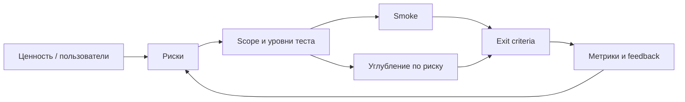
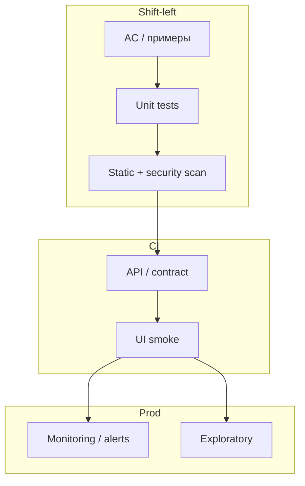

## Введение

S1–2, S5–13, S15–18: senior-вопросы про «как выстроить работу», а не «что такое boundary». Здесь — подход без ТЗ, критерии готовности, риски, метрики и оценка; формулировки, которые звучат как опыт, а не учебник.

Термины и определения согласованы с **ISTQB CTFL v4** и [глоссарием ISTQB](https://glossary.istqb.org/); номера J/M/S — опциональный индекс типовых вопросов собеса.

**Shift-left и ROI.** S19–25, S27 и M34: senior ждут стратегию автоматизации, а не список фреймворков. Как не копить регресс, что даёт shift-left, зачем unit-уровень, где ROI отрицательный, и когда BDD помогает или мешает.

Термины и определения согласованы с **ISTQB CTFL v4** и [глоссарием ISTQB](https://glossary.istqb.org/); номера J/M/S — опциональный индекс типовых вопросов собеса.

## Раздел: Как отвечать одним блоком

Этот выпуск собрал соседние короткие темы трека: «Стратегия тестирования,», «Shift-left и ROI». Раньше каждая занимала отдельную карточку на несколько минут, а на собеседовании их спрашивают одним блоком. Ниже у каждой темы свой раздел, затем общие лабы, один тест и одна колода карточек. В ответе сначала назовите, какую тему спросили, потом определение и один пример. Не проговаривайте все разделы, если спросили один. Лабы можно пройти по порядку исходного трека. Если времени мало, сделайте первую и последнюю: первая ставит язык, последняя проверяет, что соседние темы вы не перепутали.

## Раздел: Стратегия тестирования,: Старт без документов, «когда достаточно», review и риски

**Старт QA без документации.** Не ждать идеальное ТЗ. Источники правды: работающий прод/стейдж, код и OpenAPI, тикеты/AC, аналитик/PO, поддержка и жалобы клиентов, логи/метрики, конкуренты, старые баг-репорты. Первые шаги: карта модулей и интеграций, критические пользовательские пути, список неизвестных, smoke «как есть», договорённость о канале уточнений.

**Подход к старту тестирования (новый проект/модуль):**

1. Понять ценность и пользователей (кто пострадает от бага).
2. Нарисовать границы системы и зависимости.
3. Выделить риски (данные, деньги, безопасность, репутация).
4. Согласовать уровни: unit/API/UI/exploratory и владельцев.
5. Поднять тестопригодность: стенды, данные, логи, id в UI.
6. Собрать минимальный smoke + план углубления по риску.
7. Встроить качество в DoD и CI, а не в «фазу в конце».

**Когда тестирование «закончено»?** Никогда в абсолюте. Практический exit: выполнены согласованные scope и exit criteria; критические риски закрыты или приняты PO; Sev1/Sev2 по политике закрыты; smoke/регресс по плану зелёный; остаточный риск явно зафиксирован. «Багов нет» — плохой критерий.

**Review тест-кейсов.** Смотрят: трассировку на требования, ясность шагов и ожидаемого результата, данные/преусловия, независимость кейсов, дубли, устаревание, автоматизуемость, покрытие негатива и границ. Формат: peer review + выборочный walkthrough с аналитиком на критичных сценариях.

**Типы рисков и mitigation.**

| Риск | Пример | Mitigation |
|------|--------|------------|
| Продуктовый | неверная тарификация | контрактные тесты, сверка с биллингом |
| Технический | гонки в API | нагрузка, идемпотентность, логи |
| Процессный | поздний QA | shift-left, DoD |
| Среды | флаки из-за данных | изоляция, фикстуры |
| Людской | один носитель знаний | парное ревью, runbooks |
| Безопасность | IDOR | негативные authZ-кейсы |

**Основа load-стратегии.** Бизнес-цель и SLA → профиль пользователей (пики, гео) → критические сценарии → модель нагрузки → данные/стенд ≈ прод → наблюдаемость → критерии pass/fail → план эскалации. Без цели «покрутить JMeter» — не стратегия.

## Раздел: Стратегия тестирования,: Документы, smoke, команда, анализ, метрики, estimate, coverage

**Как часто ревьюить тест-документы?** Ритм под изменения продукта: при каждом крупном релизе/эпике — точечно; раз в спринт — устаревшие кейсы в зоне изменений; раз в квартал — аудит регресса (мертвые кейсы, дыры). Триггеры вне расписания: инцидент на проде, смена архитектуры, провал релиза.

**Отбор smoke.** Короткие проверки «система жива и основной бизнес возможен»: логин, ключевой create-read, платёж/заказ (если core), health зависимостей. Не более того, что команда готова гонять на каждый билд. Smoke ≠ полный регресс.

**Планирование нагрузки на команду.** Учитывать: входящий поток задач, % на регресс/автоматизацию/поддержку стендов, отпуска, on-call, буфер на инциденты (часто 20–30%). Визуализировать WIP; не планировать 100% capacity. Senior защищает фокус: «три фичи без теста = риск релиза».

**Ценность тест-анализа.** Раннее выявление дыр в требованиях, согласование приоритетов, уменьшение лишних кейсов, общая картина рисков для стейкхолдеров. Анализ экономит дорогой поздний баг-фиксинг.

**Метрики (с осторожностью):** escaped defects, defect density, pass rate, flaky rate, automation %, cycle time в Test, MTTR, coverage требований (RTM), не «количество кейсов». Метрика без решения — vanity.

**Техники оценки:** аналогия с прошлыми фичами; WBS (разбить → оценить части); three-point (opt/likely/pessim); planning poker; буфер на неопределённость. Озвучивайте допущения («нет API-доков → +X»).

**Покрытие.** Требований, рисков, кода (unit), сценариев. 100% code coverage ≠ качество. Senior говорит: «покрыли риск платежей и authZ; UI-регресс — критический путь».

**Оптимальное число шагов в сценарии.** Достаточно для воспроизводимости, без романа: обычно 5–12 атомарных шагов; длинные E2E дробить. Один кейс — одна цель проверки; иначе падения нечитаемы.

## Раздел: Стратегия тестирования,: Частые вопросы с собеседования

**Вопрос.** Чем метрика качества отличается от метрики процесса?
**Ответ.** Качество — про продукт (дефекты на проде, escape rate). Процесс — про работу команды (время прогона, доля автоматизации). На собесе их не смешивают.

**Вопрос.** Зачем пирамида тестов, если e2e ближе к пользователю?
**Ответ.** E2E дорогие и хрупкие. Уверенность дают быстрые unit и контрактные проверки, e2e оставляют на критичные сквозные пути.

**Вопрос.** Что ответить про ROI автоматизации?
**Ответ.** Сравните стоимость ручного прогона с поддержкой автотестов. Автоматизируйте стабильное и частое, не одноразовый сценарий.

## Раздел: Shift-left и ROI: Регресс, shift-left, unit и цена «всё автоматизировать»

**Как избегать дефектов регрессии.**

- Держать быстрый сигнал на критическом пути (unit + API smoke в CI).
- Контрактные тесты на границах сервисов.
- Feature flags и постепенный rollout.
- Регресс по риску, не «все 5000 кейсов руками».
- Стабильные тестовые данные и идемпотентные сценарии.
- Definition of Done с обязательными автопроверками.
- Ревью диффов с чеклистом impact (схема БД, auth, деньги).
- Мониторинг и алерты как продолжение теста на проде.

**Shift-left.** Сдвиг проверок и качества *раньше*: уточнение AC на refinement, тест-дизайн до кодирования, TDD/unit, статическая аналитика, контракты, security в пайплайне, парное тестирование с dev. Не «QA пишет кейсы за спринт до релиза», а «дефекты дешевле, потому что найдены у истока».

**Смысл unit-тестов.** Фиксируют поведение единиц (функции/классы) быстро и локально; дают рефакторинг без страха; ловят логические ошибки до интеграции. Для QA/AQA: понимать пирамиду — unit не заменяет бизнес-E2E, но без них UI-автотест становится дорогим «unit на стероидах».

**Минусы полной автоматизации всего.**

- Высокая стоимость поддержки UI и флаки.
- Ложное чувство безопасности («зелёный пайплайн»).
- Плохо автоматизируется UX, usability, exploratory, часть accessibility.
- Медленный feedback, если всё тащить в E2E.
- ROI отрицательный на редко меняющихся низкорисковых экранах.
- Нужны инженеры, среды, данные — не «магия кнопки Record».

Автоматизируйте стабильное, часто гоняемое, высокорисковое и хорошо специфицированное. Остальное — ручной/исследовательский фокус.

## Раздел: Shift-left и ROI: ROI, CI/CD, BDD и дизайн стратегии

**ROI автоматизации (упрощённо).**  
Выгода ≈ (ручные часы на прогон × частота × горизонт) + ценность раньше найденных багов − (стоимость написания + поддержки + инфраструктуры + флакотушения). Считайте в сценариях: «логин гоняем 20 раз/день» vs «отчёт раз в квартал». Показывайте стейкхолдерам payback period, не только «% automation».

**CI/CD: плюсы.** Быстрый feedback, воспроизводимые сборки, гейты качества, меньше «у меня работает», частые безопасные поставки, артефакты и трассы падений.

**CI/CD: минусы/риски.** Флаки блокируют main; долгие пайплайны → обход гейтов; секреты в CI; «деплой зелёный, прод красный» без мониторинга; культура «почините тест, а не продукт». Senior чинит сигнал (карантин, ретраи с лимитом, владельцы suites).

**BDD — когда да.** Общий язык Given/When/Then полезен, если бизнес реально читает и уточняет сценарии; сложный домен; нужна живая документация поведения. Лучше начинать с API/доменного слоя, где шаги стабильны.

**BDD — когда нет.** Команда пишет «BDD» как обёртку над UI-селекторами; сценарии пишет только QA; фичи меняются каждый день; нет фасилитации с PO. Тогда Cucumber становится дорогим дублем page objects.

**BDD UI vs API.** UI-BDD хрупкий (локаторы, анимации). API/domain-BDD стабильнее и быстрее — предпочтительнее для контракта поведения. UI оставьте тонким слоем smoke поверх.

**Дизайн automation strategy.**

1. Цели (скорость релиза, снижение leakage, поддержка рефакторинга).
2. Пирамида: unit (dev) → API/contract (AQA+dev) → UI smoke.
3. Критерии отбора кейсов в авто.
4. Стек = язык команды + CI + отчёты.
5. Владельцы, SLA на починку красных тестов.
6. Среды и данные.
7. Метрики: время пайплайна, flaky %, escaped defects на покрытых зонах.
8. Roadmap 1–2 квартала, не «автоматизируем всё».

## Раздел: Shift-left и ROI: Частые вопросы с собеседования

**Вопрос.** Чем уровень тестирования отличается от типа (вида) тестирования?

**Ответ.** Уровень отвечает на «где режем систему»: модуль, стык, продукт целиком, приёмка. Тип — «с какой целью гоняем»: smoke, regression, exploratory, security и т.д. На собесе покажите пример: один checkout можно проверить на integration (API+БД) и оформить прогон как regression после фикса — оси независимы.

**Вопрос.** Зачем на собесе спрашивают equivalence partitioning и граничные значения?

**Ответ.** EP сжимает бесконечные входы в классы «ведут себя одинаково»; BVA бьёт по стыкам классов — там чаще ломается сравнение и валидация. Для поля 18–99 достаточно классов «ниже», «внутри», «выше» и точек 17–18–19, 98–99–100; не нужно 82 случайных числа.

**Вопрос.** Severity и priority в баг-репорте — одно и то же?

**Ответ.** Нет. Severity — ущерб для продукта и пользователя (crash vs опечатка). Priority — когда чинить в очереди команды. Критичный по severity баг может ждать, если воспроизводится только на стенде без пользователей; наоборот, мелкий UI-bug в checkout может быть P1 перед релизом.

## Лаба

**Стратегия тестирования,.**

**Цель.** Стратегия на 2 недели для модуля «оплата» без полного ТЗ.

**Шаги.**
1. Список источников информации вместо ТЗ (8 пунктов) и первые 5 вопросов PO.
2. Risk register: 6 рисков с probability/impact и mitigation.
3. Exit criteria релиза (не менее 6 пунктов).
4. Smoke из ≤10 проверок и обоснование, почему не 30.
5. Оценка трудозатрат: three-point на API-регресс и на exploratory (в человеко-днях).
6. Дашборд метрик: 5 метрик и по одной «ложная интерпретация» каждой.

```python
# Three-point estimate → expected effort (PERT)
optimistic, most_likely, pessimistic = 2.0, 5.0, 12.0  # person-days
expected = (optimistic + 4 * most_likely + pessimistic) / 6
sigma = (pessimistic - optimistic) / 6
print(f"E = {expected:.1f} d, σ ≈ {sigma:.1f} d")

risks = [
    ("payment_double_charge", 0.2, 5),
    ("auth_idor", 0.3, 4),
    ("report_timeout", 0.4, 2),
]
for name, prob, impact in risks:
    score = prob * impact
    print(f"{name:24} score={score:.1f}")
```

**В группу:** заказчик просит «100% покрытие» — что отвечаете за 90 секунд?

**Готово, если…**
- [ ] Есть exit criteria и risk register
- [ ] Smoke отделён от полного регресса
- [ ] Оценка с допущениями, не «сделаем»

**Shift-left и ROI.**

**Цель.** Стратегия автоматизации модуля «корзина + оплата» на квартал.

**Шаги.**
1. Список из 10 регрессионных проверок; отметьте unit / API / UI / manual.
2. Посчитайте грубый ROI для 3 API-тестов (частота прогона, часы ручные, оценка поддержки).
3. Опишите shift-left практики на refinement и в PR (чеклист).
4. CI pipeline: стадии и гейты (lint, unit, API, UI smoke, deploy-to-stage).
5. Аргументы «за» и «против» BDD для этой команды (по 4).
6. Политика flaky: когда quarantine, кто чинит, срок.

```python
# Грубый ROI: сэкономленные ручные часы минус поддержка
runs_per_month = 20
manual_minutes = 15
create_hours = 8
maintain_hours_per_month = 1.5
hourly_cost = 1.0  # условные единицы

saved = runs_per_month * (manual_minutes / 60) * hourly_cost
cost = create_hours * hourly_cost / 6 + maintain_hours_per_month * hourly_cost  # amortize 6 мес
print(f"saved/month={saved:.1f}, cost/month≈{cost:.1f}, ROI≈{saved - cost:.1f}")

pyramid = {"unit": 70, "api": 20, "ui": 10}
assert sum(pyramid.values()) == 100
print("pyramid %:", pyramid)
```

**В группу:** бизнес хочет «100% UI automation за месяц» — как переубедить без слова «нет»?

**Готово, если…**
- [ ] Пирамида с владельцами уровней
- [ ] ROI хотя бы на пальцах, с допущениями
- [ ] BDD решение осознанное, не модное

## Схема: Стратегия тестирования,: От риска к объёму теста



## Схема: Shift-left и ROI: Пирамида и shift-left



## Тест

### Когда тестирование можно считать завершённым для релиза?

**Ответ:** когда выполнены согласованные exit criteria и остаточный риск явно принят стейкхолдерами

**Пояснение:** отсутствие известных багов — недостаточный критерий; важны scope, severity policy и прозрачный residual risk.

### Что означает shift-left на практике для QA?

**Ответ:** участие в требованиях, ранние проверки и тестопригодность до поздней UI-фазы

**Пояснение:** цель — дешевле находить дефекты и влиять на дизайн, а не только принимать готовое в конце.

### Что кладут в основу стратегии нагрузки?

**Ответ:** бизнес-SLA и профиль реальной нагрузки на критических сценариях, а не «максимальный RPS инструмента»

**Пояснение:** без цели и модели пользователей результаты load не интерпретируемы.

### Почему тотальная UI-автоматизация часто проигрывает?

**Ответ:** высокая стоимость поддержки, флаки и медленный feedback при низком ROI на редких сценариях

**Пояснение:** UI оставляют для критического пути; массу правил переносят на unit/API.

### Зачем нужны метрики flaky rate и escaped defects?

**Ответ:** flaky rate показывает доверие к автотестам; escaped defects — эффективность процесса до прода

**Пояснение:** растущий flaky убивает сигнал CI; escaped defects направляют, куда сдвигать усилия (shift-left, контракты, мониторинг).

## Шпаргалка

<ul><li>Прод, API, тикеты, PO, поддержка, логи</li><li>Карта модулей → риски → smoke → углубление</li><li>Риск = вероятность × влияние; mitigation явный</li><li>Smoke = «бизнес дышит», короткий, на каждый билд</li><li>Быстрый сигнал на критическом пути + контракты</li><li>AC и тест-дизайн до «готового UI»</li><li>Частота × ручные часы − поддержка − инфра</li><li>Автоматизировать стабильное и рисковое</li></ul>

## Anki

### Front: Exit criteria — что это?

Back: заранее согласованные условия, при которых тестирование scope считается достаточным для релиза/этапа

### Front: Назовите 3 способа снизить регресс

Back: CI на критическом пути, контрактные тесты, risk-based регресс + DoD с автогейтами

### Front: Чем опасна метрика «число тест-кейсов»?

Back: стимулирует раздувание документации без связи с риском и качеством сигнала

### Front: Формула ROI автотестов (идея)

Back: сэкономленные ручные прогоны и ранние баги минус стоимость создания, поддержки и инфраструктуры

### Front: Оптимальные шаги в кейсе?

Back: столько, сколько нужно для одной цели и воспроизводимости; длинные сценарии дробить

### Front: Минус CI/CD без дисциплины

Back: флаки и долгие пайплайны провоцируют обход гейтов и потерю доверия к сигналу

## Итоги

- Senior начинает с ценности и рисков, даже без документов
- «Готово» = exit criteria + принятый остаточный риск
- Load, smoke, capacity команды и метрики — управленческие рычаги, не ритуалы
- Оценка честна, когда видны допущения и неопределённость
- Регресс бьют архитектурой сигнала, а не количеством UI-кейсов
- Shift-left и unit — фундамент дешёвой обратной связи
- ROI честно отсекает «автоматизировать всё»
- CI/CD и BDD полезны при ясных правилах владения и уровне абстракции

## Ссылки

- [ISTQB Glossary](https://glossary.istqb.org/)
- [CTFL v4 — Certified Tester Foundation Level](https://istqb.org/certifications/certified-tester-foundation-level-ctfl-v4-0/)
- [Test pyramid — Martin Fowler](https://martinfowler.com/bliki/TestPyramid.html)
- [QA-interview-250](https://github.com/Konstantine23/QA-interview-250)
- [Learn](/game/learn)
- [Scrum Guide](https://scrumguides.org/scrum-guide.html)
- [Security perf senior](/game/learn/qa-security-perf-senior)
