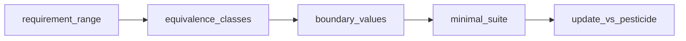
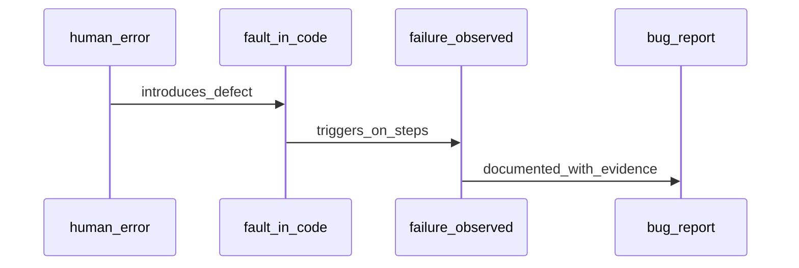

## Введение

Хороший junior не только «кликает по кнопкам», а умеет сокращать бесконечные входы до разумного набора. Этот выпуск закрывает J6–8, J24, J123, J137–140: эквивалентность, границы, pesticide paradox и практика на поле возраста и страховых классах.

Термины и определения согласованы с **ISTQB CTFL v4** и [глоссарием ISTQB](https://glossary.istqb.org/); номера J/M/S — опциональный индекс типовых вопросов собеса.

**Баги и отчёты.** Умение найти дефект бесполезно без умения его описать. На junior-собесе ждут точные термины error/fault/failure, структуру баг-репорта и разницу severity/priority. Этот выпуск закрывает J26–29 и J131–133 с практикой «чайник» и «username».

Термины и определения согласованы с **ISTQB CTFL v4** и [глоссарием ISTQB](https://glossary.istqb.org/); номера J/M/S — опциональный индекс типовых вопросов собеса.

## Раздел: Как отвечать одним блоком

Этот выпуск собрал соседние короткие темы трека: «Тест-дизайн», «Баги и отчёты». Раньше каждая занимала отдельную карточку на несколько минут, а на собеседовании их спрашивают одним блоком. Ниже у каждой темы свой раздел, затем общие лабы, один тест и одна колода карточек. В ответе сначала назовите, какую тему спросили, потом определение и один пример. Не проговаривайте все разделы, если спросили один. Лабы можно пройти по порядку исходного трека. Если времени мало, сделайте первую и последнюю: первая ставит язык, последняя проверяет, что соседние темы вы не перепутали.

## Раздел: Тест-дизайн: Equivalence Partitioning и Boundary Value Analysis

**Equivalence Partitioning (EP)** — деление входов на классы, где поведение системы считается одинаковым. Достаточно одного-двух представителей из класса вместо перебора всех значений.

Пример: возраст для регистрации 18–99.
- невалидный низкий: &lt; 18 (например 0, 17);
- валидный: 18–99;
- невалидный высокий: &gt; 99;
- отдельно: пусто, буквы, спецсимволы, пробелы, отрицательные, дробные — если поле это допускает на уровне UI/API.

**Boundary Value Analysis (BVA)** — ошибки чаще у границ, поэтому проверяем края классов: 17, 18, 19, 98, 99, 100 (и иногда «чуть за» / типовые off-by-one).

Связка EP+BVA: сначала классы, затем усиление границами. На собесе покажите таблицу: класс → представители → ожидаемый результат.

**White-box complexity (intro):** цикломатическая сложность растёт с числом независимых путей (ветвления if/else, циклы). Чем выше сложность, тем больше путей для покрытия — поэтому unit/white-box и рефакторинг важны. Junior должен понимать идею: «много ветвлений → больше риск пропущенного пути», без обязательного расчёта метрики на доске.

## Раздел: Тест-дизайн: Парадокс пестицида и практика классов

**Pesticide paradox:** если гонять одни и те же тесты, они перестают находить новые дефекты — продукт и команда «привыкают» к набору. Лечение: обновлять кейсы, менять данные, добавлять exploratory, пересматривать риски, ротировать сценарии.

Практика «страховка / тариф» (упрощённо):
- классы по возрасту или стажу (например 18–25, 26–40, 41–65, 66+);
- внутри класса — один расчёт премии; на границах — смена тарифа;
- негатив: возраст вне правил, пустые поля, несогласованные даты полиса.

Хороший ответ на J137–140: не перечислять 80 чисел, а показать 3–5 классов + границы + 1–2 специальных кейса (пустая строка, leading zero, Unicode).

## Раздел: Тест-дизайн: Как отвечать на собесе с полем 18–99

Структура ответа:
1. Назвать валидный диапазон и источник (требование).
2. Построить EP-классы (valid / invalid low / invalid high / invalid format).
3. Усилить BVA: 17, 18, 99, 100.
4. Добавить «грязные» данные: `18 `, `018`, `18.0`, `восемнадцать`, SQL/XSS-строка — если контекст веб.
5. Сказать, что на API и UI проверки могут отличаться (клиентская валидация vs серверная).

Фраза для собеса: «Я уменьшаю пространство входов классами и бью по границам, потому что там статистически больше дефектов».

## Раздел: Тест-дизайн: Частые вопросы с собеседования

**Вопрос.** Когда на собеседовании уместен smoke, а когда полный regression?

**Ответ.** Smoke — узкий «жив ли билд»: логин, критичный платёж, главная. Падает smoke — глубже не идём. Regression — шире: уже работавшее после изменений. Sanity — точечно после маленького патча. Ошибка junior: называть любой повторный прогон regression.

**Вопрос.** Severity и priority в баг-репорте — одно и то же?

**Ответ.** Нет. Severity — ущерб для продукта и пользователя (crash vs опечатка). Priority — когда чинить в очереди команды. Критичный по severity баг может ждать, если воспроизводится только на стенде без пользователей; наоборот, мелкий UI-bug в checkout может быть P1 перед релизом.

**Вопрос.** Что имеют в виду под «пирамидой тестирования» на собеседовании?

**Ответ.** Много быстрых дешёвых проверок внизу (unit, контракт API), меньше медленных UI/e2e наверху. Цель — быстрая обратная связь в CI, а не «всё через Selenium». Пирамида не запрет на e2e: сквозные сценарии оставляют на критичные деньги-потоки.

**Вопрос.** Почему flaky e2e — отдельная тема на middle/senior QA?

**Ответ.** Flaky — тест то зелёный, то красный без изменения кода: тайминги, данные, сеть, параллельность. Команда перестаёт верить CI. Лечат изоляцией данных, явными ожиданиями, стабильными селекторами, отсечением внешних сервисов; иногда понижают уровень — проверяют API вместо хрупкого UI.

## Раздел: Баги и отчёты: Error, fault, failure и что такое баг

Кратко по цепочке:
- **Error (ошибка человека)** — неверное действие разработчика/аналитика (неправильное понимание, опечатка в коде, дыра в требованиях).
- **Fault / defect / bug** — изъян в артефакте (код, конфиг, документ), следствие error.
- **Failure** — наблюдаемый сбой в работе: система ведёт себя не так, как ожидалось, когда дефект проявился на конкретных данных/шагах.

Баг в бытовой речи тестировщика — дефект, который воспроизводится и мешает ожидаемому поведению. Важно: не каждый странный UX — «critical bug»; формулируйте относительно требования или явного ожидания пользователя.

Хороший тон на собесе: «я фиксирую расхождение факта и ожидания, с шагами и окружением, без эмоций и без назначения виноватых».

## Раздел: Баги и отчёты: Поля баг-репорта, severity и priority

Типовые поля репорта:
- **Title** — коротко «что сломано + где» (без «не работает!!!»);
- **Environment** — ОС, браузер, стенд, версия сборки;
- **Preconditions** — роль, данные, состояние;
- **Steps** — нумерованные шаги;
- **Actual / Expected** — факт vs ожидание;
- **Attachments** — скрин, видео, логи, cURL;
- **Severity / Priority** — влияние и порядок фикса;
- опционально: частота, workaround, связанные требования/кейсы.

**Severity** — насколько тяжёл дефект по влиянию на систему/данные/безопасность (blocker, critical, major, minor, trivial — шкалы отличаются, смысл один).

**Priority** — насколько срочно чинить с точки зрения бизнеса/релиза (P1…P4). Severity ставит инженерная оценка влияния; priority — продукт/менеджмент (часто совместно).

Примеры:
- Опечатка на редко посещаемой странице: severity low, priority low.
- Падение оплаты: severity critical/blocker, priority highest.
- Косметика на главной перед демо инвесторам: severity minor, priority high — бизнес срочно хочет «красиво».
- Утечка ПДн в логах: severity critical (security), priority highest.

## Раздел: Баги и отчёты: Практика — чайник и username

**«Чайник» (бытовой дефект как модель репорта):**  
Title: «Чайник не отключается после закипания».  
Steps: налить воду → включить → дождаться кипения.  
Actual: продолжает греть. Expected: автоотключение.  
Severity: high (пожар/порча). Priority: high.

**Username:** поле принимает только латиницу 3–16 символов, без пробелов.  
Баг-пример: «При вводе username из 3 символов с пробелом в конце система сохраняет значение и показывает 200, хотя по ТЗ пробелы запрещены».  
В репорте: точная строка (`"ab "`), где обрезается trim (UI/API), ответ сервера, скрин валидации.

На собесе за J131–133 ждут именно структуру и ясность, а не литературный стиль.

## Раздел: Баги и отчёты: Частые вопросы с собеседования

**Вопрос.** Чем уровень тестирования отличается от типа (вида) тестирования?

**Ответ.** Уровень отвечает на «где режем систему»: модуль, стык, продукт целиком, приёмка. Тип — «с какой целью гоняем»: smoke, regression, exploratory, security и т.д. На собесе покажите пример: один checkout можно проверить на integration (API+БД) и оформить прогон как regression после фикса — оси независимы.

**Вопрос.** Когда на собеседовании уместен smoke, а когда полный regression?

**Ответ.** Smoke — узкий «жив ли билд»: логин, критичный платёж, главная. Падает smoke — глубже не идём. Regression — шире: уже работавшее после изменений. Sanity — точечно после маленького патча. Ошибка junior: называть любой повторный прогон regression.

**Вопрос.** Зачем на собесе спрашивают equivalence partitioning и граничные значения?

**Ответ.** EP сжимает бесконечные входы в классы «ведут себя одинаково»; BVA бьёт по стыкам классов — там чаще ломается сравнение и валидация. Для поля 18–99 достаточно классов «ниже», «внутри», «выше» и точек 17–18–19, 98–99–100; не нужно 82 случайных числа.

**Вопрос.** Что имеют в виду под «пирамидой тестирования» на собеседовании?

**Ответ.** Много быстрых дешёвых проверок внизу (unit, контракт API), меньше медленных UI/e2e наверху. Цель — быстрая обратная связь в CI, а не «всё через Selenium». Пирамида не запрет на e2e: сквозные сценарии оставляют на критичные деньги-потоки.

**Вопрос.** Почему flaky e2e — отдельная тема на middle/senior QA?

**Ответ.** Flaky — тест то зелёный, то красный без изменения кода: тайминги, данные, сеть, параллельность. Команда перестаёт верить CI. Лечат изоляцией данных, явными ожиданиями, стабильными селекторами, отсечением внешних сервисов; иногда понижают уровень — проверяют API вместо хрупкого UI.

## Лаба

**Тест-дизайн.**

**Цель.** Спроектировать минимальный набор тестов для поля «Возраст: целое 18–99» и для тарифа из 4 возрастных классов.

**Шаги.**
1. Нарисуйте таблицу EP для возраста: класс, пример, ожидаемый результат.
2. Добавьте BVA-набор (не меньше 6 значений вокруг границ).
3. Для страховки опишите 4 класса тарифа и тесты на стыках классов.
4. Запишите 3 способа победить pesticide paradox на своём проекте.

**В группу:** обменяйтесь таблицами; найдите пропущенный негативный класс у партнёра.

**Готово, если…**
- [ ] EP и BVA объясняете на одном примере без путаницы терминов
- [ ] Для 18–99 называете границы и форматные негативы
- [ ] Можете одной фразой объяснить pesticide paradox и лечение

**Баги и отчёты.**

**Цель.** Написать два полных баг-репорта: бытовой (чайник/утюг) и продуктовый (валидация username или логина).

**Шаги.**
1. Выберите шкалу severity (5 уровней) и priority (4 уровня) и зафиксируйте легенду.
2. Оформите репорт по чайнику со всеми обязательными полями.
3. Оформите репорт по username: steps, actual/expected, данные, окружение.
4. Для второго бага обоснуйте пару severity/priority в 2–3 предложениях.

**В группу:** обменяйтесь репортами; партнёр должен воспроизвести баг только по тексту — если не смог, доработайте steps.

**Готово, если…**
- [ ] Различаете error, fault/bug и failure
- [ ] Severity и priority не путаете и даёте контрпример «low severity / high priority»
- [ ] Репорт воспроизводим без устных пояснений

## Схема: Тест-дизайн: От требования к набору тестов

## Схема: Баги и отчёты: От ошибки до репорта

## Тест

### Зачем equivalence partitioning?

**Ответ:** сократить бесконечные входы до представителей классов с одинаковым поведением

**Пояснение:** экономит время при сохранении покрытия типов ситуаций, а не всех чисел подряд.

### Чем failure отличается от fault?

**Ответ:** fault — изъян в артефакте; failure — его проявление в работе

**Пояснение:** дефект может «спать» до определённых данных; failure — то, что увидел пользователь/тест.

### Какие значения взять для возраста 18–99 по BVA?

**Ответ:** как минимум 17, 18, 99, 100 (часто ещё 19 и 98)

**Пояснение:** границы и соседние значения ловят off-by-one и ошибки условий `&lt;=` / `&lt;`.

### Кто обычно определяет priority?

**Ответ:** бизнес/продукт (часто вместе с командой), опираясь на влияние и релиз

**Пояснение:** severity описывает тяжесть; priority — очередь исправления под цели спринта/релиза.

### Что такое pesticide paradox?

**Ответ:** одни и те же тесты со временем перестают находить новые баги

**Пояснение:** нужно обновлять сценарии, данные и подходы, иначе набор «вырождается».

## Шпаргалка

<ul><li>EP — классы эквивалентного поведения</li><li>BVA — края классов (там чаще ломается)</li><li>Pesticide — ротация и обновление тестов</li><li>Сложность кода ↑ → путей для white-box больше</li><li>Error → Fault/Bug → Failure</li><li>Репорт: title, env, preconditions, steps, actual/expected, evidence</li><li>Severity = влияние; Priority = срочность для бизнеса</li></ul>

## Anki

### Front: Что такое класс эквивалентности?

Back: множество входных значений, для которых ожидается одинаковая реакция системы

### Front: Error vs bug vs failure?

Back: error — ошибка человека; bug/fault — дефект в продукте; failure — сбой при выполнении

### Front: Почему проверяют границы?

Back: дефекты условий часто сидят на краях диапазонов и в off-by-one ошибках

### Front: Severity vs priority?

Back: severity — тяжесть влияния; priority — порядок/срочность исправления для бизнеса

### Front: Как лечить pesticide paradox?

Back: обновлять кейсы и данные, добавлять exploratory, пересматривать риски, не полагаться только на старый набор

### Front: Минимум полей хорошего баг-репорта?

Back: заголовок, окружение, шаги, фактический и ожидаемый результат, вложения/данные

## Итоги

- EP+BVA — базовый язык тест-дизайна на junior-собесе
- Возраст 18–99 отрабатывайте таблицей, не списком из 50 чисел
- Парадокс пестицида напоминает: тесты — живой актив, не музей
- Термины error/fault/failure показывают зрелость ответа на собесе
- Сильный репорт экономит часы разработчику и вам на «а у меня работает»
- Severity ≠ priority — держите готовый пример расхождения

## Ссылки

- [ISTQB Glossary](https://glossary.istqb.org/)
- [CTFL v4 — Certified Tester Foundation Level](https://istqb.org/certifications/certified-tester-foundation-level-ctfl-v4-0/)
- [QA-interview-250](https://github.com/Konstantine23/QA-interview-250)
- [Learn](/game/learn)
- [План, кейсы, RTM](/game/learn/qa-docs-plan-cases)
