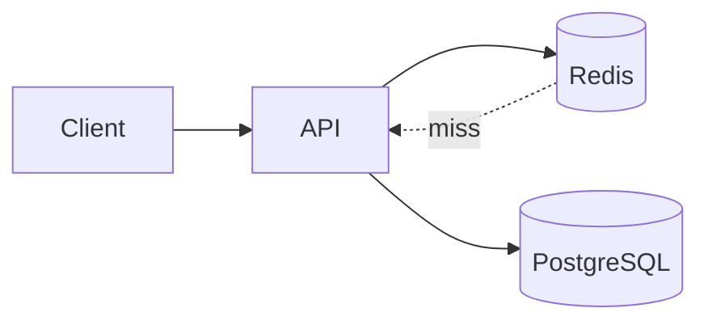
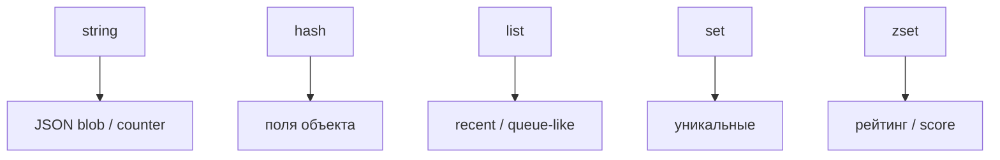

## Введение

Redis часто звучит на собесе как «кэш» — и этого мало. Junior должен объяснить модель ключ–значение, отличие от реляционной таблицы и риск хранить единственную правду в памяти. Официально Redis описывается как **in-memory data structure store** ([Introduction](https://redis.io/docs/about/)): ключ сопоставляется не только «строке», но и структурам из следующих выпусков (RD02).

**Типы Redis.** После модели KV спрашивают: «какие типы знаете?». Нужно не перечисление, а выбор типа под задачу. Канон — раздел [Data types](https://redis.io/docs/data-types/) на redis.io: каждый ключ имеет **один** тип, команды зависят от него.

## Раздел: Как отвечать одним блоком

Этот выпуск собрал соседние короткие темы трека: «KV модель», «Типы Redis». Раньше каждая занимала отдельную карточку на несколько минут, а на собеседовании их спрашивают одним блоком. Ниже у каждой темы свой раздел, затем общие лабы, один тест и одна колода карточек. В ответе сначала назовите, какую тему спросили, потом определение и один пример. Не проговаривайте все разделы, если спросили один. Лабы можно пройти по порядку исходного трека. Если времени мало, сделайте первую и последнюю: первая ставит язык, последняя проверяет, что соседние темы вы не перепутали.

## Раздел: KV модель: Что такое Redis

По [redis.io/docs](https://redis.io/docs/) Redis — сервер в RAM с сетевым протоколом (RESP), опциональной [persistence](https://redis.io/docs/management/persistence/) и репликацией. Типичные роли: кэш ответов API, сессии, rate limit, лёгкие счётчики и pub/sub-сигналы (RD06).

Сильные стороны: низкая задержка чтения/записи, [типы данных](https://redis.io/docs/data-types/) (не только string), TTL на ключах (RD03). Слабые: объём ограничен RAM и политикой [eviction](https://redis.io/docs/reference/eviction/) (RD07), операционная цена памяти, сложность инвалидации кэша (RD04).

## Раздел: KV модель: KV vs таблица

В PostgreSQL вы думаете строками, связями и JOIN. В Redis — **ключом** и значением (или структурой вокруг ключа). Нет нормализации «из коробки»: вы сами проектируете пространство имён (`user:42:profile`, `cache:api:v1:…`). Сканирование «как SELECT * WHERE …» возможно, но это не сильная сторона модели.

См. также: [SQL DDL/DML и виды СУБД](/game/learn/sql-ddl-dml-dcl) — где Redis упомянут как key-value рядом с RDBMS.

## Раздел: KV модель: Не source of truth

Если Redis — единственное место заказа/баланса без записи в БД, рестарт, сбой узла или eviction могут стереть бизнес-факт. Правило собеса: **система записи** (часто PostgreSQL) + кэш/ускоритель (Redis). RDB/AOF снижают риск потери после рестарта, но не превращают Redis в полноценную транзакционную СУБД для сложной аналитики и долговременного журнала событий.

## Раздел: KV модель: Частые вопросы с собеседования

**Вопрос.** Почему Redis не source of truth?
**Ответ.** Это память. Без persistence данные можно потерять, целостность слабее, чем у PostgreSQL. Факты живут в основной БД, Redis ускоряет доступ.

**Вопрос.** Что такое cache-aside?
**Ответ.** Приложение читает кэш, при промахе идёт в БД и кладёт значение с TTL. Запись в БД сбрасывает ключ.

**Вопрос.** Зачем TTL при явной инвалидации?
**Ответ.** Инвалидацию забывают. TTL ограничивает срок устаревшего значения, если событие обновления потерялось.

## Раздел: Типы Redis: string и hash

**string** — максимально простой тип: байтовая строка до 512 MB ([Strings](https://redis.io/docs/data-types/strings/)). JSON-blob, счётчик (`INCR`/`DECR`), битовые операции. Универсально, но обновление одного поля объекта требует перезаписи всего blob.

**hash** — поле→значение внутри одного ключа ([Hashes](https://redis.io/docs/data-types/hashes/)): `HSET user:1 name … email …`. Частичное обновление без сериализации всего объекта; удобно для «мини-строки» профиля.

## Раздел: Типы Redis: list, set, zset

**list** — упорядоченная последовательность строк ([Lists](https://redis.io/docs/data-types/lists/)): `LPUSH`/`RPOP`, диапазоны. Ленты recent items; как надёжная очередь задач — только с оговорками (RD06, брокер vs list).

**set** — неупорядоченное множество уникальных строк ([Sets](https://redis.io/docs/data-types/sets/)): теги, уникальные id, `SINTER`/`SUNION`.

**zset (sorted set)** — элемент + **score** ([Sorted sets](https://redis.io/docs/data-types/sorted-sets/)): рейтинги, time-ordered ленты, sliding window rate limit (`ZADD`, `ZRANGE`, `ZREVRANK`).

## Раздел: Типы Redis: Выбор типа

Правило: сначала сценарий доступа (целиком / по полю / топ-N / уникальность / порядок по score), потом тип. Не кладите огромный JSON в string, если часто меняете одно поле — берите hash. Не используйте list там, где нужна уникальность — set.

Streams и JSON — отдельные типы в docs; на junior/middle достаточно пяти базовых + честное «уточню в проекте».

## Раздел: Типы Redis: Частые вопросы с собеседования

**Вопрос.** Что такое cache-aside и кто отвечает за заполнение кэша?

**Ответ.** Приложение: сначала GET в Redis, при miss — читает БД и SET с TTL. Redis не подтягивает БД сам. После UPDATE в БД нужно удалить или обновить ключ, иначе отдадите stale. Не путать с write-through, где запись идёт в кэш и БД синхронно из одного слоя.

**Вопрос.** Зачем TTL у ключей Redis на собеседовании?

**Ответ.** Страховка от вечного устаревания и runaway-памяти: даже если забыли DEL после UPDATE, данные протухнут. TTL не заменяет явную инвалидацию на критичных сущностях — выбирают баланс «свежесть vs нагрузка на БД».

**Вопрос.** RDB или AOF — что выбрать для персистентности Redis?

**Ответ.** RDB — снимок на диск периодически, компактно, возможна потеря последних секунд. AOF — журнал команд, детальнее восстановление, больше I/O. На практике часто hybrid и политика fsync под допустимую потерю данных; кэш может жить и без персистентности.

**Вопрос.** Что происходит, когда Redis упирается в maxmemory?

**Ответ.** Срабатывает политика eviction (LRU/LFU и др.) — ключи удаляются, hit-rate падает, нагрузка на БД растёт. На собесе связывают с мониторингом памяти, TTL и тем, что hot keys без лимита опасны для всего кластера.

**Вопрос.** Что такое cache stampede и как его ослабить?

**Ответ.** Много запросов одновременно бьют в БД после истечения TTL одного hot key. Лечат singleflight/lock на пересчёт, jitter к TTL, прогрев, короткий stale-while-revalidate. На собесе важно назвать симптом: CPU БД скачет при «простом» GET.

## Лаба

**KV модель.**

**Цель.** Спроектировать ключи для кэша профиля пользователя без дублирования «правды» только в Redis.

**Шаги.**
1. Опишите сущность `User(id, email, name)` в PostgreSQL одной фразой.
2. Придумайте ключ Redis для кэша профиля (например `user:{id}:profile`).
3. Запишите сценарий miss: нет ключа → SELECT из БД → SET с TTL.
4. Назовите 2 причины не хранить баланс счёта только в Redis.
5. Сверьте ответ с формулировкой «кэш vs source of truth».

**В группу:** партнёр предлагает хранить заказы только in Redis — вы аргументируете против со ссылкой на persistence и eviction.

**Готово, если…**
- [ ] Отличаете KV от таблицы
- [ ] Называете 2 типичных сценария Redis
- [ ] Объясняете, почему Redis не единственная правда

**Типы Redis.**

**Цель.** Подобрать тип Redis под три сценария продукта.

**Шаги.**
1. Сессия пользователя (token → userId) — какой тип и ключ?
2. Топ-10 игроков по очкам — какой тип?
3. Список последних 20 действий — какой тип?
4. Профиль с email/name — hash или string? Обоснуйте по docs hashes vs strings.
5. Запишите одну ошибку выбора типа (например list для уникальных id).

**В группу:** партнёр называет сценарий — вы называете тип за 15 секунд.

**Готово, если…**
- [ ] Называете 5 базовых типов
- [ ] Связываете zset с рейтингом
- [ ] Отличаете hash от string-JSON

## Схема: KV модель: Кэш поверх БД

## Схема: Типы Redis: Типы и сценарии

## Тест

### Чем Redis принципиально отличается от PostgreSQL?

**Ответ:** in-memory KV vs реляционные таблицы

**Пояснение:** Разный класс задач: ускорение lookup vs схема, JOIN, ACID-отчёты.

### Какой тип для рейтинга с очками?

**Ответ:** zset sorted set

**Пояснение:** Score задаёт порядок; ZREVRANGE отдаёт топ.

### Почему Redis обычно не source of truth?

**Ответ:** RAM, рестарт и eviction стирают данные

**Пояснение:** Persistence помогает, но не заменяет модель бизнес-транзакций в СУБД.

### Чем hash удобнее string с JSON?

**Ответ:** частичное обновление полей

**Пояснение:** HSET одного поля без сериализации всего объекта.

### Назовите два типичных сценария Redis

**Ответ:** кэш API и сессии

**Пояснение:** Также rate limit, счётчики, pub/sub, leaderboard (RD02–RD06).

## Шпаргалка

<ul><li>Redis = in-memory структуры + сеть (<a href="https://redis.io/docs/">docs</a>)</li><li>Ключ → значение / структура</li><li>Кэш ускоряет, БД хранит правду</li><li>string — blob / INCR</li><li>hash — поля объекта</li><li>list — порядок</li><li>set — уникальность</li><li>zset — score + порядок</li></ul>

## Anki

### Front: Что такое Redis по redis.io/docs одной фразой?

Back: In-memory data structure store с сетевым доступом

### Front: Какой тип Redis для топ-10 игроков по очкам?

Back: zset (sorted set) с score = очки

### Front: Почему на собесе не кладут единственную правду в Redis?

Back: Рестарт, eviction и RAM; нет зрелой реляционной модели

### Front: hash vs JSON в string для профиля user:1?

Back: hash — HSET отдельных полей; string — перезапись всего JSON

### Front: Типичный ключ кэша профиля пользователя id=42?

Back: user:42:profile или hash полей в hash (RD02)

### Front: list в Redis — типичные команды и смысл?

Back: LPUSH/RPOP; упорядоченная последовательность элементов

## Мнемоника

### acronym: Redis как ключ

**Задание:** Четыре свойства, которые называют сразу.

**Элементы:**
- Ключ
- Значение
- Память
- Однопоточный команды

**Подсказка:** Однопоточность команд не отменяет ожидание сети.

**Ответ:** key, value, RAM, single-thread commands

## Итоги

- KV ≠ таблица: проектируете ключи сами
- Redis ускоряет, PostgreSQL часто пишет правду
- На собесе отделяйте кэш от системы записи; термины — из [redis.io/docs](https://redis.io/docs/)
- Пять базовых типов из [redis.io/docs/data-types](https://redis.io/docs/data-types/) закрывают большинство junior-вопросов
- Сначала сценарий, потом тип
- hash ≠ set ≠ zset

## Ссылки

- [Redis documentation](https://redis.io/docs/)
- [About Redis](https://redis.io/docs/about/)
- [Data types overview](https://redis.io/docs/data-types/)
- [SQL DDL / NoSQL обзор](/game/learn/sql-ddl-dml-dcl)
- [Python БД и кеш](/game/learn/py-perf-packaging-alt-runtimes)
- [Sorted sets](https://redis.io/docs/data-types/sorted-sets/)
- [TTL и persistence](/game/learn/rd-ttl-persistence)
