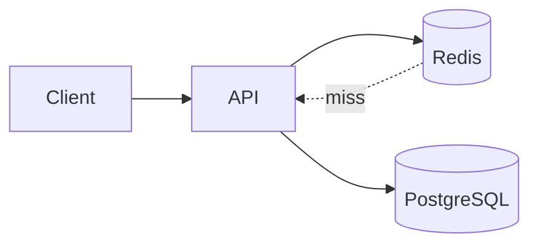

## Введение

Redis часто звучит на собесе как «кэш» — и этого мало. Junior должен объяснить модель ключ–значение, отличие от реляционной таблицы и риск хранить единственную правду в памяти. Официально Redis описывается как **in-memory data structure store** ([Introduction](https://redis.io/docs/about/)): ключ сопоставляется не только «строке», но и структурам из следующих выпусков (RD02).

## Раздел: Что такое Redis

По [redis.io/docs](https://redis.io/docs/) Redis — сервер в RAM с сетевым протоколом (RESP), опциональной [persistence](https://redis.io/docs/management/persistence/) и репликацией. Типичные роли: кэш ответов API, сессии, rate limit, лёгкие счётчики и pub/sub-сигналы (RD06).

Сильные стороны: низкая задержка чтения/записи, [типы данных](https://redis.io/docs/data-types/) (не только string), TTL на ключах (RD03). Слабые: объём ограничен RAM и политикой [eviction](https://redis.io/docs/reference/eviction/) (RD07), операционная цена памяти, сложность инвалидации кэша (RD04).

## Раздел: KV vs таблица

В PostgreSQL вы думаете строками, связями и JOIN. В Redis — **ключом** и значением (или структурой вокруг ключа). Нет нормализации «из коробки»: вы сами проектируете пространство имён (`user:42:profile`, `cache:api:v1:…`). Сканирование «как SELECT * WHERE …» возможно, но это не сильная сторона модели.

См. также: [SQL DDL/DML и виды СУБД](/game/learn/sql-ddl-dml-dcl) — где Redis упомянут как key-value рядом с RDBMS.

## Раздел: Не source of truth

Если Redis — единственное место заказа/баланса без записи в БД, рестарт, сбой узла или eviction могут стереть бизнес-факт. Правило собеса: **система записи** (часто PostgreSQL) + кэш/ускоритель (Redis). RDB/AOF снижают риск потери после рестарта, но не превращают Redis в полноценную транзакционную СУБД для сложной аналитики и долговременного журнала событий.

## Раздел: Частые вопросы с собеседования

**Вопрос.** Почему Redis не source of truth?
**Ответ.** Это память. Без persistence данные можно потерять, целостность слабее, чем у PostgreSQL. Факты живут в основной БД, Redis ускоряет доступ.

**Вопрос.** Что такое cache-aside?
**Ответ.** Приложение читает кэш, при промахе идёт в БД и кладёт значение с TTL. Запись в БД сбрасывает ключ.

**Вопрос.** Зачем TTL при явной инвалидации?
**Ответ.** Инвалидацию забывают. TTL ограничивает срок устаревшего значения, если событие обновления потерялось.

## Лаба

**Цель.** Спроектировать ключи для кэша профиля пользователя без дублирования «правды» только в Redis.

**Шаги.**
1. Опишите сущность `User(id, email, name)` в PostgreSQL одной фразой.
2. Придумайте ключ Redis для кэша профиля (например `user:{id}:profile`).
3. Запишите сценарий miss: нет ключа → SELECT из БД → SET с TTL.
4. Назовите 2 причины не хранить баланс счёта только в Redis.
5. Сверьте ответ с формулировкой «кэш vs source of truth».

**В группу:** партнёр предлагает хранить заказы только in Redis — вы аргументируете против со ссылкой на persistence и eviction.

**Готово, если…**
- [ ] Отличаете KV от таблицы
- [ ] Называете 2 типичных сценария Redis
- [ ] Объясняете, почему Redis не единственная правда

## Схема: Кэш поверх БД

## Тест

### Чем Redis принципиально отличается от PostgreSQL?

**Ответ:** in-memory KV vs реляционные таблицы

**Пояснение:** Разный класс задач: ускорение lookup vs схема, JOIN, ACID-отчёты.

### Почему Redis обычно не source of truth?

**Ответ:** RAM, рестарт и eviction стирают данные

**Пояснение:** Persistence помогает, но не заменяет модель бизнес-транзакций в СУБД.

### Назовите два типичных сценария Redis

**Ответ:** кэш API и сессии

**Пояснение:** Также rate limit, счётчики, pub/sub, leaderboard (RD02–RD06).

### Зачем префикс в ключе user:42:profile?

**Ответ:** namespace и читаемость ключей

**Пояснение:** Избегаете коллизий и упрощаете массовую инвалидацию по шаблону.

### Делает ли RDB Redis полной заменой PostgreSQL?

**Ответ:** нет, только снижает потерю

**Пояснение:** Снимки не заменяют транзакции, JOIN и долговременный OLTP-журнал.

## Шпаргалка

<h3>Суть</h3>
<ul>
<li>Redis = in-memory структуры + сеть (<a href="https://redis.io/docs/">docs</a>)</li>
<li>Ключ → значение / структура</li>
<li>Кэш ускоряет, БД хранит правду</li>
</ul>
<h3>Антипаттерн</h3>
<pre><code>единственный source of truth в Redis без БД</code></pre>

## Anki

### Front: Что такое Redis по redis.io/docs одной фразой?

Back: In-memory data structure store с сетевым доступом

### Front: Почему на собесе не кладут единственную правду в Redis?

Back: Рестарт, eviction и RAM; нет зрелой реляционной модели

### Front: Типичный ключ кэша профиля пользователя id=42?

Back: user:42:profile или hash полей в hash (RD02)

### Front: Redis vs PostgreSQL — когда что на собесе?

Back: Redis — кэш/lookup; PG — схема, JOIN, OLTP-правда

### Front: Главный компромисс in-memory хранилища Redis?

Back: Скорость и простота vs объём RAM и риск потери без БД

### Front: Что делает приложение при cache miss в типичной схеме?

Back: Читает PostgreSQL и записывает ключ с TTL (RD04)

## Итоги

- KV ≠ таблица: проектируете ключи сами
- Redis ускоряет, PostgreSQL часто пишет правду
- На собесе отделяйте кэш от системы записи; термины — из [redis.io/docs](https://redis.io/docs/)

## Ссылки

- [Redis documentation](https://redis.io/docs/)
- [About Redis](https://redis.io/docs/about/)
- [Data types overview](https://redis.io/docs/data-types/)
- Learn | [SQL DDL / NoSQL обзор](/game/learn/sql-ddl-dml-dcl)
- Learn | [Python БД и кеш](/game/learn/py-db-cache-memcached)
- Далее: [Типы данных Redis](/game/learn/rd-data-types)
