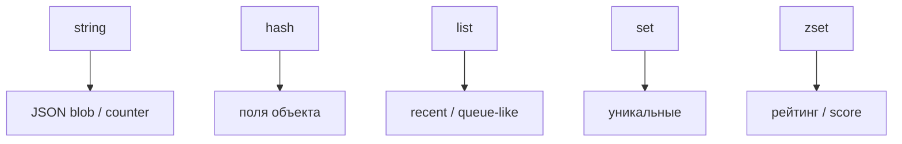

## Введение

После модели KV спрашивают: «какие типы знаете?». Нужно не перечисление, а выбор типа под задачу. Канон — раздел [Data types](https://redis.io/docs/data-types/) на redis.io: каждый ключ имеет **один** тип, команды зависят от него.

## Раздел: string и hash

**string** — максимально простой тип: байтовая строка до 512 MB ([Strings](https://redis.io/docs/data-types/strings/)). JSON-blob, счётчик (`INCR`/`DECR`), битовые операции. Универсально, но обновление одного поля объекта требует перезаписи всего blob.

**hash** — поле→значение внутри одного ключа ([Hashes](https://redis.io/docs/data-types/hashes/)): `HSET user:1 name … email …`. Частичное обновление без сериализации всего объекта; удобно для «мини-строки» профиля.

## Раздел: list, set, zset

**list** — упорядоченная последовательность строк ([Lists](https://redis.io/docs/data-types/lists/)): `LPUSH`/`RPOP`, диапазоны. Ленты recent items; как надёжная очередь задач — только с оговорками (RD06, брокер vs list).

**set** — неупорядоченное множество уникальных строк ([Sets](https://redis.io/docs/data-types/sets/)): теги, уникальные id, `SINTER`/`SUNION`.

**zset (sorted set)** — элемент + **score** ([Sorted sets](https://redis.io/docs/data-types/sorted-sets/)): рейтинги, time-ordered ленты, sliding window rate limit (`ZADD`, `ZRANGE`, `ZREVRANK`).

## Раздел: Выбор типа

Правило: сначала сценарий доступа (целиком / по полю / топ-N / уникальность / порядок по score), потом тип. Не кладите огромный JSON в string, если часто меняете одно поле — берите hash. Не используйте list там, где нужна уникальность — set.

Streams и JSON — отдельные типы в docs; на junior/middle достаточно пяти базовых + честное «уточню в проекте».

## Раздел: Частые вопросы с собеседования

**Вопрос.** Что такое cache-aside и кто отвечает за заполнение кэша?

**Ответ.** Приложение: сначала GET в Redis, при miss — читает БД и SET с TTL. Redis не подтягивает БД сам. После UPDATE в БД нужно удалить или обновить ключ, иначе отдадите stale. Не путать с write-through, где запись идёт в кэш и БД синхронно из одного слоя.

**Вопрос.** Зачем TTL у ключей Redis на собеседовании?

**Ответ.** Страховка от вечного устаревания и runaway-памяти: даже если забыли DEL после UPDATE, данные протухнут. TTL не заменяет явную инвалидацию на критичных сущностях — выбирают баланс «свежесть vs нагрузка на БД».

**Вопрос.** RDB или AOF — что выбрать для персистентности Redis?

**Ответ.** RDB — снимок на диск периодически, компактно, возможна потеря последних секунд. AOF — журнал команд, детальнее восстановление, больше I/O. На практике часто hybrid и политика fsync под допустимую потерю данных; кэш может жить и без персистентности.

**Вопрос.** Что происходит, когда Redis упирается в maxmemory?

**Ответ.** Срабатывает политика eviction (LRU/LFU и др.) — ключи удаляются, hit-rate падает, нагрузка на БД растёт. На собесе связывают с мониторингом памяти, TTL и тем, что hot keys без лимита опасны для всего кластера.

**Вопрос.** Что такое cache stampede и как его ослабить?

**Ответ.** Много запросов одновременно бьют в БД после истечения TTL одного hot key. Лечат singleflight/lock на пересчёт, jitter к TTL, прогрев, короткий stale-while-revalidate. На собесе важно назвать симптом: CPU БД скачет при «простом» GET.

## Лаба

**Цель.** Подобрать тип Redis под три сценария продукта.

**Шаги.**
1. Сессия пользователя (token → userId) — какой тип и ключ?
2. Топ-10 игроков по очкам — какой тип?
3. Список последних 20 действий — какой тип?
4. Профиль с email/name — hash или string? Обоснуйте по docs hashes vs strings.
5. Запишите одну ошибку выбора типа (например list для уникальных id).

**В группу:** партнёр называет сценарий — вы называете тип за 15 секунд.

**Готово, если…**
- [ ] Называете 5 базовых типов
- [ ] Связываете zset с рейтингом
- [ ] Отличаете hash от string-JSON

## Схема: Типы и сценарии

## Тест

### Какой тип для рейтинга с очками?

**Ответ:** zset sorted set

**Пояснение:** Score задаёт порядок; ZREVRANGE отдаёт топ.

### Чем hash удобнее string с JSON?

**Ответ:** частичное обновление полей

**Пояснение:** HSET одного поля без сериализации всего объекта.

### Для чего set в Redis?

**Ответ:** уникальные элементы без дублей

**Пояснение:** Теги, множества id, пересечения/разности.

### Какой тип у ключа после INCR counter:pageviews?

**Ответ:** string как счётчик

**Пояснение:** INCR работает со string; Redis хранит число как строку.

### Можно ли у одного ключа сменить тип?

**Ответ:** нет, тип фиксирован

**Пояснение:** Новый тип — новый ключ или DEL; иначе ошибка команды.

## Шпаргалка

<h3>Типы (<a href="https://redis.io/docs/data-types/">docs</a>)</h3>
<ul>
<li>string — blob / INCR</li>
<li>hash — поля объекта</li>
<li>list — порядок</li>
<li>set — уникальность</li>
<li>zset — score + порядок</li>
</ul>

## Anki

### Front: Какой тип Redis для топ-10 игроков по очкам?

Back: zset (sorted set) с score = очки

### Front: hash vs JSON в string для профиля user:1?

Back: hash — HSET отдельных полей; string — перезапись всего JSON

### Front: list в Redis — типичные команды и смысл?

Back: LPUSH/RPOP; упорядоченная последовательность элементов

### Front: set — когда выбрать вместо list?

Back: Нужна уникальность элементов, порядок не важен

### Front: Сколько типов данных у одного ключа Redis?

Back: Ровно один; команды должны соответствовать типу

### Front: string 512 MB лимит — что это значит на собесе?

Back: Верхняя граница размера значения string по документации

## Итоги

- Пять базовых типов из [redis.io/docs/data-types](https://redis.io/docs/data-types/) закрывают большинство junior-вопросов
- Сначала сценарий, потом тип
- hash ≠ set ≠ zset

## Ссылки

- [Redis documentation](https://redis.io/docs/)
- [Data types](https://redis.io/docs/data-types/)
- [Sorted sets](https://redis.io/docs/data-types/sorted-sets/)
- Learn | [KV модель](/game/learn/rd-kv-model)
- Далее: [TTL и persistence](/game/learn/rd-ttl-persistence)
