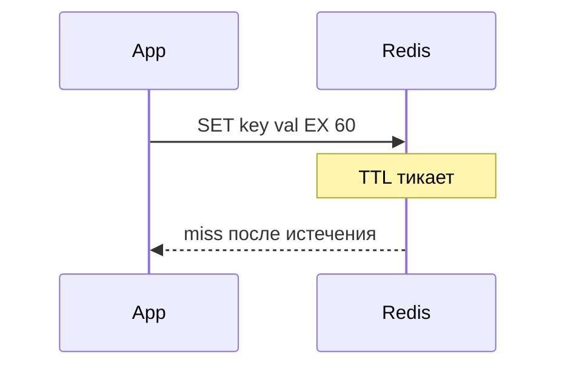

## Введение

TTL и persistence — частая пара вопросов: «протухнет ли ключ» и «что будет после рестарта». В [redis.io/docs](https://redis.io/docs/) TTL описан как свойство ключа; [Persistence](https://redis.io/docs/management/persistence/) — отдельный операционный слой поверх in-memory модели.

## Раздел: TTL

`EXPIRE`, `SET … EX`, `SETEX`, `PEXPIRE` задают время жизни ключа. По истечении ключ удаляется (комбинация lazy и active expiration — детали реализации, на собесе достаточно «ключ исчезает»). Зачем: автоинвалидация кэша, сессии, временные лимиты.

`TTL key` — оставшиеся секунды; `-1` — ключ без TTL; `-2` — ключа нет. `PTTL` — в миллисекундах. Для кэша TTL — базовая гигиена вместе с явной инвалидацией (RD04).

## Раздел: RDB vs AOF

**RDB** — point-in-time снимок dataset на диск (команда `SAVE`/`BGSAVE`, директива `save` в конфиге). Компактный файл, быстрое восстановление; **минус** — окно потери изменений после последнего успешного snapshot.

**AOF** — append-only журнал команд ([AOF](https://redis.io/docs/management/persistence/#append-only-file)). Политики `appendfsync` (always/everysec/no) задают компромисс durability vs latency. Обычно меньше потеря при краше, больше объём и IO; возможна [rewrite](https://redis.io/docs/management/persistence/) AOF для сжатия журнала.

На собесе: «persistence снижает риск, но не делает Redis заменой OLTP-СУБД» (RD01).

## Раздел: Рестарт и репликация

Без persistence и без реплики данные в RAM после kill процесса пропадут. С репликацией master→replica и Sentinel/Cluster картина сложнее (RD07). Junior: «проверю `appendonly`, `save`, бэкапы и есть ли replica».

Гибрид RDB+AOF в production встречается; в docs описаны trade-offs — назовите оба механизма, не угадывайте конфиг заказчика.

## Раздел: Частые вопросы с собеседования

**Вопрос.** Что такое cache-aside и кто отвечает за заполнение кэша?

**Ответ.** Приложение: сначала GET в Redis, при miss — читает БД и SET с TTL. Redis не подтягивает БД сам. После UPDATE в БД нужно удалить или обновить ключ, иначе отдадите stale. Не путать с write-through, где запись идёт в кэш и БД синхронно из одного слоя.

**Вопрос.** Что происходит, когда Redis упирается в maxmemory?

**Ответ.** Срабатывает политика eviction (LRU/LFU и др.) — ключи удаляются, hit-rate падает, нагрузка на БД растёт. На собесе связывают с мониторингом памяти, TTL и тем, что hot keys без лимита опасны для всего кластера.

**Вопрос.** Pub/Sub Redis — это очередь задач?

**Ответ.** Нет. Pub/Sub доставляет сообщение только подписчикам online; без персистентности и ack сообщение теряется, если consumer был offline. Для задач — Lists, Streams с consumer groups или брокер (Rabbit/Kafka), где есть повторная доставка и DLQ.

**Вопрос.** Что такое cache stampede и как его ослабить?

**Ответ.** Много запросов одновременно бьют в БД после истечения TTL одного hot key. Лечат singleflight/lock на пересчёт, jitter к TTL, прогрев, короткий stale-while-revalidate. На собесе важно назвать симптом: CPU БД скачет при «простом» GET.

**Вопрос.** Можно ли считать Redis источником истины для заказов?

**Ответ.** Нет для критичных финансовых фактов: Redis — ускоритель и ephemeral-слой, истина в PostgreSQL (или другой durable store). Потеря ноды/ eviction / restart без AOF не должны стирать оплаченный заказ; кэш восстанавливают из БД.

## Лаба

**Цель.** Смоделировать TTL и описать риск потери при RDB-only.

**Шаги.**
1. В redis-cli (или описать): `SET session:1 alice EX 60`.
2. Проверьте `TTL session:1`.
3. Объясните, что будет через 61 секунду.
4. Сравните RDB и AOF в таблице «потеря / размер / IO» по [persistence](https://redis.io/docs/management/persistence/).
5. Напишите фразу для собеса про рестарт без AOF.

**В группу:** партнёр выбирает RDB или AOF — вы называете главный компромисс из docs.

**Готово, если…**
- [ ] Ставите TTL осознанно
- [ ] Отличаете RDB от AOF
- [ ] Связываете persistence с риском потери

## Схема: Жизнь ключа

## Тест

### Зачем TTL на кэше?

**Ответ:** автоматически удалять устаревшее

**Пояснение:** Снижает риск вечного stale без ручной очистки.

### Главный минус RDB?

**Ответ:** потеря между снимками

**Пояснение:** После краша теряются изменения после последнего dump.

### AOF хранит что?

**Ответ:** журнал команд записи

**Пояснение:** Восстановление replay команд ближе к моменту сбоя.

### TTL -1 на ключе означает?

**Ответ:** ключ без срока жизни

**Пояснение:** Ключ существует, EXPIRE не задан или снят.

### Persistence делает Redis source of truth?

**Ответ:** нет, только снижает риск

**Пояснение:** OLTP-правда по-прежнему часто в PostgreSQL.

## Шпаргалка

<h3>TTL</h3>
<pre><code>SET k v EX 60
TTL k</code></pre>
<h3>Persistence (<a href="https://redis.io/docs/management/persistence/">docs</a>)</h3>
<ul>
<li>RDB — snapshot</li>
<li>AOF — journal</li>
</ul>

## Anki

### Front: Redis TTL -2 на ключе session:1?

Back: Ключа session:1 не существует

### Front: RDB vs AOF одной парой слов?

Back: RDB — снимок; AOF — журнал команд

### Front: Зачем EX на ключе сессии в Redis?

Back: Сессия истечёт без ручного DELETE

### Front: appendfsync everysec в AOF — смысл?

Back: fsync раз в секунду; баланс durability и скорости

### Front: Что теряется при краше с только RDB?

Back: Изменения после последнего успешного snapshot

### Front: SET key val EX 60 — что произойдёт через минуту?

Back: Ключ удалится; GET вернёт miss

## Итоги

- TTL — базовая гигиена кэша ([key expiration](https://redis.io/docs/commands/expire/))
- RDB/AOF — компромисс потери vs IO по [persistence](https://redis.io/docs/management/persistence/)
- Persistence ≠ замена БД

## Ссылки

- [Redis documentation](https://redis.io/docs/)
- [Persistence](https://redis.io/docs/management/persistence/)
- [EXPIRE command](https://redis.io/docs/commands/expire/)
- Learn | [Типы данных](/game/learn/rd-data-types)
- Далее: [cache-aside](/game/learn/rd-cache-aside)
