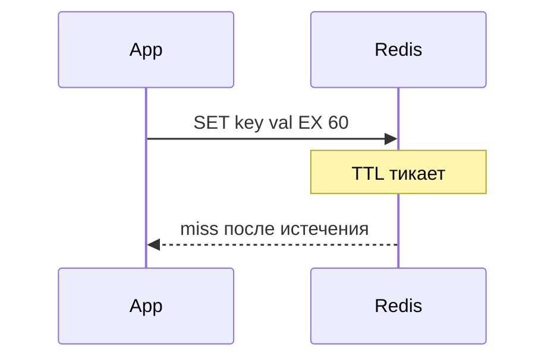
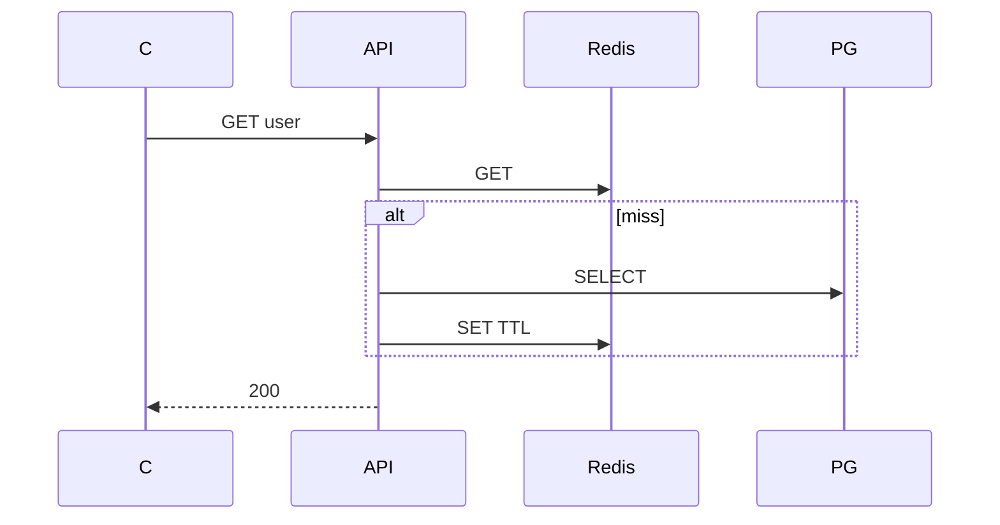
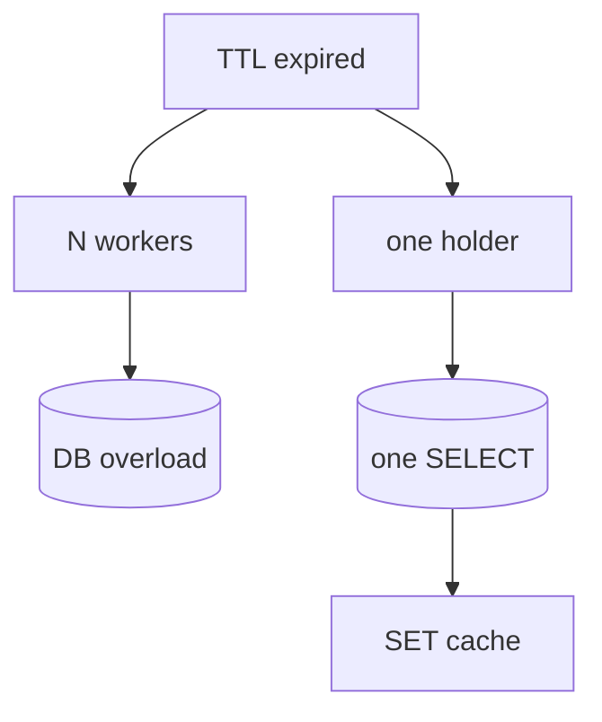

## Введение

TTL и persistence — частая пара вопросов: «протухнет ли ключ» и «что будет после рестарта». В [redis.io/docs](https://redis.io/docs/) TTL описан как свойство ключа; [Persistence](https://redis.io/docs/management/persistence/) — отдельный операционный слой поверх in-memory модели.

**Паттерн cache-aside в Redis.** Middle ждут не «поставим Redis», а паттерн чтения/записи и историю про устаревший кэш. **Cache-aside** (lazy loading) — приложение само читает/пишет Redis; сервер Redis не «подмешивает» БД автоматически ([Caching](https://redis.io/docs/manual/patterns/) / типичная практика вокруг [strings](https://redis.io/docs/data-types/strings/) и TTL из RD03).

**Cache stampede и блокировки.** Когда TTL истекает одновременно у многих воркеров, все бегут в БД — **cache stampede** (dogpile). Типичный контекст — cache-aside (RD04) и hot key. Защита опирается на атомарность Redis: [SET NX](https://redis.io/docs/commands/set/) с TTL, иногда [Redlock](https://redis.io/docs/manual/patterns/distributed-locks/) для распределённых lock (на собесе middle достаточно «lock на ключ кэша с EX»).

## Раздел: Как отвечать одним блоком

Этот выпуск собрал соседние короткие темы трека: «TTL и persistence Redis», «Паттерн cache-aside в Redis», «Cache stampede и блокировки». Раньше каждая занимала отдельную карточку на несколько минут, а на собеседовании их спрашивают одним блоком. Ниже у каждой темы свой раздел, затем общие лабы, один тест и одна колода карточек. В ответе сначала назовите, какую тему спросили, потом определение и один пример. Не проговаривайте все разделы, если спросили один. Лабы можно пройти по порядку исходного трека. Если времени мало, сделайте первую и последнюю: первая ставит язык, последняя проверяет, что соседние темы вы не перепутали.

## Раздел: TTL и persistence Redis: TTL

`EXPIRE`, `SET … EX`, `SETEX`, `PEXPIRE` задают время жизни ключа. По истечении ключ удаляется (комбинация lazy и active expiration — детали реализации, на собесе достаточно «ключ исчезает»). Зачем: автоинвалидация кэша, сессии, временные лимиты.

`TTL key` — оставшиеся секунды; `-1` — ключ без TTL; `-2` — ключа нет. `PTTL` — в миллисекундах. Для кэша TTL — базовая гигиена вместе с явной инвалидацией (RD04).

## Раздел: TTL и persistence Redis: RDB vs AOF

**RDB** — point-in-time снимок dataset на диск (команда `SAVE`/`BGSAVE`, директива `save` в конфиге). Компактный файл, быстрое восстановление; **минус** — окно потери изменений после последнего успешного snapshot.

**AOF** — append-only журнал команд ([AOF](https://redis.io/docs/management/persistence/#append-only-file)). Политики `appendfsync` (always/everysec/no) задают компромисс durability vs latency. Обычно меньше потеря при краше, больше объём и IO; возможна [rewrite](https://redis.io/docs/management/persistence/) AOF для сжатия журнала.

На собесе: «persistence снижает риск, но не делает Redis заменой OLTP-СУБД» (RD01).

## Раздел: TTL и persistence Redis: Рестарт и репликация

Без persistence и без реплики данные в RAM после kill процесса пропадут. С репликацией master→replica и Sentinel/Cluster картина сложнее (RD07). Junior: «проверю `appendonly`, `save`, бэкапы и есть ли replica».

Гибрид RDB+AOF в production встречается; в docs описаны trade-offs — назовите оба механизма, не угадывайте конфиг заказчика.

## Раздел: TTL и persistence Redis: Частые вопросы с собеседования

**Вопрос.** Что такое cache-aside и кто отвечает за заполнение кэша?

**Ответ.** Приложение: сначала GET в Redis, при miss — читает БД и SET с TTL. Redis не подтягивает БД сам. После UPDATE в БД нужно удалить или обновить ключ, иначе отдадите stale. Не путать с write-through, где запись идёт в кэш и БД синхронно из одного слоя.

**Вопрос.** Что происходит, когда Redis упирается в maxmemory?

**Ответ.** Срабатывает политика eviction (LRU/LFU и др.) — ключи удаляются, hit-rate падает, нагрузка на БД растёт. На собесе связывают с мониторингом памяти, TTL и тем, что hot keys без лимита опасны для всего кластера.

**Вопрос.** Pub/Sub Redis — это очередь задач?

**Ответ.** Нет. Pub/Sub доставляет сообщение только подписчикам online; без персистентности и ack сообщение теряется, если consumer был offline. Для задач — Lists, Streams с consumer groups или брокер (Rabbit/Kafka), где есть повторная доставка и DLQ.

**Вопрос.** Что такое cache stampede и как его ослабить?

**Ответ.** Много запросов одновременно бьют в БД после истечения TTL одного hot key. Лечат singleflight/lock на пересчёт, jitter к TTL, прогрев, короткий stale-while-revalidate. На собесе важно назвать симптом: CPU БД скачет при «простом» GET.

**Вопрос.** Можно ли считать Redis источником истины для заказов?

**Ответ.** Нет для критичных финансовых фактов: Redis — ускоритель и ephemeral-слой, истина в PostgreSQL (или другой durable store). Потеря ноды/ eviction / restart без AOF не должны стирать оплаченный заказ; кэш восстанавливают из БД.

## Раздел: Паттерн cache-aside в Redis: cache-aside

1) `GET` ключ в Redis; 2) hit → отдать; 3) miss → читать БД; 4) `SET` в Redis с TTL; 5) отдать клиенту.

Запись в БД: обновить PostgreSQL, затем **удалить** или обновить ключ кэша (иначе stale). Это не write-through (когда запись идёт в кэш и БД синхронно) и не read-through (когда кэш сам ходит в БД).

## Раздел: Паттерн cache-aside в Redis: Ключ

Ключ = сущность + id или стабильный hash параметров запроса (`user:42`, `search:sha256(params)`). Версионирование (`cache:v2:user:42`) помогает при смене формата значения без массового DEL по старому префиксу.

Согласуйте namespace с RD01; для объектов с полями часто string (JSON) или hash (RD02).

## Раздел: Паттерн cache-aside в Redis: Инвалидация

Сложнее hit-path: кто сбрасывает кэш при UPDATE? Варианты: TTL как страховка, явный `DEL` в том же сервисе после commit, событие через pub/sub на все ноды (RD06). Антипаттерн — вечный ключ без политики.

При высокой нагрузке на hot key смотрите stampede (RD05).

См. также: [Python БД и Memcached](/game/learn/py-perf-packaging-alt-runtimes).

## Раздел: Паттерн cache-aside в Redis: Частые вопросы с собеседования

**Вопрос.** RDB или AOF — что выбрать для персистентности Redis?

**Ответ.** RDB — снимок на диск периодически, компактно, возможна потеря последних секунд. AOF — журнал команд, детальнее восстановление, больше I/O. На практике часто hybrid и политика fsync под допустимую потерю данных; кэш может жить и без персистентности.

**Вопрос.** Что происходит, когда Redis упирается в maxmemory?

**Ответ.** Срабатывает политика eviction (LRU/LFU и др.) — ключи удаляются, hit-rate падает, нагрузка на БД растёт. На собесе связывают с мониторингом памяти, TTL и тем, что hot keys без лимита опасны для всего кластера.

**Вопрос.** Можно ли считать Redis источником истины для заказов?

**Ответ.** Нет для критичных финансовых фактов: Redis — ускоритель и ephemeral-слой, истина в PostgreSQL (или другой durable store). Потеря ноды/ eviction / restart без AOF не должны стирать оплаченный заказ; кэш восстанавливают из БД.

## Раздел: Cache stampede и блокировки: Проблема

Популярный ключ протух → N параллельных запросов делают один и тот же тяжёлый SELECT. БД перегружается в момент «дружного miss». Усугубляется фиксированным TTL у всех копий (одновременное истечение).

## Раздел: Cache stampede и блокировки: Защита

**Singleflight / lock на ключ**: первый воркер `SET lock:user:1 token NX EX 5`, грузит БД, пишет кэш, `DEL` lock; остальные ждут повторный GET, отдают stale или короткий retry.

**Soft TTL / early refresh** — обновлять кэш до жёсткого протухания (фоновый worker или probabilistic early expiration). **Jitter** на TTL — размазать моменты EXPIRE.

Lock — не замена транзакции; держите EX коротким, идempotency при повторной загрузке.

## Раздел: Cache stampede и блокировки: Связь с Memcached

Та же идея в PY20 про dogpile. Redis даёт NX+EX «из коробки» для простого mutex на hot key.

См. [py-perf-packaging-alt-runtimes](/game/learn/py-perf-packaging-alt-runtimes).

## Раздел: Cache stampede и блокировки: Частые вопросы с собеседования

**Вопрос.** RDB или AOF — что выбрать для персистентности Redis?

**Ответ.** RDB — снимок на диск периодически, компактно, возможна потеря последних секунд. AOF — журнал команд, детальнее восстановление, больше I/O. На практике часто hybrid и политика fsync под допустимую потерю данных; кэш может жить и без персистентности.

**Вопрос.** Что происходит, когда Redis упирается в maxmemory?

**Ответ.** Срабатывает политика eviction (LRU/LFU и др.) — ключи удаляются, hit-rate падает, нагрузка на БД растёт. На собесе связывают с мониторингом памяти, TTL и тем, что hot keys без лимита опасны для всего кластера.

**Вопрос.** Pub/Sub Redis — это очередь задач?

**Ответ.** Нет. Pub/Sub доставляет сообщение только подписчикам online; без персистентности и ack сообщение теряется, если consumer был offline. Для задач — Lists, Streams с consumer groups или брокер (Rabbit/Kafka), где есть повторная доставка и DLQ.

**Вопрос.** Можно ли считать Redis источником истины для заказов?

**Ответ.** Нет для критичных финансовых фактов: Redis — ускоритель и ephemeral-слой, истина в PostgreSQL (или другой durable store). Потеря ноды/ eviction / restart без AOF не должны стирать оплаченный заказ; кэш восстанавливают из БД.

## Лаба

**TTL и persistence Redis.**

**Цель.** Смоделировать TTL и описать риск потери при RDB-only.

**Шаги.**
1. В redis-cli (или описать): `SET session:1 alice EX 60`.
2. Проверьте `TTL session:1`.
3. Объясните, что будет через 61 секунду.
4. Сравните RDB и AOF в таблице «потеря / размер / IO» по [persistence](https://redis.io/docs/management/persistence/).
5. Напишите фразу для собеса про рестарт без AOF.

**В группу:** партнёр выбирает RDB или AOF — вы называете главный компромисс из docs.

**Готово, если…**
- [ ] Ставите TTL осознанно
- [ ] Отличаете RDB от AOF
- [ ] Связываете persistence с риском потери

**Паттерн cache-aside в Redis.**

**Цель.** Описать cache-aside для GET /users/{id}.

**Шаги.**
1. Псевдокод hit/miss.
2. Ключ `user:{id}`.
3. Сценарий UPDATE name — что с ключом?
4. Выберите TTL (и почему не «навсегда»).
5. Назовите риск stale после записи без DEL.

**В группу:** один пишет hit-path, второй — invalidation path.

**Готово, если…**
- [ ] Рисуете hit/miss
- [ ] Связываете UPDATE с DEL
- [ ] Не путаете write-through с cache-aside

**Cache stampede и блокировки.**

**Цель.** Смоделировать stampede на бумаге и добавить lock.

**Шаги.**
1. Нарисуйте 5 клиентов на один miss без защиты.
2. Добавьте `SET key:lock 1 NX EX 5`.
3. Опишите поведение второго клиента.
4. Назовите риск lock без EX.
5. Сравните с jitter на TTL.

**В группу:** кто держит lock — кто ждёт; обсудите timeout.

**Готово, если…**
- [ ] Объясняете stampede
- [ ] Знаете SET NX как lock
- [ ] Связываете с hot key

## Схема: TTL и persistence Redis: Жизнь ключа

## Схема: Паттерн cache-aside в Redis: cache-aside

## Схема: Cache stampede и блокировки: Stampede

## Тест

### Зачем TTL на кэше?

**Ответ:** автоматически удалять устаревшее

**Пояснение:** Снижает риск вечного stale без ручной очистки.

### Что делает приложение при miss?

**Ответ:** читает БД, SET в Redis

**Пояснение:** Кэш заполняется lazy (cache-aside).

### Что такое cache stampede?

**Ответ:** массовый miss одного ключа

**Пояснение:** Ещё называют dogpile; N одинаковых SELECT.

### Главный минус RDB?

**Ответ:** потеря между снимками

**Пояснение:** После краша теряются изменения после последнего dump.

### Что с ключом после UPDATE в БД?

**Ответ:** DEL или обновить ключ

**Пояснение:** Иначе клиент читает stale.

## Шпаргалка

<ul><li>RDB — snapshot</li><li>AOF — journal</li><li>cache-aside get(k): v = redis.get(k) if v: return v v = db.get() redis.set(k, v, ttl) return v</li><li>один грузит БД</li><li>остальные ждут / stale</li></ul>

## Anki

### Front: Redis TTL -2 на ключе session:1?

Back: Ключа session:1 не существует

### Front: cache-aside hit на GET user:42?

Back: Значение из Redis; БД не вызывается

### Front: dogpile / cache stampede — что происходит?

Back: Много воркеров одновременно грузят БД после TTL одного hot key

### Front: RDB vs AOF одной парой слов?

Back: RDB — снимок; AOF — журнал команд

### Front: После UPDATE user в PostgreSQL что с Redis user:42?

Back: DEL user:42 или SET новым значением

### Front: SET lock:key 1 NX EX 5 — зачем NX и EX?

Back: NX — только если lock свободен; EX — автоснятие через 5 сек

## Итоги

- TTL — базовая гигиена кэша ([key expiration](https://redis.io/docs/commands/expire/))
- RDB/AOF — компромисс потери vs IO по [persistence](https://redis.io/docs/management/persistence/)
- Persistence ≠ замена БД
- Hit/miss — база middle
- Инвалидация = половина дизайна
- TTL — страховка; паттерн согласуется с [redis.io/docs](https://redis.io/docs/)
- Stampede = дружный miss на hot key
- Lock/singleflight + jitter/soft TTL

## Ссылки

- [Redis documentation](https://redis.io/docs/)
- [Persistence](https://redis.io/docs/management/persistence/)
- [EXPIRE command](https://redis.io/docs/commands/expire/)
- [Типы данных](/game/learn/rd-kv-model)
- [Data types — strings](https://redis.io/docs/data-types/strings/)
- [PY20 кеш](/game/learn/py-perf-packaging-alt-runtimes)
- [SET command (NX, EX)](https://redis.io/docs/commands/set/)
- [Distributed locks pattern](https://redis.io/docs/manual/patterns/distributed-locks/)
- [pub/sub vs очередь](/game/learn/rd-pubsub-vs-queue)
