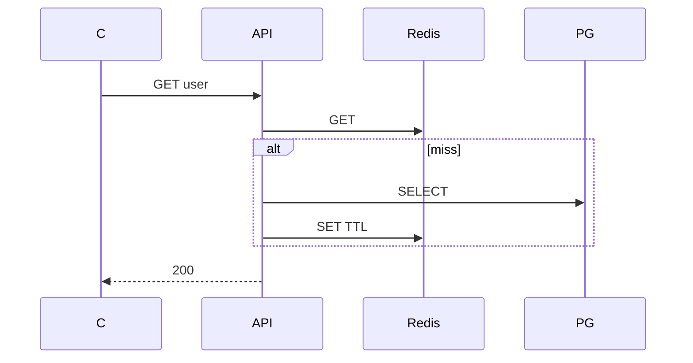

## Введение

Middle ждут не «поставим Redis», а паттерн чтения/записи и историю про устаревший кэш. **Cache-aside** (lazy loading) — приложение само читает/пишет Redis; сервер Redis не «подмешивает» БД автоматически ([Caching](https://redis.io/docs/manual/patterns/) / типичная практика вокруг [strings](https://redis.io/docs/data-types/strings/) и TTL из RD03).

## Раздел: cache-aside

1) `GET` ключ в Redis; 2) hit → отдать; 3) miss → читать БД; 4) `SET` в Redis с TTL; 5) отдать клиенту.

Запись в БД: обновить PostgreSQL, затем **удалить** или обновить ключ кэша (иначе stale). Это не write-through (когда запись идёт в кэш и БД синхронно) и не read-through (когда кэш сам ходит в БД).

## Раздел: Ключ

Ключ = сущность + id или стабильный hash параметров запроса (`user:42`, `search:sha256(params)`). Версионирование (`cache:v2:user:42`) помогает при смене формата значения без массового DEL по старому префиксу.

Согласуйте namespace с RD01; для объектов с полями часто string (JSON) или hash (RD02).

## Раздел: Инвалидация

Сложнее hit-path: кто сбрасывает кэш при UPDATE? Варианты: TTL как страховка, явный `DEL` в том же сервисе после commit, событие через pub/sub на все ноды (RD06). Антипаттерн — вечный ключ без политики.

При высокой нагрузке на hot key смотрите stampede (RD05).

См. также: [Python БД и Memcached](/game/learn/py-db-cache-memcached).

## Раздел: Частые вопросы с собеседования

**Вопрос.** RDB или AOF — что выбрать для персистентности Redis?

**Ответ.** RDB — снимок на диск периодически, компактно, возможна потеря последних секунд. AOF — журнал команд, детальнее восстановление, больше I/O. На практике часто hybrid и политика fsync под допустимую потерю данных; кэш может жить и без персистентности.

**Вопрос.** Что происходит, когда Redis упирается в maxmemory?

**Ответ.** Срабатывает политика eviction (LRU/LFU и др.) — ключи удаляются, hit-rate падает, нагрузка на БД растёт. На собесе связывают с мониторингом памяти, TTL и тем, что hot keys без лимита опасны для всего кластера.

**Вопрос.** Можно ли считать Redis источником истины для заказов?

**Ответ.** Нет для критичных финансовых фактов: Redis — ускоритель и ephemeral-слой, истина в PostgreSQL (или другой durable store). Потеря ноды/ eviction / restart без AOF не должны стирать оплаченный заказ; кэш восстанавливают из БД.

## Лаба

**Цель.** Описать cache-aside для GET /users/{id}.

**Шаги.**
1. Псевдокод hit/miss.
2. Ключ `user:{id}`.
3. Сценарий UPDATE name — что с ключом?
4. Выберите TTL (и почему не «навсегда»).
5. Назовите риск stale после записи без DEL.

**В группу:** один пишет hit-path, второй — invalidation path.

**Готово, если…**
- [ ] Рисуете hit/miss
- [ ] Связываете UPDATE с DEL
- [ ] Не путаете write-through с cache-aside

## Схема: cache-aside

## Тест

### Что делает приложение при miss?

**Ответ:** читает БД, SET в Redis

**Пояснение:** Кэш заполняется lazy (cache-aside).

### Что с ключом после UPDATE в БД?

**Ответ:** DEL или обновить ключ

**Пояснение:** Иначе клиент читает stale.

### Зачем TTL при cache-aside?

**Ответ:** страховка от забытых DEL

**Пояснение:** Ограничивает жизнь устаревших данных.

### Кто заполняет кэш в cache-aside?

**Ответ:** приложение после miss

**Пояснение:** Redis не ходит в PostgreSQL сам.

### cache-aside vs write-through в одной фразе?

**Ответ:** lazy read vs запись в кэш и БД

**Пояснение:** Write-through синхронно обновляет оба слоя при write.

## Шпаргалка

<h3>cache-aside</h3>
<pre><code>get(k):
  v = redis.get(k)
  if v: return v
  v = db.get()
  redis.set(k, v, ttl)
  return v</code></pre>

## Anki

### Front: cache-aside hit на GET user:42?

Back: Значение из Redis; БД не вызывается

### Front: После UPDATE user в PostgreSQL что с Redis user:42?

Back: DEL user:42 или SET новым значением

### Front: Стабильный ключ кэша для GET /users/42?

Back: user:42 или согласованный префикс namespace

### Front: Зачем TTL если есть DEL при UPDATE?

Back: Страховка если инвалидацию забыли или событие потерялось

### Front: cache-aside — кто пишет в Redis при miss?

Back: Код приложения после SELECT из БД

### Front: Риск без инвалидации после UPDATE?

Back: Клиент получает устаревшие данные из кэша

## Итоги

- Hit/miss — база middle
- Инвалидация = половина дизайна
- TTL — страховка; паттерн согласуется с [redis.io/docs](https://redis.io/docs/)

## Ссылки

- [Redis documentation](https://redis.io/docs/)
- [Data types — strings](https://redis.io/docs/data-types/strings/)
- [Key expiration](https://redis.io/docs/commands/expire/)
- Learn | [PY20 кеш](/game/learn/py-db-cache-memcached)
- Learn | [TTL](/game/learn/rd-ttl-persistence)
- Далее: [Stampede и locks](/game/learn/rd-stampede-locks)
