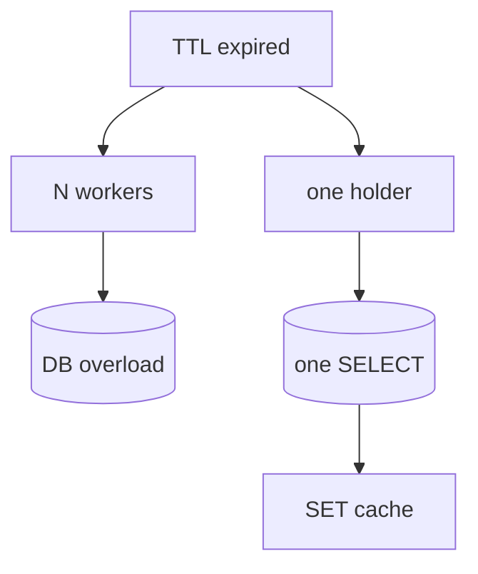

## Введение

Когда TTL истекает одновременно у многих воркеров, все бегут в БД — **cache stampede** (dogpile). Типичный контекст — cache-aside (RD04) и hot key. Защита опирается на атомарность Redis: [SET NX](https://redis.io/docs/commands/set/) с TTL, иногда [Redlock](https://redis.io/docs/manual/patterns/distributed-locks/) для распределённых lock (на собесе middle достаточно «lock на ключ кэша с EX»).

## Раздел: Проблема

Популярный ключ протух → N параллельных запросов делают один и тот же тяжёлый SELECT. БД перегружается в момент «дружного miss». Усугубляется фиксированным TTL у всех копий (одновременное истечение).

## Раздел: Защита

**Singleflight / lock на ключ**: первый воркер `SET lock:user:1 token NX EX 5`, грузит БД, пишет кэш, `DEL` lock; остальные ждут повторный GET, отдают stale или короткий retry.

**Soft TTL / early refresh** — обновлять кэш до жёсткого протухания (фоновый worker или probabilistic early expiration). **Jitter** на TTL — размазать моменты EXPIRE.

Lock — не замена транзакции; держите EX коротким, идempotency при повторной загрузке.

## Раздел: Связь с Memcached

Та же идея в PY20 про dogpile. Redis даёт NX+EX «из коробки» для простого mutex на hot key.

См. [py-db-cache-memcached](/game/learn/py-db-cache-memcached).

## Раздел: Частые вопросы с собеседования

**Вопрос.** RDB или AOF — что выбрать для персистентности Redis?

**Ответ.** RDB — снимок на диск периодически, компактно, возможна потеря последних секунд. AOF — журнал команд, детальнее восстановление, больше I/O. На практике часто hybrid и политика fsync под допустимую потерю данных; кэш может жить и без персистентности.

**Вопрос.** Что происходит, когда Redis упирается в maxmemory?

**Ответ.** Срабатывает политика eviction (LRU/LFU и др.) — ключи удаляются, hit-rate падает, нагрузка на БД растёт. На собесе связывают с мониторингом памяти, TTL и тем, что hot keys без лимита опасны для всего кластера.

**Вопрос.** Pub/Sub Redis — это очередь задач?

**Ответ.** Нет. Pub/Sub доставляет сообщение только подписчикам online; без персистентности и ack сообщение теряется, если consumer был offline. Для задач — Lists, Streams с consumer groups или брокер (Rabbit/Kafka), где есть повторная доставка и DLQ.

**Вопрос.** Можно ли считать Redis источником истины для заказов?

**Ответ.** Нет для критичных финансовых фактов: Redis — ускоритель и ephemeral-слой, истина в PostgreSQL (или другой durable store). Потеря ноды/ eviction / restart без AOF не должны стирать оплаченный заказ; кэш восстанавливают из БД.

## Лаба

**Цель.** Смоделировать stampede на бумаге и добавить lock.

**Шаги.**
1. Нарисуйте 5 клиентов на один miss без защиты.
2. Добавьте `SET key:lock 1 NX EX 5`.
3. Опишите поведение второго клиента.
4. Назовите риск lock без EX.
5. Сравните с jitter на TTL.

**В группу:** кто держит lock — кто ждёт; обсудите timeout.

**Готово, если…**
- [ ] Объясняете stampede
- [ ] Знаете SET NX как lock
- [ ] Связываете с hot key

## Схема: Stampede

## Тест

### Что такое cache stampede?

**Ответ:** массовый miss одного ключа

**Пояснение:** Ещё называют dogpile; N одинаковых SELECT.

### Как SET NX помогает?

**Ответ:** один воркер грузит БД

**Пояснение:** Остальные не дублируют тяжёлый запрос.

### Риск lock без TTL EX?

**Ответ:** вечная блокировка

**Пояснение:** EX снимает lock при падении держателя.

### Что такое singleflight в контексте кэша?

**Ответ:** один запрос на ключ

**Пояснение:** Остальные ждут результат первого.

### Jitter на TTL зачем?

**Ответ:** размазать истечение ключей

**Пояснение:** Меньше одновременных miss на hot key.

## Шпаргалка

<h3>Lock</h3>
<pre><code>SET lock:user:1 1 NX EX 5</code></pre>
<ul><li>один грузит БД</li><li>остальные ждут / stale</li></ul>

## Anki

### Front: dogpile / cache stampede — что происходит?

Back: Много воркеров одновременно грузят БД после TTL одного hot key

### Front: SET lock:key 1 NX EX 5 — зачем NX и EX?

Back: NX — только если lock свободен; EX — автоснятие через 5 сек

### Front: soft TTL в защите от stampede?

Back: Обновлять кэш до жёсткого протухания, не ждать mass miss

### Front: Второй клиент при занятом lock:user:1?

Back: Ждёт GET кэша, retry или отдаёт stale

### Front: Stampede связан с каким паттерном RD04?

Back: cache-aside при одновременном miss

### Front: Почему фиксированный TTL у hot key опасен?

Back: Все ключи протухают одновременно → штурм БД

## Итоги

- Stampede = дружный miss на hot key
- Lock/singleflight + jitter/soft TTL
- SET NX EX — базовый приём; см. [SET](https://redis.io/docs/commands/set/)

## Ссылки

- [Redis documentation](https://redis.io/docs/)
- [SET command (NX, EX)](https://redis.io/docs/commands/set/)
- [Distributed locks pattern](https://redis.io/docs/manual/patterns/distributed-locks/)
- Learn | [cache-aside](/game/learn/rd-cache-aside)
- Learn | [PY20](/game/learn/py-db-cache-memcached)
- Далее: [pub/sub vs очередь](/game/learn/rd-pubsub-vs-queue)
