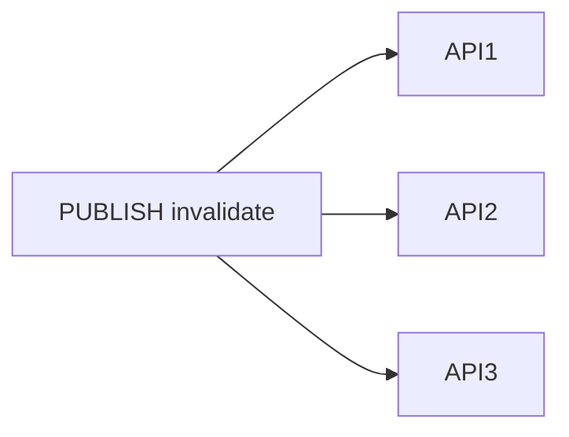
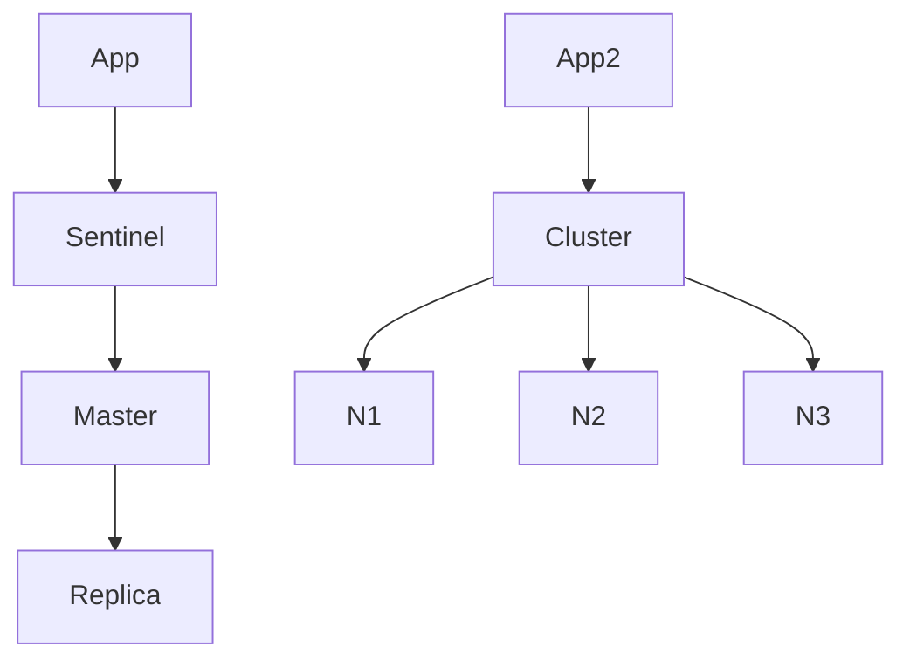
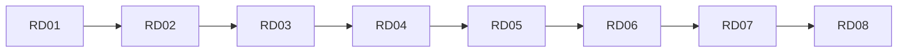

## Введение

Redis умеет [Pub/Sub](https://redis.io/docs/interact/pubsub/): `PUBLISH channel message` и `SUBSCRIBE`. Middle должен провести границу с **очередью/брокером** (Kafka, RabbitMQ) — другая семантика доставки и хранения.

**Eviction, Sentinel и Cluster.** Senior-вопросы: что будет, когда память кончилась, и чем **Sentinel** отличается от **Cluster**. Канон: [Eviction](https://redis.io/docs/reference/eviction/), [High availability with Sentinel](https://redis.io/docs/management/sentinel/), [Cluster specification](https://redis.io/docs/reference/cluster-spec/).

**Чеклист Redis.** Финальный выпуск: собрать ответы серии и проверить пробелы перед собесом. Термины и границы — по [redis.io/docs](https://redis.io/docs/); сценарии гибрида с PostgreSQL — по вашему стеку.

## Раздел: Как отвечать одним блоком

Этот выпуск собрал соседние короткие темы трека: «Redis pub/sub vs брокер», «Eviction, Sentinel и Cluster», «Чеклист Redis». Раньше каждая занимала отдельную карточку на несколько минут, а на собеседовании их спрашивают одним блоком. Ниже у каждой темы свой раздел, затем общие лабы, один тест и одна колода карточек. В ответе сначала назовите, какую тему спросили, потом определение и один пример. Не проговаривайте все разделы, если спросили один. Лабы можно пройти по порядку исходного трека. Если времени мало, сделайте первую и последнюю: первая ставит язык, последняя проверяет, что соседние темы вы не перепутали.

## Раздел: Redis pub/sub vs брокер: Redis pub/sub

Fire-and-forget fan-out: сообщение получают **только подписчики online** в момент публикации. Нет персистентного журнала «из коробки» как у Kafka; offline-подписчик сообщение не увидит. Подходит для сигналов, [cache invalidation](https://redis.io/docs/manual/patterns/) между инстансами API, live-уведомлений, координации «сбрось локальный кэш».

Pattern matching: `PSUBSCRIBE news.*`. Нагрузка: при медленном подписчике буфер может расти — operational нюанс из docs.

## Раздел: Redis pub/sub vs брокер: Брокер и Redis Streams (граница)

Kafka/Rabbit хранят сообщения на диске, дают ack, retry, DLQ, consumer groups, replay. См. [sa-sync-async-queues](/game/learn/sa-sync-async-queues).

**Redis Streams** ([Streams](https://redis.io/docs/data-types/streams/)) — consumer groups и retention в Redis; ближе к «лёгкой очереди», но не полная замена Kafka для petabyte-логов. На middle: pub/sub = сигнал; брокер = бизнес-событие с гарантиями; Streams — уточню требования.

## Раздел: Redis pub/sub vs брокер: Выбор

Replay, at-least-once, долгая очередь писем → бroker. Лёгкий fan-out «invalidate user:42 на всех нодах» → pub/sub. List как очередь без ack — антипаттерн для критичной почты.

## Раздел: Redis pub/sub vs брокер: Частые вопросы с собеседования

**Вопрос.** Что такое cache-aside и кто отвечает за заполнение кэша?

**Ответ.** Приложение: сначала GET в Redis, при miss — читает БД и SET с TTL. Redis не подтягивает БД сам. После UPDATE в БД нужно удалить или обновить ключ, иначе отдадите stale. Не путать с write-through, где запись идёт в кэш и БД синхронно из одного слоя.

**Вопрос.** Зачем TTL у ключей Redis на собеседовании?

**Ответ.** Страховка от вечного устаревания и runaway-памяти: даже если забыли DEL после UPDATE, данные протухнут. TTL не заменяет явную инвалидацию на критичных сущностях — выбирают баланс «свежесть vs нагрузка на БД».

**Вопрос.** RDB или AOF — что выбрать для персистентности Redis?

**Ответ.** RDB — снимок на диск периодически, компактно, возможна потеря последних секунд. AOF — журнал команд, детальнее восстановление, больше I/O. На практике часто hybrid и политика fsync под допустимую потерю данных; кэш может жить и без персистентности.

**Вопрос.** Что происходит, когда Redis упирается в maxmemory?

**Ответ.** Срабатывает политика eviction (LRU/LFU и др.) — ключи удаляются, hit-rate падает, нагрузка на БД растёт. На собесе связывают с мониторингом памяти, TTL и тем, что hot keys без лимита опасны для всего кластера.

**Вопрос.** Можно ли считать Redis источником истины для заказов?

**Ответ.** Нет для критичных финансовых фактов: Redis — ускоритель и ephemeral-слой, истина в PostgreSQL (или другой durable store). Потеря ноды/ eviction / restart без AOF не должны стирать оплаченный заказ; кэш восстанавливают из БД.

## Раздел: Eviction, Sentinel и Cluster: Eviction

`maxmemory` ограничивает RAM; при достижении срабатывает `maxmemory-policy`. Частые значения ([docs](https://redis.io/docs/reference/eviction/)):

- `noeviction` — новые записи с ошибкой, ключи не вытесняются (не «чистый кэш»).
- `allkeys-lru` / `allkeys-lfu` — вытеснение среди **всех** ключей по LRU/LFU.
- `volatile-lru` / `volatile-lfu` / `volatile-ttl` — только ключи **с TTL**.

Для чистого кэша — LRU/LFU; для смешанных данных — осознанный TTL на некритичных ключах или `noeviction` + алерты.

## Раздел: Eviction, Sentinel и Cluster: Sentinel

Sentinel мониторит master/replica, голосует за failover, публикует новый master клиентам. Это **HA одного логического шарда** (репликация), не деление данных по объёму. Async replication → риск потери последних записей при failover (обсудите RPO).

## Раздел: Eviction, Sentinel и Cluster: Cluster

[Redis Cluster](https://redis.io/docs/reference/cluster-spec/) делит ключи на **16384 hash slots** между master-нодами; клиент следует `MOVED`/`ASK`. Масштаб по данным и QPS; multi-key операции только в одном slot (или hash tags `{user:1}:…`). Reshard и отказ ноды — operational темы; на собесе: «Cluster = шарды; Sentinel = автопромоут replica».

## Раздел: Eviction, Sentinel и Cluster: Частые вопросы с собеседования

**Вопрос.** Что такое cache-aside и кто отвечает за заполнение кэша?

**Ответ.** Приложение: сначала GET в Redis, при miss — читает БД и SET с TTL. Redis не подтягивает БД сам. После UPDATE в БД нужно удалить или обновить ключ, иначе отдадите stale. Не путать с write-through, где запись идёт в кэш и БД синхронно из одного слоя.

**Вопрос.** RDB или AOF — что выбрать для персистентности Redis?

**Ответ.** RDB — снимок на диск периодически, компактно, возможна потеря последних секунд. AOF — журнал команд, детальнее восстановление, больше I/O. На практике часто hybrid и политика fsync под допустимую потерю данных; кэш может жить и без персистентности.

**Вопрос.** Что такое cache stampede и как его ослабить?

**Ответ.** Много запросов одновременно бьют в БД после истечения TTL одного hot key. Лечат singleflight/lock на пересчёт, jitter к TTL, прогрев, короткий stale-while-revalidate. На собесе важно назвать симптом: CPU БД скачет при «простом» GET.

**Вопрос.** Можно ли считать Redis источником истины для заказов?

**Ответ.** Нет для критичных финансовых фактов: Redis — ускоритель и ephemeral-слой, истина в PostgreSQL (или другой durable store). Потеря ноды/ eviction / restart без AOF не должны стирать оплаченный заказ; кэш восстанавливают из БД.

## Раздел: Чеклист Redis: Ответ вслух

Redis у меня — структуры и срок жизни ключа, не основная база заказов. Я называю cache-aside, TTL и чем pub/sub хуже очереди, если воркер спал.

## Раздел: Чеклист Redis: Плохой ответ

«Положим всё в Redis, он в памяти». Нет источника правды и нет выселения.

## Раздел: Чеклист Redis: Термины

Ключ-значение — key-value. Выселение — eviction. Срок жизни — TTL.

## Раздел: Чеклист Redis: Чеклист уровней

**Junior (RD01–RD03):** KV, [типы](https://redis.io/docs/data-types/), TTL, [RDB/AOF](https://redis.io/docs/management/persistence/), не source of truth.

**Middle (RD04–RD06):** cache-aside, stampede (SET NX EX), [pub/sub](https://redis.io/docs/interact/pubsub/) vs брокер.

**Senior (RD07):** [eviction](https://redis.io/docs/reference/eviction/), Sentinel vs [Cluster](https://redis.io/docs/reference/cluster-spec/).

## Раздел: Чеклист Redis: Redis vs PostgreSQL

PostgreSQL — схема, JOIN, транзакции, отчёты, долговременная правда. Redis — низкая задержка, кэш, счётчики (string INCR), zset-рейтинги, сигналы. Гибрид нормален: запись в PG, ускорение чтения в Redis с TTL и инвалидацией. См. [sql-ddl-dml-dcl](/game/learn/sql-ddl-dml-dcl).

## Раздел: Чеклист Redis: Индекс slug

| Ep | slug |
|----|------|
| RD01 | rd-kv-model |
| RD02 | rd-kv-model |
| RD03 | rd-ttl-persistence |
| RD04 | rd-ttl-persistence |
| RD05 | rd-ttl-persistence |
| RD06 | rd-pubsub-vs-queue |
| RD07 | rd-pubsub-vs-queue |
| RD08 | rd-pubsub-vs-queue |

## Раздел: Чеклист Redis: Частые вопросы с собеседования

**Вопрос.** RDB или AOF?
**Ответ.** RDB — снимки, быстрее восстановление, можно потерять окно между ними. AOF — журнал команд, меньше потерь, дороже диск. Часто включают оба.

**Вопрос.** Чем pub/sub хуже очереди задач?
**Ответ.** Сообщение без подписчика пропадает, нет ack. Для работ берут очередь или Streams.

**Вопрос.** Что такое cache stampede?
**Ответ.** Много клиентов одновременно не находят ключ и бьют в БД. Лечат singleflight, блокировку или раннее обновление.

## Лаба

**Redis pub/sub vs брокер.**

**Цель.** Выбрать механизм для двух сценариев.

**Шаги.**
1. Инвалидация кэша на 3 инстанса API — pub/sub или Kafka?
2. Очередь писем с retry — ?
3. Обоснуйте каждый выбор в 2 предложениях со ссылкой на [pubsub](https://redis.io/docs/interact/pubsub/).
4. Назовите риск pub/sub при рестарте подписчика.
5. Ссылку на SA10 добавьте в конспект.

**В группу:** поменяйтесь сценариями и проверьте аргuments.

**Готово, если…**
- [ ] Не путаете pub/sub с очередью
- [ ] Ссылаетесь на SA10
- [ ] Знаете про потерю offline-сообщений

**Eviction, Sentinel и Cluster.**

**Цель.** Составить таблицу выбора eviction и HA.

**Шаги.**
1. Кэш сессий — какая policy?
2. Критичный счётчик без TTL — риск `allkeys-lru`?
3. Нужен failover без шардов — Sentinel или Cluster?
4. Нужно 100 GB данных — ?
5. Запишите operational risk Cluster (multi-key / resharding).

**В группу:** один предлагает Cluster «на всякий случай» — второй возражает.

**Готово, если…**
- [ ] Называете 2 policy
- [ ] Отличаете Sentinel от Cluster
- [ ] Связываете eviction с типом данных

**Чеклист Redis.**

**Цель.** Пройти drill из 8 вопросов по одному на выпуск.

**Шаги.**
1. Закройте SERIES и ответьте на 8 вопросов вслух по таймеру 60с.
2. Отметьте ❌ и откройте соответствующий slug.
3. Повторите Anki слабых выпусков (5+6 карточек в каждом).
4. Сформулируйте гибрид PG+Redis для pet-проекта (кэш, сессии, rate limit).
5. Добавьте ссылку на [redis.io/docs](https://redis.io/docs/) и PY20 в конспект.

**В группу:** парный drill: вопрос → ответ → правка.

**Готово, если…**
- [ ] Есть персональный gap-list
- [ ] Умеете сравнить Redis и PG
- [ ] Знаете индекс slug

## Схема: Redis pub/sub vs брокер: Fan-out сигнала

## Схема: Eviction, Sentinel и Cluster: HA варианты

## Схема: Чеклист Redis: Трек RD

## Тест

### Сохраняет ли pub/sub сообщения для offline?

**Ответ:** нет, только online

**Пояснение:** Нужен бroker или Streams с иной семантикой.

### allkeys-lru при полной памяти?

**Ответ:** вытесняет редко используемые ключи

**Пояснение:** Среди всех ключей, не только с TTL.

### Когда Redis, когда PostgreSQL?

**Ответ:** кэш vs OLTP-правда

**Пояснение:** Гибрид: PG пишет, Redis ускоряет.

### Когда Kafka вместо pub/sub?

**Ответ:** replay и consumer groups

**Пояснение:** Журнал событий и развязка продюсера.

### Sentinel vs Cluster на собесе?

**Ответ:** failover vs шардирование слотов

**Пояснение:** Разные задачи HA и scale-out.

## Шпаргалка

<ul><li><a href="https://redis.io/docs/interact/pubsub/">pub/sub</a> — сигнал online</li><li>бroker — хранение + retry</li><li>lru/lfu — для кэша</li><li>noeviction — строгий режим</li><li>Sentinel — failover</li><li>Cluster — <a href="https://redis.io/docs/reference/cluster-spec/">slots</a></li><li>KV + <a href="https://redis.io/docs/data-types/">типы</a> + TTL</li><li>cache-aside + stampede</li><li>pub/sub ≠ Kafka</li><li>eviction + HA обзор</li></ul>

## Anki

### Front: Redis PUBLISH channel msg — кому доставится?

Back: Только подписчикам канала online в момент публикации

### Front: maxmemory-policy в Redis — что решает?

Back: Поведение при достижении лимита RAM: eviction или noeviction

### Front: RD01 slug — тема выпуска?

Back: rd-kv-model — KV и не source of truth

### Front: Почему pub/sub не замена Kafka на собесе?

Back: Нет персистентного replay и consumer groups как у брокера

### Front: Sentinel в Redis — задача?

Back: Мониторинг master/replica и автоматический failover

### Front: RD04 slug — патtern?

Back: rd-ttl-persistence — hit/miss и инвалидация

## Итоги

- pub/sub ≠ очередь ([docs](https://redis.io/docs/interact/pubsub/))
- Канон брокеров — SA10
- Сигналы vs бизнес-события
- Eviction — политика при `maxmemory` ([reference](https://redis.io/docs/reference/eviction/))
- Sentinel ≠ Cluster ([cluster-spec](https://redis.io/docs/reference/cluster-spec/))
- Senior связывает конфиг с риском потери и scale
- Capstone = чеклист + drill по RD01–RD07
- Не зубрите команды — сценарии и trade-offs из docs

## Ссылки

- [Redis documentation](https://redis.io/docs/)
- [Pub/Sub](https://redis.io/docs/interact/pubsub/)
- [Streams](https://redis.io/docs/data-types/streams/)
- [SA sync/async queues](/game/learn/sa-sync-async-queues)
- [Stampede](/game/learn/rd-ttl-persistence)
- [Eviction policies](https://redis.io/docs/reference/eviction/)
- [Sentinel](https://redis.io/docs/management/sentinel/)
- [Cluster specification](https://redis.io/docs/reference/cluster-spec/)
- [Data types](https://redis.io/docs/data-types/)
- [Persistence](https://redis.io/docs/management/persistence/)
- [SQL01](/game/learn/sql-ddl-dml-dcl)
- [PY20](/game/learn/py-perf-packaging-alt-runtimes)
