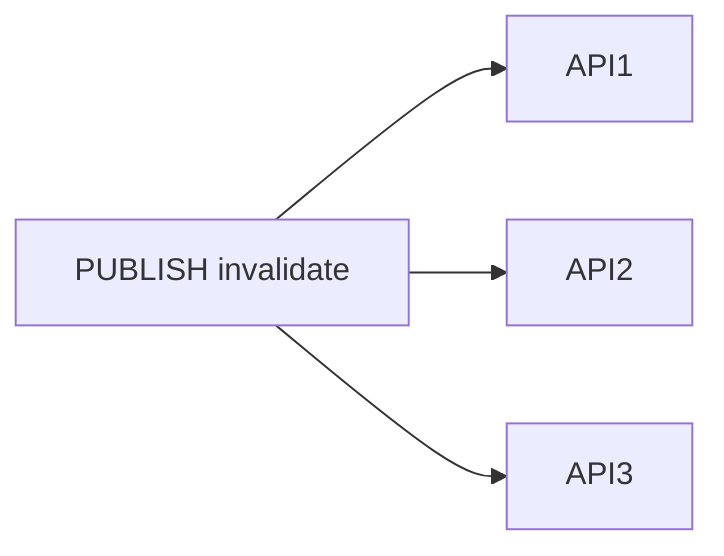

## Введение

Redis умеет [Pub/Sub](https://redis.io/docs/interact/pubsub/): `PUBLISH channel message` и `SUBSCRIBE`. Middle должен провести границу с **очередью/брокером** (Kafka, RabbitMQ) — другая семантика доставки и хранения.

## Раздел: Redis pub/sub

Fire-and-forget fan-out: сообщение получают **только подписчики online** в момент публикации. Нет персистентного журнала «из коробки» как у Kafka; offline-подписчик сообщение не увидит. Подходит для сигналов, [cache invalidation](https://redis.io/docs/manual/patterns/) между инстансами API, live-уведомлений, координации «сбрось локальный кэш».

Pattern matching: `PSUBSCRIBE news.*`. Нагрузка: при медленном подписчике буфер может расти — operational нюанс из docs.

## Раздел: Брокер и Redis Streams (граница)

Kafka/Rabbit хранят сообщения на диске, дают ack, retry, DLQ, consumer groups, replay. См. [sa-sync-async-queues](/game/learn/sa-sync-async-queues).

**Redis Streams** ([Streams](https://redis.io/docs/data-types/streams/)) — consumer groups и retention в Redis; ближе к «лёгкой очереди», но не полная замена Kafka для petabyte-логов. На middle: pub/sub = сигнал; брокер = бизнес-событие с гарантиями; Streams — уточню требования.

## Раздел: Выбор

Replay, at-least-once, долгая очередь писем → бroker. Лёгкий fan-out «invalidate user:42 на всех нодах» → pub/sub. List как очередь без ack — антипаттерн для критичной почты.

## Раздел: Частые вопросы с собеседования

**Вопрос.** Что такое cache-aside и кто отвечает за заполнение кэша?

**Ответ.** Приложение: сначала GET в Redis, при miss — читает БД и SET с TTL. Redis не подтягивает БД сам. После UPDATE в БД нужно удалить или обновить ключ, иначе отдадите stale. Не путать с write-through, где запись идёт в кэш и БД синхронно из одного слоя.

**Вопрос.** Зачем TTL у ключей Redis на собеседовании?

**Ответ.** Страховка от вечного устаревания и runaway-памяти: даже если забыли DEL после UPDATE, данные протухнут. TTL не заменяет явную инвалидацию на критичных сущностях — выбирают баланс «свежесть vs нагрузка на БД».

**Вопрос.** RDB или AOF — что выбрать для персистентности Redis?

**Ответ.** RDB — снимок на диск периодически, компактно, возможна потеря последних секунд. AOF — журнал команд, детальнее восстановление, больше I/O. На практике часто hybrid и политика fsync под допустимую потерю данных; кэш может жить и без персистентности.

**Вопрос.** Что происходит, когда Redis упирается в maxmemory?

**Ответ.** Срабатывает политика eviction (LRU/LFU и др.) — ключи удаляются, hit-rate падает, нагрузка на БД растёт. На собесе связывают с мониторингом памяти, TTL и тем, что hot keys без лимита опасны для всего кластера.

**Вопрос.** Можно ли считать Redis источником истины для заказов?

**Ответ.** Нет для критичных финансовых фактов: Redis — ускоритель и ephemeral-слой, истина в PostgreSQL (или другой durable store). Потеря ноды/ eviction / restart без AOF не должны стирать оплаченный заказ; кэш восстанавливают из БД.

## Лаба

**Цель.** Выбрать механизм для двух сценариев.

**Шаги.**
1. Инвалидация кэша на 3 инстанса API — pub/sub или Kafka?
2. Очередь писем с retry — ?
3. Обоснуйте каждый выбор в 2 предложениях со ссылкой на [pubsub](https://redis.io/docs/interact/pubsub/).
4. Назовите риск pub/sub при рестарте подписчика.
5. Ссылку на SA10 добавьте в конспект.

**В группу:** поменяйтесь сценариями и проверьте аргuments.

**Готово, если…**
- [ ] Не путаете pub/sub с очередью
- [ ] Ссылаетесь на SA10
- [ ] Знаете про потерю offline-сообщений

## Схема: Fan-out сигнала

## Тест

### Сохраняет ли pub/sub сообщения для offline?

**Ответ:** нет, только online

**Пояснение:** Нужен бroker или Streams с иной семантикой.

### Когда Kafka вместо pub/sub?

**Ответ:** replay и consumer groups

**Пояснение:** Журнал событий и развязка продюсера.

### Хороший кейс Redis pub/sub?

**Ответ:** сигнал invalidate кэша

**Пояснение:** Лёгкий fan-out без жёстких гарантий.

### PUBLISH без SUBSCRIBE на канале?

**Ответ:** сообщение теряется

**Пояснение:** Нет подписчиков — некому доставить.

### List RPOP как очередь писем — риск?

**Ответ:** нет ack и retry

**Пояснение:** Падение worker после POP — потеря задачи.

## Шпаргалка

<h3>Граница</h3>
<ul>
<li><a href="https://redis.io/docs/interact/pubsub/">pub/sub</a> — сигнал online</li>
<li>бroker — хранение + retry</li>
</ul>

См. SA10 sync/async

## Anki

### Front: Redis PUBLISH channel msg — кому доставится?

Back: Только подписчикам канала online в момент публикации

### Front: Почему pub/sub не замена Kafka на собесе?

Back: Нет персистентного replay и consumer groups как у брокера

### Front: Кейс invalidate cache на трёх API-нодах?

Back: PUBLISH на канал; каждая нода SUBSCRIBE и DEL локально

### Front: Offline подписчик после Redis pub/sub?

Back: Пропущенные сообщения не восстановить из pub/sub

### Front: Redis Streams vs pub/sub одной фразой?

Back: Streams — log с groups; pub/sub — мгновенный fan-out без хранения

### Front: Очередь писем с retry — pub/sub или бroker?

Back: Broker (Kafka/Rabbit); не классический pub/sub

## Итоги

- pub/sub ≠ очередь ([docs](https://redis.io/docs/interact/pubsub/))
- Канон брокеров — SA10
- Сигналы vs бизнес-события

## Ссылки

- [Redis documentation](https://redis.io/docs/)
- [Pub/Sub](https://redis.io/docs/interact/pubsub/)
- [Streams](https://redis.io/docs/data-types/streams/)
- Learn | [SA sync/async queues](/game/learn/sa-sync-async-queues)
- Learn | [Stampede](/game/learn/rd-stampede-locks)
- Далее: [Eviction и cluster](/game/learn/rd-eviction-cluster)
