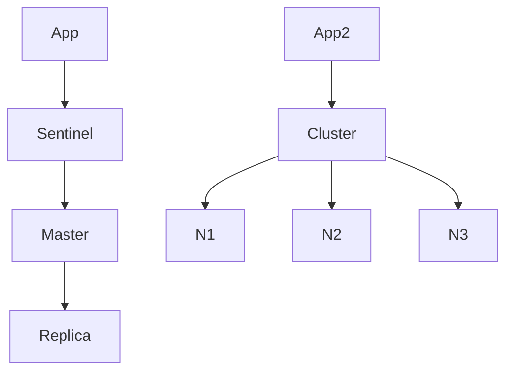

## Введение

Senior-вопросы: что будет, когда память кончилась, и чем **Sentinel** отличается от **Cluster**. Канон: [Eviction](https://redis.io/docs/reference/eviction/), [High availability with Sentinel](https://redis.io/docs/management/sentinel/), [Cluster specification](https://redis.io/docs/reference/cluster-spec/).

## Раздел: Eviction

`maxmemory` ограничивает RAM; при достижении срабатывает `maxmemory-policy`. Частые значения ([docs](https://redis.io/docs/reference/eviction/)):

- `noeviction` — новые записи с ошибкой, ключи не вытесняются (не «чистый кэш»).
- `allkeys-lru` / `allkeys-lfu` — вытеснение среди **всех** ключей по LRU/LFU.
- `volatile-lru` / `volatile-lfu` / `volatile-ttl` — только ключи **с TTL**.

Для чистого кэша — LRU/LFU; для смешанных данных — осознанный TTL на некритичных ключах или `noeviction` + алерты.

## Раздел: Sentinel

Sentinel мониторит master/replica, голосует за failover, публикует новый master клиентам. Это **HA одного логического шарда** (репликация), не деление данных по объёму. Async replication → риск потери последних записей при failover (обсудите RPO).

## Раздел: Cluster

[Redis Cluster](https://redis.io/docs/reference/cluster-spec/) делит ключи на **16384 hash slots** между master-нодами; клиент следует `MOVED`/`ASK`. Масштаб по данным и QPS; multi-key операции только в одном slot (или hash tags `{user:1}:…`). Reshard и отказ ноды — operational темы; на собесе: «Cluster = шарды; Sentinel = автопромоут replica».

## Раздел: Частые вопросы с собеседования

**Вопрос.** Что такое cache-aside и кто отвечает за заполнение кэша?

**Ответ.** Приложение: сначала GET в Redis, при miss — читает БД и SET с TTL. Redis не подтягивает БД сам. После UPDATE в БД нужно удалить или обновить ключ, иначе отдадите stale. Не путать с write-through, где запись идёт в кэш и БД синхронно из одного слоя.

**Вопрос.** RDB или AOF — что выбрать для персистентности Redis?

**Ответ.** RDB — снимок на диск периодически, компактно, возможна потеря последних секунд. AOF — журнал команд, детальнее восстановление, больше I/O. На практике часто hybrid и политика fsync под допустимую потерю данных; кэш может жить и без персистентности.

**Вопрос.** Что такое cache stampede и как его ослабить?

**Ответ.** Много запросов одновременно бьют в БД после истечения TTL одного hot key. Лечат singleflight/lock на пересчёт, jitter к TTL, прогрев, короткий stale-while-revalidate. На собесе важно назвать симптом: CPU БД скачет при «простом» GET.

**Вопрос.** Можно ли считать Redis источником истины для заказов?

**Ответ.** Нет для критичных финансовых фактов: Redis — ускоритель и ephemeral-слой, истина в PostgreSQL (или другой durable store). Потеря ноды/ eviction / restart без AOF не должны стирать оплаченный заказ; кэш восстанавливают из БД.

## Лаба

**Цель.** Составить таблицу выбора eviction и HA.

**Шаги.**
1. Кэш сессий — какая policy?
2. Критичный счётчик без TTL — риск `allkeys-lru`?
3. Нужен failover без шардов — Sentinel или Cluster?
4. Нужно 100 GB данных — ?
5. Запишите operational risk Cluster (multi-key / resharding).

**В группу:** один предлагает Cluster «на всякий случай» — второй возражает.

**Готово, если…**
- [ ] Называете 2 policy
- [ ] Отличаете Sentinel от Cluster
- [ ] Связываете eviction с типом данных

## Схема: HA варианты

## Тест

### allkeys-lru при полной памяти?

**Ответ:** вытесняет редко используемые ключи

**Пояснение:** Среди всех ключей, не только с TTL.

### Sentinel vs Cluster на собесе?

**Ответ:** failover vs шардирование слотов

**Пояснение:** Разные задачи HA и scale-out.

### noeviction при maxmemory?

**Ответ:** ошибка записи без eviction

**Пояснение:** Данные не вытесняются автоматически.

### volatile-lru вытесняет ключи без TTL?

**Ответ:** нет, только с TTL

**Пояснение:** Ключи без EXPIRE не кандидаты.

### Сколько hash slots в Cluster?

**Ответ:** 16384 слота

**Пояснение:** Ключ → CRC16 slot → нода по карте слотов.

## Шпаргалка

<h3>Eviction</h3>
<ul><li>lru/lfu — для кэша</li><li>noeviction — строгий режим</li></ul>
<h3>HA</h3>
<ul><li>Sentinel — failover</li><li>Cluster — <a href="https://redis.io/docs/reference/cluster-spec/">slots</a></li></ul>

## Anki

### Front: maxmemory-policy в Redis — что решает?

Back: Поведение при достижении лимита RAM: eviction или noeviction

### Front: Sentinel в Redis — задача?

Back: Мониторинг master/replica и автоматический failover

### Front: Cluster hash slot — зачем на собесе?

Back: Шардирование ключей между нодами; 16384 слота

### Front: allkeys-lru vs volatile-lru?

Back: allkeys — любые ключи; volatile — только с TTL

### Front: Нужен только failover одной пары master/replica?

Back: Sentinel, не Cluster для шардирования

### Front: Eviction может удалить «важный» ключ без TTL?

Back: При allkeys-lru/lfu — да; защита — TTL, другая policy или noeviction

## Итоги

- Eviction — политика при `maxmemory` ([reference](https://redis.io/docs/reference/eviction/))
- Sentinel ≠ Cluster ([cluster-spec](https://redis.io/docs/reference/cluster-spec/))
- Senior связывает конфиг с риском потери и scale

## Ссылки

- [Redis documentation](https://redis.io/docs/)
- [Eviction policies](https://redis.io/docs/reference/eviction/)
- [Sentinel](https://redis.io/docs/management/sentinel/)
- [Cluster specification](https://redis.io/docs/reference/cluster-spec/)
- Learn | [pub/sub](/game/learn/rd-pubsub-vs-queue)
- Далее: [Capstone Redis](/game/learn/rd-capstone)
