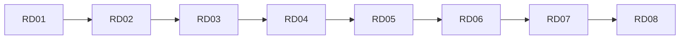

## Введение

Финальный выпуск: собрать ответы серии и проверить пробелы перед собесом. Термины и границы — по [redis.io/docs](https://redis.io/docs/); сценарии гибрида с PostgreSQL — по вашему стеку.

## Раздел: Ответ вслух

Redis у меня — структуры и срок жизни ключа, не основная база заказов. Я называю cache-aside, TTL и чем pub/sub хуже очереди, если воркер спал.

## Раздел: Плохой ответ

«Положим всё в Redis, он в памяти». Нет источника правды и нет выселения.

## Раздел: Термины

Ключ-значение — key-value. Выселение — eviction. Срок жизни — TTL.

## Раздел: Чеклист уровней

**Junior (RD01–RD03):** KV, [типы](https://redis.io/docs/data-types/), TTL, [RDB/AOF](https://redis.io/docs/management/persistence/), не source of truth.

**Middle (RD04–RD06):** cache-aside, stampede (SET NX EX), [pub/sub](https://redis.io/docs/interact/pubsub/) vs брокер.

**Senior (RD07):** [eviction](https://redis.io/docs/reference/eviction/), Sentinel vs [Cluster](https://redis.io/docs/reference/cluster-spec/).

## Раздел: Redis vs PostgreSQL

PostgreSQL — схема, JOIN, транзакции, отчёты, долговременная правда. Redis — низкая задержка, кэш, счётчики (string INCR), zset-рейтинги, сигналы. Гибрид нормален: запись в PG, ускорение чтения в Redis с TTL и инвалидацией. См. [sql-ddl-dml-dcl](/game/learn/sql-ddl-dml-dcl).

## Раздел: Индекс slug

| Ep | slug |
|----|------|
| RD01 | rd-kv-model |
| RD02 | rd-data-types |
| RD03 | rd-ttl-persistence |
| RD04 | rd-cache-aside |
| RD05 | rd-stampede-locks |
| RD06 | rd-pubsub-vs-queue |
| RD07 | rd-eviction-cluster |
| RD08 | rd-capstone |

## Раздел: Частые вопросы с собеседования

**Вопрос.** RDB или AOF?
**Ответ.** RDB — снимки, быстрее восстановление, можно потерять окно между ними. AOF — журнал команд, меньше потерь, дороже диск. Часто включают оба.

**Вопрос.** Чем pub/sub хуже очереди задач?
**Ответ.** Сообщение без подписчика пропадает, нет ack. Для работ берут очередь или Streams.

**Вопрос.** Что такое cache stampede?
**Ответ.** Много клиентов одновременно не находят ключ и бьют в БД. Лечат singleflight, блокировку или раннее обновление.

## Лаба

**Цель.** Пройти drill из 8 вопросов по одному на выпуск.

**Шаги.**
1. Закройте SERIES и ответьте на 8 вопросов вслух по таймеру 60с.
2. Отметьте ❌ и откройте соответствующий slug.
3. Повторите Anki слабых выпусков (5+6 карточек в каждом).
4. Сформулируйте гибрид PG+Redis для pet-проекта (кэш, сессии, rate limit).
5. Добавьте ссылку на [redis.io/docs](https://redis.io/docs/) и PY20 в конспект.

**В группу:** парный drill: вопрос → ответ → правка.

**Готово, если…**
- [ ] Есть персональный gap-list
- [ ] Умеете сравнить Redis и PG
- [ ] Знаете индекс slug

## Схема: Трек RD

## Тест

### Когда Redis, когда PostgreSQL?

**Ответ:** кэш vs OLTP-правда

**Пояснение:** Гибрид: PG пишет, Redis ускоряет.

### Главный риск stampede?

**Ответ:** перегрузка БД на hot key

**Пояснение:** Лечится lock/singleflight (RD05).

### Sentinel решает какую задачу?

**Ответ:** failover master/replica

**Пояснение:** Не шардирование данных.

### RDB vs AOF в одной фразе?

**Ответ:** снимок vs журнал

**Пояснение:** Компромисс потери и IO (RD03).

### pub/sub для очереди писем с retry?

**Ответ:** нет, нужен брокер

**Пояснение:** Pub/sub не хранит offline-сообщения (RD06).

## Шпаргалка

<h3>Чеклист</h3>
<ul>
<li>KV + <a href="https://redis.io/docs/data-types/">типы</a> + TTL</li>
<li>cache-aside + stampede</li>
<li>pub/sub ≠ Kafka</li>
<li>eviction + HA обзор</li>
</ul>

## Anki

### Front: RD01 slug — тема выпуска?

Back: rd-kv-model — KV и не source of truth

### Front: RD04 slug — патtern?

Back: rd-cache-aside — hit/miss и инвалидация

### Front: Гибрид PostgreSQL + Redis на собесе?

Back: PG — правда и транзакции; Redis — кэш и низкая latency

### Front: RD07 — Sentinel или Cluster для 100 GB?

Back: Cluster (шарды); Sentinel — failover одного шарда

### Front: Тип Redis для leaderboard?

Back: zset (RD02)

### Front: Официальный источник терминов серии RD?

Back: redis.io/docs (data-types, persistence, cluster-spec)

## Итоги

- Capstone = чеклист + drill по RD01–RD07
- Не зубрите команды — сценарии и trade-offs из docs
- Связки с SQL/SA/PY обязательны

## Ссылки

- [Redis documentation](https://redis.io/docs/)
- [Data types](https://redis.io/docs/data-types/)
- [Persistence](https://redis.io/docs/management/persistence/)
- [Cluster specification](https://redis.io/docs/reference/cluster-spec/)
- Learn | [SQL01](/game/learn/sql-ddl-dml-dcl)
- Learn | [PY20](/game/learn/py-db-cache-memcached)
- Learn | [SA10](/game/learn/sa-sync-async-queues)
