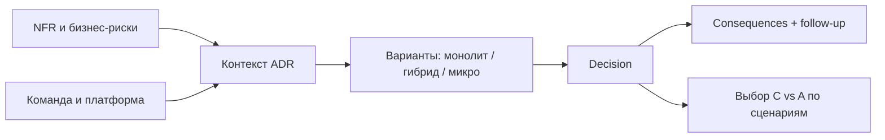
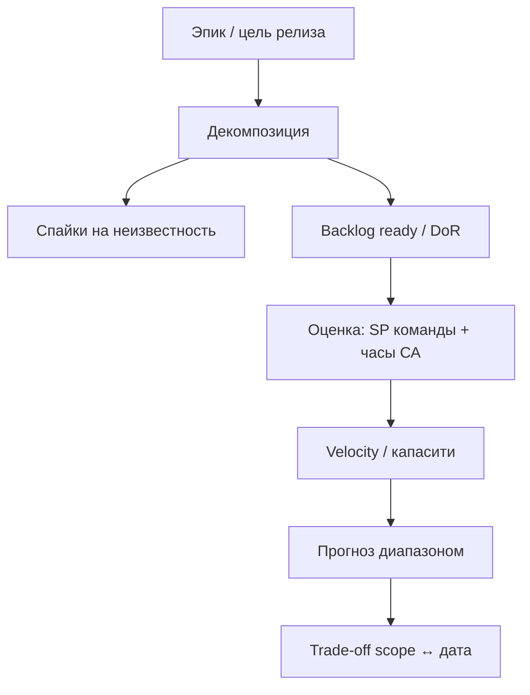

## Введение

Тема 5 на middle дала словарь: SOA, микросервисы, оркестрация, CAP, API Gateway. Senior должен **принять и зафиксировать решение**: зачем этот стиль здесь, какие жертвы, как откатить/эволюционировать. Инструмент — ADR. Ниже синтез T5 в формате собеседования.

ADR по формату **Michael Nygard** фиксирует контекст, решение и последствия; C4 даёт картинку. Синтез **T5**; первично — [documenting architecture decisions](https://cognitect.com/blog/2011/11/15/documenting-architecture-decisions) и c4model.com.

**Оценка и поставка.** В SA08 вы трогали методологии и DoR/DoD. Senior-вопросы T6.1.5–6.1.14 копают глубже: как резать работу, чем SP отличается от часов, как аналитик влияет на прогноз поставки и почему «у нас Scrum» часто не спасает сроки. Здесь — рабочие ответы без лозунгов.

Оценка и поставка — BABOK *Planning and Monitoring* и agile-метрики. **T6.1** углубление; story points vs t-shirt — соглашения команды, не dogma.

## Раздел: Как отвечать одним блоком

Этот выпуск собрал соседние короткие темы трека: «Архитектурные решения», «Оценка и поставка». Раньше каждая занимала отдельную карточку на несколько минут, а на собеседовании их спрашивают одним блоком. Ниже у каждой темы свой раздел, затем общие лабы, один тест и одна колода карточек. В ответе сначала назовите, какую тему спросили, потом определение и один пример. Не проговаривайте все разделы, если спросили один. Лабы можно пройти по порядку исходного трека. Если времени мало, сделайте первую и последнюю: первая ставит язык, последняя проверяет, что соседние темы вы не перепутали.

## Раздел: Архитектурные решения: ADR — зачем и как писать

**ADR (Architecture Decision Record)** — короткий документ об одном решении: контекст, варианты, выбор, последствия. Пишут не «ради бюрократии», а чтобы через полгода не гадать «почему Kafka» и не повторять спор.

Структура (достаточная на собесе и в Confluence):

1. **Title / Status:** Proposed | Accepted | Deprecated | Superseded by ADR-N.
2. **Context:** силы, ограничения, требования (NFR, команда, срок).
3. **Decision:** что решили одним абзацем.
4. **Options considered:** 2–4 альтернативы с плюсами/минусами.
5. **Consequences:** что становится легче/сложнее; риски; follow-up задачи.
6. **Links:** требования, диаграммы, тикеты.

Роль СА: часто **готовит черновик** вместе с архитектором/техлидом — формулирует контекст из бизнеса и NFR, проверяет, что варианты честные (не соломенные). Плохой ADR: «выбрали микросервисы, потому что modern». Хороший: «команда 6 человек, time-to-market 3 месяца, домен ещё плывёт → модульный монолит; границы сервисов пересмотрим при стабилизации BC».

Классический шаблон Nygard: **Title, Status, Context, Decision, Consequences**. Статусы *Superseded* сохраняют историю — важно для аудита «почему ушли с монолита». СА приносит в Context бизнес-NFR и ограничения compliance, не только технологии.

## Раздел: Архитектурные решения: Монолит vs микросервисы — критерии, не религия

**Монолит (в т.ч. модульный):** одна единица деплоя, проще транзакции и локальный рефакторинг, меньше сетевых сбоев. Риски: общая кодовая база растёт, масштабирование «всего сразу», командные конфликты в одном репо.

**Микросервисы:** независимый деплой и масштаб частей, границы команд (идеально по bounded context). Риски: распределённые транзакции, наблюдаемость, дубли данных, операционная сложность, «распределённый монолит» при неправильных границах.

**Когда монолит рационален:** ранняя стадия продукта, маленькая команда, неясные границы домена, жёсткие сроки MVP, нет зрелого DevOps/платформы.

**Когда резать сервисы:** разные циклы релизов и нагрузки, явные BC, команды могут владеть сервисом end-to-end, есть платформа (CI, трейсинг, секреты), NFR требуют независимого масштаба.

Компромисс для ответа senior: **«модульный монолит сейчас + карта будущих швов»** часто сильнее, чем преждевременное дробление. Микросервис ради резюме — антипаттерн.

Связь с интеграциями (SA19): каждый новый сервис = контракты, версии, отказные режимы. Цена разрезания — не только код.

## Раздел: Архитектурные решения: CAP на прикладном примере

**CAP:** в распределённой системе при **сетевом разделении (P)** нельзя одновременно гарантировать полную **Consistency (C)** и **Availability (A)**. Выбираете сторону для конкретного сценария; «мы обеспечим CAP целиком» — красный флаг ответа.

Пример **заказ и остатки на двух складах / двух репликах:**

- Каталог читает остаток с реплики (хотим A при лаге) → возможна продажа «призрачного» stock → нужна компенсация/оверселл-политика (**упор в A + eventual C**).
- Платёж и финальное списание резерва в primary с синхронной проверкой → при падении сети к primary лучше отказать в покупке, чем продать дважды (**упор в C**, жертвуем A на запись).

Другой пример: **корзина в одном DC** vs **глобальный профиль пользователя**. Для профиля часто допустим eventual consistency между регионами; для двойного списания денег — нет.

На собесе свяжите CAP с продуктовым решением: «что хуже для бизнеса — недоступность кнопки „купить“ на 1 минуту или оверселл?» Ответ бизнеса → ваш выбор C или A в условиях P. СА фиксирует это в NFR и ADR, а не оставляет на «интуицию разработки».

## Раздел: Архитектурные решения: Частые вопросы с собеседования

**Вопрос.** User story или use case — что выбрать на проекте?

**Ответ.** Story — короткий инкремент ценности для backlog и спринта. Use case — полный сценарий с актёром, основным и альтернативными потоками, когда важны ветки и исключения. На собесе: story для приоритизации, UC/sequence — когда согласуете интеграции и QA-покрытие.

**Вопрос.** BPMN и UML — конкуренты или разные задачи?

**Ответ.** Разные вопросы. BPMN — бизнес-процесс, шлюзы, роли людей. UML Use Case — граница системы и цели; Sequence — вызовы сервисов во времени. Ошибка: рисовать микросервисы на BPMN вместо бизнес-шагов.

**Вопрос.** Зачем на собесе СА спрашивают идемпотентность REST?

**Ответ.** Повтор запроса (таймаут, retry клиента, двойной клик) не должен дважды списать деньги. POST платежа часто делают идемпотентным через Idempotency-Key, уникальный constraint или проверку «уже обработано». GET/PUT/DELETE по смыслу ближе к идемпотентности, чем «слепой» POST.

**Вопрос.** Когда на интеграции выбрать синхронный REST, а когда очередь?

**Ответ.** Sync — нужен ответ сейчас и цепочка короткая (проверка остатка перед оплатой). Async — долгая работа, сглаживание пиков, слабая связность: 202 Accepted, статус по webhook/polling. СА описывает ретраи, дедупликацию и SLA ответа, а не только «повесим Kafka».

**Вопрос.** ACID и CAP — про одно и то же?

**Ответ.** Нет. ACID — свойства транзакции в одной БД (атомарность, согласованность, изоляция, долговечность). CAP — компромисс распределённой системы при сбое сети: согласованность vs доступность. На собесе связывают с контекстом: баланс — строже ACID; лента лайков — чаще eventual consistency.

## Раздел: Оценка и поставка: Декомпозиция и оценка аналитика

**Декомпозиция** — разбиение эпика/фичи на куски, которые можно понять, оценить и поставить инкрементом. Senior режет не только «по экранам», но по **ценности и риску**: сначала тонкий сквозной путь (skeleton), потом ветки, потом полировка.

Практичный порядок:

1. Цель и границы (что *не* входит в релиз N).
2. Сквозной happy path end-to-end (заказ создаётся и оплачивается «в ноль»).
3. Критичные негативы (отказ оплаты, нет остатка).
4. Интеграции и NFR (идемпотентность, аудит, perf-smoke).
5. Отчётность/админка — часто позже, если не блокер денег.

Размер куска для команды: «можно закончить и проверить за спринт или меньше», с ясной приёмкой. Слишком крупные — скрытые зависимости; слишком мелкие — шум и потеря смысла.

**Где оценивает аналитик.** СА редко «даёт часы разработки вместо команды», но обязан:

- оценить **свою** работу (сбор, модели, согласования, правки);
- помочь команде увидеть объём через ясность scope и рисков («неизвестно поведение банка» = буфер/спайк);
- не обещать бизнесу дату в одиночку — только совместно с Dev/QA/PO после DoR;
- фиксировать допущения оценки (что считали известным).

Фраза на собесе: «Я оцениваю аналитику и качество входных данных для оценки команды; дату релиза защищаем вместе после декомпозиции и рисков».

## Раздел: Оценка и поставка: Часы vs Story Points — зачем два языка

**Часы (или человеко-дни)** — абсолютная оценка трудозатрат. Удобны заказчику и для фиксированных контрактов; плохо переносят различия в скорости людей и скрытую неопределённость. Соблазн: суммировать часы в «гарантированный» дедлайн.

**Story Points (SP)** — относительная оценка сложности/объёма относительно эталона команды. Входят неопределённость, объём, риск (в здоровых командах). Нужны для **прогноза по velocity**, не для бухгалтерии. Переводить «1 SP = 4 часа» официально — уничтожить смысл SP.

Когда что использовать:

| Контекст | Инструмент | Комментарий |
|----------|------------|-------------|
| Внутренний спринт, стабильная команда | SP + velocity | Прогноз диапазоном |
| Фикс. контракт / внешний аутсорс | Часы/дни с буфером риска | Прозрачность для договора |
| Спайк/неизвестность | Time-box в часах | Исследование, не feature-оценка |
| Отчёт «сколько стоит аналитика» | Часы СА | Отдельно от SP разработки |

Senior-ошибка: обещать дату по сумме SP без velocity и без буфера на интеграции. Вторая ошибка: менять SP задачи после старта, чтобы «влезло в спринт».

## Раздел: Оценка и поставка: Где ломается Scrum и что делает СА

Типичные поломки (звучат на собесе как «опыт», не нытьё):

1. **Нет DoR** — в спринт тащат сырые хотелки; аналитик не успел снять неоднозначность.
2. **Спринт = водопад двух недель** — анализ → вся разработка → тест в последний день; нет инкремента.
3. **PO отсутствует / вечный proxy** — приоритеты скачут, scope creep без trade-off.
4. **Velocity как KPI давления** — команда раздувает SP; прогноз врёт.
5. **Игнорируют зависимости** — смежные команды и вендоры вне Scrum-ритуала.
6. **Ceremony без цели** — дейли без блокеров, ретро без изменений.
7. **«Scrum», но меняют состав и процесс каждый месяц** — нет статистики для прогноза.
8. **QA вне команды** — приёмка и баги вылетают за границы спринта.

Что делает senior СА, когда Scrum «не работает»:

- вернуть DoR/DoD в явном виде и не пускать в спринт без приёмки;
- вынести discovery/спайки отдельно от commitment delivery;
- визуализировать внешние зависимости на доске;
- предложить Kanban для потока поддержки/багов рядом со Scrum feature-команды;
- говорить бизнесу языком риска: «можем дату X с scope A или дату Y с scope A+B».

Scrum — каркас инспекции и адаптации. Если нет прозрачного backlog, владельца ценности и стабильной команды, «больше митингов» не лечит.

## Раздел: Оценка и поставка: Частые вопросы с собеседования

**Вопрос.** Как на собесе отличить функциональное требование от нефункционального?

**Ответ.** FR — конкретное поведение: «можно оплатить картой». NFR — качество и ограничения: «p95 ответа API ≤ 300 мс при 500 RPS», «данные карты не в логах». NFR должны быть измеримы; «быстро и безопасно» без цифр — wish, не требование.

**Вопрос.** User story или use case — что выбрать на проекте?

**Ответ.** Story — короткий инкремент ценности для backlog и спринта. Use case — полный сценарий с актёром, основным и альтернативными потоками, когда важны ветки и исключения. На собесе: story для приоритизации, UC/sequence — когда согласуете интеграции и QA-покрытие.

**Вопрос.** BPMN и UML — конкуренты или разные задачи?

**Ответ.** Разные вопросы. BPMN — бизнес-процесс, шлюзы, роли людей. UML Use Case — граница системы и цели; Sequence — вызовы сервисов во времени. Ошибка: рисовать микросервисы на BPMN вместо бизнес-шагов.

**Вопрос.** Когда на интеграции выбрать синхронный REST, а когда очередь?

**Ответ.** Sync — нужен ответ сейчас и цепочка короткая (проверка остатка перед оплатой). Async — долгая работа, сглаживание пиков, слабая связность: 202 Accepted, статус по webhook/polling. СА описывает ретраи, дедупликацию и SLA ответа, а не только «повесим Kafka».

**Вопрос.** ACID и CAP — про одно и то же?

**Ответ.** Нет. ACID — свойства транзакции в одной БД (атомарность, согласованность, изоляция, долговечность). CAP — компромисс распределённой системы при сбое сети: согласованность vs доступность. На собесе связывают с контекстом: баланс — строже ACID; лента лайков — чаще eventual consistency.

## Лаба

**Архитектурные решения.**

**Цель.** Написать ADR и разобрать CAP для учебного магазина.

**Шаги.**
1. Контекст: команда 8 человек, релизы раз в 2 недели, домен заказа ещё меняется, пик Чёрной пятницы ×5 RPS.
2. Сравните 3 варианта: модульный монолит; Order+Payment сервисы; «сразу 12 микросервисов».
3. Напишите ADR-001 (Accepted): выберите вариант и 5 consequences.
4. Для чтения витрины остатков и для commit оплаты явно выберите сторону C или A при分区оне; обоснуйте бизнесом.
5. Укажите 3 метрики/сигнала, что решение пора пересматривать (например, время сборки, число конфликтов в модулях, independently scaling hotspots).
6. Свяжите follow-up: какие швы модулей станут кандидатами в сервисы.

**В группу:** защитите монолит против «микросервисы = масштабируемость» за 90 секунд.

**Готово, если…**
- [ ] ADR содержит options, decision и consequences
- [ ] CAP разобран на двух разных сценариях одного продукта
- [ ] Есть критерии пересмотра решения

**Оценка и поставка.**

**Цель.** Разложить фичу «возврат оплаты» в поставку и дать прогноз честно.

**Шаги.**
1. Разбейте на 6–8 элементов backlog (stories/tasks), отметьте зависимости.
2. Отметьте 2 пункта, которые требуют спайка (неизвестность банка/бухгалтерии).
3. Оцените работу СА в часах; разработку — в относительных SP (эталон = простой CRUD).
4. Предположите velocity 20 SP/спринт — дайте прогноз диапазоном (optimistic/likely/pessimistic) с допущениями.
5. Выпишите 3 способа, как «Scrum сломается» на этой фиче, и ваш контрмеры.
6. Сформулируйте trade-off для PO: урезанный scope к дате vs полный scope позже.

**В группу:** партнёр переводит SP в часы для отчёта директору — объясните, какой отчёт дать вместо этого.

**Готово, если…**
- [ ] Есть декомпозиция с зависимостями и спайками
- [ ] Часы и SP не смешаны в одну «магическую» дату
- [ ] Названы риски процесса и ответ аналитика

## Схема: Архитектурные решения: От контекста к ADR

## Схема: Оценка и поставка: От эпика к прогнозу

## Тест

### Что обязательно должно быть в ADR?

**Ответ:** контекст, рассмотренные варианты, принятое решение и последствия (плюсы/минусы/риски)

**Пояснение:** без вариантов и последствий ADR превращается в приказ; без контекста — в лозунг.

### Чем Story Points отличаются от часов?

**Ответ:** SP — относительная оценка сложности для прогноза по velocity; часы — абсолютные трудозатраты, удобные для контрактов и учёта

**Пояснение:** жёсткий перевод SP в часы обесценивает относительность и маскирует неопределённость.

### Когда модульный монолит предпочтительнее микросервисов?

**Ответ:** при небольшой команде, нестабильных границах домена и отсутствии зрелой платформы — проще поставка и транзакции

**Пояснение:** микросервисы окупаются при явных BC, независимых релизах/нагрузке и готовности к распределённой сложности.

### Что оценивает системный аналитик в поставке?

**Ответ:** свою аналитическую работу и качество входных данных/рисков для оценки команды; дату релиза — только совместно

**Пояснение:** СА не подменяет собой оценку разработки, но без его декомпозиции и допущений прогноз команды слепой.

### Как объяснить CAP на примере магазина?

**Ответ:** при сетевом сбое нельзя одновременно гарантировать строгую согласованность остатков/платежей и полную доступность записи — выбираем по бизнес-риску оверселла vs простоя

**Пояснение:** CAP — про компромисс в условиях partition; разные сценарии одного продукта могут выбрать разные стороны.

## Шпаргалка

<ul><li>ADR = контекст + варианты + решение + последствия</li><li>Монолит ≠ плохо; микросервисы ≠ всегда правильно</li><li>Резать по BC и командам, не по таблицам</li><li>CAP: при P выбираем C или A для сценария</li><li>Решение пересматриваем по сигналам, не по моде</li><li>Резать по ценности и риску, не только по экранам</li><li>Сначала skeleton E2E, потом ветки и отчёты</li><li>SP для velocity; часы для контракта и работы СА</li><li>Не обещать дату в одиночку</li><li>Сломанный Scrum лечат DoR, зависимости, trade-off scope</li></ul>

## Anki

### Front: Структура ADR?

Back: context, options, decision, consequences (+ status, links)

### Front: Порядок декомпозиции фичи?

Back: границы → E2E happy path → критичные негативы → интеграции/NFR → вторичные части (отчёты и т.п.)

### Front: Главный риск преждевременных микросервисов?

Back: распределённый монолит — сетевая сложность без реальной независимости границ и команд

### Front: Можно ли официально считать 1 SP = N часов?

Back: нет — это ломает смысл относительной оценки; для часов ведите отдельный учёт/контракт

### Front: CAP одной фразой?

Back: при разделении сети нельзя одновременно обещать полную согласованность и полную доступность — выбираем для сценария

### Front: Что делать, если Scrum формальный?

Back: вернуть DoR/DoD, вынести discovery, показать внешние зависимости, говорить trade-off scope↔дата

## Итоги

- Senior фиксирует архитектуру в ADR, а не в чате
- Монолит vs микросервисы — функция контекста команды и домена
- CAP объясняется прикладным риском, не определением из вики
- Синтез T5: стили + компромиссы + следствия для интеграций и NFR
- Оценка начинается с декомпозиции и явных допущений
- Часы и SP решают разные задачи — не смешивать
- Аналитик влияет на прогноз через ясность и риски, не через «магическую дату»
- Scrum ломается на сыром backlog, давлении velocity и игноре зависимостей — это зона влияния senior СА (T6.1)

## Ссылки

- [Documenting Architecture Decisions (Michael Nygard)](https://cognitect.com/blog/2011/11/15/documenting-architecture-decisions)
- [C4 Model](https://c4model.com/)
- [BABOK Guide — Strategy Analysis (IIBA)](https://www.iiba.org/knowledgehub/business-analysis-body-of-knowledge-babok-guide/)
- [Топ-150 вопросов СА (Хабр) — индекс формулировок](https://habr.com/ru/articles/963708/)
- [Learn](/game/learn)
