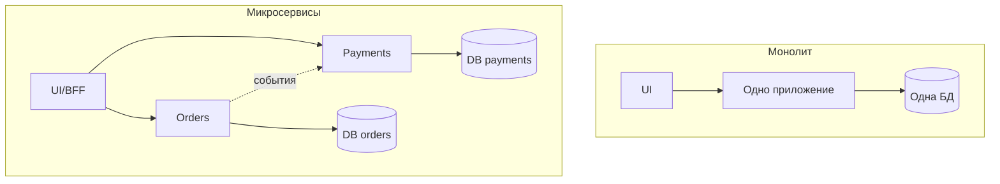

## Введение

Тема 5 на собеседовании СА начинается с картины «как устроена система». Нужно уверенно говорить про клиент-сервер, виды архитектуры, отличие SOA от микросервисов, способы нарезки сервисов и когда монолит честнее микросервисной моды. Вопросы T5.1–5.6.

SOA, монолит и микросервисы описывают на **C4 model** (context/container) и фиксируют в ADR. **T5.1–5.6** — индекс; первично — [c4model.com](https://c4model.com/) и trade-offs, не Habr.

## Раздел: Клиент-сервер и виды архитектуры

**Клиент-серверная архитектура** — разделение ролей: **клиент** инициирует запрос и показывает UI/результаты; **сервер** хранит данные и выполняет бизнес-логику. Пример: браузер ↔ backend API ↔ БД. Плюсы: централизация данных и правил, тонкие клиенты. Минусы: зависимость от доступности сервера, нагрузка в центре.

**Виды архитектуры (обзор для ответа «какие знаешь»):**
- монолитная;
- многослойная (layered: presentation / business / data);
- клиент-сервер / N-tier;
- SOA;
- микросервисная;
- event-driven;
- serverless / peer-to-peer (по ситуации).

На проекте отвечайте фактами: «модульный монолит на Java + отдельные worker'ы», а не идеальной схемой из учебника.

## Раздел: SOA vs микросервисы

**SOA (Service-Oriented Architecture)** — предприятие строится как набор **сервисов** с контрактами, часто вокруг **шины (ESB)** и крупных доменных сервисов, переиспользуемых многими каналами. Акцент: интеграция гетерогенного ландшафта, канонические модели, централизованное управление.

**Микросервисы** — набор **небольших** автономных сервисов, каждый со своей БД/жизненным циклом, лёгкая коммуникация (HTTP/gRPC/события), независимый деплой. Акцент: скорость команд, масштабирование частей, эволюция по доменам.

**Отличия в одной таблице:**
| | SOA | Микросервисы |
|--|-----|----------------|
| Гранулярность | чаще крупные сервисы | мельче, «одна команда — сервис» |
| Интеграция | часто ESB/тяжёлая медиация | smart endpoints, dumb pipes |
| Данные | нередко общие модели/хранилища | database per service |
| Управление | централизованные стандарты | автономные команды + платформа |

Не путать: микросервисы — *вид* сервисного подхода, но не синоним «SOA с ESB».

## Раздел: Декомпозиция и независимость микросервисов

**Способы декомпозиции:**
1. **По бизнес-возможности** (capability): «Заказы», «Биллинг», «Каталог».
2. **По subdomain / Bounded Context** (DDD): границы языка и модели.
3. **По командам (Conway)** — структура сервисов следует оргструктуре.
4. **По изменениям** — то, что меняется вместе, живёт вместе.
5. **По данным и транзакциям** — минимизация распределённых транзакций.

На практике СА участвует в workshop границ: события между контекстами, владельцы данных, анти-«Distributed Monolith».

**Независимость микросервисов** означает:
- независимый **деплой** без обязательного релиза всех сразу;
- своя **модель данных** (нет shared DB как жёсткой сцепки);
- устойчивость к недоступности соседей (таймауты, деградация);
- автономная **команда** и жизненный цикл версии API.

Независимость **не** значит «ноль взаимодействия» — значит слабая связанность через явные контракты.

## Раздел: Монолит vs микросервисы

**Монолит** — единый деплой-артефакт (часто одна БД). **Плюсы:** проще транзакции, проще локальная разработка и отладка, меньше ops-накладных. **Минусы:** сложнее масштабировать узкое место, риск большого комка связей, долгие релизы при росте команды.

**Микросервисы — плюсы:** независимое масштабирование и деплой, изоляция сбоев (при правильном дизайне), параллель команд. **Минусы:** распределённая сложность, наблюдаемость, консистентность eventual, дороже платформа.

**Когда лучше монолит:** ранняя стадия продукта, маленькая команда, домен ещё плывёт, нет сильной ops-зрелости. Модульный монолит с чёткими пакетами — частый здравый выбор перед нарезкой.

## Раздел: Частые вопросы с собеседования

**Вопрос.** Как на собесе отличить функциональное требование от нефункционального?

**Ответ.** FR — конкретное поведение: «можно оплатить картой». NFR — качество и ограничения: «p95 ответа API ≤ 300 мс при 500 RPS», «данные карты не в логах». NFR должны быть измеримы; «быстро и безопасно» без цифр — wish, не требование.

**Вопрос.** User story или use case — что выбрать на проекте?

**Ответ.** Story — короткий инкремент ценности для backlog и спринта. Use case — полный сценарий с актёром, основным и альтернативными потоками, когда важны ветки и исключения. На собесе: story для приоритизации, UC/sequence — когда согласуете интеграции и QA-покрытие.

**Вопрос.** BPMN и UML — конкуренты или разные задачи?

**Ответ.** Разные вопросы. BPMN — бизнес-процесс, шлюзы, роли людей. UML Use Case — граница системы и цели; Sequence — вызовы сервисов во времени. Ошибка: рисовать микросервисы на BPMN вместо бизнес-шагов.

**Вопрос.** Зачем на собесе СА спрашивают идемпотентность REST?

**Ответ.** Повтор запроса (таймаут, retry клиента, двойной клик) не должен дважды списать деньги. POST платежа часто делают идемпотентным через Idempotency-Key, уникальный constraint или проверку «уже обработано». GET/PUT/DELETE по смыслу ближе к идемпотентности, чем «слепой» POST.

**Вопрос.** Когда на интеграции выбрать синхронный REST, а когда очередь?

**Ответ.** Sync — нужен ответ сейчас и цепочка короткая (проверка остатка перед оплатой). Async — долгая работа, сглаживание пиков, слабая связность: 202 Accepted, статус по webhook/polling. СА описывает ретраи, дедупликацию и SLA ответа, а не только «повесим Kafka».

## Лаба

**Цель.** Предложить границы сервисов для «учебного маркетплейса» и аргументировать монолит vs микро.

**Шаги.**
1. Перечислите 5 capability: каталог, корзина, заказ, оплата, уведомления.
2. Для пары «заказ–оплата» опишите синхронный и событийный контракт.
3. Найдите риск distributed monolith (общий статус в одной таблице на всех).
4. Напишите 3 критерия, при которых останетесь на модульном монолите.
5. Сформулируйте «независимость» Billing: деплой, БД, деградация при падении Notify.

**В группу:** разрежьте иначе (по каналам Web/Mobile) — почему это обычно хуже, чем по домену.

**Готово, если…**
- [ ] Объясняете клиент-сервер и 4+ вида архитектуры
- [ ] Чётко отличаете SOA (ESB) от микросервисов
- [ ] Аргументируете выбор монолита без стыда

## Схема: Монолит и микросервисы

## Тест

### Чем SOA отличается от микросервисов?

**Ответ:** SOA часто крупнее сервисы и ESB-центричная интеграция; микросервисы мельче, автономный деплой и данные, лёгкие каналы связи

**Пояснение:** оба сервисные, но гранулярность, владение данными и роль шины различаются.

### В чём независимость микросервиса?

**Ответ:** может деплоиться и развиваться отдельно, со своей БД и устойчивостью к сбоям соседей через явные контракты

**Пояснение:** независимость — про слабую связанность и автономный жизненный цикл, не про изоляцию от бизнеса.

### Когда выбрать монолит?

**Ответ:** малая команда, ранний продукт, нестабильные границы домена, нет зрелой платформы эксплуатации

**Пояснение:** монолит (лучше модульный) дешевле по ops и транзакциям, пока сложность распределёнки не окупается.

### Что показывает C4 Context diagram?

**Ответ:** систему в окружении: пользователи и внешние системы

**Пояснение:** один уровень абстракции выше контейнеров; границы ответственности и интegrations.

### «Распределённый монолит» — признак?

**Ответ:** жёсткая связность сервисов, общая БД, синхронные цепочки без границ

**Пояснение:** формально микросервисы, но деплой и изменения всё ещё согласованы — худший компромисс.

## Шпаргалка

<h3>Суть</h3>
<ul>
<li>Клиент-сервер: запрос к центру логики и данных</li>
<li>SOA ≠ микросервисы (ESB и гранулярность)</li>
<li>Резать по capability / bounded context</li>
<li>Независимость = деплой + данные + деградация</li>
<li>Монолит — валидный default на старте</li>
</ul>
<h3>Антипаттерн</h3>
<pre><code>Distributed monolith:
много репозиториев + одна общая БД
+ совместный релиз всех сервисов</code></pre>

## Anki

### Front: Что такое клиент-сервер?

Back: клиент инициирует запросы; сервер обрабатывает логику и данные централизованно

### Front: Назови способы декомпозиции на микросервисы

Back: по бизнес-capability, по bounded context/DDD, по командам, по совместным изменениям, по границам данных

### Front: Плюс монолита

Back: проще транзакции, проще отладка и деплой одного артефакта; меньше распределённой сложности

### Front: C4 Container — что такое container?

Back: отдельно деплоимая часть (API, worker, DB) внутри software system

### Front: SOA vs microservices в одной фразе?

Back: SOA — крупные сервисы и ESB; microservices — мелкие автономные сервисы с децентрализацией

### Front: Где официальный сайт C4 model?

Back: c4model.com

## Итоги

- Виды архитектуры — словарь; ценен рассказ про *ваш* проект
- SOA и микросервисы различаются гранулярностью, данными и ролью шины
- Монолит vs микро — trade-off команды и домена, не экзамен на модность

## Ссылки

- [C4 Model](https://c4model.com/)
- [Documenting Architecture Decisions (ADR)](https://cognitect.com/blog/2011/11/15/documenting-architecture-decisions)
- [BABOK Guide — Strategy Analysis (IIBA)](https://www.iiba.org/knowledgehub/business-analysis-body-of-knowledge-babok-guide/)
- [Топ-150 вопросов СА (Хабр) — индекс формулировок](https://habr.com/ru/articles/963708/)
- Learn | /game/learn
