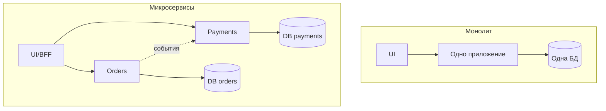
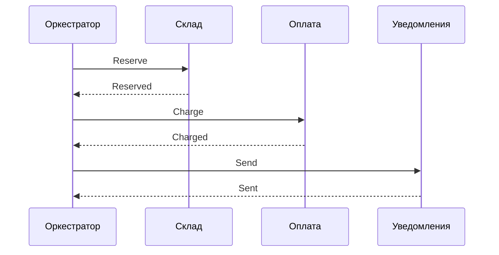

## Введение

Тема 5 на собеседовании СА начинается с картины «как устроена система». Нужно уверенно говорить про клиент-сервер, виды архитектуры, отличие SOA от микросервисов, способы нарезки сервисов и когда монолит честнее микросервисной моды. Вопросы T5.1–5.6.

SOA, монолит и микросервисы описывают на **C4 model** (context/container) и фиксируют в ADR. **T5.1–5.6** — индекс; первично — [c4model.com](https://c4model.com/) и trade-offs, не Habr.

**Оркестрация, CAP, API.** Продолжение архитектурного блока: как сервисы договариваются о длинном бизнес-процессе (хореография vs оркестрация), что такое AJAX, почему нельзя одновременно иметь идеальные C, A и P в распределёнке, зачем API Gateway и балансировщик, и что хранит Event Sourcing. Вопросы T5.7–5.15.

Оркестрация, CAP и API Gateway — распределённые системы и NFR. **T5.7–5.15** — индекс; BPMN для процессов оркестрации — OMG; границы сервисов — C4 Container.

## Раздел: Как отвечать одним блоком

Этот выпуск собрал соседние короткие темы трека: «Архитектурные стили», «Оркестрация, CAP, API». Раньше каждая занимала отдельную карточку на несколько минут, а на собеседовании их спрашивают одним блоком. Ниже у каждой темы свой раздел, затем общие лабы, один тест и одна колода карточек. В ответе сначала назовите, какую тему спросили, потом определение и один пример. Не проговаривайте все разделы, если спросили один. Лабы можно пройти по порядку исходного трека. Если времени мало, сделайте первую и последнюю: первая ставит язык, последняя проверяет, что соседние темы вы не перепутали.

## Раздел: Архитектурные стили: Клиент-сервер и виды архитектуры

**Клиент-серверная архитектура** — разделение ролей: **клиент** инициирует запрос и показывает UI/результаты; **сервер** хранит данные и выполняет бизнес-логику. Пример: браузер ↔ backend API ↔ БД. Плюсы: централизация данных и правил, тонкие клиенты. Минусы: зависимость от доступности сервера, нагрузка в центре.

**Виды архитектуры (обзор для ответа «какие знаешь»):**
- монолитная;
- многослойная (layered: presentation / business / data);
- клиент-сервер / N-tier;
- SOA;
- микросервисная;
- event-driven;
- serverless / peer-to-peer (по ситуации).

На проекте отвечайте фактами: «модульный монолит на Java + отдельные worker'ы», а не идеальной схемой из учебника.

## Раздел: Архитектурные стили: SOA vs микросервисы

**SOA (Service-Oriented Architecture)** — предприятие строится как набор **сервисов** с контрактами, часто вокруг **шины (ESB)** и крупных доменных сервисов, переиспользуемых многими каналами. Акцент: интеграция гетерогенного ландшафта, канонические модели, централизованное управление.

**Микросервисы** — набор **небольших** автономных сервисов, каждый со своей БД/жизненным циклом, лёгкая коммуникация (HTTP/gRPC/события), независимый деплой. Акцент: скорость команд, масштабирование частей, эволюция по доменам.

**Отличия в одной таблице:**
| | SOA | Микросервисы |
|--|-----|----------------|
| Гранулярность | чаще крупные сервисы | мельче, «одна команда — сервис» |
| Интеграция | часто ESB/тяжёлая медиация | smart endpoints, dumb pipes |
| Данные | нередко общие модели/хранилища | database per service |
| Управление | централизованные стандарты | автономные команды + платформа |

Не путать: микросервисы — *вид* сервисного подхода, но не синоним «SOA с ESB».

## Раздел: Архитектурные стили: Декомпозиция и независимость микросервисов

**Способы декомпозиции:**
1. **По бизнес-возможности** (capability): «Заказы», «Биллинг», «Каталог».
2. **По subdomain / Bounded Context** (DDD): границы языка и модели.
3. **По командам (Conway)** — структура сервисов следует оргструктуре.
4. **По изменениям** — то, что меняется вместе, живёт вместе.
5. **По данным и транзакциям** — минимизация распределённых транзакций.

На практике СА участвует в workshop границ: события между контекстами, владельцы данных, анти-«Distributed Monolith».

**Независимость микросервисов** означает:
- независимый **деплой** без обязательного релиза всех сразу;
- своя **модель данных** (нет shared DB как жёсткой сцепки);
- устойчивость к недоступности соседей (таймауты, деградация);
- автономная **команда** и жизненный цикл версии API.

Независимость **не** значит «ноль взаимодействия» — значит слабая связанность через явные контракты.

## Раздел: Архитектурные стили: Монолит vs микросервисы

**Монолит** — единый деплой-артефакт (часто одна БД). **Плюсы:** проще транзакции, проще локальная разработка и отладка, меньше ops-накладных. **Минусы:** сложнее масштабировать узкое место, риск большого комка связей, долгие релизы при росте команды.

**Микросервисы — плюсы:** независимое масштабирование и деплой, изоляция сбоев (при правильном дизайне), параллель команд. **Минусы:** распределённая сложность, наблюдаемость, консистентность eventual, дороже платформа.

**Когда лучше монолит:** ранняя стадия продукта, маленькая команда, домен ещё плывёт, нет сильной ops-зрелости. Модульный монолит с чёткими пакетами — частый здравый выбор перед нарезкой.

## Раздел: Архитектурные стили: Частые вопросы с собеседования

**Вопрос.** Как на собесе отличить функциональное требование от нефункционального?

**Ответ.** FR — конкретное поведение: «можно оплатить картой». NFR — качество и ограничения: «p95 ответа API ≤ 300 мс при 500 RPS», «данные карты не в логах». NFR должны быть измеримы; «быстро и безопасно» без цифр — wish, не требование.

**Вопрос.** User story или use case — что выбрать на проекте?

**Ответ.** Story — короткий инкремент ценности для backlog и спринта. Use case — полный сценарий с актёром, основным и альтернативными потоками, когда важны ветки и исключения. На собесе: story для приоритизации, UC/sequence — когда согласуете интеграции и QA-покрытие.

**Вопрос.** BPMN и UML — конкуренты или разные задачи?

**Ответ.** Разные вопросы. BPMN — бизнес-процесс, шлюзы, роли людей. UML Use Case — граница системы и цели; Sequence — вызовы сервисов во времени. Ошибка: рисовать микросервисы на BPMN вместо бизнес-шагов.

**Вопрос.** Зачем на собесе СА спрашивают идемпотентность REST?

**Ответ.** Повтор запроса (таймаут, retry клиента, двойной клик) не должен дважды списать деньги. POST платежа часто делают идемпотентным через Idempotency-Key, уникальный constraint или проверку «уже обработано». GET/PUT/DELETE по смыслу ближе к идемпотентности, чем «слепой» POST.

**Вопрос.** Когда на интеграции выбрать синхронный REST, а когда очередь?

**Ответ.** Sync — нужен ответ сейчас и цепочка короткая (проверка остатка перед оплатой). Async — долгая работа, сглаживание пиков, слабая связность: 202 Accepted, статус по webhook/polling. СА описывает ретраи, дедупликацию и SLA ответа, а не только «повесим Kafka».

## Раздел: Оркестрация, CAP, API: Хореография и оркестрация

**Хореография** — участники процесса реагируют на **события** друг друга без центрального дирижёра: `OrderCreated` → склад резервирует → `StockReserved` → биллинг списывает. **Зачем:** слабая связанность, нет единой точки оркестратора. **Плюсы:** гибкость, параллелизм команд. **Минусы:** сложнее увидеть сквозной процесс, труднее отладить «где застряло», риск циклических событий; нужен мониторинг саги и компенсирующие действия.

**Оркестрация** — есть **координатор** (процессный движок, workflow-сервис), который вызывает шаги по сценарию: «сначала склад, потом оплата, потом нотификация». **Зачем:** явный BPMN/state machine длинного процесса. **Плюсы:** прозрачный статус, проще менять порядок шагов в одном месте. **Минусы:** оркестратор — критический компонент; риск чрезмерной централизации логики; нагрузка на координатор.

На собесе: для регулируемых процессов с auditable статусом чаще оркестрация; для слабосвязанного event-driven контура — хореография или гибрид.

## Раздел: Оркестрация, CAP, API: AJAX и CAP-теорема

**AJAX (Asynchronous JavaScript and XML)** — подход, при котором страница в браузере обменивается данными с сервером **без полной перезагрузки**: XHR/fetch (сегодня чаще JSON, не XML). **Зачем:** отзывчивый UI, частичное обновление блоков, SPA-паттерны. Для СА: фиксировать API под асинхронные виджеты и состояния загрузки/ошибок.

**CAP-теорема:** в распределённой системе при **сетевом разделении (Partition)** нельзя одновременно гарантировать полную **Consistency** (все узлы видят одни данные) и полную **Availability** (каждый запрос получает ответ). Выбирают CP или AP на время партиции; **P** в сети почти неизбежен, поэтому «CA без оговорок» — упрощение для одной ноды.

**«Консистентна, доступна и устойчива на части»** — маркетинговый идеал; на практике: репликация + кворумы, деградация (read-only), conflict resolution, явное SLA eventual consistency. Аналитик фиксирует: что важнее для домена — не принять заказ при сомнении (C) или принять и свернуть позже (A).

## Раздел: Оркестрация, CAP, API: API Gateway и балансировщик

**API Gateway** — единая точка входа для клиентов к множеству backend-сервисов: маршрутизация, TLS termination, authN, rate limit, агрегирование BFF-сценариев, версия API, логирование. Клиент не ходит на 15 микросервисов напрямую.

**Балансировщик нагрузки (load balancer)** — распределяет трафик между **однотипными** инстансами сервиса (round-robin, least connections, health checks). Цель: масштабирование и отказоустойчивость горизонтали. Gateway *может* включать балансировку, но роли разные: gateway — *какой* сервис/политика; balancer — *какой инстанс* внутри пула.

## Раздел: Оркестрация, CAP, API: Event Sourcing

**Event Sourcing** — состояние сущности восстанавливается из **журнала событий** (`OrderCreated`, `ItemAdded`, `OrderPaid`), а не только из мутабельной «текущей строки». Текущий снимок (snapshot) — оптимизация. **Зачем:** аудит, временные запросы «как было», сложные саги, интеграция через тот же поток событий. **Цена:** сложнее читать «текущее», нужны проекции/read-модели, эволюция схем событий, идемпотентность обработчиков.

Не путать с «просто писать логи» или с CQRS (часто рядом, но не синоним): CQRS — разделение read/write моделей; Event Sourcing — способ хранения write-модели как событий.

## Раздел: Оркестрация, CAP, API: Частые вопросы с собеседования

**Вопрос.** Как на собесе отличить функциональное требование от нефункционального?

**Ответ.** FR — конкретное поведение: «можно оплатить картой». NFR — качество и ограничения: «p95 ответа API ≤ 300 мс при 500 RPS», «данные карты не в логах». NFR должны быть измеримы; «быстро и безопасно» без цифр — wish, не требование.

**Вопрос.** User story или use case — что выбрать на проекте?

**Ответ.** Story — короткий инкремент ценности для backlog и спринта. Use case — полный сценарий с актёром, основным и альтернативными потоками, когда важны ветки и исключения. На собесе: story для приоритизации, UC/sequence — когда согласуете интеграции и QA-покрытие.

**Вопрос.** Зачем системному аналитику OpenAPI, если есть текст требований?

**Ответ.** OpenAPI — исполнимый контракт для Dev/QA/партнёров: методы, схемы, коды ошибок, версии. Меньше «договорились устно». Аналитик не обязан писать YAML руками, но обязан согласовать поля, обязательность, breaking vs optional изменения и примеры ошибок.

## Лаба

**Архитектурные стили.**

**Цель.** Предложить границы сервисов для «учебного маркетплейса» и аргументировать монолит vs микро.

**Шаги.**
1. Перечислите 5 capability: каталог, корзина, заказ, оплата, уведомления.
2. Для пары «заказ–оплата» опишите синхронный и событийный контракт.
3. Найдите риск distributed monolith (общий статус в одной таблице на всех).
4. Напишите 3 критерия, при которых останетесь на модульном монолите.
5. Сформулируйте «независимость» Billing: деплой, БД, деградация при падении Notify.

**В группу:** разрежьте иначе (по каналам Web/Mobile) — почему это обычно хуже, чем по домену.

**Готово, если…**
- [ ] Объясняете клиент-сервер и 4+ вида архитектуры
- [ ] Чётко отличаете SOA (ESB) от микросервисов
- [ ] Аргументируете выбор монолита без стыда

**Оркестрация, CAP, API.**

**Цель.** Спроектировать сагу «заказ → резерв → оплата» в двух стилях и выбрать CAP-приоритет для каталога и платежей.

**Шаги.**
1. Нарисуйте оркестратор со статусами WaitingStock / WaitingPayment / Done / Compensating.
2. Нарисуйте хореографию теми же событиями без центра.
3. Для платежей выберите CP или AP при партиции и аргументируйте.
4. Перечислите 5 функций API Gateway для мобильного приложения маркетплейса.
5. Опишите 3 события Event Sourcing для сущности `Order` и одну read-модель «заказ для UI».

**В группу:** где гибрид лучше чистой хореографии (намек: компенсации и дедлайны оплаты).

**Готово, если…**
- [ ] Сравниваете плюсы/минусы orchestration vs choreography
- [ ] Объясняете CAP без мифа «выберем все три»
- [ ] Отличаете Gateway от load balancer и суть Event Sourcing

## Схема: Архитектурные стили: Монолит и микросервисы

## Схема: Оркестрация, CAP, API: Оркестрация заказа

## Тест

### Чем SOA отличается от микросервисов?

**Ответ:** SOA часто крупнее сервисы и ESB-центричная интеграция; микросервисы мельче, автономный деплой и данные, лёгкие каналы связи

**Пояснение:** оба сервисные, но гранулярность, владение данными и роль шины различаются.

### Плюс оркестрации относительно хореографии?

**Ответ:** сквозной процесс и статусы видны в одном координаторе, проще менять сценарий централизованно

**Пояснение:** цена — зависимость от оркестратора и риск свалить всю логику в него.

### В чём независимость микросервиса?

**Ответ:** может деплоиться и развиваться отдельно, со своей БД и устойчивостью к сбоям соседей через явные контракты

**Пояснение:** независимость — про слабую связанность и автономный жизненный цикл, не про изоляцию от бизнеса.

### Что утверждает CAP-теорема?

**Ответ:** при сетевом разделении нельзя одновременно сохранить полную согласованность и полную доступность

**Пояснение:** выбирают приоритет CP или AP; «сделать CA+P идеально» в распределёнке нельзя.

### Когда выбрать монолит?

**Ответ:** малая команда, ранний продукт, нестабильные границы домена, нет зрелой платформы эксплуатации

**Пояснение:** монолит (лучше модульный) дешевле по ops и транзакциям, пока сложность распределёнки не окупается.

## Шпаргалка

<ul><li>Клиент-сервер: запрос к центру логики и данных</li><li>SOA ≠ микросервисы (ESB и гранулярность)</li><li>Резать по capability / bounded context</li><li>Независимость = деплой + данные + деградация</li><li>Монолит — валидный default на старте</li><li>Хореография — события без дирижёра; оркестрация — центральный сценарий</li><li>AJAX — обновление UI без полной перезагрузки страницы</li><li>CAP: при P выбираем C или A</li><li>Gateway — вход и политики; LB — распределение по инстансам</li><li>Event Sourcing — журнал событий как источник состояния</li></ul>

## Anki

### Front: Что такое клиент-сервер?

Back: клиент инициирует запросы; сервер обрабатывает логику и данные централизованно

### Front: Хореография vs оркестрация

Back: хореография — реакция на события без центра; оркестрация — координатор вызывает шаги процесса

### Front: Назови способы декомпозиции на микросервисы

Back: по бизнес-capability, по bounded context/DDD, по командам, по совместным изменениям, по границам данных

### Front: CAP в одном предложении

Back: в распределённой системе при partition нельзя одновременно гарантировать полные Consistency и Availability

### Front: Плюс монолита

Back: проще транзакции, проще отладка и деплой одного артефакта; меньше распределённой сложности

### Front: Что такое Event Sourcing?

Back: состояние сущности восстанавливается из последовательности событий, а не только из мутабельного снимка строки

## Мнемоника

### acronym: Стили

**Задание:** Четыре стиля и цена связности.

**Элементы:**
- Монолит
- Модули
- Сервисы
- События

**Подсказка:** Событие ослабляет вызов и усиливает вопрос «кто доехал».

**Ответ:** монолит, модули, сервисы, события

## Итоги

- Виды архитектуры — словарь; ценен рассказ про *ваш* проект
- SOA и микросервисы различаются гранулярностью, данными и ролью шины
- Монолит vs микро — trade-off команды и домена, не экзамен на модность
- Саги бывают «с дирижёром» и «по событиям» — у каждого свой operational cost
- CAP заставляет явно выбрать поведение при сбое сети
- Gateway, LB и Event Sourcing — разные рычаги масштаба, безопасности и аудита

## Ссылки

- [C4 Model](https://c4model.com/)
- [Documenting Architecture Decisions (ADR)](https://cognitect.com/blog/2011/11/15/documenting-architecture-decisions)
- [BABOK Guide — Strategy Analysis (IIBA)](https://www.iiba.org/knowledgehub/business-analysis-body-of-knowledge-babok-guide/)
- [Топ-150 вопросов СА (Хабр) — индекс формулировок](https://habr.com/ru/articles/963708/)
- [Learn](/game/learn)
- [BPMN 2.0 — OMG](https://www.omg.org/spec/BPMN/2.0/)
- [OpenAPI — контракт gateway](https://spec.openapis.org/oas/latest.html)
