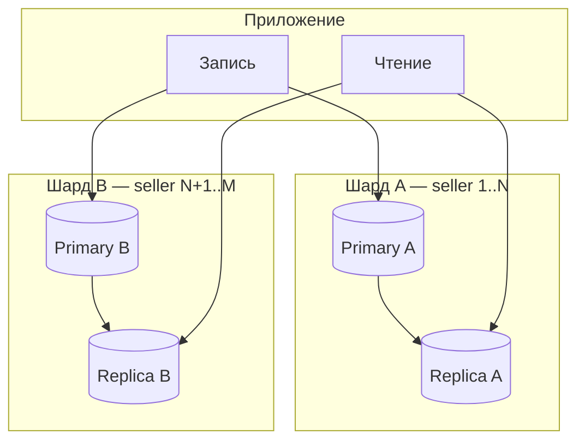
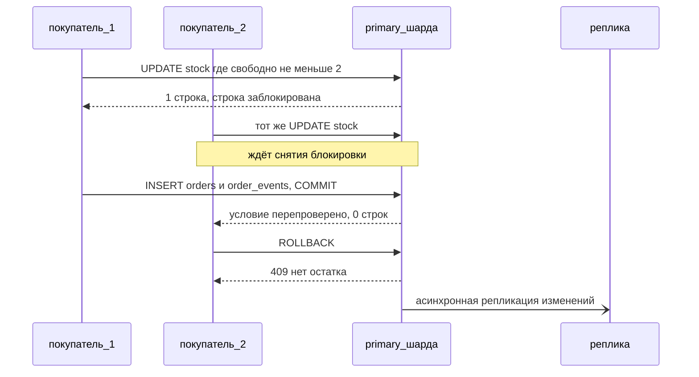

## Введение

На middle-собеседовании по БД уже недостаточно назвать 1–3 НФ. Ждут объяснения транзакций и ACID, хода проектирования схемы, приёмов оптимизации, а также когда партиции, реплики и шарды — разные инструменты, а не синонимы. Этот выпуск закрывает T3.1.13–3.1.24 оригинальными формулировками для трека аналитика.

ACID, индексы и масштабирование — NFR и *Solution Evaluation* в BABOK; **T3.1.13–3.1.24** — индекс. Первично — модель транзакций PostgreSQL/SQL и архитектурные trade-offs репликации.

## Раздел: Транзакция и требования ACID

**Транзакция** — логическая единица работы с данными: набор операций, который либо целиком применяется, либо целиком откатывается. Типичный пример: списание со счёта A и зачисление на счёт B — нельзя оставить систему после только первого шага.

**ACID:**
- **Atomicity (атомарность)** — «всё или ничего»: при ошибке откат всей транзакции.
- **Consistency (согласованность)** — после commit данные удовлетворяют ограничениям схемы (FK, CHECK, бизнес-инварианты, которые СУБД и приложение поддерживают).
- **Isolation (изоляция)** — параллельные транзакции не должны «ломать» друг друга сильнее, чем допускает выбранный уровень изоляции.
- **Durability (долговечность)** — зафиксированные изменения переживают сбой (WAL, флэш на диск и т.п.).

Аналитику важно: в постановке явно писать границы транзакции («в одной транзакции создать заказ и зарезервировать остаток») и допустимые аномалии чтения, если команда обсуждает уровни изоляции.

## Раздел: Процесс проектирования БД и оптимизация

**Процесс проектирования (типовой ход):**
1. Выявить сущности и связи из предметной области (требования, процессы, Use Case).
2. Построить концептуальную модель (часто ER / Class на уровне домена).
3. Логическая модель: таблицы, ключи, нормализация, ограничения.
4. Физическая модель: типы, индексы, партиции, настройки СУБД под нагрузку.
5. Проверка на сценариях: частые запросы, отчёты, рост данных, миграции.

**Способы оптимизации (что называют на собесе):**
- правильные индексы под горячие WHERE/JOIN/ORDER BY;
- нормализация vs точечная денормализация под чтение;
- партиционирование больших таблиц;
- кэш (Redis и др.) перед тяжёлыми SELECT;
- пересмотр запросов (избегать N+1, лишних JOIN);
- архивирование/TTL для «холодных» данных;
- реплики на чтение, шарды при горизонтальном росте.

Роль СА: не «тюнить PostgreSQL», а зафиксировать объёмы, SLA чтения/записи, критичные запросы и инварианты — чтобы DBA/разработка выбрали средства.

## Раздел: Партиционирование, репликация, шардирование

**Партиционирование** — разбиение одной логической таблицы на части (партиции) по правилу: диапазон дат, хэш ключа, список значений. Запросы с предикатом по ключу партиции сканируют меньше данных. Принцип: ключ партиционирования должен совпадать с типичным фильтром (часто `created_at`, `tenant_id`).

**Реплицирование** — копирование одних и тех же данных на несколько узлов. Цель: отказоустойчивость и/или масштабирование чтения. Есть синхронная и асинхронная репликация; при async возможна задержка (lag).

**Шардирование** — горизонтальное разнесение **разных** подмножеств данных по узлам (шардам) по shard key. Цель: обойти лимит одной машины по объёму и записи. Цена: кросс-шард JOIN и распределённые транзакции усложняются.

**Реплика vs шард:** реплика — копии одного набора; шард — разные куски данных. Часто комбинируют: каждый шард имеет свои реплики.

## Раздел: Маппинг, уровни абстракции, индексы

**Маппинг данных** — соответствие между представлениями: поле API ↔ колонка БД, сущность домена ↔ таблица, сообщение шины ↔ запись. В интеграциях маппинг описывают в спецификации (таблица полей, типы, обязательность, преобразования).

**Уровни абстракции данных (часто на собесе):**
- **внешний (пользовательский)** — что видит приложение/отчёт;
- **логический (концептуальный)** — сущности и связи без физического хранения;
- **внутренний (физический)** — файлы, страницы, индексы СУБД.

Отличие: при движении «вниз» растёт детализация реализации; смена физ. уровня не должна ломать логическую модель без миграции контракта.

**Индексы** — структуры для ускорения поиска по столбцам ценой места и замедления записи. На практике: уникальный индекс на email, составной на `(order_id, created_at)` под ленту событий. Аналитик фиксирует уникальность и частые фильтры в постановке — это подсказка для индексов.

## Раздел: Dirty read и когда денормализовать

**Грязное чтение (dirty read)** — транзакция A прочитала незафиксированные изменения транзакции B; если B сделает ROLLBACK, A опиралась на «несуществующие» данные. На строгих уровнях изоляции (например, Read Committed и выше в типичных СУБД) dirty read запрещён; риск проявляется при Read Uncommitted или слабых настройках.

**Денормализация** — сознательное нарушение нормальных форм (дублирование, агрегаты в строке) ради скорости чтения или упрощения запросов. **Когда уместно:** витрины и отчёты, кэш счётчиков (`likes_count`), digests для UI, digests после стабилизации OLTP-схемы. **Когда рано:** пока не ясны инварианты и частота обновлений — дубли легко рассинхронизировать. В постановке всегда пишите, кто владелец истины и как обновляется копия.

## Раздел: Пример в коде

Сценарий из лабы: покупатель оформляет заказ на 2 штуки товара 501 у продавца 7. Таблицы `stock(product_id, quantity, reserved)`, `orders`, `order_events`. СУБД — PostgreSQL 16, уровень изоляции по умолчанию Read Committed.

Плохо: проверка остатка отдельным SELECT, решение в приложении.

```sql
BEGIN;
SELECT quantity - reserved AS free FROM stock WHERE product_id = 501;
-- приложение видит free = 2 и решает, что резерв возможен
UPDATE stock SET reserved = reserved + 2 WHERE product_id = 501;
INSERT INTO orders (buyer_id, seller_id, status, total)
VALUES (42, 7, 'awaiting_payment', 3980);
COMMIT;
```

Два покупателя одновременно читают `free = 2`. Второй UPDATE ждёт блокировку строки, затем применяется поверх первого: `reserved` растёт на 4, товар продан дважды. Атомарность здесь не помогла: каждая транзакция по отдельности корректна, ломается изоляция между ними.

Хорошо: проверка и резерв одной командой.

```sql
BEGIN ISOLATION LEVEL READ COMMITTED;
UPDATE stock
SET reserved = reserved + 2
WHERE product_id = 501 AND quantity - reserved >= 2
RETURNING quantity - reserved AS free_after;
-- 0 строк: остатка нет, приложение делает ROLLBACK и отвечает 409
INSERT INTO orders (buyer_id, seller_id, status, total)
VALUES (42, 7, 'awaiting_payment', 3980)
RETURNING id;
-- 9001 — id, который вернул предыдущий INSERT
INSERT INTO order_events (order_id, type, created_at)
VALUES (9001, 'OrderCreated', now());
COMMIT;
```

На Read Committed второй UPDATE после ожидания перепроверяет условие на новой версии строки и обновляет 0 строк. На Repeatable Read второй получит ошибку сериализации `40001`, и приложение обязано повторить транзакцию — это пишут в постановке. Страховка согласованности (C в ACID) — `CHECK (reserved <= quantity)` на таблице: даже ошибка в коде не запишет отрицательный остаток. Резерв, заказ и событие живут в одной транзакции: при сбое на любом шаге откатывается всё.

Индекс под ленту событий заказа и проверка плана:

```sql
CREATE INDEX order_events_order_created_idx
    ON order_events (order_id, created_at);

EXPLAIN (ANALYZE, COSTS OFF)
SELECT type, created_at
FROM order_events
WHERE order_id = 9001
ORDER BY created_at DESC
LIMIT 20;
```

```text
-- до индекса (фрагмент)
Limit (actual time=410.2..410.2 rows=3 loops=1)
  ->  Sort (actual time=410.2..410.2 rows=3 loops=1)
        Sort Key: created_at DESC
        ->  Seq Scan on order_events (actual time=0.02..410.1 rows=3 loops=1)
              Filter: (order_id = 9001)
              Rows Removed by Filter: 4999997
-- после индекса
Limit (actual time=0.03..0.04 rows=3 loops=1)
  ->  Index Scan Backward using order_events_order_created_idx on order_events (actual time=0.03..0.04 rows=3 loops=1)
        Index Cond: (order_id = 9001)
```

Признак проблемы — `Seq Scan` и огромный `Rows Removed by Filter`: база прочитала 5 млн строк ради трёх. Составной индекс закрывает и фильтр, и сортировку, поэтому `Sort` исчезает. Цена — каждая вставка в `order_events` теперь обновляет и индекс.

Куда идут запросы при шардах по `seller_id` с репликами:

| Запрос | Узел | Почему |
|--------|------|--------|
| Резерв и оплата заказа | primary шарда продавца | запись и транзакция только на primary |
| Карточка заказа сразу после оплаты | primary шарда продавца | асинхронная реплика может отставать |
| Каталог и отчёт продавца | реплика шарда | разгружаем primary, лаг в секунды допустим |
| Все заказы покупателя | все шарды | shard key — продавец, а не покупатель |

Последняя строка — плата за выбор ключа: запрос по покупателю обходит все шарды и собирает результат. Если такой экран частый, это аргумент за отдельную read-модель «заказы покупателя».

## Раздел: Частые вопросы с собеседования

**Вопрос.** Как на собесе отличить функциональное требование от нефункционального?

**Ответ.** FR — конкретное поведение: «можно оплатить картой». NFR — качество и ограничения: «p95 ответа API ≤ 300 мс при 500 RPS», «данные карты не в логах». NFR должны быть измеримы; «быстро и безопасно» без цифр — wish, не требование.

**Вопрос.** User story или use case — что выбрать на проекте?

**Ответ.** Story — короткий инкремент ценности для backlog и спринта. Use case — полный сценарий с актёром, основным и альтернативными потоками, когда важны ветки и исключения. На собесе: story для приоритизации, UC/sequence — когда согласуете интеграции и QA-покрытие.

**Вопрос.** BPMN и UML — конкуренты или разные задачи?

**Ответ.** Разные вопросы. BPMN — бизнес-процесс, шлюзы, роли людей. UML Use Case — граница системы и цели; Sequence — вызовы сервисов во времени. Ошибка: рисовать микросервисы на BPMN вместо бизнес-шагов.

**Вопрос.** Зачем на собесе СА спрашивают идемпотентность REST?

**Ответ.** Повтор запроса (таймаут, retry клиента, двойной клик) не должен дважды списать деньги. POST платежа часто делают идемпотентным через Idempotency-Key, уникальный constraint или проверку «уже обработано». GET/PUT/DELETE по смыслу ближе к идемпотентности, чем «слепой» POST.

**Вопрос.** ACID и CAP — про одно и то же?

**Ответ.** Нет. ACID — свойства транзакции в одной БД (атомарность, согласованность, изоляция, долговечность). CAP — компромисс распределённой системы при сбое сети: согласованность vs доступность. На собесе связывают с контекстом: баланс — строже ACID; лента лайков — чаще eventual consistency.

## Лаба

**Цель.** Для домена «заказы маркетплейса» спроектировать границы транзакций, ключ партиционирования и решение «реплика vs шард», плюс список индексов.

**Шаги.**
1. Опишите сценарий «оплата заказа»: какие 2–4 операции в одной транзакции, что при откате.
2. Таблица `order_events` растёт на 50M строк/год — предложите ключ партиционирования и типовой запрос, который от него выиграет.
3. Нагрузка: 90% чтение каталога, 10% запись заказов — что даст реплика, а что нет; когда подумаете о шарде по `seller_id`.
4. Найдите 3 поля для индексов и одно место, где денормализация `items_count` оправдана.
5. Сформулируйте одной фразой dirty read на примере «черновик статуса оплаты».

**В группу:** партнёр предлагает другой shard key — сравните кросс-шард сценарии «заказ покупателя по всем продавцам».

**Готово, если…**
- [ ] Объясняете ACID на примере перевода денег без шпаргалки
- [ ] Чётко отличаете реплику, шард и партицию
- [ ] Называете dirty read и уровень, где его обычно нет

## Схема: Реплика и шард рядом



## Схема: Два покупателя резервируют последний товар



## Тест

### Какой приём делит разные подмножества данных по узлам по ключу?

**Ответ:** шардирование

**Пояснение:** репликация копирует один и тот же набор данных, шардирование делит данные на разные узлы по shard key. Реплика помогает с чтением и отказоустойчивостью, шард — с объёмом и записью, усложняя кросс-узловые запросы.

### Как называется чтение незафиксированных изменений другой транзакции?

**Ответ:** грязное чтение

**Пояснение:** это dirty read — чтение данных, которые могут откатиться. Классическая аномалия слабой изоляции; на Read Committed и выше в обычных СУБД она не допускается.

### Как называется осознанное дублирование данных ради скорости чтения?

**Ответ:** денормализация

**Пояснение:** она уместна, когда выигрыш по чтению и простоте запросов важнее стоимости синхронизации копий. Типично витрины, счётчики, кэш полей UI при ясном владельце истины; не вместо проектирования OLTP.

### Какой уровень изоляции чаще всего по умолчанию в PostgreSQL?

**Ответ:** Read Committed

**Пояснение:** каждый statement видит committed snapshot; phantom/non-repeatable read возможны без Serializable.

### Зачем covering index?

**Ответ:** index-only scan

**Пояснение:** покрывающий индекс содержит все нужные запросу колонки, поэтому СУБД читает только индекс без обращения к heap. INCLUDE или составной индекс с нужными колонками ускоряет типовые SELECT отчётов.

### Два покупателя одновременно резервируют последние 2 штуки: приложение читает остаток SELECT-ом, потом делает UPDATE. Прошли оба заказа. Что добавите к SELECT?

**Ответ:** FOR UPDATE

**Пояснение:** `SELECT ... FOR UPDATE` блокирует строку остатка до конца транзакции, и второй покупатель увидит уже обновлённый резерв. Можно и условным UPDATE одной командой; Serializable тоже спасёт, но потребует повторов при ошибке сериализации.

### После оплаты пользователь открывает заказ и видит «не оплачен». Карточка читается с асинхронной реплики. Откуда читать карточку сразу после записи?

**Ответ:** с primary

**Пояснение:** асинхронная реплика отстаёт (lag), поэтому для read-your-writes свежие данные читают с primary. Синхронная репликация решила бы это ценой замедления всех записей, а кэш только усилит устаревание.

### Отчёт по order_events за прошлый месяц сканирует всю таблицу на 500 млн строк, хотя фильтр всегда по created_at. Что предложите для таблицы?

**Ответ:** партиционирование

**Пояснение:** партиции по диапазону `created_at` дают отсечение лишних партиций (partition pruning), а старые месяцы легко архивировать. Реплика не уменьшит объём скана, а шард нужен при упоре в ёмкость узла, не ради одного отчёта.

## Шпаргалка

<h3>Суть</h3>
<ul>
<li>Транзакция = атомарная единица; ACID — свойства надёжной СУБД</li>
<li>Партиция — куски одной таблицы; реплика — копии; шард — разные данные</li>
<li>Индекс ускоряет чтение, замедляет запись</li>
<li>Dirty read — чтение незакоммиченного</li>
<li>Денормализация — осознанный дубль под нагрузку чтения</li>
</ul>
<h3>Памятка аналитику</h3>
<pre><code>В постановке: граница транзакции, объёмы, SLA,
ключ партиции/шарда, уникальность → индексы,
владелец поля при денормализации</code></pre>

## Anki

### Front: Расшифруй ACID

Back: Atomicity, Consistency, Isolation, Durability — атомарность, согласованность, изоляция, долговечность

### Front: Реплика vs шард одной фразой

Back: Реплика — копии одних данных; шард — разные подмножества на разных узлах

### Front: Что такое dirty read?

Back: Транзакция прочитала чужие незафиксированные изменения, которые потом могут исчезнуть при ROLLBACK

### Front: Что гарантирует «D» в ACID?

Back: Durability — committed transaction переживает сбой после ACK commit

### Front: Read replica для чего аналитику?

Back: разгрузить отчёты и тяжёлые SELECT без блокировки primary write path

### Front: Шардирование решает какую проблему?

Back: горизонтальное деление данных/нагрузки когда один узел упёрся в ёмкость

## Мнемоника

### link: Почему запрос тяжёлый

**Задание:** Порядок разбора, который ждут от аналитика.

**Элементы:**
- кардинальность
- индекс
- фильтр
- план

**Подсказка:** Индекс не лечит фильтр, который отбрасывает почти все строки поздно.

**Ответ:** кардинальность → индекс → фильтр → план

## Итоги

- ACID и границы транзакций — must-have для middle СА
- Партиция, реплика, шард решают разные проблемы масштаба
- Индексы, маппинг и точечная денормализация — часть постановки, не «магия DBA»

## Ссылки

- [BABOK Guide — NFR и оценка решений (IIBA)](https://www.iiba.org/knowledgehub/business-analysis-body-of-knowledge-babok-guide/)
- [Топ-150 вопросов СА (Хабр) — индекс формулировок](https://habr.com/ru/articles/963708/)
- Learn | /game/learn
