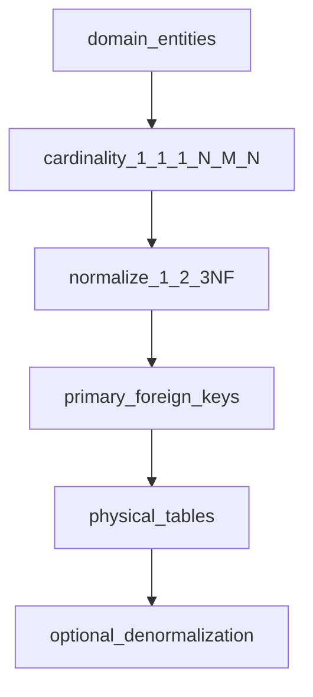
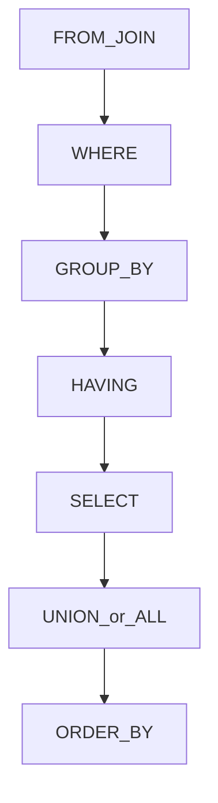

## Введение

Системного аналитика на junior-собесе проверяют на понимание данных: что такое БД, зачем нормализация и как моделировать связи. Выпуск T3.1.1–3.1.12 даёт ответы без углубления в администрирование — ровно тот уровень, который ждут от СА.

Модель данных для СА пересекается с BABOK *Requirements Analysis and Design Definition* и нормализацией реляционных схем. **T3.1.1–3.1.12** — индекс; первично — теория БД и ER, не списки вопросов.

**SQL основы.** На собесе СА часто просят «чуть-чуть SQL»: не оптимизировать планы, а уверенно читать и писать выборки. Выпуск T3.2.1–3.2.7 закрывает команды, JOIN, фильтры агрегатов и типичные ловушки TRUNCATE/UNION.

SQL для аналитика — проверка данных и прототипирование выборок; опора на стандарт SQL и ER из предыдущего выпуска. **T3.2.1–3.2.7** — индекс серии.

## Раздел: Как отвечать одним блоком

Этот выпуск собрал соседние короткие темы трека: «БД основы», «SQL основы». Раньше каждая занимала отдельную карточку на несколько минут, а на собеседовании их спрашивают одним блоком. Ниже у каждой темы свой раздел, затем общие лабы, один тест и одна колода карточек. В ответе сначала назовите, какую тему спросили, потом определение и один пример. Не проговаривайте все разделы, если спросили один. Лабы можно пройти по порядку исходного трека. Если времени мало, сделайте первую и последнюю: первая ставит язык, последняя проверяет, что соседние темы вы не перепутали.

## Раздел: БД основы: БД, СУБД, типы и выбор реляционной / NoSQL

**База данных (БД)** — организованное хранилище данных с правилами доступа и целостности. **СУБД** — программная система, которая управляет БД: хранение, запросы, транзакции, права, резервное копирование (PostgreSQL, MySQL, MongoDB, Redis и т.д.).

**Типы БД / моделей данных (обзор):**
- **Реляционные** — таблицы, строки, столбцы, SQL, ключи, JOIN;
- **Документные** — JSON/BSON-документы (MongoDB);
- **Ключ-значение** — быстрый доступ по ключу (Redis);
- **Колоночные** — аналитика по столбцам;
- **Графовые** — узлы и рёбра (связи «как в соцсети»);
- **Поисковые движки** — полнотекст (Elasticsearch) как отдельный класс хранилищ.

**Почему реляционные так популярны:** зрелая модель целостности (PK/FK), мощный декларативный SQL, транзакции ACID в классических СУБД, предсказуемые схемы для бизнес-учёта, отчётности и строгих инвариантов. Для СА важно: реляционка хорошо ложится на нормализованные предметные области с чёткими связями.

**Задачи, где часто смотрят NoSQL:** гибкая/меняющаяся схема документов; очень высокий write/read по ключу; графовые рекомендации; кэш и сессии; большие полуструктурированные логи. Не «NoSQL вместо SQL всегда», а под паттерн доступа и требования консистентности.

**Реляционные vs нереляционные:**
- схема: жёсткая заранее vs гибкая/неявная;
- связи: JOIN и FK vs встраивание/ссылки/отдельные коллекции;
- транзакции: сильная сторона классических RDBMS vs часто ограниченная/иная модель;
- масштабирование: вертикаль + реплики/шарды vs изначально горизонтальные паттерны у многих NoSQL;
- запросы: SQL-универсальность vs API под тип хранилища.

## Раздел: БД основы: Нормализация 1–3NF и введение в денормализацию

**Нормализация** — проектирование схемы так, чтобы уменьшить избыточность и аномалии обновления.

- **1NF:** атомарные значения в ячейках, нет повторяющихся групп в виде «списка в поле»; каждая строка уникально идентифицируема.
- **2NF:** есть 1NF + нет частичной зависимости от составного ключа (неключевые атрибуты зависят от *всего* ключа).
- **3NF:** есть 2NF + нет транзитивных зависимостей (неключевой атрибут не зависит от другого неключевого). Классика: город не хранить и в заказе, и отдельно от справочника, если город определяется пунктом выдачи — выносят в справочник.

На собесе приведите пример: таблица заказов с «телефон клиента» дублируется → при смене телефона правят много строк (аномалия). Вынос клиента в отдельную сущность с PK решает это.

**Денормализация** — осознанное введение избыточности ради чтения/отчётности/производительности (кэш поля, агрегаты, материализованные витрины). Это не «ошибка junior», а trade-off: быстрее читать, сложнее согласованно обновлять. Аналитик фиксирует, *почему* избыточность нужна и кто отвечает за консистентность.

## Раздел: БД основы: Типы связей, M:N и первичный ключ

**Типы связей:**
- **1:1** — паспорт ↔ человек (редко, часто для разделения чувствительных данных);
- **1:N** — клиент → заказы;
- **M:N** — заказ ↔ товары, студент ↔ курсы.

**M:N** в реляционной модели реализуют **связующей таблицей** (order_items): составной или суррогатный ключ + FK на обе стороны + атрибуты связи (количество, цена на момент покупки).

**Первичный ключ (PK)** — атрибут или набор атрибутов, уникально идентифицирующий строку, не NULL. Бывает **натуральный** (ИНН — осторожно с бизнес-сменой) и **суррогатный** (id serial/uuid). Внешний ключ (FK) ссылается на PK/unique другой таблицы и поддерживает ссылочную целостность.

Для СА: сначала сущности и связи в предметной области, потом ключи и кардинальность, затем уже физические типы столбцов.

## Раздел: БД основы: Частые вопросы с собеседования

**Вопрос.** Как на собесе отличить функциональное требование от нефункционального?

**Ответ.** FR — конкретное поведение: «можно оплатить картой». NFR — качество и ограничения: «p95 ответа API ≤ 300 мс при 500 RPS», «данные карты не в логах». NFR должны быть измеримы; «быстро и безопасно» без цифр — wish, не требование.

**Вопрос.** User story или use case — что выбрать на проекте?

**Ответ.** Story — короткий инкремент ценности для backlog и спринта. Use case — полный сценарий с актёром, основным и альтернативными потоками, когда важны ветки и исключения. На собесе: story для приоритизации, UC/sequence — когда согласуете интеграции и QA-покрытие.

**Вопрос.** Зачем на собесе СА спрашивают идемпотентность REST?

**Ответ.** Повтор запроса (таймаут, retry клиента, двойной клик) не должен дважды списать деньги. POST платежа часто делают идемпотентным через Idempotency-Key, уникальный constraint или проверку «уже обработано». GET/PUT/DELETE по смыслу ближе к идемпотентности, чем «слепой» POST.

**Вопрос.** Когда на интеграции выбрать синхронный REST, а когда очередь?

**Ответ.** Sync — нужен ответ сейчас и цепочка короткая (проверка остатка перед оплатой). Async — долгая работа, сглаживание пиков, слабая связность: 202 Accepted, статус по webhook/polling. СА описывает ретраи, дедупликацию и SLA ответа, а не только «повесим Kafka».

**Вопрос.** ACID и CAP — про одно и то же?

**Ответ.** Нет. ACID — свойства транзакции в одной БД (атомарность, согласованность, изоляция, долговечность). CAP — компромисс распределённой системы при сбое сети: согласованность vs доступность. На собесе связывают с контекстом: баланс — строже ACID; лента лайков — чаще eventual consistency.

## Раздел: SQL основы: Команды SQL и JOIN

**Группы команд SQL (классика):**
- **DDL** — структура: CREATE, ALTER, DROP, TRUNCATE (часто относят к DDL);
- **DML** — данные: SELECT, INSERT, UPDATE, DELETE;
- **DCL** — права: GRANT, REVOKE;
- **TCL** — транзакции: BEGIN/COMMIT/ROLLBACK (в конкретных диалектах синтаксис свой).

Для аналитика в повседневности важнее DML-выборки и понимание, что DDL меняет схему.

**JOIN** объединяет строки связанных таблиц:
- **INNER JOIN** — только совпавшие пары по условию;
- **LEFT JOIN** — все слева + совпадения справа (иначе NULL справа);
- **RIGHT JOIN** — зеркало LEFT (на практике чаще переписывают в LEFT);
- **FULL OUTER JOIN** — все из обеих сторон;
- **CROSS JOIN** — декартово произведение.

Аналитику: LEFT JOIN нужен, когда важны «заказы без оплаты» или «клиенты без заказов» (дальше фильтр по NULL — anti-join). Ошибка новичка — фильтровать правую таблицу в WHERE так, что LEFT превращается по смыслу в INNER.

## Раздел: SQL основы: TRUNCATE vs DELETE, HAVING и WHERE

**DELETE** удаляет строки (можно с WHERE), обычно логируется построчно, может срабатывать с триггерами, откатывается в транзакции (зависит от СУБД/режима). **TRUNCATE** быстро очищает таблицу целиком, сбрасывает идентичность в многих СУБД, обычно не допускает WHERE, ограничения по FK могут мешать; семантика транзакций/триггеров зависит от СУБД — на собесе скажите принцип: TRUNCATE — массовая очистка структуры хранения, DELETE — удаление набора строк.

**HAVING** фильтрует результат **после группировки** (условия на агрегаты: COUNT, SUM, AVG…). **WHERE** фильтрует строки **до** GROUP BY.

Пример смысла: «клиенты с числом заказов &gt; 5» → GROUP BY customer_id HAVING COUNT(*) &gt; 5. Писать COUNT в WHERE нельзя (ещё нет групп).

**HAVING vs WHERE:** WHERE — про сырые строки и индексируемые предикаты на столбцы; HAVING — про агрегаты групп. Часто часть условий можно вынести в WHERE, чтобы раньше отсечь строки и не тащить их в группировку.

## Раздел: SQL основы: Anti-join и UNION

**Anti-join** — найти строки одной таблицы без пар в другой. Способы:
1. `LEFT JOIN ... WHERE right.id IS NULL`
2. `NOT EXISTS (подзапрос)`
3. `NOT IN (подзапрос)` — осторожно с NULL внутри списка
4. Иногда `EXCEPT` (если диалект поддерживает)

Предпочтительно для ответа: NOT EXISTS или LEFT JOIN + IS NULL; про NULL в NOT IN упомянуть как ловушку.

**UNION** объединяет результаты выборок и **убирает дубликаты**. **UNION ALL** склеивает всё **с дубликатами**, обычно быстрее. Число и типы столбцов должны совпадать. На собесе: «нужна уникальность — UNION; нужна скорость/полная картина повторов — UNION ALL».

## Раздел: SQL основы: Частые вопросы с собеседования

**Вопрос.** Как на собесе отличить функциональное требование от нефункционального?

**Ответ.** FR — конкретное поведение: «можно оплатить картой». NFR — качество и ограничения: «p95 ответа API ≤ 300 мс при 500 RPS», «данные карты не в логах». NFR должны быть измеримы; «быстро и безопасно» без цифр — wish, не требование.

**Вопрос.** User story или use case — что выбрать на проекте?

**Ответ.** Story — короткий инкремент ценности для backlog и спринта. Use case — полный сценарий с актёром, основным и альтернативными потоками, когда важны ветки и исключения. На собесе: story для приоритизации, UC/sequence — когда согласуете интеграции и QA-покрытие.

**Вопрос.** BPMN и UML — конкуренты или разные задачи?

**Ответ.** Разные вопросы. BPMN — бизнес-процесс, шлюзы, роли людей. UML Use Case — граница системы и цели; Sequence — вызовы сервисов во времени. Ошибка: рисовать микросервисы на BPMN вместо бизнес-шагов.

**Вопрос.** Зачем на собесе СА спрашивают идемпотентность REST?

**Ответ.** Повтор запроса (таймаут, retry клиента, двойной клик) не должен дважды списать деньги. POST платежа часто делают идемпотентным через Idempotency-Key, уникальный constraint или проверку «уже обработано». GET/PUT/DELETE по смыслу ближе к идемпотентности, чем «слепой» POST.

**Вопрос.** Когда на интеграции выбрать синхронный REST, а когда очередь?

**Ответ.** Sync — нужен ответ сейчас и цепочка короткая (проверка остатка перед оплатой). Async — долгая работа, сглаживание пиков, слабая связность: 202 Accepted, статус по webhook/polling. СА описывает ретраи, дедупликацию и SLA ответа, а не только «повесим Kafka».

## Лаба

**БД основы.**

**Цель.** Спроектировать мини-схему интернет-магазина до 3NF и показать одну осознанную денормализацию.

**Шаги.**
1. Выделите сущности: Customer, Order, Product, Category; проставьте связи и кардинальность.
2. Разложите M:N Order–Product через order_items с полями qty и price_at_purchase.
3. Проверьте 1–3NF: уберите телефон клиента из строки заказа в сущность клиента.
4. Добавьте денормализованное поле orders_count у клиента и запишите риск рассинхрона.

**В группу:** коллега ищет аномалии обновления в вашей «почти нормальной» схеме.

**Готово, если…**
- [ ] Объясняете БД vs СУБД и зачем реляционные модели
- [ ] Даёте определения 1NF/2NF/3NF на примере
- [ ] Показываете реализацию M:N и смысл PK

**SQL основы.**

**Цель.** Написать 4 запроса «на бумаге» и объяснить план фильтрации.

**Шаги.**
1. INNER JOIN заказов и клиентов по customer_id с фильтром по дате в WHERE.
2. LEFT JOIN + IS NULL: клиенты без заказов.
3. GROUP BY товара с HAVING SUM(qty) &gt; 100.
4. Два SELECT статусов через UNION ALL и тот же через UNION — опишите разницу результата.

**В группу:** разберите ошибку «LEFT JOIN, но в WHERE right.col = 'X'» — что произошло с семантикой.

**Готово, если…**
- [ ] Перечисляете DDL/DML и типы JOIN своими словами
- [ ] Объясняете TRUNCATE vs DELETE и WHERE vs HAVING
- [ ] Знаете ≥2 способа anti-join и отличие UNION/UNION ALL

## Схема: БД основы: От предметной области к таблицам

## Схема: SQL основы: Порядок логической обработки запроса

## Тест

### Чем СУБД отличается от базы данных?

**Ответ:** БД — сами данные и их организация; СУБД — ПО, которое ими управляет

**Пояснение:** файл с таблицами — ещё не вся история; PostgreSQL как СУБД даёт запросы, права, транзакции.

### Почему условие на COUNT пишут в HAVING, а не в WHERE?

**Ответ:** COUNT появляется после группировки; WHERE работает до GROUP BY

**Пояснение:** WHERE не видит агрегаты групп; HAVING как раз фильтрует группы.

### Зачем связующая таблица при M:N?

**Ответ:** чтобы хранить пары связанных ключей и атрибуты связи без дублирования списков

**Пояснение:** нельзя аккуратно положить «много товаров» в строку заказа и «много заказов» в товар одновременно без отдельной сущности связи.

### Чем TRUNCATE принципиально отличается от DELETE без WHERE?

**Ответ:** TRUNCATE — быстрая очистка всей таблицы с иной семантикой; DELETE удаляет строки и может быть выборочным

**Пояснение:** у TRUNCATE обычно нет WHERE, другое поведение по идентичности/триггерам в зависимости от СУБД.

### Что даёт переход к 3NF?

**Ответ:** убирает транзитивные зависимости и снижает аномалии обновления

**Пояснение:** неключевые данные не должны зависеть друг от друга через «цепочку»; справочники выносят отдельно.

## Шпаргалка

<ul><li>БД = данные; СУБД = система управления</li><li>Реляционные сильны схемой, SQL, целостностью, транзакциями</li><li>NoSQL — под конкретный паттерн доступа и гибкость</li><li>1NF атомарность → 2NF полный ключ → 3NF без транзитивностей</li><li>M:N → link-таблица; PK уникально идентифицирует строку</li><li>DDL структура, DML данные, DCL права, TCL транзакции</li><li>INNER — пересечение; LEFT — все слева</li><li>WHERE до групп; HAVING после агрегатов</li><li>Anti-join: NOT EXISTS или LEFT + IS NULL</li><li>UNION уникализирует; UNION ALL сохраняет дубли</li></ul>

## Anki

### Front: Что такое 3NF простыми словами?

Back: Таблица в 2NF и без транзитивных зависимостей: неключевые атрибуты зависят только от ключа, не друг от друга

### Front: INNER JOIN vs LEFT JOIN?

Back: INNER возвращает только совпадения; LEFT — все строки левой таблицы и совпадения правой (или NULL)

### Front: Как реализовать связь многие-ко-многим?

Back: Отдельная связующая таблица с внешними ключами на обе сущности и атрибутами связи

### Front: WHERE vs HAVING?

Back: WHERE фильтрует строки до группировки; HAVING — группы после агрегации

### Front: Когда оправдана денормализация?

Back: Когда осознанно жертвуем нормальной формой ради скорости чтения/отчётности и принимаем сложность обновлений

### Front: UNION vs UNION ALL?

Back: UNION удаляет дубликаты между выборками; UNION ALL оставляет все строки

## Итоги

- СА обязан говорить на языке сущностей, ключей и кардинальности
- Нормализация уменьшает аномалии; денормализация — осознанный trade-off
- Реляционные и NoSQL выбирают по задаче, а не по моде
- M:N почти всегда = связующая таблица с атрибутами факта связи
- СА читает SQL как язык проверки гипотез о данных и требований
- JOIN и anti-join закрывают типичные аналитические вопросы «есть/нет связи»
- HAVING и WHERE путают часто — держите порядок обработки запроса в голове
- UNION ALL по умолчанию практичнее, если уникальность не нужна

## Ссылки

- [BABOK Guide — анализ данных (IIBA)](https://www.iiba.org/knowledgehub/business-analysis-body-of-knowledge-babok-guide/)
- [Топ-150 вопросов СА (Хабр) — индекс формулировок](https://habr.com/ru/articles/963708/)
- [Learn](/game/learn)
