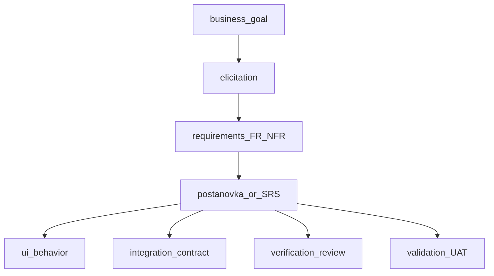
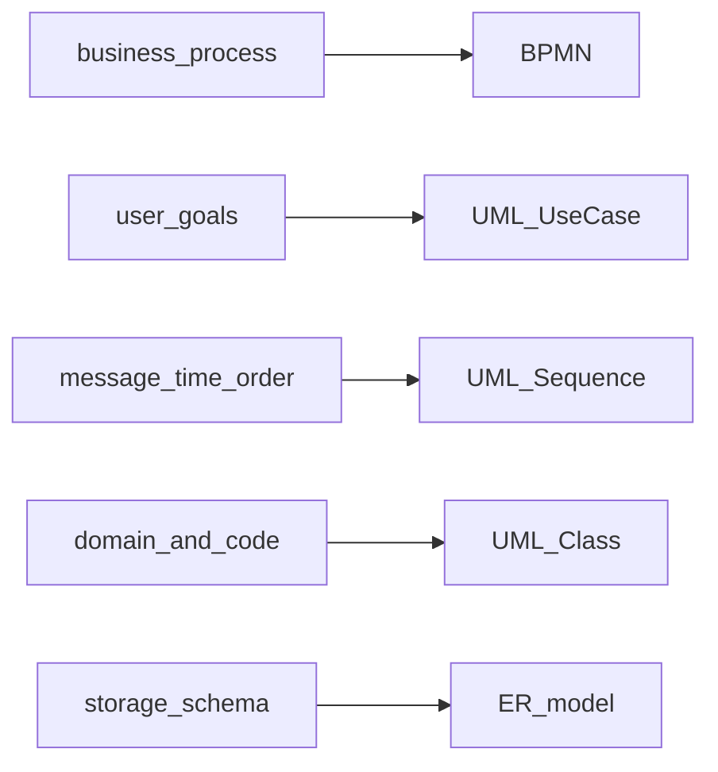

## Введение

В корпоративных и госпроектах junior СА спрашивают про ГОСТ, структуру постановки и SRS, а также чем verification отличается от validation. Выпуск T1.13–1.22 даёт рабочие ответы: что писать, для кого и как проверить качество требований.

ГОСТ 19/34 и SRS согласуются с BABOK *Requirements Life Cycle Management* (управление атрибутами и базой требований). **T1.13–1.22** — индекс; verification/validation — из KA *Solution Evaluation*.

**BPMN и UML.** Умение выбрать нотацию и объяснить диаграмму — базовый навык СА на собесе. Выпуск T2.1–2.8 закрывает BPMN и UML: какие элементы знать наизусть, чем шлюзы отличаются от событий и когда class diagram не заменяет ER.

BPMN 2.0 — спецификация **OMG** для исполнимых и неисполнимых бизнес-процессов; UML — OMG для структуры и поведения ПО. **T2.1–2.8** — индекс серии. Первичный источник элементов BPMN — [спецификация BPMN 2.0](https://www.omg.org/spec/BPMN/2.0/), не пересказы с Habr.

## Раздел: Как отвечать одним блоком

Этот выпуск собрал соседние короткие темы трека: «ГОСТ и SRS», «BPMN и UML». Раньше каждая занимала отдельную карточку на несколько минут, а на собеседовании их спрашивают одним блоком. Ниже у каждой темы свой раздел, затем общие лабы, один тест и одна колода карточек. В ответе сначала назовите, какую тему спросили, потом определение и один пример. Не проговаривайте все разделы, если спросили один. Лабы можно пройти по порядку исходного трека. Если времени мало, сделайте первую и последнюю: первая ставит язык, последняя проверяет, что соседние темы вы не перепутали.

## Раздел: ГОСТ и SRS: ГОСТ 19 vs 34 и критерии хороших требований

**ГОСТ 19** (ЕСПД) — стандарты на **программную документацию**: спецификации программ, описания применения, ведомости и т.п. Исторически сильнее про оформление документов на ПО.

**ГОСТ 34** — комплекс стандартов на **автоматизированные системы** (АС): стадии создания, ТЗ на АС (34.602), виды обеспечения, испытания. В РФ часто именно 34-й ряд ждут в тендерах и на собесе для «классической» постановки.

Коротко для ответа: 19 — про документы на программы; 34 — про создание автоматизированной системы и комплект документов вокруг неё (включая ТЗ). На практике команды берут структуру разделов как каркас и адаптируют под Agile, не копируя бюрократию слепо.

**Критерии хороших требований** (удобный список):
- **Полнота** — нет дыр по сценариям и исключениям в заявленном scope;
- **Непротиворечивость** — требования не конфликтуют друг с другом;
- **Однозначность** — одна трактовка у аналитика, разработки и QA;
- **Проверяемость** — можно придумать тест/метрику;
- **Трассируемость** — связь с целью, story, тестом, изменением;
- **Атомарность** — одно требование ≈ одно утверждение;
- **Необходимость** — без «золочения» вне цели;
- **Выполнимость** — реально при ограничениях срока/бюджета/технологий.

Плохие формулировки: «быстро», «удобно», «как в Excel», «и т.д.» без расшифровки.

## Раздел: ГОСТ и SRS: Артефакты аналитика, постановка, UI и интеграции, SRS

**Типовые артефакты СА и потребители:**
- видение/цели, CJM — бизнес и PO;
- требования (FR/NFR), постановка, SRS — разработка, QA, архитектура;
- BPMN/UML, ER, контракты API — разработка и интеграции;
- матрица трассировки — QA и управление изменениями;
- протоколы встреч, ADR (по желанию) — команда и стейкхолдеры.

**Шаблон постановки задачи** (минимум junior-уровня):
1. Контекст и цель (зачем бизнесу).
2. Роли и права.
3. Пользовательские сценарии / stories + AC.
4. Бизнес-правила и статусы сущностей.
5. Данные: поля, валидации, источники.
6. UI: экраны/состояния (или ссылка на макеты) — поля, кнопки, пустые/ошибочные состояния.
7. Интеграции: системы, метод обмена, частота, ответственность за ошибку, идемпотентность на уровне «ожидание».
8. NFR: безопасность, производительность, аудит.
9. Ограничения, out of scope, критерии приёмки релиза.
10. Вопросы и открытые риски.

**Описание UI:** не «нарисовать пиксель», а поведение — навигация, обязательность полей, маски, сообщения, доступность ролей, адаптив при необходимости.

**Описание интеграции:** кто инициатор, синхрон/асинхрон, формат, код ошибок, повторные запросы, мониторинг, что видит пользователь при сбое внешней системы.

**SRS (Software Requirements Specification)** — сводная спецификация требований к ПО: введение, общее описание, детальные FR/NFR, интерфейсы, данные, ограничения, приложения. SRS может жить как документ или как структурированный набор артефактов в Confluence/Jira; важно содержание и согласованность, а не «файл ради файла».

## Раздел: ГОСТ и SRS: Verification vs validation для аналитика

**Verification** — «делаем ли продукт правильно?»: требования полны и согласованы, дизайн соответствует требованиям, реализация соответствует спецификации (ревью, трассировка, статические проверки).

**Validation** — «делаем ли правильный продукт?»: решение закрывает потребность стейкхолдера (демо, UAT, проверка ценности на реальных сценариях).

Аналитик участвует в обоих: verification — качество формулировок и трассировка; validation — уточнение целей, UAT-сценарии, обратная связь после демо. Можно идеально «провести verification» по неверной постановке и провалить validation.

## Раздел: ГОСТ и SRS: Частые вопросы с собеседования

**Вопрос.** Чем ТЗ или SRS отличается от user story?
**Ответ.** Story — короткий инкремент ценности. SRS фиксирует контракт: функции, ограничения, данные, ошибки. Одно не заменяет другое.

**Вопрос.** Что обязательно в постановке?
**Ответ.** Цель, актёры, сценарий, данные, ошибки и критерии приёмки. Без критериев нельзя проверить «готово».

**Вопрос.** Зачем ГОСТ, если команда в Scrum?
**Ответ.** Чтобы говорить с заказчиком на языке его артефактов и не потерять требования, которые story не удерживает.

## Раздел: BPMN и UML: Нотации, BPMN: элементы, шлюзы, события

**Нотации моделирования** — согласованный язык картинок и символов: BPMN (бизнес-процессы), UML (структура и поведение ПО), ER (данные), иногда ArchiMate/C4 на обзор архитектуры. Выбор зависит от аудитории: бизнес читает BPMN, разработка — sequence/class, DBA — ER.

**BPMN — ключевые элементы:**
- **Пулы и дорожки (pools/lanes)** — границы участников и ответственности.
- **Задачи / подпроцессы** — работа, которую выполняют.
- **События** — start, intermediate, end (сообщение, таймер, ошибка и др.).
- **Шлюзы (gateways)** — развилки и слияния потока.
- **Потоки** — sequence flow внутри процесса, message flow между пулами.
- **Артефакты** — data object, annotation, group.

**Шлюзы (минимум для junior):**
- **Exclusive (XOR)** — один из путей (или/или);
- **Parallel (AND)** — все пути параллельно, потом синхронизация;
- **Inclusive (OR)** — один или несколько путей по условиям;
- **Event-based** — развилка по тому, какое событие придёт первым.

**События:** стартовые запускают процесс; промежуточные случаются «по дороге» (ждать оплату 15 минут — timer); конечные завершают ветку/процесс. Сообщение (message) связано с обменом между участниками; ошибка (error) — с обработкой сбоев. На собесе подчеркните: шлюз маршрутизирует поток по условиям; событие отражает факт во времени/окружении.

В BPMN 2.0 (OMG) **Process** описывает поток внутри одного участника; **Collaboration** — обмен между пулами через message flow. Для собеса junior достаточно знать официальные типы gateway (exclusive, parallel, inclusive, event-based) и различие **sequence flow** vs **message flow**.

## Раздел: BPMN и UML: UML: типы диаграмм, Sequence frames, Use Case

**Частые UML-диаграммы для СА:**
- **Use Case** — акторы и цели относительно системы;
- **Activity** — поток действий (близко к процессу, но в UML-семантике);
- **Sequence** — обмен сообщениями во времени между объектами/сервисами;
- **Class** — классы, атрибуты, операции, связи;
- **State** — жизненный цикл сущности (заказ: created → paid → shipped);
- **Component / Deployment** — реже на junior, но полезны для обзора.

**Sequence: фреймы (combined fragments)** — блоки на диаграмме:
- **alt** — альтернативы (if/else);
- **opt** — опциональный фрагмент;
- **loop** — цикл;
- **par** — параллельно;
- **ref** — ссылка на другую диаграмму.

Умение читать фреймы часто важнее, чем рисовать «красивые стрелки».

**Use Case diagram:** система (граница), акторы (люди/внешние системы), овалы use case, связи associate, include (обязательное включение общего поведения), extend (опциональное расширение), generalization акторов. Диаграмма показывает состав целей, но не заменяет текстовые сценарии с ветками.

## Раздел: BPMN и UML: Class diagram vs ER

**Class diagram (UML)** моделирует объектную структуру ПО: классы, поля, методы, наследование, ассоциации, агрегация/композиция, видимость. Она ближе к коду и доменной модели приложения.

**ER (Entity-Relationship)** моделирует данные для хранения: сущности, атрибуты, ключи, связи 1:1 / 1:N / M:N, иногда атрибуты связей. Ближе к схеме БД и нормализации.

Отличия для ответа на собесе:
- class может содержать поведение (операции); ER — нет;
- наследование в class естественно; в ER обычно через приёмы моделирования таблиц;
- M:N в ER часто раскладывают в связующую сущность сразу; в class могут оставить ассоциацию;
- цель class — понимание/проектирование кода; цель ER — структура данных и ограничения целостности.

На практике аналитик часто ведёт оба взгляда: доменные понятия → class/glossary; физическое хранение → ER.

## Раздел: BPMN и UML: Частые вопросы с собеседования

**Вопрос.** Как на собесе отличить функциональное требование от нефункционального?

**Ответ.** FR — конкретное поведение: «можно оплатить картой». NFR — качество и ограничения: «p95 ответа API ≤ 300 мс при 500 RPS», «данные карты не в логах». NFR должны быть измеримы; «быстро и безопасно» без цифр — wish, не требование.

**Вопрос.** User story или use case — что выбрать на проекте?

**Ответ.** Story — короткий инкремент ценности для backlog и спринта. Use case — полный сценарий с актёром, основным и альтернативными потоками, когда важны ветки и исключения. На собесе: story для приоритизации, UC/sequence — когда согласуете интеграции и QA-покрытие.

**Вопрос.** Зачем на собесе СА спрашивают идемпотентность REST?

**Ответ.** Повтор запроса (таймаут, retry клиента, двойной клик) не должен дважды списать деньги. POST платежа часто делают идемпотентным через Idempotency-Key, уникальный constraint или проверку «уже обработано». GET/PUT/DELETE по смыслу ближе к идемпотентности, чем «слепой» POST.

**Вопрос.** Когда на интеграции выбрать синхронный REST, а когда очередь?

**Ответ.** Sync — нужен ответ сейчас и цепочка короткая (проверка остатка перед оплатой). Async — долгая работа, сглаживание пиков, слабая связность: 202 Accepted, статус по webhook/polling. СА описывает ретраи, дедупликацию и SLA ответа, а не только «повесим Kafka».

**Вопрос.** ACID и CAP — про одно и то же?

**Ответ.** Нет. ACID — свойства транзакции в одной БД (атомарность, согласованность, изоляция, долговечность). CAP — компромисс распределённой системы при сбое сети: согласованность vs доступность. На собесе связывают с контекстом: баланс — строже ACID; лента лайков — чаще eventual consistency.

## Лаба

**ГОСТ и SRS.**

**Цель.** Собрать каркас постановки и проверить требования по критериям качества.

**Шаги.**
1. Возьмите фичу «уведомление о статусе заказа» и заполните шаблон постановки (10 пунктов выше) тезисами.
2. Выпишите 5 требований и оцените каждое: однозначность, проверяемость, трассируемость.
3. Добавьте блок интеграции с email/SMS-шлюзом: ошибка доставки, ретраи, что видит пользователь.
4. Сформулируйте по одному примеру verification и validation для этой фичи.

**В группу:** сосед ищет противоречия и «дырявые» формулировки в вашей постановке за 5 минут.

**Готово, если…**
- [ ] Объясняете отличие ГОСТ 19 и 34 без шпаргалки
- [ ] Перечисляете критерии хороших требований и потребителей артефактов
- [ ] Различаете verification и validation на своём примере

**BPMN и UML.**

**Цель.** За 30 минут набросать BPMN и sequence для одного сценария и объяснить выбор нотаций.

**Шаги.**
1. Процесс «оплата заказа»: нарисуйте BPMN с XOR (успех/отказ оплаты) и timer-событием ожидания колбэка.
2. Для того же сценария нарисуйте sequence: UI → Order Service → Payment Gateway, с фреймом alt.
3. Добавьте use case diagram: покупатель, платёжная система, use case «Оплатить заказ» + include «Проверить наличие».
4. Для сущностей Order и Payment сравните набросок class vs ER (2–3 поля и связь).

**В группу:** коллега задаёт вопросы «почему XOR, а не OR?» и «зачем sequence, если уже есть BPMN?».

**Готово, если…**
- [ ] Называете основные элементы BPMN и 3 типа шлюзов
- [ ] Объясняете alt/opt/loop на sequence
- [ ] Чётко отличаете class diagram от ER

## Схема: ГОСТ и SRS: От цели к SRS и проверкам

## Схема: BPMN и UML: Когда какую нотацию выбрать

## Тест

### Чем ГОСТ 34 ближе к работе СА, чем ГОСТ 19?

**Ответ:** 34 описывает создание автоматизированных систем и ТЗ на АС; 19 — в большей степени программную документацию

**Пояснение:** на собесе достаточно связать 34 с стадиями/ТЗ АС, а 19 — с комплектом документов на ПО.

### Чем exclusive gateway отличается от parallel?

**Ответ:** XOR выбирает один путь; AND запускает/синхронизирует все параллельные пути

**Пояснение:** оплата картой или счётом — XOR; «списать склад и создать накладную одновременно» — часто AND.

### Какой критерий ломается у требования «система должна быть удобной»?

**Ответ:** однозначность и проверяемость

**Пояснение:** без метрик и сценариев разные люди по-разному поймут «удобно»; нужно конкретизировать.

### Для чего фрейм alt на sequence-диаграмме?

**Ответ:** показать взаимоисключающие ветки сценария

**Пояснение:** например, успех и отказ авторизации в одном фрагменте с условиями.

### Verification или validation: UAT с реальными пользователями?

**Ответ:** validation

**Пояснение:** UAT проверяет, что продукт решает задачу пользователя; verification больше про соответствие спецификации и артефактам.

## Шпаргалка

<ul><li>ГОСТ 19 — программная документация; ГОСТ 34 — АС и ТЗ на систему</li><li>Хорошее требование: ясное, полное, согласованное, проверяемое, трассируемое</li><li>Постановка = цель, сценарии, правила, данные, UI, интеграции, NFR, scope</li><li>SRS = структурированный свод требований</li><li>Verification = правильно ли сделано; Validation = то ли сделано</li><li>BPMN — процессы: tasks, events, gateways, pools/lanes</li><li>XOR / AND / OR — разные правила ветвления</li><li>UML для СА: use case, activity, sequence, class, state</li><li>Sequence frames: alt, opt, loop, par, ref</li><li>Class ≠ ER: поведение/код vs схема данных</li></ul>

## Anki

### Front: ГОСТ 19 vs ГОСТ 34 — в одном предложении?

Back: 19 — про документы на ПО; 34 — про автоматизированные системы и их создание/ТЗ

### Front: Какие три типа шлюзов BPMN назвать в первую очередь?

Back: Exclusive (XOR), Parallel (AND), Inclusive (OR); плюс event-based

### Front: Назовите 5 критериев хороших требований

Back: полнота, непротиворечивость, однозначность, проверяемость, трассируемость (также атомарность, выполнимость)

### Front: Что показывает UML Sequence diagram?

Back: Обмен сообщениями между участниками во времени, включая альтернативы через фреймы

### Front: Чем verification отличается от validation?

Back: verification — соответствие спецификации/артефактам; validation — ценность и правильность продукта для стейкхолдера

### Front: Class vs ER — главный акцент?

Back: Class — объектная модель ПО (данные+поведение); ER — модель хранения данных и связей

## Итоги

- ГОСТ даёт каркас документов; смысл важнее слепого копирования разделов
- Качество требований проверяется критериями, а не объёмом текста
- Постановка должна закрывать UI-поведение и интеграции, иначе разработка додумает
- Verification и validation — разные вопросы; аналитику нужны оба
- Нотацию выбирают под аудиторию и вопрос (процесс, взаимодействие, данные)
- В BPMN важно не путать шлюзы и события
- Sequence с фреймами закрывает ветвления интеграций
- Class и ER отвечают на разные проектные вопросы

## Ссылки

- [BABOK Guide — Requirements Life Cycle (IIBA)](https://www.iiba.org/knowledgehub/business-analysis-body-of-knowledge-babok-guide/)
- [Топ-150 вопросов СА (Хабр) — индекс формулировок](https://habr.com/ru/articles/963708/)
- [Learn](/game/learn)
- [BPMN 2.0 — спецификация OMG](https://www.omg.org/spec/BPMN/2.0/)
- [UML — ресурсы OMG](https://www.omg.org/spec/UML/)
