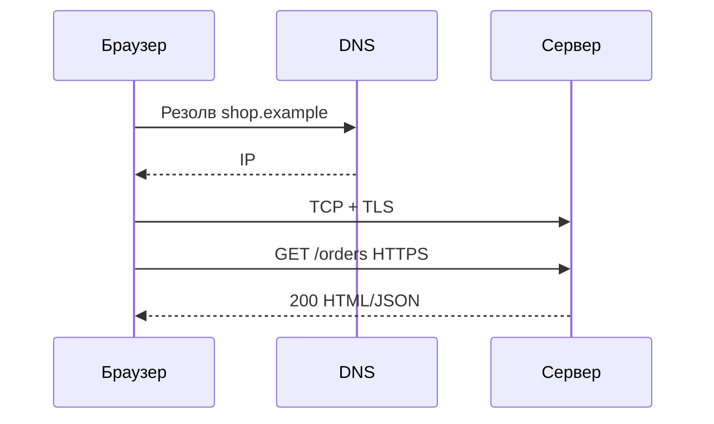
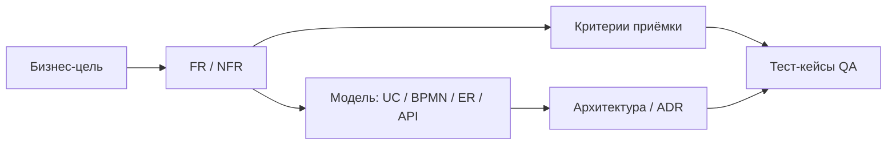

## Введение

Тема 7 — «дополнительное», но на middle без неё редко обходятся: что такое протокол, чем HTTP отличается от HTTPS, в чём разница аутентификации и авторизации, что происходит при открытии URL и что значит шифрование. Вопросы T7.1–7.5 — короткие, но провальные при путанице терминов.

HTTP/TLS и auth — NFR безопасности (BABOK *Requirements Analysis*). **T7.1–7.5** — индекс; первично RFC и OWASP-ориентиры, не списки вопросов.

**Senior craft постановки.** На junior достаточно отличить FR от NFR и написать user story. На senior ждут другое: постановка, по которой разработка и QA не спорят «что имелось в виду», явная трассировка требования → сценарий → API/таблицы → тест, и NFR, которые можно измерить и принять. Это углубление темы T1 плюс стык с QA (T6.1.4).

Senior craft — KA BABOK *Elicitation*, *Requirements Life Cycle*, *Solution Evaluation*. Углубление **T1**; трассировость и quality attributes — первичнее индекса Habr.

## Раздел: Как отвечать одним блоком

Этот выпуск собрал соседние короткие темы трека: «HTTP/S, аутентификация и», «Senior craft постановки». Раньше каждая занимала отдельную карточку на несколько минут, а на собеседовании их спрашивают одним блоком. Ниже у каждой темы свой раздел, затем общие лабы, один тест и одна колода карточек. В ответе сначала назовите, какую тему спросили, потом определение и один пример. Не проговаривайте все разделы, если спросили один. Лабы можно пройти по порядку исходного трека. Если времени мало, сделайте первую и последнюю: первая ставит язык, последняя проверяет, что соседние темы вы не перепутали.

## Раздел: HTTP/S, аутентификация и: Протоколы и HTTP vs HTTPS

**Протокол** — набор правил обмена данными: формат сообщений, порядок шагов, коды ошибок, адресация. Примеры: HTTP/HTTPS, TCP, IP, SMTP, FTP/SFTP, WebSocket, gRPC (поверх HTTP/2), DNS.

**HTTP** — протокол прикладного уровня для передачи гипертекста/API: методы, заголовки, статусы, тело. Работает поверх TCP (или QUIC в HTTP/3). Сообщения по умолчанию **не шифруются**: посредник на пути может читать и подменять трафик.

**HTTPS** — HTTP поверх **TLS** (раньше говорили SSL): канал шифруется, проверяется сертификат сервера (и опционально клиента). Даёт конфиденциальность и целостность на транспорте, помогает аутентифицировать сервер по PKI. Для СА: в постановках интеграций требовать HTTPS, pin/политики сертификатов для внешних webhook, не тащить секреты в query string.

## Раздел: HTTP/S, аутентификация и: Аутентификация и авторизация

**Аутентификация (Authentication, authN)** — *кто ты?* Проверка личности: пароль, OTP, сертификат, SSO, биометрия. Результат — установленная идентичность (subject).

**Авторизация (Authorization, authZ)** — *что тебе можно?* Проверка прав уже известного субъекта: роли, политики, ACL, scopes OAuth. Пример: пользователь аутентифицирован как `ivan`, но не авторизован удалять чужие заказы.

Частая ошибка на собесе — перепутать слова. Запомните: **сначала authN, потом authZ**. В API: `401 Unauthorized` исторически про отсутствие/провал аутентификации; `403 Forbidden` — аутентифицирован, но нет прав (уточняйте конвенцию проекта).

## Раздел: HTTP/S, аутентификация и: Что происходит, когда переходишь по URL

Упрощённая цепочка для ответа «расскажи по шагам»:
1. Пользователь вводит URL или кликает ссылку (`https://shop.example/orders`).
2. Браузер разбирает схему, хост, путь, query.
3. **DNS** резолвит имя хоста в IP (с кэшем ОС/браузера).
4. Устанавливается TCP (и **TLS handshake** для HTTPS) с сервером/CDN.
5. Уходит **HTTP-запрос** (GET, заголовки Cookie/Authorization и т.д.).
6. Сервер (или цепочка LB → Gateway → app) формирует **ответ**: HTML/JSON, редирект 302, ошибка 4xx/5xx.
7. Браузер рендерит страницу, тянет статику (CSS/JS/картинки) — новые запросы по той же схеме; JS может дальше ходить в API (AJAX/fetch).

Аналитику полезно помнить про редиректы http→https, HSTS, cookie flags (`Secure`, `HttpOnly`, `SameSite`) как часть NFR безопасности.

## Раздел: HTTP/S, аутентификация и: Шифрование данных

**Шифрование** — преобразование данных так, чтобы без ключа их нельзя прочитать. Цели: конфиденциальность при хранении (data at rest) и при передаче (data in transit).

Виды (уровень ответа middle):
- **симметричное** — один общий ключ (AES): быстро, проблема доставки ключа;
- **асимметричное** — пара public/private (RSA, EC): удобно для обмена ключами и подписи;
- на практике TLS использует гибрид: асимметрия для handshake, симметрия для потока.

Отличить от **хеширования** (односторонние отпечатки паролей) и **подписи** (целостность + авторство). В постановке: что шифруем (PII, платежные токены), где ключи (KMS/HSM), кто имеет доступ.

## Раздел: HTTP/S, аутентификация и: Частые вопросы с собеседования

**Вопрос.** User story или use case — что выбрать на проекте?

**Ответ.** Story — короткий инкремент ценности для backlog и спринта. Use case — полный сценарий с актёром, основным и альтернативными потоками, когда важны ветки и исключения. На собесе: story для приоритизации, UC/sequence — когда согласуете интеграции и QA-покрытие.

**Вопрос.** BPMN и UML — конкуренты или разные задачи?

**Ответ.** Разные вопросы. BPMN — бизнес-процесс, шлюзы, роли людей. UML Use Case — граница системы и цели; Sequence — вызовы сервисов во времени. Ошибка: рисовать микросервисы на BPMN вместо бизнес-шагов.

**Вопрос.** Зачем на собесе СА спрашивают идемпотентность REST?

**Ответ.** Повтор запроса (таймаут, retry клиента, двойной клик) не должен дважды списать деньги. POST платежа часто делают идемпотентным через Idempotency-Key, уникальный constraint или проверку «уже обработано». GET/PUT/DELETE по смыслу ближе к идемпотентности, чем «слепой» POST.

**Вопрос.** Когда на интеграции выбрать синхронный REST, а когда очередь?

**Ответ.** Sync — нужен ответ сейчас и цепочка короткая (проверка остатка перед оплатой). Async — долгая работа, сглаживание пиков, слабая связность: 202 Accepted, статус по webhook/polling. СА описывает ретраи, дедупликацию и SLA ответа, а не только «повесим Kafka».

**Вопрос.** ACID и CAP — про одно и то же?

**Ответ.** Нет. ACID — свойства транзакции в одной БД (атомарность, согласованность, изоляция, долговечность). CAP — компромисс распределённой системы при сбое сети: согласованность vs доступность. На собесе связывают с контекстом: баланс — строже ACID; лента лайков — чаще eventual consistency.

## Раздел: Senior craft постановки: Качество постановки и критерии «готово к разработке»

**Плохая постановка** описывает «что хотим в целом». **Хорошая** снимает неоднозначность до уровня контракта: актёры, предусловия, основной и альтернативные потоки, правила данных, ошибки, границы системы, ссылки на интеграции.

Senior-чеклист перед передачей в спринт:

1. **Цель и ценность** — зачем бизнесу (метрика/риск), не только «сделать экран».
2. **Область** — in/out of scope явным списком.
3. **Данные** — сущности, обязательность, валидации, уникальность, жизненный цикл статусов.
4. **Поведение** — happy path + минимум 3 альтернативы (отказ, таймаут, повтор).
5. **Интерфейсы** — кто вызывает кого, синхронно/асинхронно, коды ответов.
6. **NFR** — числа: RPS, p95 latency, RPO/RTO, уровни доступа, аудит.
7. **Приёмка** — проверяемые критерии (Given/When/Then или чеклист QA).
8. **Открытые вопросы** — отдельно, с владельцем и сроком; не прятать в тексте.

«Готово к разработке» ≠ «много текста». Готово — когда разработчик может оценить, QA — написать кейсы, архитектор — увидеть влияние на контур, а бизнес подписывает scope без «ну вы поняли».

Типичные дефекты постановки на собесе: смешение желания и решения («сделать на Kafka»), отсутствие негативов, NFR вида «быстро и надёжно», нет владельца данных, нет DoD приёмки.

## Раздел: Senior craft постановки: Traceability к архитектуре и работа с QA

**Трассировка (traceability)** — связь артефактов: бизнес-цель → требование/эпик → use case/story → элементы модели (BPMN/ER/API) → тест-кейсы → релиз. Senior не держит это «в голове»: матрица или ссылки в Confluence/Jira/ADR.

Минимальная матрица для фичи «оплата заказа»:

| ID | Требование | Артефакт | Компонент | Тест |
|----|------------|----------|-----------|------|
| FR-41 | Создать платёж | UC-Pay, Seq-Pay | payments-api | TC-Pay-01..05 |
| NFR-12 | p95 &lt; 300 ms | ADR-cache | gateway+payments | Perf-Pay-smoke |
| FR-42 | Идемпотентность | API POST /payments | payments-api | TC-Pay-idem |

Зачем это на собесе: показать, что вы не «пишете ТЗ в вакууме», а контролируете полноту и влияние изменений. Меняется поле в API — видно, какие FR и тесты затронуты.

**Работа с QA (T6.1.4).** Аналитик — поставщик ясности для тестирования, не замена тест-дизайнеру:

- До разработки: согласовать критерии приёмки и границы (что *не* тестируем в релизе).
- В спринте: уточнять неоднозначности до бага «по документации».
- На регрессе: подсветить зоны риска по изменениям (diff требований).
- Не писать за QA сотни кейсов; давать сценарии и данные-примеры, риск-карту, контракты ошибок.
- Совместно чинить формулировки: если QA не может автоматизировать проверку — требование, скорее всего, размыто.

Правило: **баг «непонятно из постановки» — дефект аналитики**, даже если код «в целом работает».

## Раздел: Senior craft постановки: Сложные NFR — измеримость и компромиссы

Простые NFR («HTTPS», «логин») вы уже закрыли в middle. Senior формулирует **измеримые** и **конфликтующие** ограничения:

- **Производительность:** целевой RPS, p50/p95/p99, объём данных, сценарий нагрузки (не «сайт не тормозит»).
- **Доступность:** SLA/SLO (%), окно обслуживания, поведение деградации (что отключаем первым).
- **Согласованность:** eventual vs strong; допустимый лаг реплики для отчётов.
- **Безопасность:** классы данных (PII), маскирование, срок хранения логов, требования к authN/authZ.
- **Наблюдаемость:** обязательные метрики, correlation-id, аудит кто изменил статус.
- **Сопровождаемость:** время наката миграции, обратная совместимость API N релизов.
- **Масштаб:** рост пользователей/заказов на горизонте 12–24 мес — закладывать в ADR, не «потом».

Сложность NFR в том, что они **торгуются**: сильная консистентность vs latency; полный аудит vs стоимость хранения. Senior фиксирует решение и владельца компромисса (бизнес/архитектор), а не прячет конфликт.

Шаблон строки NFR: *«Система должна … при условии …; измеряем …; принимаем, если …; иначе … (деградация/эскалация)»*.

## Раздел: Senior craft постановки: Частые вопросы с собеседования

**Вопрос.** Как отличить требование от решения?
**Ответ.** Требование — потребность и критерий. Решение — экран, брокер или таблица. На senior спрашивают, не подменили ли вы одно другим слишком рано.

**Вопрос.** Что делать с противоречивыми стейкхолдерами?
**Ответ.** Зафиксировать конфликт, владельца решения и критерий выбора. Молчаливый компромисс потом всплывает на интеграции.

**Вопрос.** Зачем трассировка требований?
**Ответ.** Чтобы изменение было видно в API, данных и тестах, а не потерялось между документами.

## Лаба

**HTTP/S, аутентификация и.**

**Цель.** Описать security-требования для публичного API заказов и цепочку открытия URL личного кабинета.

**Шаги.**
1. Напишите 5 протоколов в вашем учебном контуре (DNS, TCP, TLS, HTTPS, SMTP…).
2. Сформулируйте пару требований: «все внешние API только HTTPS» и «секреты не в query».
3. Разведите на примере входа: шаг authN (логин) и шаг authZ (роль `manager` видит отчёты).
4. Расскажите вслух 7 шагов «клик по URL ЛК» до JSON `/api/me`.
5. Укажите: пароль в БД — хеш; номер карты в transit — TLS; бэкап диска — encryption at rest.

**В группу:** партнёр путает 401 и 403 — поправьте примерами.

**Готово, если…**
- [ ] Даёте определение протокола и 5 примеров
- [ ] Без запинки отличаете authN от authZ
- [ ] Объясняете HTTPS как HTTP+TLS и смысл шифрования

**Senior craft постановки.**

**Цель.** Собрать senior-постановку на фичу «возврат оплаты заказа» с трассировкой и NFR.

**Шаги.**
1. Запишите цель бизнеса и 5 пунктов in/out of scope.
2. Опишите основной поток + 3 альтернативы (банк отклонил, таймаут, повторный запрос).
3. Составьте матрицу traceability на 4 строки (FR/NFR → артефакт → компонент → тест).
4. Сформулируйте 3 NFR по шаблону (latency платежа, идемпотентность, аудит).
5. Напишите 5 критериев приёмки в Given/When/Then для передачи QA.
6. Выделите 2 открытых вопроса с владельцем (например, кто инициирует refund — клиент или оператор).

**В группу:** партнёр пишет NFR «система должна быть надёжной» — перепишите в измеримый вид за 2 минуты.

**Готово, если…**
- [ ] Постановка без «ну вы поняли» и с явным out of scope
- [ ] Есть матрица трассировки хотя бы на 4 связи
- [ ] QA может начать кейсы по вашим критериям приёмки без доп. встречи

## Схема: HTTP/S, аутентификация и: От URL до ответа

## Схема: Senior craft постановки: От требования до теста

## Тест

### Чем HTTP отличается от HTTPS?

**Ответ:** HTTPS — это HTTP поверх TLS: трафик шифруется и сервер подтверждается сертификатом

**Пояснение:** HTTP передаёт данные открытым текстом на прикладном уровне; HTTPS защищает канал от перехвата и подмены на пути.

### Чем senior-постановка отличается от «длинного ТЗ»?

**Ответ:** снимает неоднозначность до проверяемого контракта: scope, негативы, данные, интерфейсы, измеримые NFR и приёмка

**Пояснение:** объём текста не равен качеству; важны проверяемость, границы и трассировка до реализации и тестов.

### Чем аутентификация отличается от авторизации?

**Ответ:** аутентификация проверяет личность; авторизация — права уже известного субъекта

**Пояснение:** «вошёл в систему» ≠ «можно удалить платежи».

### Зачем системному аналитику traceability?

**Ответ:** чтобы видеть полноту и влияние изменений: требование ↔ модель ↔ компонент ↔ тест

**Пояснение:** без связей правка API «тихо» ломает приёмку и регресс; матрица делает последствия явными.

### Что такое шифрование данных?

**Ответ:** преобразование информации с помощью ключа так, чтобы без ключа нельзя прочитать исходное содержимое

**Пояснение:** применяют in transit (TLS) и at rest; не путать с хешированием паролей.

## Шпаргалка

<ul><li>Протокол — правила обмена</li><li>HTTPS = HTTP + TLS</li><li>authN = кто; authZ = можно ли</li><li>URL → DNS → TCP/TLS → HTTP → ответ → рендер</li><li>Шифрование: симметрия/асимметрия; отдельно хеш и подпись</li><li>Постановка = контракт для Dev + QA + архитектуры</li><li>Готово к разработке: scope, данные, негативы, API, NFR, приёмка, открытые вопросы</li><li>Traceability: цель → требование → модель → тест</li><li>QA: ясность и риски, не замена тест-дизайна</li><li>NFR: число + условие + приёмка + деградация</li></ul>

## Anki

### Front: Что такое протокол?

Back: согласованный набор правил формата и порядка обмена данными между участниками

### Front: 8 пунктов senior-чеклиста постановки?

Back: цель, scope, данные, поведение (+негативы), интерфейсы, NFR, приёмка, открытые вопросы

### Front: authN vs authZ

Back: Authentication — проверка кто ты; Authorization — проверка что тебе разрешено

### Front: Что такое traceability у СА?

Back: явные связи бизнес-цель → требование → модель/API → тест/релиз

### Front: Что происходит при переходе по HTTPS URL? (кратко)

Back: DNS → TCP+TLS → HTTP-запрос → ответ сервера → отрисовка и доп. запросы ресурсов/API

### Front: Как писать сложный NFR?

Back: измеримо: метрика, нагрузка, критерий приёмки, поведение при нарушении

## Мнемоника

### acronym: HTTP и доступ

**Задание:** Три кода, которые аналитик не путает.

**Элементы:**
- 401 кто вы
- 403 нельзя
- 404 нет или скрыто

**Подсказка:** 404 иногда прячет существование. Это решение, не случайность.

**Ответ:** 401 403 404

## Итоги

- Термины T7 короткие: протокол, HTTPS, authN/authZ, цепочка URL, шифрование
- Путаница authN/authZ и HTTP/HTTPS — частый стоп-фактор на middle
- В постановках фиксируйте HTTPS, коды 401/403 и требования к секретам
- Senior-постановка — про однозначность и приёмку, не про объём документа
- Трассировка защищает от «потерянных» требований и сюрпризов регресса
- Сложные NFR всегда содержат числа и компромисс с владельцем
- Стык с QA — ранняя ясность критериев и зон риска (T6.1.4)

## Ссылки

- [BABOK Guide — безопасность требований (IIBA)](https://www.iiba.org/knowledgehub/business-analysis-body-of-knowledge-babok-guide/)
- [OpenAPI — securitySchemes](https://spec.openapis.org/oas/latest.html)
- [Топ-150 вопросов СА (Хабр) — индекс формулировок](https://habr.com/ru/articles/963708/)
- [Learn](/game/learn)
