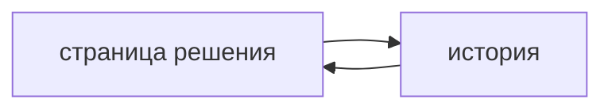

## Введение

Вакансии ждут уверенный Jira и Confluence. На собесе это не «умею кликать». Это где лежит постановка, чтобы разработчик и тестировщик нашли одно и то же.

## Раздел: Что куда

В Jira — работа: история или задача, связь с эпиком, критерии приёмки, зависимость, статус. Описание задачи отвечает, что меняется для пользователя и как это проверить. Простыня на десять экранов в описании устаревает незаметно.

В Confluence — решение длиннее спринта: контекст, схема процесса, словарь, ссылка на контракт. Страница ссылается на задачи, задачи ссылаются на страницу. Копия одного текста в обоих местах расходится.

Комментарий в Jira годится для уточнения. Решение «почему так интегрируемся» из комментария переносят на страницу, иначе его не найдут через квартал.

## Раздел: Ответ вслух

Задачу я держу короткой: цель, границы, критерии, ссылки. Длинное решение и схему кладу в Confluence и ставлю ссылку. Если требование изменилось, правлю источник и задачи, которые ещё не сданы, а не дописываю новый комментарий поверх старого смысла.

## Раздел: Плохой ответ

Плохой ответ: «вся спецификация в описании эпика». Эпик закроют, описание никто не обновит, контракт останется в голове.

## Раздел: Термины

История — story. Эпик — epic. Критерии приёмки — acceptance criteria. База знаний — Confluence page. Трассировка — traceability.

## Лаба

**20 минут.** Разложите «оплата заказа» на эпик, одну историю и страницу решения. В истории оставьте три критерия. На страницу вынесите статусную схему и ссылку на контракт, не копируя критерии целиком.

## Схема: Ссылки вместо копий

## Тест

### Что обязано быть в истории для разработки?

**Ответ:** границы и критерии приёмки

**Пояснение:** Без них задачу нельзя проверить и нельзя понять, что не входит.

### Куда класть схему процесса, которая нужна через полгода?

**Ответ:** на страницу Confluence

**Пояснение:** Закрытая задача плохо ищется как спецификация.

### Почему не копировать один абзац в задачу и на страницу?

**Ответ:** копии разъедутся

**Пояснение:** Правят одно место, второе молча врёт.

### Комментарий «давайте иначе» стал решением. Что сделать?

**Ответ:** перенести его в источник

**Пояснение:** Комментарий не заменяет страницу и критерии.

### Как связать требование и проверку?

**Ответ:** ссылкой истории на кейс и контракт

**Пояснение:** Трассировка — это ссылка, не пересказ в чате.

## Шпаргалка

<ul><li>Задача — работа и критерии</li><li>Страница — решение длиннее спринта</li><li>Ссылки, не вторые копии</li><li>Комментарий не хранит контракт</li></ul>

## Anki

### Front: Что писать в story?

Back: Цель, границы и проверяемые критерии.

### Front: Что писать в Confluence?

Back: Контекст, схему и решение, которое переживёт спринт.

### Front: Чем опасна копия текста?

Back: Обновят одну сторону, вторая останется старой.

### Front: Роль комментария в Jira?

Back: Уточнение. Устойчивое решение из него переносят в источник.

### Front: Что такое трассировка для аналитика?

Back: Связь требования, задачи, контракта и проверки.

### Front: Почему эпик — плохая спецификация?

Back: Его закроют, а текст перестанут поддерживать как контракт.

## Итоги

- Работа и знание лежат в разных инструментах
- Критерии проверяемы
- Один источник, остальные ссылаются

## Ссылки

- [Scrum и Kanban](/game/learn/sa-methods-scrum-kanban)
- [Критерии приёмки](/game/learn/pm-acceptance)
