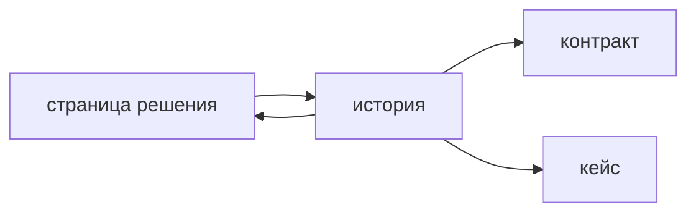

## Введение

Вакансии системного аналитика ждут уверенный Jira и Confluence. На собеседовании это не скорость кликов и не знание названий полей наизусть. Это ответ, где лежит постановка, чтобы разработчик и тестировщик нашли одно и то же через месяц, когда чат уже не найти. Задача несёт работу текущего спринта: что меняется, чего не делаем, как проверить. Страница несёт решение длиннее спринта: контекст, схему, словарь, ссылку на контракт. Одно другим не заменяют. Простыня на десять экранов в описании эпика устаревает в день закрытия эпика. Решение только в комментарии не находится поиском через квартал.

Копия одного абзаца в задаче и на странице расходится в первую правку. Взрослый учёт — ссылки. Страница ссылается на задачи, задачи ссылаются на страницу и на контракт. Трассировка для аналитика — это как раз эти ссылки, а не пересказ требования в трёх местах разными словами.

Выпуск раскладывает «оплату заказа» на эпик, одну историю и страницу решения. Критерии остаются проверяемыми. Схема статусов живёт на странице и не копируется целиком в каждую историю.

## Раздел: Что куда

В Jira живёт работа. Эпик собирает цель крупного куска, но не становится спецификацией: его закроют, описание перестанут поддерживать как контракт. История или задача отвечает на четыре коротких вопроса. Какой пользователь и какая ситуация. Что меняется в поведении. Что сознательно не входит. Как это проверить. Критерии приёмки наблюдаемы: статус, сообщение, запись, отказ. «Удобно» и «по аналогии» в описание не кладут, их переписывают до планирования.

Связи показывают зависимость. История оплаты не стартует раньше контракта счёта, если без него нечего проверять. Статус задачи — про работу, не про истину предметной области. «Готово» значит, что критерии этой истории приняты, а не что вся оплата навсегда описана.

В Confluence живёт знание, которое нужно после спринта. Контекст: зачем оплата и какие ограничения регулятора. Схема статусов заказа. Словарь: чем «счёт» отличается от «платежа» в этой системе. Ссылка на OpenAPI и на страницу интеграций. Решение «почему идём через провайдера А, а не через прямой файл» — тоже здесь, с датой и с тем, что отклонили. Через квартал это найдут поиском по странице. В закрытой задаче тот же текст найдут только те, кто помнит номер.

Комментарий в Jira годится для уточнения по ходу работы: «на стенде код 409, см. критерий 2». Устойчивое решение из комментария переносят на страницу или в критерии, иначе его не увидит человек, который откроет задачу с середины. Длинная полемика в комментариях — сигнал, что источнику не хватает абзаца, а не что надо писать ещё.

Копии вредны конкретно. Если критерий продублирован на странице и в истории, правят историю перед спринтом и забывают страницу. Тест сверяется с историей, поддержка читает страницу, и они спорят. Критерии живут у истории. Страница даёт ссылку «актуальные критерии в задачах эпика» и держит то, что задачам общее: схему и контекст. Общее не размножают.

Изменение требования правит источник и ещё не сданные задачи. Дописывать новый комментарий поверх старого смысла, не трогая критерий, — способ оставить в спринте старую проверку. Сданную историю не переписывают задним числом без следа: если смысл изменился после приёмки, это новая работа, а не тихая правка закрытого текста.

## Раздел: Разбор на примере

Эпик «оплата заказа» коротко говорит, зачем кусок и какие истории в него входят. Он ссылается на страницу решения. На странице: статусы заказа от «создан» до «оплачен» и «отменён», что считается деньгами, ссылка на контракт провайдера, открытый вопрос про частичный возврат, который в этот эпик не входит. Страница не содержит трёх критериев конкретной истории дословно.

История «плательщик получает ссылку на оплату» содержит цель, границу и три критерия. Граница: возврат и вторая валюта не входят. Критерии в форме «дано — когда — тогда»: у заказа статус «ожидает оплаты», плательщик открывает ссылку и видит сумму этого заказа; ссылка просрочена — видит отказ, статус заказа не становится «оплачен»; чужой номер заказа ссылку не выдаёт. Разработчик оценивает эту историю, не всю схему статусов. Тестировщик заводит кейсы на три критерия и ссылается на историю, а не переписывает схему своими словами в отрыве от неё.

Контракт метода лежит в репозитории API. История ссылается на метод. Страница ссылается на тот же метод. Ни история, ни страница не вставляют простыню JSON, которая устареет при следующем поле. Если поле нужно для критерия, в критерии назван наблюдаемый результат для пользователя, а имя поля остаётся в контракте.

Комментарий разработчика «давайте отдавать ссылку только после резерва товара» — уточнение, которое меняет поведение. Его переносят: либо в критерий этой истории, если это ещё в границах, либо на страницу как решение и в новую историю, если резерв не входил в оценку. Оставить его только в комментарии значит принять работу, которую не проверяли по тексту задачи.

Через полгода новый аналитик открывает страницу, видит схему и ссылку на контракт, и не читает все закрытые комментарии эпика. Это и есть проверка, правильно ли разложили знания.

## Раздел: Где это ломается

Вся спецификация в описании эпика. Эпик закрыли, контракт остался в голове и в устаревшем тексте. Спецификацию держат на странице и в контракте, эпик ссылается.

Один абзац скопирован в пять историй. Правка правила оплаты обновляет одну и забывает четыре. Общее правило — на странице, в историях ссылка и только их собственный наблюдаемый результат.

Решение живёт в комментарии. Поиск по пространству его не находит. Перенос в источник в тот же день, пока контекст свежий.

Критерии нельзя показать на стенде. «Оплата быстрая и понятная». Историю рано брать в спринт. Сначала наблюдаемый факт.

Нет границы. В историю ссылки приносят возврат «заодно», оценка врёт, приёмка не кончается. Граница написана строкой «не делаем».

Трассировка пересказом в чате. «Ну это же в переписке с тестом». Ссылка истории на кейс и на метод переживает отпуск. Переписка нет.

Страницу никто не владеет. Она есть, но дата и автор неизвестны, два противоречивых абзаца. У страницы решения есть хозяин и привычка править её в том же изменении, что и задачи.

## Раздел: Ответ вслух

Задачу я держу короткой: цель, границы, проверяемые критерии, ссылки на страницу и контракт. Длинное решение, схему и словарь кладу в Confluence. Критерии не копирую на страницу целиком. Если требование изменилось, правлю источник и задачи, которые ещё не сданы, а не добавляю комментарий поверх старого смысла. Комментарий, ставший решением, переношу в тот же день. Эпик не считаю спецификацией: его закроют. Трассировка для меня — ссылка требования, задачи, контракта и проверки.

## Раздел: Плохой ответ

Плохой ответ: «вся спецификация в описании эпика». Эпик закроют, текст перестанут поддерживать. Второй плохой ответ: «документация в Confluence, а в задачах и так все всё знают». Без критериев в истории нечего принимать и нечего оценивать. Знание и работа лежат в разных инструментах и ссылаются друг на друга.

## Раздел: Термины

История — story. Эпик — epic, контейнер цели, не контракт. Критерии приёмки — acceptance criteria. База знаний в этом контуре — страница Confluence. Трассировка — traceability, связь артефактов ссылками. Источник — то место, которое правят, когда меняется смысл. Копия — второй текст, который почти сразу врёт.

## Лаба

**Цель.** Разложить оплату на работу и знание без второй копии критериев.

**Шаги.**

1. Опишите эпик одним абзацем цели и ссылкой на будущую страницу. Не вставляйте в него схему статусов целиком.
2. Создайте страницу решения: статусы заказа, чем счёт отличается от платежа, ссылка на контракт, вопрос частичного возврата как не входящий в эпик.
3. Напишите одну историю «плательщик получает ссылку» с границей и тремя критериями, включая отказ по просроченной ссылке и чужой заказ.
4. Проверьте, что критерии не скопированы на страницу дословно. На странице только ссылка на истории.
5. Возьмите комментарий «делать резерв товара до ссылки» и решите: в критерий, в новую историю или на страницу как отложенное решение. В комментарии его не оставляйте единственной копией.
6. Назовите, куда тестировщик повесит кейс: на историю, не на эпик.

**Готово, если…**

- [ ] У истории есть граница и наблюдаемые критерии
- [ ] Схема живёт на странице
- [ ] JSON контракта не вставлен простынёй в оба места
- [ ] Решение из комментария перенесено в источник

## Схема: Ссылки вместо копий

## Тест

### Что обязано быть в истории для разработки?

**Ответ:** границы и критерии приёмки

**Пояснение:** Без них задачу нельзя проверить и нельзя понять, что не входит.

### Куда класть схему процесса, которая нужна через полгода?

**Ответ:** на страницу Confluence

**Пояснение:** Закрытая задача плохо ищется как спецификация.

### Почему не копировать один абзац в задачу и на страницу?

**Ответ:** копии разъедутся

**Пояснение:** Правят одно место, второе молча врёт.

### Комментарий «давайте иначе» стал решением. Что сделать?

**Ответ:** перенести его в источник

**Пояснение:** Комментарий не заменяет страницу и критерии.

### Как связать требование и проверку?

**Ответ:** ссылкой истории на кейс и контракт

**Пояснение:** Трассировка — это ссылка, не пересказ в чате.

## Шпаргалка

<ul><li>Задача — работа и критерии</li><li>Страница — решение длиннее спринта</li><li>Ссылки, не вторые копии</li><li>Комментарий не хранит контракт</li><li>Эпик — не спецификация</li></ul>

## Anki

### Front: Что писать в story?

Back: Цель, границы и проверяемые критерии.

### Front: Что писать в Confluence?

Back: Контекст, схему и решение, которое переживёт спринт.

### Front: Чем опасна копия текста?

Back: Обновят одну сторону, вторая останется старой.

### Front: Роль комментария в Jira?

Back: Уточнение. Устойчивое решение из него переносят в источник.

### Front: Что такое трассировка для аналитика?

Back: Связь требования, задачи, контракта и проверки ссылками.

### Front: Почему эпик — плохая спецификация?

Back: Его закроют, а текст перестанут поддерживать как контракт.

## Итоги

- Работа и знание лежат в разных инструментах
- Критерии проверяемы и живут у истории
- Один источник, остальные ссылаются
- Комментарий не хоронит решение
- Закрытый эпик не заменяет страницу

## Ссылки

- [Scrum и Kanban](/game/learn/sa-rest-basics)
- [Критерии приёмки](/game/learn/pm-acceptance)
