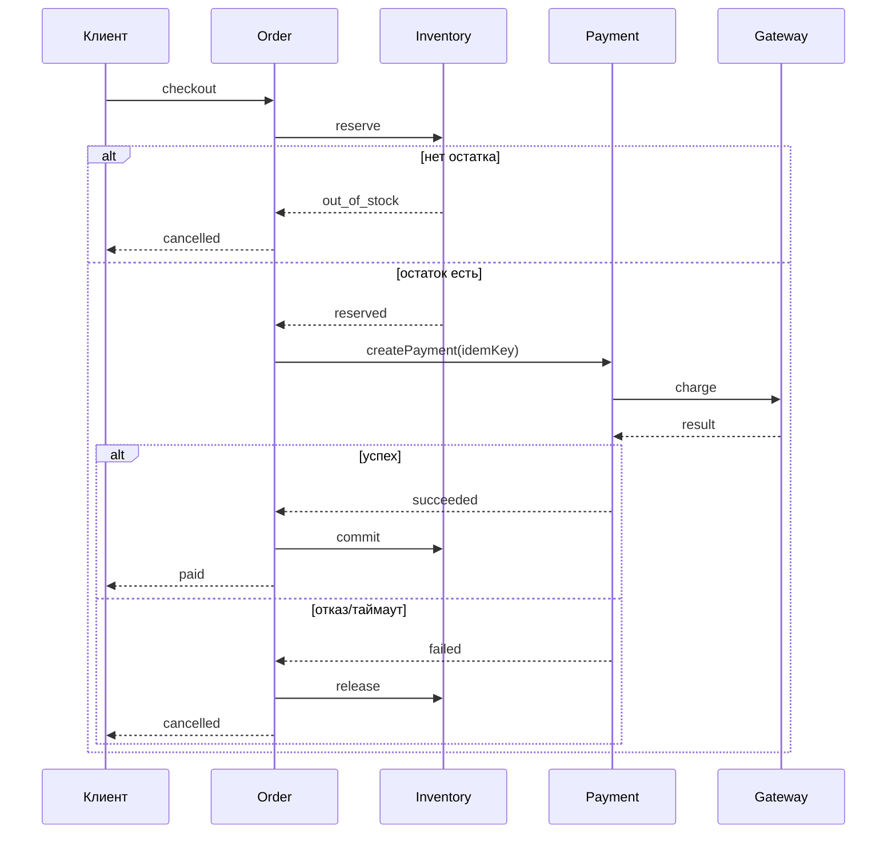
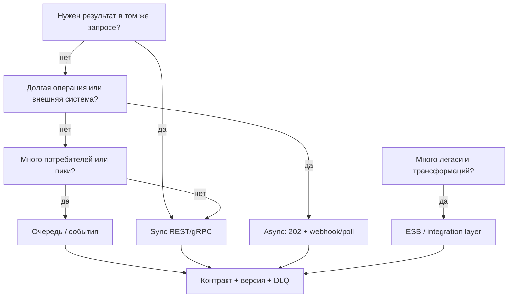

## Введение

Теорию нотаций вы закрыли в junior (T2) и БД в T3. Senior на собесе часто просят: «нарисуйте процесс заказа с оплатой». Здесь один учебный кейс — три модели рядом: BPMN (бизнес-поток), Sequence (взаимодействие систем), ER (данные). Цель — показать согласованность, а не красоту фигур.

Лаборатория BPMN + Sequence + ER — практика OMG BPMN 2.0 и UML Sequence. Синтез **T2+T3**; первичные спецификации OMG, не пересказ T-номеров.

**Проектирование интеграций.** Тема 4 на junior/middle разбирала REST, SOAP, очереди, ESB по отдельности. Senior должен **выбрать** механизм под сценарий и обосновать: latency, надёжность, связность, команда сопровождения. Второй столп — **обратная совместимость** контрактов при эволюции API. Это синтез T4.

Выбор интegration style — синтез REST/OpenAPI, очередей (Kafka/Rabbit), SOAP. BABOK *Requirements Analysis*; **T4** — индекс; Richardson + OpenAPI для HTTP-ветки.

## Раздел: Как отвечать одним блоком

Этот выпуск собрал соседние короткие темы трека: «Моделирующий воркшоп», «Проектирование интеграций». Раньше каждая занимала отдельную карточку на несколько минут, а на собеседовании их спрашивают одним блоком. Ниже у каждой темы свой раздел, затем общие лабы, один тест и одна колода карточек. В ответе сначала назовите, какую тему спросили, потом определение и один пример. Не проговаривайте все разделы, если спросили один. Лабы можно пройти по порядку исходного трека. Если времени мало, сделайте первую и последнюю: первая ставит язык, последняя проверяет, что соседние темы вы не перепутали.

## Раздел: Моделирующий воркшоп: Кейс и BPMN процесса заказа

**Кейс.** Клиент оформляет заказ в интернет-магазине, резервирует товар, инициирует оплату; при успехе заказ подтверждается, при отказе/таймауте — резерв снимается. Участники: Клиент, Storefront, Order Service, Inventory, Payment Gateway.

**BPMN — что показать на собесе:**

1. **Пулы/дорожки:** Клиент | Магазин (можно объединить сервисы в один пул «Backend» с lane'ами).
2. **Старт:** «Клиент подтвердил корзину».
3. **Задачи:** создать заказ, зарезервировать остаток, создать платёж, дождаться результата, подтвердить/отменить.
4. **Шлюзы:** exclusive после ответа банка (успех / отказ); возможно timer boundary на ожидании оплаты.
5. **События:** сообщение от платёжного шлюза; ошибка нехватки остатка → конец с отменой.
6. **Не рисовать** реализацию (циклы SQL) — только бизнес-смысл и точки ожидания.

Текстовый скелет потока (его проговорите, даже без Ideального Visio):

1. Создать заказ в статусе `draft`/`awaiting_payment`.
2. Резерв inventory; если нет остатка — `cancelled`, конец.
3. Инициация оплаты (внешний gateway).
4. Ожидание callback/redirect result.
5. Успех → `paid` + подтверждение резерва; отказ/таймаут → `cancelled` + release резерва.

## Раздел: Моделирующий воркшоп: Sequence и ER — один кейс, разные срезы

**Sequence (UML)** отвечает на «кто кого в каком порядке вызывает». Для того же кейса:

- Client → Storefront: POST /checkout
- Storefront → Order: createOrder
- Order → Inventory: reserve(items)
- Inventory → Order: reserved / out_of_stock
- Order → Payment: createPayment(orderId, amount, idempotencyKey)
- Payment → Gateway: charge
- Gateway --> Payment: async result (или sync, если так решили)
- Payment → Order: payment.succeeded / failed
- Order → Inventory: commit / release
- Order --> Storefront → Client: итоговый статус

На диаграмме обязательны: **синхронные** вызовы (сплошная стрелка туда-обратно) и **асинхронный** результат оплаты, если он webhook/очередь. Покажите **идемпотентный ключ** на создании платежа — senior-деталь.

**ER (сущности):**

- `Customer` (1) — (N) `Order`
- `Order` (1) — (N) `OrderItem`
- `OrderItem` (N) — (1) `Product` (или SKU)
- `Order` (1) — (0..1 или 1..N) `Payment` (повторные попытки)
- `Payment`: id, order_id, amount, currency, status, external_id, idempotency_key UNIQUE
- `Reservation` / поля резерва на `OrderItem` (qty_reserved) — как решите, но согласуйте с BPMN

Правило воркшопа: **статусы в BPMN = статусы в атрибутах Order/Payment**. Если в процессе есть `awaiting_payment`, в ER/enum он тоже есть. Расхождение моделей — красный флаг на собесе.

## Раздел: Моделирующий воркшоп: Согласование трёх моделей и типичные ошибки

Перед сдачей лабы сверьте:

| Вопрос | BPMN | Sequence | ER |
|--------|------|----------|-----|
| Кто инициирует оплату? | задача | вызов | — |
| Где ждём банк? | waiting/event | async return | Payment.status |
| Нет остатка? | gateway cancel | ответ inventory | нет Order paid |
| Повтор оплаты? | loop/новый платёж | новый createPayment | новая строка Payment |

Частые ошибки:

- На BPMN «рисовали микросервисы», забыв клиента и бизнес-ветки.
- Sequence без ошибок и таймаутов.
- ER без связи Payment↔Order или без уникальности идемпотентности.
- Три модели про «разные миры» (в BPMN отмена есть, в ER статуса нет).

На собесе лучше одна согласованная тройка на доске, чем три красивых несвязанных картинки.

## Раздел: Моделирующий воркшоп: Частые вопросы с собеседования

**Вопрос.** Как на собесе отличить функциональное требование от нефункционального?

**Ответ.** FR — конкретное поведение: «можно оплатить картой». NFR — качество и ограничения: «p95 ответа API ≤ 300 мс при 500 RPS», «данные карты не в логах». NFR должны быть измеримы; «быстро и безопасно» без цифр — wish, не требование.

**Вопрос.** User story или use case — что выбрать на проекте?

**Ответ.** Story — короткий инкремент ценности для backlog и спринта. Use case — полный сценарий с актёром, основным и альтернативными потоками, когда важны ветки и исключения. На собесе: story для приоритизации, UC/sequence — когда согласуете интеграции и QA-покрытие.

**Вопрос.** ACID и CAP — про одно и то же?

**Ответ.** Нет. ACID — свойства транзакции в одной БД (атомарность, согласованность, изоляция, долговечность). CAP — компромисс распределённой системы при сбое сети: согласованность vs доступность. На собесе связывают с контекстом: баланс — строже ACID; лента лайков — чаще eventual consistency.

**Вопрос.** Зачем системному аналитику OpenAPI, если есть текст требований?

**Ответ.** OpenAPI — исполнимый контракт для Dev/QA/партнёров: методы, схемы, коды ошибок, версии. Меньше «договорились устно». Аналитик не обязан писать YAML руками, но обязан согласовать поля, обязательность, breaking vs optional изменения и примеры ошибок.

## Раздел: Проектирование интеграций: Матрица выбора sync / async / очередь / ESB

Коротко определения для ответа на собесе:

- **Sync (обычно REST/gRPC):** запрос → ждём ответ в том же соединении. Нужен, когда без результата нельзя продолжить UI/следующий шаг.
- **Async (callback, webhook, «принял в работу»):** сразу 202/ack, результат позже. Нужен при долгих операциях и внешних системах.
- **Очередь/брокер (Kafka, RabbitMQ и т.п.):** буфер, развязка производителя и потребителя, ретраи, пики нагрузки, fan-out.
- **ESB / интеграционная шина:** централизованная оркестрация/трансформация множества легаси-систем; плюс — единая точка; минус — риск «божественного» узла и стоимости изменений.

**Эвристики выбора:**

| Сценарий | Предпочтительный стиль | Почему |
|----------|------------------------|--------|
| Экран «статус заказа сейчас» | Sync GET | Пользователь ждёт актуальный ответ |
| Списание оплаты у банка 5–30 с | Async + статус/webhook | Не держать HTTP минутами |
| Рассылка «заказ оплачен» в 5 сервисов | Событие в очередь | Слабая связность, пики |
| Ночной обмен с 1С/легаси XML | ESB или batch-файл/шина | Трансформации, мониторинг потоков |
| Высокий RPS телеметрии | Очередь/стрим | Буфер, не блокировать источник |
| Жёсткая согласованность «деньги↔остаток» в одном UC | Sync + сага/транзакционный контур | Нужен явный протокол компенсации |

Senior-формулировка: «Выбираю не технологию из резюме, а **свойства**: нужен ли ответ сейчас, допустима ли потеря/дубль (at least once), кто владеет ретраями, что при недоступности зависимости».

Антипаттерн: всё через ESB «на всякий случай»; всё через Kafka, когда хватило бы sync CRUD внутри одного BC.

## Раздел: Проектирование интеграций: Контракты и обратная совместимость

**Контракт** — соглашение о формате и семантике: поля, типы, обязательность, коды ошибок, идемпотентность, версии. Для REST — OpenAPI; для событий — схема (JSON Schema/Avro) + имя топика + ключ партиции; для SOAP — WSDL.

**Обратно совместимое изменение (consumers не ломаются):**

- Добавить опциональное поле.
- Добавить новое значение enum, если клиенты игнорируют неизвестное (договориться!).
- Добавить новый endpoint / новый event type.
- Ослабить ограничение (было max 10, стало 20) — осторожно по бизнес-смыслу.

**Ломающее изменение:**

- Удалить/переименовать поле; сделать опциональное обязательным.
- Изменить тип или семантику (сумма в рублях → копейки без нового поля).
- Ужесточить валидацию так, что старые валидные запросы стали 400.
- Сменить коды ошибок, на которых завязана логика клиента.

**Стратегии версий:** URI (`/v1/`, `/v2/`), заголовок версии, параллельные схемы событий (`order.paid.v2`). Правило поддержки: N предыдущих минорных/мажорных — как зафиксировано в ADR. Deprecation: дата, метрики старых клиентов, канал связи.

Роль СА: в постановке явно писать *breaking / non-breaking*, кто потребитель, план миграции, что в changelog. Не оставлять «чуть поменяем JSON» без анализа клиентов.

## Раздел: Проектирование интеграций: Склейка сценариев — от выбора к постановке

Для каждой интеграции в артефактах senior фиксирует:

1. Стиль (sync/async/queue/ESB) и **почему**.
2. Контракт (ссылка на OpenAPI/схему) и версия.
3. Таймауты, ретраи, идемпотентность, DLQ.
4. Безопасность: mTLS/OAuth, подпись webhook.
5. Наблюдаемость: correlation-id сквозь вызовы и события.
6. Совместимость: политика версий и deprecation.

Пример пакета для магазина: Storefront↔Order — sync; Order→Payment — sync create + async webhook результата; Order→уведомления — событие `order.paid`; обмен с ERP остатков — ночной batch через шину/файл. Один «правильный» стек на всё — редкость.

## Раздел: Проектирование интеграций: Частые вопросы с собеседования

**Вопрос.** Как на собесе отличить функциональное требование от нефункционального?

**Ответ.** FR — конкретное поведение: «можно оплатить картой». NFR — качество и ограничения: «p95 ответа API ≤ 300 мс при 500 RPS», «данные карты не в логах». NFR должны быть измеримы; «быстро и безопасно» без цифр — wish, не требование.

**Вопрос.** User story или use case — что выбрать на проекте?

**Ответ.** Story — короткий инкремент ценности для backlog и спринта. Use case — полный сценарий с актёром, основным и альтернативными потоками, когда важны ветки и исключения. На собесе: story для приоритизации, UC/sequence — когда согласуете интеграции и QA-покрытие.

**Вопрос.** BPMN и UML — конкуренты или разные задачи?

**Ответ.** Разные вопросы. BPMN — бизнес-процесс, шлюзы, роли людей. UML Use Case — граница системы и цели; Sequence — вызовы сервисов во времени. Ошибка: рисовать микросервисы на BPMN вместо бизнес-шагов.

**Вопрос.** ACID и CAP — про одно и то же?

**Ответ.** Нет. ACID — свойства транзакции в одной БД (атомарность, согласованность, изоляция, долговечность). CAP — компромисс распределённой системы при сбое сети: согласованность vs доступность. На собесе связывают с контекстом: баланс — строже ACID; лента лайков — чаще eventual consistency.

## Лаба

**Моделирующий воркшоп.**

**Цель.** За 45–60 минут собрать согласованный пакет моделей для заказа с оплатой.

**Шаги.**
1. Выпишите актёров и статусы `Order` / `Payment` (5–7 значений суммарно).
2. Нарисуйте BPMN: от корзины до paid/cancelled, с веткой out_of_stock и таймером оплаты.
3. Нарисуйте Sequence: минимум 8 сообщений, включая неуспех оплаты и release резерва.
4. Нарисуйте ER: Customer, Order, OrderItem, Product, Payment + ключи и кардинальности.
5. Заполните таблицу согласования (3 строки: успех, отказ банка, нет остатка).
6. Добавьте в заметку: где идемпотентность и где фиксируется `external_id` платежа.

**В группу:** обменяйтесь Sequence; найдите у партнёра место, где статус в ER не следует из диаграммы.

**Готово, если…**
- [ ] Три модели описывают один и тот же кейс без противоречий статусов
- [ ] Есть ветки успеха, отказа оплаты и нехватки товара
- [ ] Payment связан с Order, idempotency_key уникален

**Проектирование интеграций.**

**Цель.** Спроектировать интеграции для «заказ → оплата → уведомление → выгрузка в ERP».

**Шаги.**
1. Разбейте на 4 взаимодействия и выберите стиль для каждого с одной фразой обоснования.
2. Для платежного webhook опишите: код ack, ретраи со стороны банка, проверку подписи, идемпотентность по `event_id`.
3. Предложите изменение контракта Payment: добавить `bonusAmount` — classified as non-breaking; план для старых клиентов.
4. Предложите ломающее изменение (переименовать `amount` → `amountMinor`) и план `/v2` + срок поддержки `/v1`.
5. Нарисуйте таблицу: интеграция | стиль | контракт | failure mode.
6. Укажите, где нужен DLQ и кто его разгребает (роль).

**В группу:** партнёр предлагает «всё через ESB» — контраргументы по latency UI и стоимости изменений.

**Готово, если…**
- [ ] У каждого взаимодействия есть обоснованный стиль, не «модно»
- [ ] Есть пример non-breaking и breaking с миграцией
- [ ] Описаны ретраи/идемпотентность для async-оплаты

## Схема: Моделирующий воркшоп: Сквозной поток заказа и оплаты

## Схема: Проектирование интеграций: Выбор стиля интеграции

## Тест

### Чем BPMN отличается от Sequence на одном кейсе оплаты?

**Ответ:** BPMN показывает бизнес-процесс и решения; Sequence — порядок вызовов между системами

**Пояснение:** обе нужны: процесс для стейкхолдеров и QA, sequence — для интеграций и разработки.

### Когда предпочесть очередь синхронному REST?

**Ответ:** при развязке систем, пиках нагрузки, нескольких потребителях одного факта или когда продюсеру не нужен мгновенный результат обработки

**Пояснение:** очередь даёт буфер и слабую связность; для «пользователь ждёт ответ на экране» обычно нужен sync или sync+poll статуса.

### Что обязательно согласовать между BPMN и ER?

**Ответ:** статусы сущностей и исходы веток процесса (paid, cancelled, awaiting_payment и т.д.)

**Пояснение:** если в процессе есть состояние, которого нет в модели данных — реализации и тестам не на что опереться.

### Что считается обратно совместимым изменением API?

**Ответ:** такое, при котором существующие клиенты продолжают работать без доработки — например добавление опционального поля

**Пояснение:** удаление, переименование, смена семантики и ужесточение обязательности — как правило breaking.

### Зачем на Sequence показывать idempotency key при createPayment?

**Ответ:** чтобы повтор запроса не создал второй платёж при ретраях клиента или сети

**Пояснение:** senior-деталь интеграций; в ER ключ должен быть уникальным ограничением.

## Шпаргалка

<ul><li>Один кейс → BPMN + Sequence + ER</li><li>BPMN: дорожки, шлюзы, ожидание оплаты, отмены</li><li>Sequence: вызовы, async результат, ошибки</li><li>ER: Order–Payment–Items, статусы, unique idempotency</li><li>Сверка статусов между моделями обязательна</li><li>Сначала свойства сценария, потом технология</li><li>Sync — нужен ответ сейчас; async — результат позже</li><li>Очередь — буфер, fan-out, пики</li><li>ESB — легаси и центральные трансформации</li><li>Non-breaking vs breaking + план версий</li></ul>

## Anki

### Front: Какие три модели собрать на кейсе заказа/оплаты?

Back: BPMN (процесс), Sequence (вызовы), ER (данные и статусы)

### Front: Эвристика sync vs async?

Back: sync — без ответа нельзя продолжить шаг пользователя/транзакции; async — долгая или внешняя операция с поздним результатом

### Front: Что проверить при согласовании моделей?

Back: одни и те же исходы и статусы; кто инициирует оплату; отмена резерва при неуспехе

### Front: Пример non-breaking изменения контракта?

Back: добавить опциональное поле или новый endpoint, не меняя семантику существующих полей

### Front: Где живёт идемпотентность оплаты в моделях?

Back: в Sequence на createPayment и в ER как UNIQUE idempotency_key у Payment

### Front: Что фиксировать в постановке интеграции?

Back: стиль, контракт/версия, ретраи и идемпотентность, security, наблюдаемость, политика совместимости

## Итоги

- Senior моделирует один сценарий тремя нотациями без противоречий
- BPMN — бизнес и ожидания; Sequence — интеграции; ER — факты и ограничения
- Оплата заказа — идеальный тренировочный кейс для T2+T3 на собесе
- Идемпотентность и статусы — то, за что цепляют на senior-уровне
- Выбор интеграции — аргументация под сценарий, не любимый брокер
- Очередь, sync и ESB решают разные классы задач
- Совместимость контрактов — часть работы СА, не «дело разработки потом»
- Синтез T4: стили + контракты + отказные режимы в одном пакете

## Ссылки

- [BPMN 2.0 — OMG](https://www.omg.org/spec/BPMN/2.0/)
- [UML — OMG](https://www.omg.org/spec/UML/)
- [Топ-150 вопросов СА (Хабр) — индекс формулировок](https://habr.com/ru/articles/963708/)
- [Learn](/game/learn)
- [OpenAPI Specification](https://spec.openapis.org/oas/latest.html)
- [Richardson Maturity Model](https://martinfowler.com/articles/richardsonMaturityModel.html)
- [Apache Kafka Documentation](https://kafka.apache.org/documentation/)
- [RabbitMQ Documentation](https://www.rabbitmq.com/docs)
