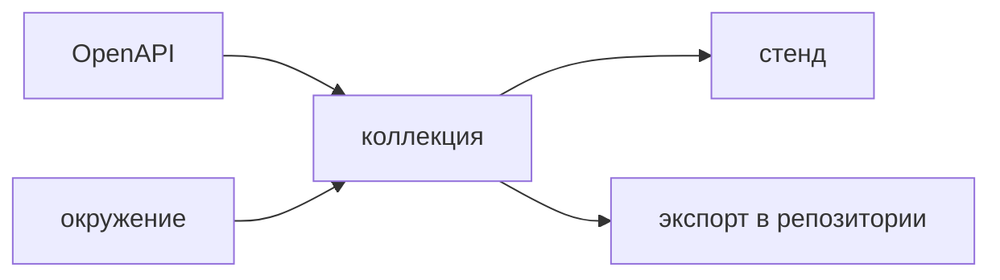

## Введение

Рядом со Swagger вакансии системного аналитика называют Postman. Аналитик собирает им примеры запросов, которые потом читают разработка и тест: успешное создание, ошибка тела, отсутствующий объект. Кнопка Try it out в спецификации этот набор не заменяет. Разовый клик не остаётся сценарием для команды, не хранит окружение стенда и не запускается пачкой в CI. Коллекция как раз для этого.

При этом Postman не становится документацией. Спецификация OpenAPI описывает поля, обязательность и коды. Коллекция доказывает, что пример на названном стенде ещё отвечает как договорено. Если пример разошёлся со спецификацией, правят оба в одну сторону, начиная со спецификации. Пример, который «и есть контракт», через месяц теряет обязательное поле, и никто не видит красной схемы.

Выпуск собирает три запроса к учебному ресурсу заметок, выносит адрес в окружение и кладёт экспорт туда, где его найдёт коллега. Рядом — чем коллекция отличается от Insomnia по роли в этом курсе: инструмент примера может быть любым, правила источника и повторяемости те же.

## Раздел: Коллекция и окружение

Запрос в коллекции — метод, путь, пример тела, пример успеха и, отдельным запросом, пример ошибки. Один запрос с комментарием «подставьте плохой id» не проживает ревью: плохой id не подставят. Минимум на ресурс, который создают и читают: успешное создание, тело с пустым обязательным полем, чтение несуществующего идентификатора. Обновление и конфликт добавляют, когда они есть в контракте, не «для солидности» на метод, которого нет.

Окружение хранит адрес стенда, идентификаторы учебного пользователя и токен отдельно от текста запроса. Локальный и тестовый контур не плодят две копии коллекции, в которых уже разъехались тела. Меняется окружение, коллекция та же. Секрет окружения не коммитят в открытом виде в репозиторий, если это боевой ключ. В учебный репозиторий кладут пример переменной и описание, где взять значение. Адрес `localhost` против адреса стенда — как раз то, что окружение обязано развести.

Небольшой тест коллекции проверяет код и одно обязательное поле. Это не полный набор QA. Это сигнал, что пример ещё живой: создание вернуло 201 и в ответе есть `id`, пустое поле вернуло 422, а не 500, чужой id вернуло 404. Глубокие цепочки данных и визуальные проверки сюда не тащат. Их место в тестах сервиса и в кейсах. Коллекция аналитика ловит «пример умер», не заменяет регрессию.

Прогон коллекции, collection run, гоняет эти запросы пачкой на выбранном окружении. Его имеет смысл повесить на стенд после выкладки контракта. Упавший тест коллекции — повод смотреть, спека ли уехала вперёд примера или стенд отдал не то. Чинят со спецификации: если поле переименовали в контракте, обновляют контракт как источник, затем пример, затем ожидание теста. Если контракт не меняли, а стенд врёт, это дефект реализации, не правка примера «чтобы позеленело».

Экспорт коллекции лежит в репозитории рядом с описанием API. Коллекция только в аккаунте автора равна отсутствию коллекции: коллега её не прогонит, CI её не увидит. Формат экспорта можно спорить, привычка класть его в систему контроля версий — нет.

Try it out полезен, чтобы один раз пощупать метод, пока пишете спецификацию. Он не хранит три ошибки и не шарит окружение. После того как пример стабилен, его переносят в коллекцию. Оставлять «смотрите swagger и как-нибудь вызовите» — вернуть команду к разовому клику.

## Раздел: Разбор на примере

Ресурс заметок. В спецификации `POST /notes` ждёт `title`, пустой title — 422, успешный ответ содержит `id` и `title`. `GET /notes/{id}` на неизвестный id — 404.

В коллекции три запроса. «Создать заметку»: тело с непустым заголовком, тест ждёт 201 и поле `id`. Идентификатор из ответа сохраняют в переменную коллекции, если следующий учебный запрос его читает. «Пустой заголовок»: то же путь, тело с пустой строкой, тест ждёт 422. «Чужой id»: GET с заведомо отсутствующим значением из окружения, тест ждёт 404. Адрес `baseUrl` только в окружении. В запросе путь начинается с `{{baseUrl}}`.

Что должно совпасть со спецификацией дословно: коды и наличие полей, которые спека объявила обязательными в этих ответах. Лишний заголовок сервера, порядок полей JSON и поле трассировки, которого нет в контракте, коллекция аналитика может не утверждать. Она не второй компилятор схемы. Но она не имеет права ждать поле, которого в спеке уже нет.

Экспорт кладут в репозиторий `api/examples`. В описании PR аналитик пишет, какое окружение прогнал. Разработчик может импортировать ту же коллекцию и увидеть 422, не собирая тело по памяти. Тестировщик не копирует шаги в кейс из чата: кейс ссылается на контракт, коллекция остаётся живым примером.

Если Insomnia уже стоит у команды вместо Postman, правила не меняются. Коллекция или набор запросов, окружение, экспорт, спека главнее примера. Инструмент в резюме называют тот, которым пользуетесь, смысл учёта — тот же.

## Раздел: Где это ломается

«Postman и есть документация». Обязательность поля живёт в примере, схему не обновляют, генерация типов на фронте смотрит в другую сторону. Спека первая.

Коллекция на ноутбуке. Повторить нельзя, спор «у меня 201» не проверить. Экспорт в репозиторий.

Адрес стенда вшит в каждый запрос. Для второго стенда копируют коллекцию и правят тела только в одной копии. Адрес выносят в окружение.

Только счастливый путь. 422 и 404 команда выдумывает на приёмке заново. Ошибочные запросы заведены заранее.

Тест коллекции разрастается до ста шагов и заменяет собой QA. Его не запускают, потому что он хрупкий. Оставляют код и одно поле. Остальное — в нормальных тестах.

Пример подгоняют под баг. Стенд вернул 500, тест переписывают на 500, чтобы прогон был зелёный. Если спека ждёт 422, красный тест — дефект стенда.

В экспорт попадает боевой токен. Репозиторий примеров внезапно становится утечкой. В файле переменная, значение — в секрете CI или в локальном окружении, которое не коммитят.

## Раздел: Ответ вслух

Я завожу коллекцию на ресурс: создание, ошибка тела, отсутствие объекта. Адрес стенда выношу в окружение. Экспорт кладу в репозиторий, чтобы коллега прогнал то же самое. Спецификация описывает поле, Postman доказывает, что пример на стенде отвечает как договорено. Расхождение чиню со спецификации, а не подгонкой теста под случайный ответ. Try it out оставляю для черновика. Insomnia вместо Postman допустим, если сохраняются окружение, экспорт и главенство спеки. Полным набором регрессии коллекцию не называю.

## Раздел: Плохой ответ

Плохой ответ: «Postman и есть документация». Через месяц в нём примеры без обязательных полей, а контракт живёт в другом месте или не живёт нигде. Второй плохой ответ: «достаточно Try it out, коллекция — лишний ритуал». Разовый клик не повторяется командой и не ловит 422, который забыли вызвать.

## Раздел: Термины

Коллекция — collection, набор запросов. Окружение — environment, адреса и секреты вне текста запроса. Пример — example, конкретное тело. Прогон коллекции — collection run. Спецификация — OpenAPI. Try it out — разовый вызов из интерфейса спецификации. Экспорт — файл коллекции в системе контроля версий.

## Лаба

**Цель.** Собрать три запроса, которые можно повторить не только автору.

**Шаги.**

1. Для учебного ресурса опишите успешное создание, пустое обязательное поле и чтение несуществующего id. У каждого — метод, путь, тело если нужно, ожидаемый код.
2. Адрес вынесите в переменную окружения. В тексте запроса нет `localhost`, вшитого строкой.
3. На успешном ответе проверяется одно обязательное поле. На ошибках проверяется код, не весь JSON мира.
4. Напишите, какой из трёх ответов должен совпасть со спецификацией по коду и обязательным полям: все три. Лишние незадокументированные заголовки можно не утверждать.
5. Укажите путь в репозитории, куда ляжет экспорт, и что не ляжет: боевой токен.
6. Одной фразой объясните, почему Try it out эти три запроса не заменяет.

**Готово, если…**

- [ ] Есть и успех, и две ошибки
- [ ] Адрес живёт в окружении
- [ ] Спека названа источником полей
- [ ] Экспорт предполагается в репозитории
- [ ] Тест коллекции остаётся коротким

## Схема: Пример и контракт

## Тест

### Чем коллекция отличается от Try it out?

**Ответ:** набор примеров можно повторить

**Пояснение:** Разовый клик в Swagger не остаётся сценарием для команды.

### Куда класть адрес стенда?

**Ответ:** в окружение

**Пояснение:** Иначе каждый стенд плодит свою копию запросов.

### Кто источник правды по полям?

**Ответ:** спецификация

**Пояснение:** Пример в Postman может отстать. Поле описывают в OpenAPI.

### Зачем запрос с заведомо плохим телом?

**Ответ:** зафиксировать код ошибки

**Пояснение:** Счастливый пример не показывает 422 или 400.

### Коллекция только на ноутбуке аналитика. Что потеряно?

**Ответ:** повторяемость для команды

**Пояснение:** Экспорт должен лежать рядом с контрактом.

## Шпаргалка

<ul><li>Пример успеха и пример ошибки</li><li>Адрес в окружении</li><li>Спека главнее примера</li><li>Экспорт в репозитории</li><li>Короткий тест кода и поля</li></ul>

## Anki

### Front: Что хранит environment?

Back: Адреса и секреты стенда вне текста запроса.

### Front: Что хранит collection?

Back: Запросы, примеры тел и простые проверки ответа.

### Front: Postman заменяет OpenAPI?

Back: Нет. Он прогоняет примеры, спецификация описывает контракт.

### Front: Какой минимум запросов на ресурс?

Back: Успех, ошибка тела и отсутствие объекта.

### Front: Зачем collection run?

Back: Прогнать примеры пачкой и увидеть, что стенд ещё совпадает с ними.

### Front: Куда коммитить коллекцию?

Back: В репозиторий рядом с описанием API.

## Мнемоника

### peg: Проверка ручки

**Задание:** Три запроса, которыми аналитик проверяет контракт.

**Элементы:**
- счастливый
- ошибка клиента
- повтор

**Подсказка:** Повтор показывает, идемпотентен ли метод.

**Ответ:** 1 200 · 2 400 · 3 повтор

## Итоги

- Коллекция повторяет примеры, спека описывает поля
- Окружение отделяет стенд от сценария
- Расхождение чинят со спецификации
- Экспорт делает пример общим
- Try it out остаётся черновиком, не учётом команды

## Ссылки

- [REST основы](/game/learn/sa-rest-basics)
- [Insomnia](/game/learn/s01e05-fastapi)
