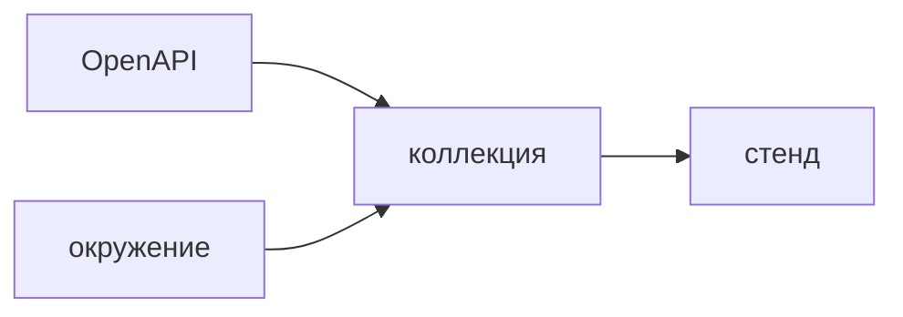

## Введение

Рядом со Swagger вакансии называют Postman. Аналитик собирает им примеры запросов, которые потом читают разработка и тест. Кнопка Try it out в спецификации этого набора не заменяет.

## Раздел: Коллекция

Запрос в коллекции — метод, путь, пример тела, пример успеха и пример ошибки. Окружение хранит адрес стенда отдельно от запроса, чтобы локальный и тестовый контур не плодили копии.

Небольшой тест коллекции проверяет код и обязательное поле. Это не полный набор QA, это сигнал, что пример ещё живой.

Коллекцию кладут в репозиторий. Экспорт только у автора равен отсутствию коллекции. Спецификация OpenAPI остаётся источником полей. Postman показывает пример и прогон. Если пример разошёлся со спецификацией, правят оба в одну сторону, начиная со спецификации.

## Раздел: Ответ вслух

Я завожу коллекцию на ресурс: создание, чтение, конфликт. Адрес стенда выношу в окружение. В репозиторий кладу экспорт, чтобы коллега прогнал то же самое. Спецификация описывает поле, Postman доказывает, что пример на стенде отвечает как договорено. Ошибку 404 и 409 я кладу отдельными запросами, не только счастливый путь.

## Раздел: Плохой ответ

Плохой ответ: «Postman и есть документация». Через месяц в нём примеры без обязательных полей, а контракт живёт в другом месте.

## Раздел: Термины

Коллекция — collection. Окружение — environment. Пример — example. Прогон коллекции — collection run. Спецификация — OpenAPI.

## Лаба

**25 минут.** Соберите три запроса к учебному ресурсу: успешное создание, пустое обязательное поле, чтение несуществующего id. Адрес вынесите в окружение. Напишите, какой из трёх ответов должен совпасть со спецификацией дословно.

## Схема: Пример и контракт

## Тест

### Чем коллекция отличается от Try it out?

**Ответ:** набор примеров можно повторить

**Пояснение:** Разовый клик в Swagger не остаётся сценарием для команды.

### Куда класть адрес стенда?

**Ответ:** в окружение

**Пояснение:** Иначе каждый стенд плодит свою копию запросов.

### Кто источник правды по полям?

**Ответ:** спецификация

**Пояснение:** Пример в Postman может отстать. Поле описывают в OpenAPI.

### Зачем запрос с заведомо плохим телом?

**Ответ:** зафиксировать код ошибки

**Пояснение:** Счастливый пример не показывает 422 или 400.

### Коллекция только на ноутбуке аналитика. Что потеряно?

**Ответ:** повторяемость для команды

**Пояснение:** Экспорт должен лежать рядом с контрактом.

## Шпаргалка

<ul><li>Пример успеха и пример ошибки</li><li>Адрес в окружении</li><li>Спека главнее примера</li><li>Экспорт в репозитории</li></ul>

## Anki

### Front: Что хранит environment?

Back: Адреса и секреты стенда вне текста запроса.

### Front: Что хранит collection?

Back: Запросы, примеры тел и простые проверки ответа.

### Front: Postman заменяет OpenAPI?

Back: Нет. Он прогоняет примеры, спецификация описывает контракт.

### Front: Какой минимум запросов на ресурс?

Back: Успех, ошибка тела и отсутствие объекта.

### Front: Зачем collection run?

Back: Прогнать примеры пачкой и увидеть, что стенд ещё совпадает с ними.

### Front: Куда коммитить коллекцию?

Back: В репозиторий рядом с описанием API.

## Итоги

- Коллекция повторяет примеры
- Окружение отделяет стенд от сценария
- Расхождение чинят со спецификации

## Ссылки

- [REST основы](/game/learn/sa-rest-basics)
- [Insomnia](/game/learn/s01e06-insomnia)
