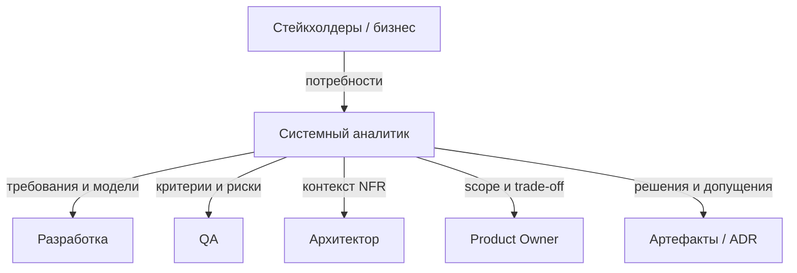
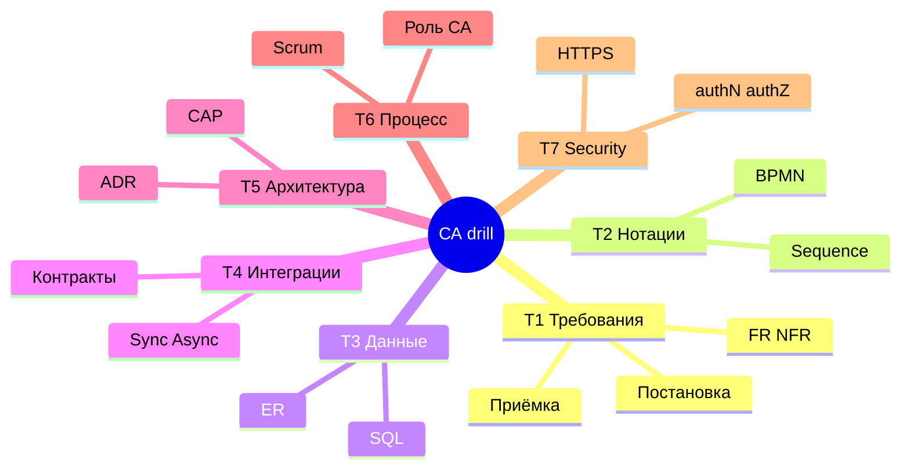
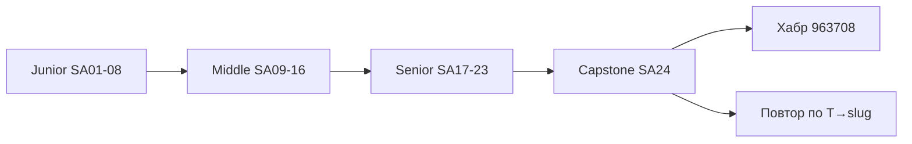

## Введение

Блок T6.2 на собесе звучит мягко («какой аналитик хороший?»), но по ответу отличают человека с опытом от выучившего определения. Ниже — оригинальные ориентиры T6.2.1–6.2.4: эталон, разница уровней, антипаттерны и граница роли СА.

Junior vs Senior — компетенции по BABOK KA и глубине арtefactов. **T6.2** — индекс; ориентир — что вы делаете сами vs с ревью архитектора.

**Drill аналитика.** Финальная тренировка перед capstone: не новая теория, а **скорость и связность** ответов по всем семи темам Хабра-списка. Ниже — квиз-блоки T1–T7 и лаба «10 быстрых ответов». Говорите вслух; Ideal — 60–90 секунд на пункт без воды.

Drill по семи темам серии с опорой на BABOK KA как оглавление: T1 Requirements, T2 Modeling (BPMN/UML), T3 Data, T4 Integrations (OpenAPI, Kafka/Rabbit), T5 Architecture (C4, ADR), T6 Delivery, T7 Security. Habr — только индекс формулировок.

**Capstone СА.** Финальный выпуск серии System Analyst Learn: собрать траекторию Junior → Middle → Senior, пройти self-check и понять, куда возвращаться по пробелам. Полный список формулировок вопросов — в статье на Хабре; здесь — **ориентиры компетенций**, индекс выпусков и честный план до собеса.

Capstone собирает серию по **BABOK Knowledge Areas** как оглавлению компетенций: Planning, Elicitation, Requirements Life Cycle, Strategy, Analysis/Design, Solution Evaluation — плюс стандарты **BPMN OMG**, **OpenAPI**, **Richardson**, **C4**, **ADR Nygard**, **Kafka/Rabbit** для интegrations. Индекс **T→slug** сохранён; [Хабр 963708](https://habr.com/ru/articles/963708/) — опциональный индекс вопросов.

## Раздел: Как отвечать одним блоком

Этот выпуск собрал соседние короткие темы трека: «Уровни профессии СА», «Drill аналитика», «Capstone СА». Раньше каждая занимала отдельную карточку на несколько минут, а на собеседовании их спрашивают одним блоком. Ниже у каждой темы свой раздел, затем общие лабы, один тест и одна колода карточек. В ответе сначала назовите, какую тему спросили, потом определение и один пример. Не проговаривайте все разделы, если спросили один. Лабы можно пройти по порядку исходного трека. Если времени мало, сделайте первую и последнюю: первая ставит язык, последняя проверяет, что соседние темы вы не перепутали.

## Раздел: Уровни профессии СА: Хороший аналитик и зона ответственности

**Хороший системный аналитик** (T6.2.1) — не тот, кто больше всех пишет документы, а тот, кто:

- переводит неопределённость бизнеса в **проверяемые** требования и модели;
- выявляет противоречия **до** разработки, а не после релиза;
- говорит на языке стейкхолдеров и на языке инженеров без подмены одного другим;
- фиксирует решения и допущения (протоколы, ADR, open questions);
- считает качество постановки частью своей репутации: если QA/Dev «не поняли» — это сигнал доработать вход;
- видит систему целиком: данные, процесс, интеграции, NFR, приёмка;
- умеет сказать «нет/не сейчас» с альтернативой (trade-off), а не только «сделаем».

**Что должен делать СА** (T6.2.4) — ядро роли:

1. Выявлять и приоритизировать потребности стейкхолдеров.
2. Формировать и согласовывать требования (FR/NFR), scope.
3. Моделировать процессы и данные, описывать интеграции.
4. Готовить постановки/user stories/UC и критерии приёмки.
5. Сопровождать реализацию: уточнения, влияние изменений, трассировка.
6. Участвовать в приёмке и разборе дефектов «из требований».
7. Помогать оценке и планированию через декомпозицию и риски.
8. Не подменять собой PO (приоритет ценности), архитектора (финальный tech-choice) и QA (тест-дизайн) — но стыковаться со всеми.

Граница: СА **владеет ясностью задачи**; не обязан писать прод-код и не обязан быть единственным «виновником сроков», если решения принимал бизнес вопреки рискам — но обязан риски озвучить письменно.

## Раздел: Уровни профессии СА: Junior vs Senior

**Junior** (ориентир):

- собирает требования по шаблону, уточняет у наставника;
- пишет stories/простые UC, базовые диаграммы с проверкой;
- знает FR/NFR на уровне списка, путается в сложных интеграциях;
- работает в узком куске системы; слабо видит побочные эффекты;
- оценку и конфликт приоритетов эскалирует;
- сильная сторона роста — скорость обучения и аккуратность артефактов.

**Senior** (ориентир):

- сам ведёт неопределённые темы end-to-end до согласованного решения;
- выбирает нотацию и глубину под аудиторию; согласует модели между собой;
- проектирует интеграции и формулирует измеримые NFR;
- влияет на архитектуру через контекст и ADR, не через «я так чувствую»;
- mentorit junior, ставит DoR, режет scope с бизнесом;
- отвечает за качество входа команды и прозрачность рисков поставки;
- на собесе приводит **кейсы**: конфликт стейкхолдеров, ломающий контракт, компромисс CAP/SLA.

Middle — мост: самостоятельные фичи внутри известного контура, ещё без владения «плавающей» архитектурой и жёсткими политическими компромиссами.

Вопрос «чем junior отличается от senior?» лучше закрывать **примерами поведения**, не годами стажа: senior уменьшает энтропию системы решений; junior аккуратно исполняет известный процесс.

## Раздел: Уровни профессии СА: Плохой аналитик — антипаттерны

**Плохой СА** (T6.2.3) узнаётся по следствиям:

- **Письмоводитель** — пересказывает встречу без решений и открытых вопросов.
- **Прокси-разработчик без компетенций** — диктует стек и таблицы, игнорируя архитектора и NFR.
- **Человек-соглашатель** — принимает любой scope «завтра», риски не фиксирует.
- **Хранитель тайны** — знания только в голове, артефакты пустые или устаревшие.
- **Враг QA** — «тестируйте как хотите», без критериев приёмки.
- **Водонапорная башня** — все коммуникации только через него, команда слепнет.
- **Шаблонный фанатик** — ГОСТ/BPMN ради галочки, не ради ясности.
- **Тихий саботаж изменений** — Sabotages через бесконечные уточнения без критерия остановки analysis.

Контраст для собеса: хороший аналитик оставляет после себя **воспроизводимую ясность** (документы, модели, решения); плохой — либо хаос, либо иллюзию порядка.

## Раздел: Уровни профессии СА: Частые вопросы с собеседования

**Вопрос.** User story или use case — что выбрать на проекте?

**Ответ.** Story — короткий инкремент ценности для backlog и спринта. Use case — полный сценарий с актёром, основным и альтернативными потоками, когда важны ветки и исключения. На собесе: story для приоритизации, UC/sequence — когда согласуете интеграции и QA-покрытие.

**Вопрос.** Зачем на собесе СА спрашивают идемпотентность REST?

**Ответ.** Повтор запроса (таймаут, retry клиента, двойной клик) не должен дважды списать деньги. POST платежа часто делают идемпотентным через Idempotency-Key, уникальный constraint или проверку «уже обработано». GET/PUT/DELETE по смыслу ближе к идемпотентности, чем «слепой» POST.

**Вопрос.** Когда на интеграции выбрать синхронный REST, а когда очередь?

**Ответ.** Sync — нужен ответ сейчас и цепочка короткая (проверка остатка перед оплатой). Async — долгая работа, сглаживание пиков, слабая связность: 202 Accepted, статус по webhook/polling. СА описывает ретраи, дедупликацию и SLA ответа, а не только «повесим Kafka».

**Вопрос.** ACID и CAP — про одно и то же?

**Ответ.** Нет. ACID — свойства транзакции в одной БД (атомарность, согласованность, изоляция, долговечность). CAP — компромисс распределённой системы при сбое сети: согласованность vs доступность. На собесе связывают с контекстом: баланс — строже ACID; лента лайков — чаще eventual consistency.

**Вопрос.** Зачем системному аналитику OpenAPI, если есть текст требований?

**Ответ.** OpenAPI — исполнимый контракт для Dev/QA/партнёров: методы, схемы, коды ошибок, версии. Меньше «договорились устно». Аналитик не обязан писать YAML руками, но обязан согласовать поля, обязательность, breaking vs optional изменения и примеры ошибок.

## Раздел: Drill аналитика: Ответ вслух

Я беру один процесс и довожу до контракта: кто вызывает, какие данные меняются, какой отказ возможен. Нотацию называю после потока, не вместо него. Если интеграций несколько, выбираю одну и говорю, чем заплатили.

## Раздел: Drill аналитика: Плохой ответ

Список аббревиатур REST, SOAP, BPMN без сценария. Нечего проверить.

## Раздел: Drill аналитика: Термины

Требование — requirement. Поток — flow. Контракт — contract. Отказ — failure.

## Раздел: Drill аналитика: Drill T1–T3 — требования, нотации, данные

**T1 · Требования.** Держите каркас: stakeholder → потребность → FR/NFR → приёмка. Отличия user story vs use case; зачем DoR; как выглядит измеримый NFR; что такое traceability. Ловушка: путать wish и требование («чтобы было удобно»).

Мини-ответы для тренировки:

- FR — *что* система делает; NFR — *как/с какими ограничениями* (число!).
- Хорошая постановка снимает неоднозначность до контракта для Dev/QA.
- С QA (T6.1.4): критерии приёмки и зоны риска, не 200 кейсов за них.

**T2 · Нотации.** BPMN — процесс и шлюзы; UML Use Case — актёры и цели; Sequence — вызовы во времени; Activity — похож на поток работ. Выбор нотации = аудитория + вопрос. Ловушка: рисовать микросервисы на BPMN вместо бизнеса.

**T3 · Данные.** Нормализация до 3NF как идея устранения аномалий; PK/FK; 1:1, 1:N, M:N; SQL JOIN vs WHERE; зачем индекс; ACID коротко. Senior добавка: согласованность статусов процесса с ER (урок SA18).

Связка на собесе: «покажу заказ в BPMN, затем sequence оплаты, затем ER Order–Payment» — это уже уровень выше зубрёжки определений.

## Раздел: Drill аналитика: Drill T4–T5 — интеграции и архитектура

**T4 · Интеграции.** REST принципы и идемпотентность; когда 201/202/204; sync vs async; очередь зачем; SOAP/WSDL где жив; ESB не по умолчанию; webhook + подпись; совместимость контрактов (добавить optional ≠ удалить поле).

Каркас ответа «как интегрировать A и B»:

1. Нужен ли ответ сейчас?
2. Кто ретраит и что при дублях?
3. Контракт и версия.
4. Security и корреляция.
5. Наблюдаемость отказа.

**T5 · Архитектура.** Монолит vs микросервисы — контекст команды и BC; API Gateway; оркестрация vs хореография; CAP на примере (оверселл vs простой кнопки); ADR как фиксация. Ловушка: «микросервисы масштабируют всё» без цены распределённости.

Связка T4+T5: каждый новый сервис умножает контракты — поэтому преждевременное дробление бьёт аналитика первым.

## Раздел: Drill аналитика: Drill T6–T7 — процесс, роль, безопасность

**T6 · Процесс и профессия.** Scrum vs Kanban в двух фразах; DoR/DoD; SP vs часы; где Scrum ломается; хороший/плохой аналитик; junior vs senior на примерах поведения; граница с PO/QA/архитектором. Ловушка: обещать дату в одиночку.

**T7 · Безопасность-база.** Протокол; HTTP vs HTTPS (TLS); authN vs authZ; цепочка URL (DNS→TCP/TLS→HTTP→ответ); шифрование vs хеш. Ловушка: 401/403 перепутаны; «HTTPS шифрует БД».

Режим drill: партнер/таймер задаёт номер темы — вы отвечаете структурой **определение → пример → типичная ошибка**. Так звучит senior, а не шпаргалка.

## Раздел: Drill аналитика: Частые вопросы с собеседования

**Вопрос.** «Ответ API за 200 мс» — FR или NFR?
**Ответ.** NFR, производительность. FR описывает, что система делает, NFR — насколько хорошо.

**Вопрос.** Когда очередь лучше синхронного REST?
**Ответ.** Когда вызывающий не должен ждать долгую работу и допустима отложенная согласованность. Цена — идемпотентность и сложнее разбор сбоев.

**Вопрос.** Что такое идемпотентный метод?
**Ответ.** Повтор того же запроса не меняет результат сверх первого применения. PUT обычно идемпотентен, голый POST — нет.

## Раздел: Capstone СА: Ответ вслух

Чеклист я использую как страховку дыр: требования, данные, интеграция, поставка. Вслух беру один пункт и пример, а не читаю все двадцать четыре заголовка.

## Раздел: Capstone СА: Плохой ответ

«Я прошёл всю карту». Карта не отвечает на вопрос про конкретный процесс.

## Раздел: Capstone СА: Термины

Поставка — delivery. Граница — boundary. Компромисс — tradeoff.

## Раздел: Capstone СА: Чеклисты Junior → Middle → Senior

**Как пользоваться серией.**

1. Идите по `order` 501→524 или точечно по пробелам (таблица индекса ниже).
2. Выпуск: теория → лаба → тест → Anki; лабу не пропускайте.
3. Опционально: [Топ-150 вопросов СА](https://habr.com/ru/articles/963708/) как индекс формулировок; разборы и первичные источники (BABOK, BPMN OMG, OpenAPI, C4, ADR) — в выпусках Learn.
4. После Middle (SA16) обязательно Senior craft → modeling → integrations → ADR (SA17–20) до drill (SA23).
5. Повторяйте Anki и свой рабочий кейс (одна система end-to-end) — сильнее зубрёжки списков.

**Чеклист Junior (SA01–SA08).**

- [ ] FR/NFR, сбор требований, базовые техники выявления
- [ ] User story, acceptance, use case на учебном уровне
- [ ] Понимает назначение ГОСТ/SRS/постановки как артефактов
- [ ] Читает и рисует простой BPMN и use case
- [ ] ER: сущности, ключи, 1:N / M:N; SQL SELECT/JOIN
- [ ] REST: методы, статусы, ресурсность на базе
- [ ] Scrum/Kanban, DoR/DoD без путаницы ролей
- [ ] Может провести мини-постановку фичи под ревью наставника

**Чеклист Middle (SA09–SA16).**

- [ ] ACID, индексы, идеи репликации/шардинга «для разговора»
- [ ] Sync/async, очереди, когда что выбирать на базовом уровне
- [ ] Идемпотентность, версии API, схемы
- [ ] SOAP/WSDL vs REST — где уместен
- [ ] ESB/webhook/gRPC/GraphQL обзорно
- [ ] Стили: монолит, SOA, микросервисы — плюсы/минусы
- [ ] CAP, gateway, оркестрация — определения с примером
- [ ] HTTP/HTTPS, authN/authZ, цепочка URL, шифрование vs хеш

**Чеклист Senior (SA17–SA23).**

- [ ] Постановка как контракт: scope, негативы, измеримые NFR, приёмка
- [ ] Traceability требование → модель → тест; стык с QA
- [ ] Воркшоп: BPMN + Sequence + ER без противоречий статусов
- [ ] Выбор интеграции под сценарий + совместимость контрактов
- [ ] ADR: монолит/микросервисы, consequences, CAP по риску бизнеса
- [ ] Декомпозиция, SP vs часы, прогноз диапазоном, поломки Scrum
- [ ] T6.2: хороший/плохой СА, junior vs senior на поведении
- [ ] Drill T1–T7: 60–90 с на ответ, сквозной кейс заказа

## Раздел: Capstone СА: Индекс T→slug и маршрут повторения

| Тема | Фокус | Выпуски (slug) |
|------|-------|----------------|
| T1 | Требования, постановка | `sa-requirements-basics`, `sa-requirements-basics`, `sa-gost-srs-artifacts`, `sa-http-security-basics` |
| T2 | BPMN/UML | `sa-gost-srs-artifacts`, `sa-modeling-workshop` |
| T3 | БД и SQL | `sa-db-basics`, `sa-db-basics`, `sa-db-advanced`, `sa-modeling-workshop` |
| T4 | Интеграции и API | `sa-rest-basics`, `sa-sync-async-queues`, `sa-sync-async-queues`, `sa-soap-xml`, `sa-soap-xml`, `sa-modeling-workshop` |
| T5 | Архитектура | `sa-architecture-styles`, `sa-architecture-styles`, `sa-architecture-decisions` |
| T6 | Процесс и роль | `sa-rest-basics`, `sa-architecture-decisions`, `sa-profession-levels` |
| T7 | HTTP/security база | `sa-http-security-basics` |
| Кросс | Drill + capstone | `sa-profession-levels`, `sa-profession-levels` |

**Полный список вопросов:** [habr.com/ru/articles/963708/](https://habr.com/ru/articles/963708/).

**Индекс серии SA Learn (обзор).**

| Ep | slug | Фокус |
|----|------|--------|
| SA01 | sa-requirements-basics | FR/NFR, сбор |
| SA02 | sa-requirements-basics | Stories, UC |
| SA03 | sa-gost-srs-artifacts | ГОСТ, SRS |
| SA04 | sa-gost-srs-artifacts | BPMN, UML |
| SA05 | sa-db-basics | БД база |
| SA06 | sa-db-basics | SQL |
| SA07 | sa-rest-basics | REST |
| SA08 | sa-rest-basics | Scrum/Kanban |
| SA09 | sa-db-advanced | ACID, индекс |
| SA10 | sa-sync-async-queues | Sync/async |
| SA11 | sa-sync-async-queues | Идемпотентность |
| SA12 | sa-soap-xml | SOAP |
| SA13 | sa-soap-xml | ESB и др. |
| SA14 | sa-architecture-styles | Стили |
| SA15 | sa-architecture-styles | CAP, gateway |
| SA16 | sa-http-security-basics | HTTP, auth |
| SA17 | sa-http-security-basics | Senior постановка |
| SA18 | sa-modeling-workshop | BPMN+Seq+ER |
| SA19 | sa-modeling-workshop | Выбор интеграции |
| SA20 | sa-architecture-decisions | ADR |
| SA21 | sa-architecture-decisions | Оценка |
| SA22 | sa-profession-levels | Уровни роли |
| SA23 | sa-profession-levels | Drill T1–T7 |
| SA24 | sa-profession-levels | Capstone |

## Раздел: Capstone СА: План на 4 недели до собеса

Неделя 1 — закрыть ❌ в Junior-чеклисте (T1–T3 база).  
Неделя 2 — Middle интеграции и архитектура (T4–T5, SA09–SA16).  
Неделя 3 — Senior craft + modeling + ADR (SA17–SA20) + один сквозной кейс в портфолио.  
Неделя 4 — estimation, роль, drill (SA21–SA23), ежедневные Anki, пробный собес с таймером.

Артефакт «папка доказательств»: 1 постановка, 1 тройка моделей, 1 ADR, 1 матрица трассировки, 1 разбор интеграции — даже учебные.

## Раздел: Capstone СА: Частые вопросы с собеседования

**Вопрос.** Что проверить в REST-контракте?
**Ответ.** Ресурс, метод, коды ошибок, идемпотентность и схему тела. «Просто JSON» без ошибок — слабый ответ.

**Вопрос.** Чем BPMN удобнее свободного рисунка?
**Ответ.** У событий, задач и шлюзов фиксированный смысл, схему читают и аналитик, и разработчик.

**Вопрос.** Как коротко объяснить CAP?
**Ответ.** При разделении сети нельзя одновременно гарантировать свежую согласованность и доступность всех узлов.

## Лаба

**Уровни профессии СА.**

**Цель.** Собрать самооценку уровня и «истории» для T6.2 на собесе.

**Шаги.**
1. Отметьте по чеклисту хорошего СА 8 пунктов: ✅ / ⚠️ / ❌.
2. Напишите 1 кейс junior-поведения и 1 кейс senior-поведения из своего опыта (или учебного проекта).
3. Выберите 2 антипаттерна, которым вы рискуете чаще всего, и контрмеры на 30 дней.
4. Сформулируйте 60-секундный ответ: «чем senior СА отличается от junior».
5. Разделите таблицу: делаю я / делает PO / архитектор / QA — на примере последней фичи.
6. Подготовьте фразу эскалации риска, которую вы реально готовы сказать бизнесу.

**В группу:** партнёр играет плохого «соглашателя» — остановите расползание scope за 2 минуты.

**Готово, если…**
- [ ] Есть честный gap-list по T6.2
- [ ] Pitch junior vs senior звучит на примерах, не на стаже
- [ ] Границы роли с PO/QA/архитектором названы без размытия

**Drill аналитика.**

**Цель.** Дать 10 быстрых устных ответов (по ~60–90 секунд) без конспекта.

**Шаги.** Закройте статью и ответьте по порядку; затем сверьтесь с подсказками ниже.

1. FR vs NFR + пример измеримого NFR.
2. User story vs use case — когда что.
3. Зачем BPMN и Sequence на одном процессе оплаты.
4. 1:N и M:N — пример из заказа.
5. Идемпотентность POST платежа — как обеспечить.
6. Когда очередь лучше sync REST.
7. Монолит vs микросервисы — 3 критерия выбора.
8. CAP на примере остатков/оплаты.
9. Чем senior СА отличается от junior (поведение).
10. authN vs authZ + зачем HTTPS.

**Подсказки для самопроверки (не читайте до ответа):**
1. NFR с метрикой и условием нагрузки.
2. Story — инкремент ценности; UC — полное поведение с ветками.
3. Бизнес-ветки vs вызовы систем; статусы согласованы.
4. Order–Items = 1:N; Order–Product через OrderItem = M:N.
5. Idempotency-Key / unique constraint / тот же результат при повторе.
6. Пики, fan-out, продюсеру не нужен мгновенный результат обработки.
7. Команда, ясность BC, платформа/Ops, независимый масштаб.
8. При partition выбрать C или A по риску бизнеса.
9. Энтропия/end-to-end vs шаблон в узком контуре.
10. Кто ты vs что можно; HTTPS = HTTP+TLS на канале.

**В группу:** 10 вопросов с таймером; штрафуйте «воду» дольше 2 минут.

**Готово, если…**
- [ ] 8/10 ответов структурны без подглядывания
- [ ] В каждом есть пример, не только определение
- [ ] Можете связать T1→T4→T5 на кейсе заказа за 2 минуты

**Capstone СА.**

**Цель.** Личный gap-analysis и план на 4 недели.

**Шаги.**
1. Пройдите три чеклиста уровней, отметьте ❌/⚠️/✅.
2. Выберите 5 ❌ и привяжите к slug из индекса T→slug.
3. Составьте расписание: 3 выпуска/неделя или 2 лабы + Anki.
4. Напишите 60-секундный pitch: «кто я как СА и чем усиливаю команду».
5. Соберите папку доказательств (5 артефактов выше).
6. Пройдите лабу SA23 ещё раз на таймере и запишите слабые номера вопросов.

**В группу:** что важнее за месяц — закрыть все Junior-дыры или один сильный Senior-рассказ про конфликт стейкхолдеров и ADR?

**Готово, если…**
- [ ] Есть письменный gap-list и план на 4 недели
- [ ] Pitch звучит 60 секунд без шпаргалки
- [ ] Знаете slug для каждой слабой темы T1–T7

## Схема: Уровни профессии СА: Зона ясности СА

## Схема: Drill аналитика: Карта тем drill

## Схема: Capstone СА: Траектория серии СА

## Тест

### Что характеризует хорошего системного аналитика?

**Ответ:** превращает неопределённость в проверяемые требования и согласованные решения, видит систему целиком и фиксирует риски и компромиссы

**Пояснение:** объём документов сам по себе не показатель; показатель — ясность для Dev/QA и управляемый scope.

### Какой каркас ответа использовать на любом вопросе собеса?

**Ответ:** короткое определение → прикладной пример → типичная ошибка или компромисс

**Пояснение:** так ответ звучит как опыт; одно определение без примера легко забывается и не отличает уровни.

### Зачем в capstone индекс T→slug?

**Ответ:** чтобы быстро вернуться к нужному выпуску Learn по пробелу в теме собеса, а не перечитывать всю серию подряд

**Пояснение:** Хабр даёт список вопросов; индекс связывает темы с конкретными материалами 9to18.

### Чем senior СА отличается от junior?

**Ответ:** senior самостоятельно ведёт неопределённые темы end-to-end, стыкует интеграции/NFR/архитектурный контекст и управляет trade-off; junior работает по шаблону в узком контуре с эскалацией

**Пояснение:** разница в снижении энтропии и зоне ответственности, а не только в годах.

### Как связать несколько тем на кейсе заказа?

**Ответ:** требование и приёмка (T1) → BPMN/Sequence/ER (T2–T3) → стиль интеграции оплаты (T4) → решение по границам сервисов и CAP (T5)

**Пояснение:** сквозной кейс показывает senior-мышление лучше, чем изолированные термины.

## Шпаргалка

<ul><li>Хороший СА = ясность + трассировка + смелость trade-off</li><li>Junior исполняет процесс; senior снимает неопределённость</li><li>Плохой: письмоводитель, соглашатель, хранитель тайн</li><li>СА владеет ясностью задачи, не приоритетом продукта и не тест-дизайном</li><li>На собесе — кейсы поведения, не лозунги</li><li>T1–T7 закрывать каркасом: определение → пример → ошибка</li><li>Сквозной кейс заказа связывает темы</li><li>60–90 секунд на типовой вопрос</li><li>Интеграции: нужен ли ответ сейчас + ретраи + контракт</li><li>Роль: ясность и trade-off, не одинокая дата релиза</li><li>Junior → Middle → Senior чеклисты = self-check</li><li>Хабр 963708 — список вопросов; Learn — разборы</li></ul>

## Anki

### Front: T6.2.1 — хороший аналитик?

Back: делает требования проверяемыми, снимает противоречия рано, фиксирует решения и риски, говорит и с бизнесом, и с инженерами

### Front: Каркас устного ответа на собесе СА?

Back: определение → пример из системы → типичная ошибка или компромисс

### Front: Где полный список вопросов СА для серии?

Back: статья на Хабре https://habr.com/ru/articles/963708/ плюс разборы в Learn /game/learn

### Front: Ключевое отличие junior vs senior СА?

Back: зона неопределённости: junior — узкий кусок с эскалацией; senior — end-to-end решение и trade-off

### Front: Мини-маршрут сквозного кейса по темам?

Back: T1 требования → T2/T3 модели → T4 интеграция оплаты → T5 границы и CAP

### Front: Что входит в senior-чеклист серии?

Back: постановка+NFR+traceability, modeling workshop, выбор интеграций, ADR/CAP, оценка/Scrum, T6.2, drill T1–T7

## Мнемоника

### peg: Уровни аналитика

**Задание:** Чем отличается следующий уровень.

**Элементы:**
- junior фиксирует
- middle выбирает
- senior держит последствие

**Подсказка:** Senior называет, что сломается через полгода.

**Ответ:** 1 запись · 2 выбор · 3 последствие

## Итоги

- T6.2 проверяет зрелость роли, не зубрёжку терминов
- Senior измеряется поведением в неопределённости и качеством входа команды
- Антипаттерны полезно знать для самоконтроля и для «разбора чужих провалов» на собесе
- Чёткие границы с PO, архитектором и QA усиливают, а не ослабляют позицию СА
- Drill тренирует скорость и связность, не новые определения
- Лучший senior-сигнал — сквозной кейс через T1–T5 плюс зрелый T6
- T7 короткий, но провальный при путанице терминов — держите в разминке
- После стабильных 8/10 из лабы переходите к capstone-чеклисту SA24

## Ссылки

- [BABOK Guide — компетенции BA (IIBA)](https://www.iiba.org/knowledgehub/business-analysis-body-of-knowledge-babok-guide/)
- [C4 Model](https://c4model.com/)
- [Топ-150 вопросов СА (Хабр) — индекс формулировок](https://habr.com/ru/articles/963708/)
- [Learn](/game/learn)
- [BPMN 2.0 — OMG](https://www.omg.org/spec/BPMN/2.0/)
- [OpenAPI Specification](https://spec.openapis.org/oas/latest.html)
- [Richardson Maturity Model](https://martinfowler.com/articles/richardsonMaturityModel.html)
- [Documenting Architecture Decisions](https://cognitect.com/blog/2011/11/15/documenting-architecture-decisions)
- [Apache Kafka Documentation](https://kafka.apache.org/documentation/)
- [RabbitMQ Documentation](https://www.rabbitmq.com/docs)
