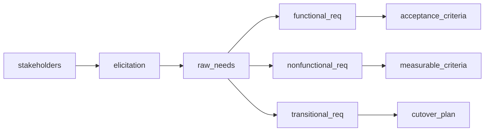
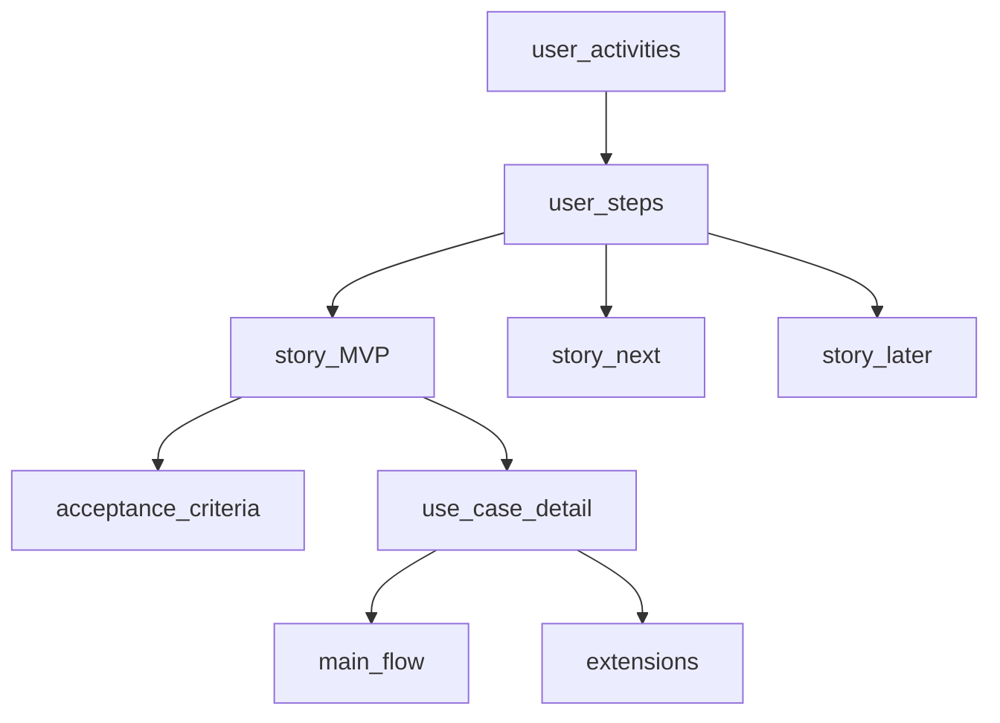

## Введение

На junior-собесе системного аналитика почти всегда спрашивают, как вы собираете требования и чем функциональные отличаются от нефункциональных. Этот выпуск закрывает T1.1–1.6 своими формулировками — без копипаста платных курсов.

Оглавление компетенций — **BABOK Guide** (Knowledge Areas: *Business Analysis Planning and Monitoring*, *Elicitation and Collaboration*, *Requirements Analysis and Design Definition*). Индекс вопросов **T1.1–1.6** сохранён для навигации по серии; первичные формулировки — в BABOK и практике elicitation.

**User story, USM и use case.** После базы про FR/NFR на junior-собесе СА часто переходят к форматам описания ценности: user story, карта историй и use case. Этот выпуск закрывает T1.7–1.12 практичными ответами, которые можно сказать за 60–90 секунд.

User story и use case — артефакты из KA BABOK *Requirements Analysis and Design Definition* и agile-практики; **T1.7–1.12** — только индекс серии. Первично опирайтесь на INVEST, USM (Jeff Patton) и текстовые сценарии use case, а не на списки вопросов.

## Раздел: Как отвечать одним блоком

Этот выпуск собрал соседние короткие темы трека: «Требования FR/NFR», «User story, USM и use case». Раньше каждая занимала отдельную карточку на несколько минут, а на собеседовании их спрашивают одним блоком. Ниже у каждой темы свой раздел, затем общие лабы, один тест и одна колода карточек. В ответе сначала назовите, какую тему спросили, потом определение и один пример. Не проговаривайте все разделы, если спросили один. Лабы можно пройти по порядку исходного трека. Если времени мало, сделайте первую и последнюю: первая ставит язык, последняя проверяет, что соседние темы вы не перепутали.

## Раздел: Требования FR/NFR: Elicitation и стейкхолдеры

**Elicitation** — выявление требований: активный сбор потребностей, ограничений и ожиданий, а не «ждать, пока заказчик пришлёт ТЗ». Аналитик выбирает методы под контекст и фиксирует результат так, чтобы его можно было проверить и согласовать.

Частые методы elicitation:
- **Интервью** — глубина по ролям и сценариям; хорошо для скрытых ожиданий.
- **Воркшопы / фасилитация** — согласование между ролями в одной комнате.
- **Наблюдение / job shadowing** — как люди реально работают, а не как «по регламенту».
- **Анализ документов** — договоры, регламенты, логи, тикеты поддержки, legacy-ТЗ.
- **Прототипы и мокапы** — быстро проверить UI-ожидания.
- **Опросы и анкеты** — широкий охват при однотипных вопросах.
- **Brainwriting / CJM / user journey** — путь пользователя и точки боли.

**Стейкхолдер** — любой, кто влияет на продукт или на кого продукт влияет: спонсор, владелец продукта, пользователи, смежные системы, служба безопасности, поддержка, юристы, регулятор. На собесе полезно сказать: стейкхолдеров ищут по влиянию и интересу, а не только по оргструктуре; карту интересов обновляют, когда меняется scope или появляются новые интеграции.

Практика: для каждой крупной фичи фиксируйте «кто решает», «кто использует», «кого затронет сбой» и «кто даёт ограничение» (безопасность, compliance, инфраструктура).

В терминах BABOK **elicitation** входит в KA *Elicitation and Collaboration* (подготовка, проведение, подтверждение), а классификация FR/NFR — в *Requirements Analysis and Design Definition*. Transitional requirements часто фиксируют в *Strategy Analysis* и плане перехода, а не в целевом backlog продукта.

## Раздел: Требования FR/NFR: Типы FR, классификация NFR, FR vs NFR

**Функциональное требование (FR)** описывает *что* система должна уметь делать: поведение, данные, бизнес-правила, реакции на события. Примеры: «пользователь может создать заказ», «система отклоняет платёж при недостатке средств», «админ выгружает отчёт в CSV».

Типы FR (удобная сетка для ответа):
- **Бизнес-функции** — операции предметной области (создание, изменение, расчёт).
- **Интерфейсные** — обмен с пользователем или внешней системой (экран, API, файл, сообщение).
- **Правила и ограничения поведения** — валидации, статусы, права доступа на уровне «кто может что».
- **Отчётность и уведомления** — что система сообщает и когда.
- **Обработка ошибок и исключений** — ожидаемое поведение при сбоях данных/интеграций.

**Нефункциональное требование (NFR)** описывает *как* система должна работать: качество, ограничения среды, эксплуатационные свойства. Классификация NFR (часто на собесе ждут именно группы):
- **Производительность** — latency, throughput, время отклика под нагрузкой.
- **Надёжность / доступность** — SLA, RTO/RPO, устойчивость к сбоям.
- **Безопасность** — аутентификация, авторизация, шифрование, аудит.
- **Масштабируемость и ёмкость** — рост пользователей/данных.
- **Удобство использования (usability)** — обучаемость, доступность, ошибки пользователя.
- **Сопровождаемость и наблюдаемость** — логи, метрики, простота изменений.
- **Совместимость и переносимость** — браузеры, ОС, стандарты обмена.
- **Юридические / compliance** — хранение ПДн, сроки, отраслевые нормы.

**FR vs NFR:** FR отвечает на «какая функция нужна», NFR — на «с какими характеристиками качества и в каких границах». Тест на собесе: если требование можно проверить сценарием «сделал действие → получил результат», это скорее FR; если нужна метрика, порог или политика качества («p95 &lt; 300 мс», «доступность 99.9%»), это NFR. Одно и то же слово («быстро», «удобно») без числа — ещё не требование, а пожелание; аналитик уточняет измеримый критерий.

## Раздел: Требования FR/NFR: Переходные (transitional) требования

**Переходные требования** описывают условия *миграции и внедрения*, а не целевое поведение системы в стационарном режиме. Они нужны, чтобы «дойти» от текущего состояния к новому: перенос данных, параллельная работа со старой системой, обучение, cutover, откат.

Примеры:
- одноразовая миграция клиентов и историй заказов с маппингом полей;
- период dual-run: старая и новая система работают параллельно с сверкой;
- требования к обучению и runbook для поддержки на go-live;
- окна простоя, план отката, критерии «миграция успешна».

После завершения перехода такие требования обычно закрываются: они не входят в постоянный backlog целевой системы, но критичны для проекта. На собесе подчеркните: без transitional-требований можно «правильно» спроектировать продукт и провалить внедрение.

## Раздел: Требования FR/NFR: Частые вопросы с собеседования

**Вопрос.** User story или use case — что выбрать на проекте?

**Ответ.** Story — короткий инкремент ценности для backlog и спринта. Use case — полный сценарий с актёром, основным и альтернативными потоками, когда важны ветки и исключения. На собесе: story для приоритизации, UC/sequence — когда согласуете интеграции и QA-покрытие.

**Вопрос.** BPMN и UML — конкуренты или разные задачи?

**Ответ.** Разные вопросы. BPMN — бизнес-процесс, шлюзы, роли людей. UML Use Case — граница системы и цели; Sequence — вызовы сервисов во времени. Ошибка: рисовать микросервисы на BPMN вместо бизнес-шагов.

**Вопрос.** Зачем на собесе СА спрашивают идемпотентность REST?

**Ответ.** Повтор запроса (таймаут, retry клиента, двойной клик) не должен дважды списать деньги. POST платежа часто делают идемпотентным через Idempotency-Key, уникальный constraint или проверку «уже обработано». GET/PUT/DELETE по смыслу ближе к идемпотентности, чем «слепой» POST.

**Вопрос.** Когда на интеграции выбрать синхронный REST, а когда очередь?

**Ответ.** Sync — нужен ответ сейчас и цепочка короткая (проверка остатка перед оплатой). Async — долгая работа, сглаживание пиков, слабая связность: 202 Accepted, статус по webhook/polling. СА описывает ретраи, дедупликацию и SLA ответа, а не только «повесим Kafka».

**Вопрос.** ACID и CAP — про одно и то же?

**Ответ.** Нет. ACID — свойства транзакции в одной БД (атомарность, согласованность, изоляция, долговечность). CAP — компромисс распределённой системы при сбое сети: согласованность vs доступность. На собесе связывают с контекстом: баланс — строже ACID; лента лайков — чаще eventual consistency.

## Раздел: User story, USM и use case: User story, USM и преимущества

**User story** — короткое описание потребности с точки зрения роли, обычно в формате: «Как &lt;роль&gt;, я хочу &lt;действие&gt;, чтобы &lt;ценность&gt;». История сама по себе не заменяет анализ: к ней добавляют **acceptance criteria (AC)**, ограничения, наброски UI и ссылки на правила. Story — «обещание разговора», а не полное ТЗ в одной строке.

Пример: «Как покупатель, я хочу сохранить адрес доставки, чтобы не вводить его при каждом заказе». AC могут включать: поля адреса, валидацию индекса, возможность редактировать/удалять, кто видит адрес.

**User Story Mapping (USM)** — визуальная карта продукта: по горизонтали — путь пользователя (activities → steps), по вертикали — приоритет деталей (backbone сверху, затем walking skeleton и релизы вниз). USM помогает:
- увидеть целостность продукта, а не россыпь тикетов;
- договориться о MVP (горизонтальный «срез» ценности);
- выявить пробелы в сценарии («оплатили, но письмо не уходит»);
- планировать релизы слоями, а не случайным набором stories.

**Преимущества user stories** (что говорить на собесе):
- фокус на ценности для роли, а не на «кнопке»;
- лёгкость приоритизации и декомпозиции;
- живой диалог с командой вместо толстого документа «на полку»;
- удобная связка с AC и демо;
- хорошо стыкуются с backlog и итеративной поставкой.

Ограничения: без AC и контекста истории размыты; сложные интеграции и NFR плохо живут «только в story» — их нужно явно дополнять.

## Раздел: User story, USM и use case: INVEST, хорошая история, use case

**INVEST** — чеклист качества story:
- **I**ndependent — по возможности независима от других (иначе явные зависимости);
- **N**egotiable — детали обсуждаемы до реализации;
- **V**aluable — даёт ценность пользователю/бизнесу;
- **E**stimable — команда может оценить;
- **S**mall — умещается в итерацию;
- **T**estable — есть способ проверить (обычно через AC).

Признаки **хорошей истории**: ясная роль и ценность, проверяемые AC, понятный scope «in/out», учтены ошибки и права, согласована с владельцем продукта. Плохая история: «сделать админку», «улучшить UX», «как система, я хочу…» без ценности.

**Use case** — описание взаимодействия актора с системой для достижения цели: название, актор(ы), предусловия, основной поток, альтернативы/исключения, постусловия. Use case сильнее в детализации ветвлений и системных реакций; часто рисуют диаграмму вариантов использования и текстовые сценарии.

Структура текстового use case (минимум для ответа):
1. Цель и уровень (user-goal / subfunction).
2. Основной успешный сценарий по шагам.
3. Расширения: ошибки оплаты, отказ прав, таймаут внешней системы.
4. Бизнес-правила и данные на входе/выходе.

## Раздел: User story, USM и use case: User story vs use case

| | User story | Use case |
|---|---|---|
| Фокус | ценность и разговор | полное взаимодействие и ветки |
| Объём | коротко + AC | сценарии детально |
| Когда удобно | Agile backlog, MVP, частые поставки | сложные процессы, много альтернатив, контракты |
| Риск | недосказать детали | избыточная бюрократия |

На практике их комбинируют: story как единица планирования, use case / сценарий — когда нужно разобрать ветвления; для интеграций часто добавляют sequence/BPMN. Хороший ответ: «story не против use case — разные уровни детализации и разные цели артефакта».

## Раздел: User story, USM и use case: Частые вопросы с собеседования

**Вопрос.** Зачем на собесе СА спрашивают идемпотентность REST?

**Ответ.** Повтор запроса (таймаут, retry клиента, двойной клик) не должен дважды списать деньги. POST платежа часто делают идемпотентным через Idempotency-Key, уникальный constraint или проверку «уже обработано». GET/PUT/DELETE по смыслу ближе к идемпотентности, чем «слепой» POST.

**Вопрос.** Когда на интеграции выбрать синхронный REST, а когда очередь?

**Ответ.** Sync — нужен ответ сейчас и цепочка короткая (проверка остатка перед оплатой). Async — долгая работа, сглаживание пиков, слабая связность: 202 Accepted, статус по webhook/polling. СА описывает ретраи, дедупликацию и SLA ответа, а не только «повесим Kafka».

**Вопрос.** ACID и CAP — про одно и то же?

**Ответ.** Нет. ACID — свойства транзакции в одной БД (атомарность, согласованность, изоляция, долговечность). CAP — компромисс распределённой системы при сбое сети: согласованность vs доступность. На собесе связывают с контекстом: баланс — строже ACID; лента лайков — чаще eventual consistency.

**Вопрос.** Зачем системному аналитику OpenAPI, если есть текст требований?

**Ответ.** OpenAPI — исполнимый контракт для Dev/QA/партнёров: методы, схемы, коды ошибок, версии. Меньше «договорились устно». Аналитик не обязан писать YAML руками, но обязан согласовать поля, обязательность, breaking vs optional изменения и примеры ошибок.

## Лаба

**Требования FR/NFR.**

**Цель.** Устно за 2 минуты объяснить elicitation, стейкхолдеров, FR/NFR и привести пример переходного требования.

**Шаги.**
1. Выберите домен (например, запись к врачу или интернет-магазин) и перечислите 6 стейкхолдеров с ролью «решает / использует / ограничивает».
2. Запишите 4 FR разных типов и 4 NFR из разных классов с измеримым критерием.
3. Добавьте 2 transitional-требования для запуска (миграция + dual-run или обучение).
4. Для одного «размытого» пожелания («система должна быть быстрой») переформулируйте в NFR с метрикой.

**В группу:** коллега играет спонсора и пользователя с конфликтующими интересами; вы фиксируете вопросы elicitation и предлагаете, как согласовать.

**Готово, если…**
- [ ] Называете ≥4 метода elicitation и зачем каждый
- [ ] Чётко отличаете FR от NFR на своих примерах
- [ ] Объясняете transitional requirements и когда они «умирают»

**User story, USM и use case.**

**Цель.** Собрать мини-USM и сравнить одну потребность в форматах story и use case.

**Шаги.**
1. Возьмите сценарий «оформить возврат товара» и постройте backbone из 5–7 шагов пользователя.
2. Напишите 3 user stories с INVEST-проверкой и AC (не менее 3 критериев на story).
3. Для одной story напишите use case: основной поток + 2 альтернативы.
4. Отметьте, что лучше оставить в story, а что вынести в use case/правила.

**В группу:** один защищает «только stories», другой — «только use cases»; договоритесь о гибриде для вашего домена.

**Готово, если…**
- [ ] Объясняете формат story и смысл USM
- [ ] Прогоняете историю по INVEST без шпаргалки
- [ ] Называете 3 отличия story от use case на примере

## Схема: Требования FR/NFR: От стейкхолдера к FR/NFR

## Схема: User story, USM и use case: USM и связь с use case

## Тест

### Чем elicitation отличается от «прочитать ТЗ»?

**Ответ:** это активное выявление потребностей разными методами, а не только разбор готового документа

**Пояснение:** ТЗ часто неполное или устаревшее; аналитик уточняет у людей, в процессах и данных, затем фиксирует проверяемые требования.

### Что обязательно добавить к user story, кроме шаблона «как… хочу…»?

**Ответ:** acceptance criteria и контекст границ

**Пояснение:** одна строка без AC непроверяема; команде нужны условия приёмки, ошибки и scope.

### Как быстро отличить FR от NFR?

**Ответ:** FR — поведение/функция; NFR — качество и ограничения с метрикой

**Пояснение:** «создать заказ» — FR; «создание заказа p95 &lt; 500 мс при 200 RPS» — NFR.

### Что означает буква V в INVEST?

**Ответ:** Valuable — история должна давать ценность

**Пояснение:** технический рефакторинг без объяснённой ценности для пользователя/бизнеса обычно формулируют иначе или связывают с риском/скоростью поставки.

### Что такое переходное требование?

**Ответ:** требование к миграции и внедрению, нужное только на переходном этапе

**Пояснение:** примеры — перенос данных, dual-run, обучение, cutover; после go-live обычно закрывается.

## Шпаргалка

<ul><li>Elicitation = интервью, воркшопы, наблюдение, документы, прототипы</li><li>Стейкхолдер = влияние + интерес, не только должность</li><li>FR = что система делает; NFR = как хорошо / в каких рамках</li><li>NFR без числа — часто ещё не требование</li><li>Transitional = миграция, cutover, dual-run, обучение</li><li>Story = роль + действие + ценность + AC</li><li>USM = путь пользователя × приоритет деталей / релизов</li><li>INVEST = Independent, Negotiable, Valuable, Estimable, Small, Testable</li><li>Use case = актор, потоки, предусловия/постусловия, расширения</li><li>Story для планирования ценности; use case для детальных ветвлений</li></ul>

## Anki

### Front: Назовите 4 метода elicitation

Back: интервью, воркшоп, наблюдение, анализ документов (также прототипы, опросы)

### Front: Классический шаблон user story?

Back: Как &lt;роль&gt;, я хочу &lt;действие&gt;, чтобы &lt;ценность&gt; (+ AC)

### Front: Чем FR отличается от NFR?

Back: FR описывает функцию/поведение; NFR — характеристики качества и ограничения, обычно измеримые

### Front: Что такое User Story Mapping?

Back: Карта пути пользователя по оси X и приоритета деталей/релизов по оси Y для планирования MVP

### Front: Пример transitional requirement?

Back: одноразовая миграция данных или период параллельной работы со старой системой до cutover

### Front: Чем use case отличается от user story?

Back: Use case детализирует взаимодействие и ветки; story короче фокусируется на ценности и планировании

## Итоги

- Сбор требований — активный процесс с выбором методов под контекст
- Стейкхолдеров ищут шире оргструктуры: влияние, интерес, ограничения
- FR и NFR дополняют друг друга; NFR нужно делать измеримыми
- Переходные требования спасают внедрение, но не живут вечно в целевой системе
- User story работает только вместе с критериями приёмки и диалогом
- USM помогает собрать целостность продукта и MVP-срез
- INVEST — быстрый фильтр «можно ли брать в спринт»
- Story и use case дополняют друг друга, а не конкурируют

## Ссылки

- [BABOK Guide — Knowledge Areas (IIBA)](https://www.iiba.org/knowledgehub/business-analysis-body-of-knowledge-babok-guide/)
- [Топ-150 вопросов СА (Хабр) — индекс формулировок](https://habr.com/ru/articles/963708/)
- [Learn](/game/learn)
