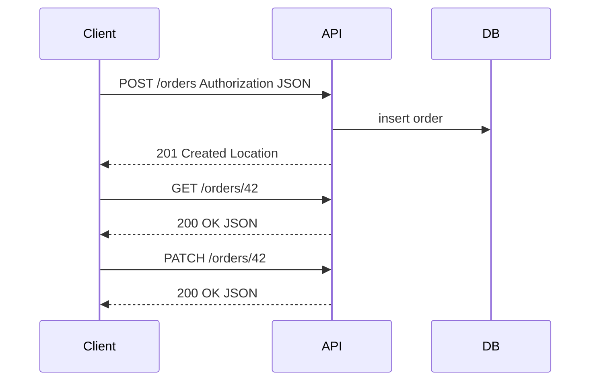
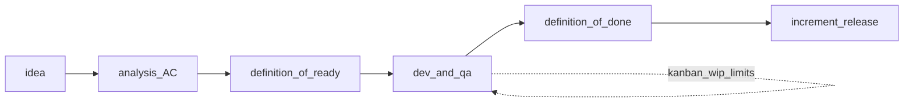

## Введение

Интеграции — хлеб системного аналитика: на junior-собесе ждут уверенный рассказ про API и REST без путаницы методов и кодов. Выпуск T4.2.1–4.2.14 собирает базу, на которой потом строят версии, контракты и идемпотентность уровня middle.

REST — архитектурный стиль Fielding; контракт HTTP API описывают через **OpenAPI 3.x** и уровни **Richardson Maturity Model**. **T4.2.1–4.2.14** — индекс; первично — OpenAPI и семантика HTTP, не Habr.

**Scrum и Kanban.** Закрывая junior-блок СА, на собесе проверяют процессное мышление: где аналитик в SDLC, как оценивать работу и чем Scrum отличается от Kanban. Выпуск T6.1.1–6.1.14 — про практику поставки, а не про заучивание манифеста.

Agile-методы и DoR/DoD — KA BABOK *Business Analysis Planning and Monitoring* (план поставки и соглашения команды). **T6.1.1–6.1.14** — индекс серии.

## Раздел: Как отвечать одним блоком

Этот выпуск собрал соседние короткие темы трека: «REST основы», «Scrum и Kanban». Раньше каждая занимала отдельную карточку на несколько минут, а на собеседовании их спрашивают одним блоком. Ниже у каждой темы свой раздел, затем общие лабы, один тест и одна колода карточек. В ответе сначала назовите, какую тему спросили, потом определение и один пример. Не проговаривайте все разделы, если спросили один. Лабы можно пройти по порядку исходного трека. Если времени мало, сделайте первую и последнюю: первая ставит язык, последняя проверяет, что соседние темы вы не перепутали.

## Раздел: REST основы: API, REST, RESTful, Stateless и кэш

**API** — контракт взаимодействия: как одна система просит другую выполнить операцию или отдать данные (методы, URL, форматы, ошибки, авторизация).

**REST** — стиль архитектуры для распределённых систем (Dissertation Fielding): ресурсы, единообразный интерфейс, представление ресурса (JSON и др.), взаимодействие через HTTP в вебе. **RESTful** на практике называют API, которые *примерно* следуют этим идеям: ресурсные URL, правильные глаголы, коды ответов. Идеально «чистый REST» редок; на собесе честно разделите теорию и «как принято в индустрии».

**Stateless:** сервер не хранит клиентскую сессию между запросами как обязательное условие обработки. Каждый запрос содержит всё нужное (токен, параметры). Состояние ресурса лежит в хранилище, а не в «памяти сервера о прошлом запросе этого клиента». Это упрощает масштабирование.

**Кэширование (вводно):** ответы можно помечать как кэшируемые (Cache-Control, ETag, Last-Modified), чтобы клиент или промежуточный кэш не ходил в origin повторно. Для СА: кэш ускоряет чтение, но усложняет актуальность; для изменяющих операций кэш обычно bypass.

**Richardson Maturity Model** (уровни 0–3): от «один URL + POST RPC» к ресурсам (1), HTTP-глаголам (2) и HATEOAS (3). На собесе достаточно показать, что ваш API — как минимум level 2: ресурсы + правильные методы; OpenAPI фиксирует paths, schemas и responses.

## Раздел: REST основы: Методы, параметры, URL, заголовки, коды

**Методы HTTP (базовый набор):**
- **GET** — читать ресурс(ы), без побочных эффектов в идеале;
- **POST** — создать ресурс / запустить процесс / неидемпотентная операция;
- **PUT** — создать или полностью заменить ресурс по известному URI;
- **PATCH** — частичное обновление;
- **DELETE** — удалить;
- **HEAD/OPTIONS** — метаданные и возможности (реже спрашивают junior).

**Параметры:** path (`/orders/{id}`), query (`?status=paid&page=2`), body (JSON для POST/PUT/PATCH), иногда headers для сквозных корреляционных id.

**URL:** существительные-ресурсы во множественном числе (`/users/42/orders`), избегают глаголов в пути (`/getOrders` — запах RPC). Действия-процессы иногда моделируют отдельно (`/payments`), если это отдельный ресурс.

**Заголовки:** `Authorization`, `Content-Type`, `Accept`, `Idempotency-Key`, корреляция (`X-Request-Id`), кэш-заголовки. Аналитик фиксирует обязательные заголовки в контракте интеграции.

**200 vs 201:** **200 OK** — успешный ответ общего вида (часто на GET, иногда на PUT/PATCH/DELETE). **201 Created** — ресурс успешно создан; желательно `Location` с URI нового ресурса. На POST создания заказа уместный ответ — 201.

## Раздел: REST основы: GET vs POST, PUT vs PATCH, POST vs PUT, идемпотентность

**GET vs POST:** GET для безопасного чтения и возможности кэша/закладок; POST когда меняем состояние или нельзя светить данные в URL. «GET с телом» — плохая практика.

**PUT vs PATCH:** PUT передаёт полное представление ресурса (или согласованную полную замену); PATCH — только изменённые поля. Если клиент не знает всех полей, PATCH безопаснее от затирания.

**POST vs PUT (создание):** POST на коллекцию (`POST /orders`) — сервер назначает id, типичный 201. PUT на конкретный URI (`PUT /orders/42`) — клиент знает id, операция идемпотентна: повторный PUT с тем же телом не создаёт «ещё один» ресурс.

**Идемпотентность (вводно):** повтор запроса даёт тот же эффект на ресурсах, что и один успешный (не обязательно тот же байтовый ответ). GET, PUT, DELETE — идемпотентны по семантике HTTP; POST — обычно нет. Для оплаты на POST ставят ключ идемпотентности, чтобы ретрай не списал дважды — детали будут в middle-серии.

## Раздел: REST основы: Частые вопросы с собеседования

**Вопрос.** Как на собесе отличить функциональное требование от нефункционального?

**Ответ.** FR — конкретное поведение: «можно оплатить картой». NFR — качество и ограничения: «p95 ответа API ≤ 300 мс при 500 RPS», «данные карты не в логах». NFR должны быть измеримы; «быстро и безопасно» без цифр — wish, не требование.

**Вопрос.** User story или use case — что выбрать на проекте?

**Ответ.** Story — короткий инкремент ценности для backlog и спринта. Use case — полный сценарий с актёром, основным и альтернативными потоками, когда важны ветки и исключения. На собесе: story для приоритизации, UC/sequence — когда согласуете интеграции и QA-покрытие.

**Вопрос.** BPMN и UML — конкуренты или разные задачи?

**Ответ.** Разные вопросы. BPMN — бизнес-процесс, шлюзы, роли людей. UML Use Case — граница системы и цели; Sequence — вызовы сервисов во времени. Ошибка: рисовать микросервисы на BPMN вместо бизнес-шагов.

**Вопрос.** Когда на интеграции выбрать синхронный REST, а когда очередь?

**Ответ.** Sync — нужен ответ сейчас и цепочка короткая (проверка остатка перед оплатой). Async — долгая работа, сглаживание пиков, слабая связность: 202 Accepted, статус по webhook/polling. СА описывает ретраи, дедупликацию и SLA ответа, а не только «повесим Kafka».

**Вопрос.** ACID и CAP — про одно и то же?

**Ответ.** Нет. ACID — свойства транзакции в одной БД (атомарность, согласованность, изоляция, долговечность). CAP — компромисс распределённой системы при сбое сети: согласованность vs доступность. На собесе связывают с контекстом: баланс — строже ACID; лента лайков — чаще eventual consistency.

## Раздел: Scrum и Kanban: SDLC, роль аналитика, работа с QA, оценка

**Этапы SDLC (типовая лента):** инициация и цели → анализ требований → проектирование → реализация → тестирование → внедрение/релиз → эксплуатация и развитие. В Agile этапы перекрываются итерациями, но смыслы те же.

**Роль системного аналитика:** выявить и зафиксировать потребности, согласовать scope, смоделировать процессы и данные, описать постановки/контракты, провести требования через разработку и приёмку, управлять изменениями. СА — «переводчик» между бизнесом и инженерией.

**Когда аналитик особенно ключевой:** новый продукт/домен, много стейкхолдеров и конфликтов целей, сложные интеграции, регуляторика, миграции, высокий cost of defect в требованиях. Когда «уже всё ясно и команда зрелая», роль смещается к уточнению edges и NFR.

**Работа с QA:** совместный разбор AC, тест-идеи на этапе требований, трассировка требование→тест, уточнение спорных кейсов до кодирования, участие в приёмке. Хороший тон: баг «неясных требований» чинят уточнением постановки, а не спором «это не баг».

**Декомпозиция и оценка:** крупную цель режут на ценности (epic → stories → tasks), отдельно выделяют spikes на неизвестность. Оценка нужна для прогноза, не для «отчётности ради отчётности».

**Часы vs story points:** часы — абсолютная длительность, удобны для внешних контрактов, но плохо живут с разной скоростью людей. Story points — относительная сложность/объём; скорость (velocity) измеряют post-factum. На собесе: points не равны часам напрямую; это шкала команды.

## Раздел: Scrum и Kanban: DoR, DoD, AC и методологии

**DoR (Definition of Ready)** — критерии «можно брать в спринт/работу»: понятная цель, AC, зависимости ясны, дизайн/макеты достаточны, оценили, нет блокеров доступа. Без DoR команда берёт «сырое» и срывает итерацию.

**DoD (Definition of Done)** — критерии «готово»: код смержен, ревью пройдено, тесты зелёные, документация/контракт обновлены, задеплоено на стенд, AC выполнены. DoD общий для команды; не путать с AC конкретной story.

**AC (Acceptance Criteria)** — проверяемые условия приёмки *этой* истории. AC ⊂ готовности по DoD, но DoD шире (инженерное качество поставки).

**Методологии (обзор):** Waterfall — последовательные фазы; Agile — итеративная поставка ценности; Scrum — фреймворк Agile с ролями/событиями/артефактами; Kanban — визуальный поток и лимиты WIP; иногда гибриды (Scrumban).

## Раздел: Scrum и Kanban: Scrum events, правила Kanban, Scrum vs Kanban

**События Scrum:** Sprint Planning, Daily Scrum, Sprint Review (демо стейкхолдерам), Sprint Retrospective; сам Sprint — контейнер времени. Артефакты: Product Backlog, Sprint Backlog, Increment. Роли: PO, SM, Developers (аналитик часто внутри Developers или рядом с PO — зависит от компании).

**Правила Kanban (практический минимум):** визуализировать поток; ограничить WIP; управлять временем цикла; делать политики явными; улучшать эволюционно. Нет обязательных спринтов и фиксированных ролей Scrum — изменения входят в поток по приоритету.

**Scrum vs Kanban:**
- ритм: итерации фиксированной длины vs непрерывный поток;
- обязательства: sprint goal vs лимиты и пропускная способность;
- изменения mid-sprint: ограничены vs обычны (с учётом WIP);
- роли и церемонии: предписаны vs гибкие;
- когда Scrum: нужна каденция, фокус, обучение команды; когда Kanban: поток поддержки/операционка, нестабильный вход задач, нужна прозрачность узких мест.

Аналитик в Scrum готовит ready- backlog к planning и уточняет AC; в Kanban следит, чтобы анализ не стал вечным WIP-бутылочным горлышком — лимит на колонку «Analysis».

## Раздел: Scrum и Kanban: Частые вопросы с собеседования

**Вопрос.** Как на собесе отличить функциональное требование от нефункционального?

**Ответ.** FR — конкретное поведение: «можно оплатить картой». NFR — качество и ограничения: «p95 ответа API ≤ 300 мс при 500 RPS», «данные карты не в логах». NFR должны быть измеримы; «быстро и безопасно» без цифр — wish, не требование.

**Вопрос.** User story или use case — что выбрать на проекте?

**Ответ.** Story — короткий инкремент ценности для backlog и спринта. Use case — полный сценарий с актёром, основным и альтернативными потоками, когда важны ветки и исключения. На собесе: story для приоритизации, UC/sequence — когда согласуете интеграции и QA-покрытие.

**Вопрос.** BPMN и UML — конкуренты или разные задачи?

**Ответ.** Разные вопросы. BPMN — бизнес-процесс, шлюзы, роли людей. UML Use Case — граница системы и цели; Sequence — вызовы сервисов во времени. Ошибка: рисовать микросервисы на BPMN вместо бизнес-шагов.

**Вопрос.** Зачем на собесе СА спрашивают идемпотентность REST?

**Ответ.** Повтор запроса (таймаут, retry клиента, двойной клик) не должен дважды списать деньги. POST платежа часто делают идемпотентным через Idempotency-Key, уникальный constraint или проверку «уже обработано». GET/PUT/DELETE по смыслу ближе к идемпотентности, чем «слепой» POST.

**Вопрос.** Когда на интеграции выбрать синхронный REST, а когда очередь?

**Ответ.** Sync — нужен ответ сейчас и цепочка короткая (проверка остатка перед оплатой). Async — долгая работа, сглаживание пиков, слабая связность: 202 Accepted, статус по webhook/polling. СА описывает ретраи, дедупликацию и SLA ответа, а не только «повесим Kafka».

## Лаба

**REST основы.**

**Цель.** Описать REST-контракт ресурса Order на одну страницу.

**Шаги.**
1. Перечислите endpoints: список, получение, создание, полное и частичное обновление, удаление.
2. Для каждого укажите метод, код успеха, пример JSON и 1–2 ошибки (404, 409, 422).
3. Отметьте, какие операции идемпотентны и где нужен Idempotency-Key.
4. Добавьте 2 заголовка обязательных для всех запросов и политику кэша для GET списка.

**В группу:** сосед пытается сломать ваш контракт неоднозначным PATCH и повторным POST.

**Готово, если…**
- [ ] Объясняете REST/stateless без воды
- [ ] Не путаете 200/201 и GET/POST/PUT/PATCH
- [ ] Даёте определение идемпотентности и пример с ретраями

**Scrum и Kanban.**

**Цель.** Сформулировать DoR/DoD для команды и сравнить один поток в Scrum и Kanban.

**Шаги.**
1. Напишите 6 пунктов DoR и 6 пунктов DoD для фичи «REST-ресурс заказов».
2. Разложите epic на 5 stories, оцените относительно (1/2/3/5), отметьте spike.
3. Опишите, как пройдёт planning → daily → review → retro для двухнедельного спринта.
4. Нарисуйте Kanban-доску Analysis/Dev/QA/Done с WIP-лимитами и объясните, что делать при заторе в QA.

**В группу:** один настаивает на часах, другой на points — найдите, для какого стейкхолдера какой язык.

**Готово, если…**
- [ ] Объясняете роль СА в SDLC и связку с QA
- [ ] Не путаете DoR, DoD и AC
- [ ] Сравниваете Scrum и Kanban на своём примере потока

## Схема: REST основы: Запрос к ресурсу заказа

## Схема: Scrum и Kanban: Ready → Sprint/Flow → Done

## Тест

### Что означает stateless в REST?

**Ответ:** сервер не опирается на сохранённую сессию клиента между запросами; каждый запрос самодостаточен

**Пояснение:** авторизация и контекст передаются с запросом; состояние ресурсов — в хранилище.

### Чем DoR отличается от DoD?

**Ответ:** DoR — готовность взять задачу в работу; DoD — готовность считать результат поставленным

**Пояснение:** DoR про качество входа (AC, зависимости); DoD про качество выхода (тесты, ревью, деплой, выполнение AC).

### Когда отвечать 201, а не 200?

**Ответ:** когда успешно создан новый ресурс

**Пояснение:** типично для POST создания; полезно вернуть Location и тело созданного объекта.

### Почему story points не переводят «официально» в часы?

**Ответ:** points относительны и зависят от команды; скорость проявляется по факту

**Пояснение:** прямой перевод создаёт ложную точность и давление; для внешних оценок иногда калибруют отдельно, но это уже договорённость, не свойство SP.

### Чем PATCH отличается от PUT?

**Ответ:** PATCH меняет часть полей; PUT заменяет ресурс целиком по контракту полной замены

**Пояснение:** повторный PUT с полным телом идемпотентен; неосторожный PUT без всех полей может обнулить данные.

## Шпаргалка

<ul><li>API = контракт; REST = стиль ресурсного взаимодействия</li><li>Stateless упрощает горизонтальное масштабирование</li><li>GET читать; POST создавать/действие; PUT заменить; PATCH частично; DELETE удалить</li><li>201 — создано; 200 — общий успех</li><li>Идемпотентность критична при ретраях сетей</li><li>SDLC: от цели и требований до эксплуатации</li><li>СА переводит потребности в проверяемые постановки и ведёт изменения</li><li>DoR = вход; AC = приёмка story; DoD = стандарт готовности поставки</li><li>Points — относительный объём; часы — абсолютное время</li><li>Scrum — каденция; Kanban — поток и WIP</li></ul>

## Anki

### Front: RESTful API — что обычно имеют в виду на практике?

Back: HTTP API с ресурсными URL, осмысленными методами и кодами, близкое к принципам REST

### Front: Что такое Definition of Ready?

Back: Набор критериев, при выполнении которых задача достаточно ясна для взятия в разработку/спринт

### Front: Почему POST обычно не идемпотентен?

Back: Повтор может создать второй ресурс или повторно запустить действие; без ключа идемпотентности ретрай опасен

### Front: Назовите основные события Scrum

Back: Sprint Planning, Daily Scrum, Sprint Review, Sprint Retrospective (и сам Sprint)

### Front: Path vs query параметры?

Back: Path идентифицирует ресурс/иерархию; query — фильтры, сортировка, пагинация и опции выборки

### Front: Зачем WIP-лимит в Kanban?

Back: Ограничивает незавершённую работу, снижает многозадачность и делает узкие места видимыми

## Мнемоника

### acronym: REST на словах

**Задание:** Четыре опоры ответа про HTTP API.

**Элементы:**
- Ресурс
- Метод
- Код
- Идемпотентность

**Подсказка:** GET не меняет ресурс. PUT повторяют. POST не обещает то же самое.

**Ответ:** resource, method, code, idempotent

## Итоги

- Аналитик описывает API как контракт: ресурсы, методы, коды, ошибки, заголовки
- Stateless и кэш — часть поведения системы, не «детали разработки»
- Путаница PUT/PATCH/POST — частый фильтр на собесе
- Идемпотентность стоит упоминать сразу, когда речь о платежах и ретраях
- Аналитик ценен там, где неопределённость и цена ошибки требований высоки
- DoR/DoD/AC — три разных слоя дисциплины поставки
- Оценка служит прогнозу; язык часов и points выбирают осознанно
- Scrum и Kanban решают разные проблемы потока — умейте обосновать выбор

## Ссылки

- [OpenAPI Specification 3.x](https://spec.openapis.org/oas/latest.html)
- [Richardson Maturity Model](https://martinfowler.com/articles/richardsonMaturityModel.html)
- [BABOK Guide — интеграции и интерфейсы (IIBA)](https://www.iiba.org/knowledgehub/business-analysis-body-of-knowledge-babok-guide/)
- [Топ-150 вопросов СА (Хабр) — индекс формулировок](https://habr.com/ru/articles/963708/)
- [Learn](/game/learn)
- [HTTP/REST для QA](/game/learn/qa-docs-plan-cases)
