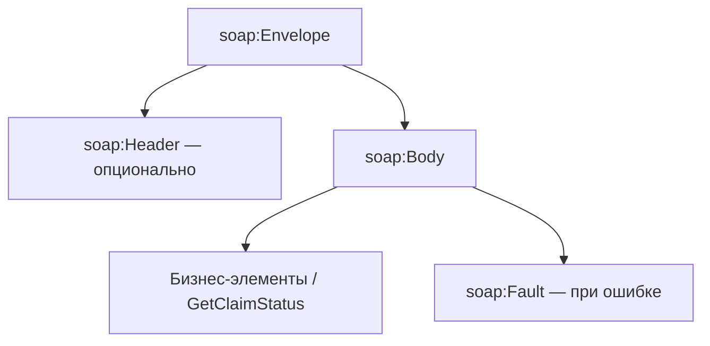
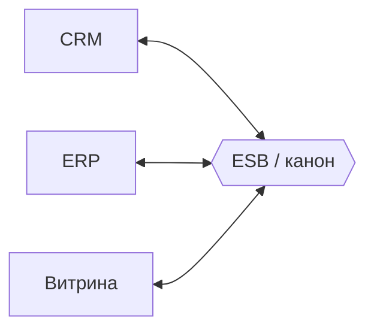

## Введение

В энтерпрайзе и банках SOAP/XML всё ещё встречаются в легаси и B2B. Middle СА должен отличить HTML от XML, объяснить XSD и namespaces, разобрать конверт SOAP и роль WSDL, а также честно сравнить с REST. Тема T4.3.1–4.3.9.

SOAP/WSDL — контракты enterprise-интеграций; дополняют REST/OpenAPI в портфеле СА. **T4.3** — индекс серии.

**ESB и интеграции.** После REST/SOAP/очередей на middle ждут «ландшафт интеграций»: что такое ESB, чем шина не очередь и не ETL, что будет, если на шине появились новые обязательные поля, и когда брать GraphQL, WebSocket, gRPC, webhook или файлы. Вопросы T4.4.6–4.4.9 и T4.5.1–4.5.8.

ESB, GraphQL, gRPC и webhooks — выбор стиля интеграции (BABOK *Requirements Analysis*). **T4.4.6–9; T4.5** — индекс; для REST-части — OpenAPI, для событий — Kafka/Rabbit docs.

## Раздел: Как отвечать одним блоком

Этот выпуск собрал соседние короткие темы трека: «SOAP и XML», «ESB и интеграции». Раньше каждая занимала отдельную карточку на несколько минут, а на собеседовании их спрашивают одним блоком. Ниже у каждой темы свой раздел, затем общие лабы, один тест и одна колода карточек. В ответе сначала назовите, какую тему спросили, потом определение и один пример. Не проговаривайте все разделы, если спросили один. Лабы можно пройти по порядку исходного трека. Если времени мало, сделайте первую и последнюю: первая ставит язык, последняя проверяет, что соседние темы вы не перепутали.

## Раздел: SOAP и XML: HTML vs XML и что внутри XML

**HTML** — язык разметки **страниц** для браузера: фиксированный набор тегов (`div`, `p`, `a`), толерантен к ошибкам, про представление.

**XML** — универсальный формат **данных и документов**: теги вы задаёте сами под домен (`<Order>`, `<Amount>`), строже к синтаксису (хорошо сформированный документ), про обмен и хранение структурированных данных.

**Что содержится в XML:**
- пролог (`<?xml version="1.0" encoding="UTF-8"?>`);
- элементы (теги) с вложенностью;
- атрибуты у элементов;
- текстовые узлы;
- опционально — namespaces, CDATA, комментарии, processing instructions;
- часто рядом — ссылка на XSD/DTD для валидации.

XML не «исполняется» как HTML в браузере; его парсят системы.

## Раздел: SOAP и XML: XSD, пространства имён, инструменты

**XSD (XML Schema Definition)** — схема, описывающая допустимую структуру XML: элементы, типы (`xs:string`, `xs:decimal`), обязательность, cardinality (`minOccurs`/`maxOccurs`), ограничения. Аналитик встречается с XSD как с контрактом интеграции (аналог JSON Schema для XML). «Писал ли» — если нет, скажите, что читаете/согласовываете XSD с вендором и сверяете примеры сообщений.

**Пространство имён (namespace)** — способ избежать конфликта одинаковых имён тегов из разных словарей (`<id>` в заказе и в пользователе). Объявляется через URI (`xmlns:ord="http://example.com/order"`) и префиксы. На собесе: «namespace = уникальный контекст имён элементов».

**Инструменты работы с XML:** редакторы и IDE (VS Code, IDEA), `xmllint`, Oxygen XML, SoapUI / Postman (SOAP), XMLSpy, библиотеки языков (Java JAXB, Python `lxml`), XSLT-процессоры для преобразований, браузер для просмотра сырого XML.

## Раздел: SOAP и XML: SOAP, сообщение, WSDL

**SOAP (Simple Object Access Protocol)** — протокол обмена структурированными сообщениями, обычно XML поверх HTTP(S). В энтерпрайсе: строгий контракт, WS-* (безопасность, транзакции) в зрелых стеках.

**Из чего состоит SOAP-сообщение (envelope):**
- **Envelope** — корневой контейнер;
- **Header** (опционально) — метаданные: безопасность, трассировка, маршрутизация;
- **Body** — полезный бизнес-payload;
- **Fault** — стандартный способ ошибки внутри Body при сбое.

**WSDL (Web Services Description Language)** — машинно-читаемое описание сервиса: операции, сообщения, типы (часто через XSD), привязка к протоколу (SOAP/HTTP), endpoint. По WSDL генерируют клиенты и stub'ы. Для СА WSDL = «паспорт» SOAP-API.

## Раздел: SOAP и XML: SOAP vs REST

| | SOAP | REST |
|--|------|------|
| Контракт | WSDL + XSD, операции | ресурсы + HTTP-методы, OpenAPI/JSON Schema |
| Формат | XML (типично) | JSON чаще; бывает XML |
| Стиль | RPC-операции (`GetOrder`) | ресурсно-ориентированный |
| Транспорт | чаще HTTP, возможны другие | HTTP(S) |
| Плюсы SOAP | строгая схема, зрелые WS-Security, формальные операции | простота, кэш GET, широкая экосистема веба |
| Плюсы REST | скорость разработки, читаемость, мобильные/SPA | — |

Выбор: SOAP — легаси и корпоративные шины с жёстким контрактом; REST/JSON — новые публичные и продуктовые API. Аналитик не «воюет за моду», а стыкует то, что есть у контрагента.

## Раздел: SOAP и XML: Частые вопросы с собеседования

**Вопрос.** Как на собесе отличить функциональное требование от нефункционального?

**Ответ.** FR — конкретное поведение: «можно оплатить картой». NFR — качество и ограничения: «p95 ответа API ≤ 300 мс при 500 RPS», «данные карты не в логах». NFR должны быть измеримы; «быстро и безопасно» без цифр — wish, не требование.

**Вопрос.** User story или use case — что выбрать на проекте?

**Ответ.** Story — короткий инкремент ценности для backlog и спринта. Use case — полный сценарий с актёром, основным и альтернативными потоками, когда важны ветки и исключения. На собесе: story для приоритизации, UC/sequence — когда согласуете интеграции и QA-покрытие.

**Вопрос.** BPMN и UML — конкуренты или разные задачи?

**Ответ.** Разные вопросы. BPMN — бизнес-процесс, шлюзы, роли людей. UML Use Case — граница системы и цели; Sequence — вызовы сервисов во времени. Ошибка: рисовать микросервисы на BPMN вместо бизнес-шагов.

**Вопрос.** Зачем на собесе СА спрашивают идемпотентность REST?

**Ответ.** Повтор запроса (таймаут, retry клиента, двойной клик) не должен дважды списать деньги. POST платежа часто делают идемпотентным через Idempotency-Key, уникальный constraint или проверку «уже обработано». GET/PUT/DELETE по смыслу ближе к идемпотентности, чем «слепой» POST.

**Вопрос.** Когда на интеграции выбрать синхронный REST, а когда очередь?

**Ответ.** Sync — нужен ответ сейчас и цепочка короткая (проверка остатка перед оплатой). Async — долгая работа, сглаживание пиков, слабая связность: 202 Accepted, статус по webhook/polling. СА описывает ретраи, дедупликацию и SLA ответа, а не только «повесим Kafka».

## Раздел: ESB и интеграции: Корпоративная шина, очередь и ETL

**Корпоративная шина (ESB, Enterprise Service Bus)** — посредник между множеством систем: маршрутизация, преобразование форматов (медиация), оркестрация вызовов, единая точка политик (логирование, безопасность). Системы подключаются к шине, а не каждая к каждой («звезда» вместо полной сетки связей).

**Шина vs очередь:**
- **очередь/брокер** — транспорт сообщений (доставка, буфер, pub/sub);
- **шина** — интеграционная платформа *поверх* транспорта: маппинг, каноническая модель, правила маршрутизации, адаптеры к протоколам. Очередь может быть частью ESB, но сама по себе ESB не является.

**Шина vs ETL:**
- **ETL** (Extract–Transform–Load) — пакетная выгрузка/преобразование/загрузка данных, часто в хранилище/DWH, по расписанию или батчам;
- **ESB** — операционный обмен сообщениями/вызовами near real-time между бизнес-приложениями. ETL не заменяет онлайн-интеграцию заказа; ESB плохо заменяет тяжёлые ночные витрины.

**Новые обязательные поля в одном веб-сервисе на шине:** меняется контракт этого сервиса. На канонической модели шины нужно:
1. расширить схему (XSD/JSON) и версию контракта;
2. обновить маппинги publisher → canonical → consumer;
3. потребители, которым поля не нужны, могут игнорировать (если в каноне optional) — но **обязательность у провайдера** заставляет всех, кто зовёт этот сервис напрямую, начать передавать поля;
4. через шину часто делают **адаптер**: старые клиенты шлют старый формат, шина обогащает дефолтами/справочником или режет вызов до обновления. Без версии и переходного периода интеграция «упадёт» на валидации.

## Раздел: ESB и интеграции: GraphQL и WebSocket

**GraphQL** — язык запросов к API: клиент описывает нужное дерево полей, один endpoint (часто `POST /graphql`), схема типов на сервере.

**Когда применяют:** много клиентов с разными потребностями в полях (web/mobile), проблема over/under-fetching REST, агрегация BFF. **Плюсы относительно REST:** точный набор полей, меньше round-trip для сложных экранов, строгая схема, интроспекция. Цена: сложнее кэш на HTTP-уровне, нужна защита от тяжёлых запросов (depth/complexity), другая модель авторизации полей.

**WebSocket** — двусторонний канал поверх TCP после HTTP-handshake. Когда: чаты, онлайн-статусы, котировки, совместное редактирование, push без постоянного polling. Не заменяет REST для обычного CRUD; дополняет real-time канал.

## Раздел: ESB и интеграции: gRPC, webhook, файловый обмен

**gRPC** — RPC-фреймворк на HTTP/2 + Protobuf. Когда: внутренние низколатентные сервисы, стриминг, строгие контракты `.proto`, полиглотные клиенты. Меньше удобен как публичный API для браузера без gRPC-Web/прокси.

**Webhook** — «обратный» HTTP: ваша система подписывается, провайдер сам делает `POST` на ваш URL при событии (оплата прошла, статус доставки).

**Плюсы webhook:** near real-time без polling, простота для провайдера событий, слабая связанность по расписанию. **Минусы:** нужен публичный HTTPS-endpoint, ретраи и идемпотентность, проверка подписи, проблемы недоступности вашего URL, сложнее отладка, чем cron-опрос.

**Файловый обмен** — системы кладут/забирают файлы (CSV, XML, JSON) с SFTP/бакета по расписанию.

**Плюсы:** простота для легаси и бухгалтерии, крупные объёмы батчем, понятный аудит файлов. **Минусы:** задержка (не online), сложные согласования формата и кодировок, идемпотентность загрузок, мониторинг «файл не пришёл», слабая интерактивность ошибок (отложенный reject).

## Раздел: ESB и интеграции: Частые вопросы с собеседования

**Вопрос.** Как на собесе отличить функциональное требование от нефункционального?

**Ответ.** FR — конкретное поведение: «можно оплатить картой». NFR — качество и ограничения: «p95 ответа API ≤ 300 мс при 500 RPS», «данные карты не в логах». NFR должны быть измеримы; «быстро и безопасно» без цифр — wish, не требование.

**Вопрос.** User story или use case — что выбрать на проекте?

**Ответ.** Story — короткий инкремент ценности для backlog и спринта. Use case — полный сценарий с актёром, основным и альтернативными потоками, когда важны ветки и исключения. На собесе: story для приоритизации, UC/sequence — когда согласуете интеграции и QA-покрытие.

**Вопрос.** BPMN и UML — конкуренты или разные задачи?

**Ответ.** Разные вопросы. BPMN — бизнес-процесс, шлюзы, роли людей. UML Use Case — граница системы и цели; Sequence — вызовы сервисов во времени. Ошибка: рисовать микросервисы на BPMN вместо бизнес-шагов.

**Вопрос.** Когда на интеграции выбрать синхронный REST, а когда очередь?

**Ответ.** Sync — нужен ответ сейчас и цепочка короткая (проверка остатка перед оплатой). Async — долгая работа, сглаживание пиков, слабая связность: 202 Accepted, статус по webhook/polling. СА описывает ретраи, дедупликацию и SLA ответа, а не только «повесим Kafka».

**Вопрос.** ACID и CAP — про одно и то же?

**Ответ.** Нет. ACID — свойства транзакции в одной БД (атомарность, согласованность, изоляция, долговечность). CAP — компромисс распределённой системы при сбое сети: согласованность vs доступность. На собесе связывают с контекстом: баланс — строже ACID; лента лайков — чаще eventual consistency.

## Лаба

**SOAP и XML.**

**Цель.** Разобрать учебный SOAP-вызов «получить статус заявки» и сопоставить с REST-аналогом.

**Шаги.**
1. Напишите дерево XML: `Envelope / Header / Body / GetClaimStatus` с полем `claimId`.
2. Опишите 3 ограничения XSD для `claimId` (тип, длина, pattern).
3. Объясните, зачем двум системам разные `xmlns` на тег `Status`.
4. Составьте таблицу маппинга: SOAP-операция → `GET /claims/{id}/status`.
5. Перечислите 2 причины оставить SOAP на контуре банка и 2 — не тащить SOAP в новый мобильный BFF.

**В группу:** обменяйтесь «сломанным» XML (незакрытый тег) — что скажет парсер vs HTML-браузер.

**Готово, если…**
- [ ] Отличаете HTML от XML по назначению
- [ ] Называете части SOAP Envelope
- [ ] Объясняете роль WSDL и XSD в контракте

**ESB и интеграции.**

**Цель.** Выбрать стиль интеграции для трёх кейсов и описать влияние новых обязательных полей на шине.

**Шаги.**
1. Кейс A: мобильному экрану нужно 5 из 40 полей профиля + вложенные заказы — GraphQL или REST и почему.
2. Кейс B: платёжный провайдер уведомляет об успехе — webhook vs polling раз в минуту.
3. Кейс C: ночная сверка 2M проводок в DWH — файл/ETL vs ESB.
4. На шине у сервиса «Клиенты» добавили обязательные `inn` и `kpp`: напишите план версий и адаптера на 2 спринта.
5. Сформулируйте, когда возьмёте gRPC между Order и Billing внутри кластера.

**В группу:** сравните каноническую модель vs point-to-point маппинг при 6 системах.

**Готово, если…**
- [ ] Отличаете ESB от брокера и от ETL
- [ ] Объясняете последствия новых required-полей на шине
- [ ] Подбираете GraphQL/WS/gRPC/webhook/файл под задачу

## Схема: SOAP и XML: SOAP Envelope

## Схема: ESB и интеграции: Шина между системами

## Тест

### В чём разница HTML и XML?

**Ответ:** HTML — разметка страниц с фиксированными тегами; XML — расширяемый формат данных со своими тегами и строгим синтаксисом

**Пояснение:** HTML про отображение в браузере; XML про структурированный обмен между системами.

### Чем ESB отличается от очереди сообщений?

**Ответ:** очередь — транспорт доставки; ESB — интеграционная платформа с маршрутизацией, трансформацией и адаптерами

**Пояснение:** брокер может входить в состав ESB, но сам по себе не даёт каноническую модель и медиацию.

### Что такое WSDL?

**Ответ:** описание SOAP-веб-сервиса: операции, сообщения, типы, endpoint

**Пояснение:** по WSDL строят клиенты и понимают контракт без чтения чужого кода.

### Плюс GraphQL относительно REST?

**Ответ:** клиент запрашивает ровно нужные поля и снижает over/under-fetching

**Пояснение:** удобно для разных UI; взамен сложнее кэширование и контроль тяжёлых запросов.

### Чем SOAP отличается от REST?

**Ответ:** SOAP — протокол операций с XML/WSDL; REST — стиль доступа к ресурсам через HTTP и произвольный контракт (часто JSON)

**Пояснение:** разный уровень стандартизации контракта и модель мышления (RPC-операции vs ресурсы).

## Шпаргалка

<ul><li>XML — данные; HTML — страница</li><li>XSD — схема XML; namespace — словарь имён</li><li>SOAP: Envelope = Header + Body (+ Fault)</li><li>WSDL — контракт сервиса</li><li>SOAP vs REST — операции/XML vs ресурсы/HTTP</li><li>ESB — посредник интеграций; очередь — доставка; ETL — батч в хранилища</li><li>Новые required на шине = версия + маппинг + адаптер/дефолты</li><li>GraphQL — гибкий запрос полей; WebSocket — двусторонний real-time</li><li>gRPC — быстрый внутренний RPC; webhook — push-событие HTTP</li><li>Файлы — простые батчи, плохой online</li></ul>

## Anki

### Front: Из чего состоит SOAP-сообщение?

Back: Envelope, опциональный Header, Body; при ошибке — Fault

### Front: Шина vs ETL

Back: шина — операционный обмен между приложениями; ETL — пакетная выгрузка/трансформация/загрузка данных, часто в DWH

### Front: Зачем namespace в XML?

Back: развести одинаковые имена элементов из разных словарей через URI/префиксы

### Front: Когда WebSocket?

Back: когда нужен постоянный двусторонний канал: чат, котировки, live-статусы без частого polling

### Front: Что описывает XSD?

Back: допустимую структуру и типы XML-документа: элементы, обязательность, ограничения

### Front: Плюсы файлового обмена

Back: просто для легаси, удобен для больших батчей и аудита файлов; минус — задержка и хрупкость форматов

## Итоги

- XML/XSD/namespace — язык корпоративных контрактов
- SOAP строится вокруг Envelope и WSDL, не «просто XML по HTTP»
- Сравнение с REST — про модель и экосистему, не про «кто лучше абсолютен»
- ESB, очередь и ETL — разные слои задач, не взаимозаменяемые ярлыки
- Смена обязательных полей на шине — это change management контракта
- GraphQL, gRPC, webhook, файлы выбирают по latency, объёму и стороне инициативы

## Ссылки

- [OpenAPI — для сравнения REST-контрактов](https://spec.openapis.org/oas/latest.html)
- [BABOK Guide — интеграции (IIBA)](https://www.iiba.org/knowledgehub/business-analysis-body-of-knowledge-babok-guide/)
- [Топ-150 вопросов СА (Хабр) — индекс формулировок](https://habr.com/ru/articles/963708/)
- [Learn](/game/learn)
- [Apache Kafka Documentation](https://kafka.apache.org/documentation/)
- [RabbitMQ Documentation](https://www.rabbitmq.com/docs)
