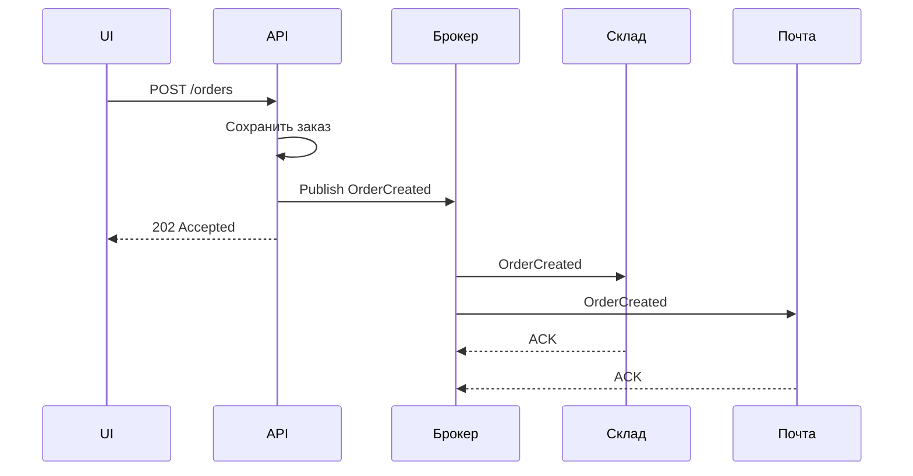
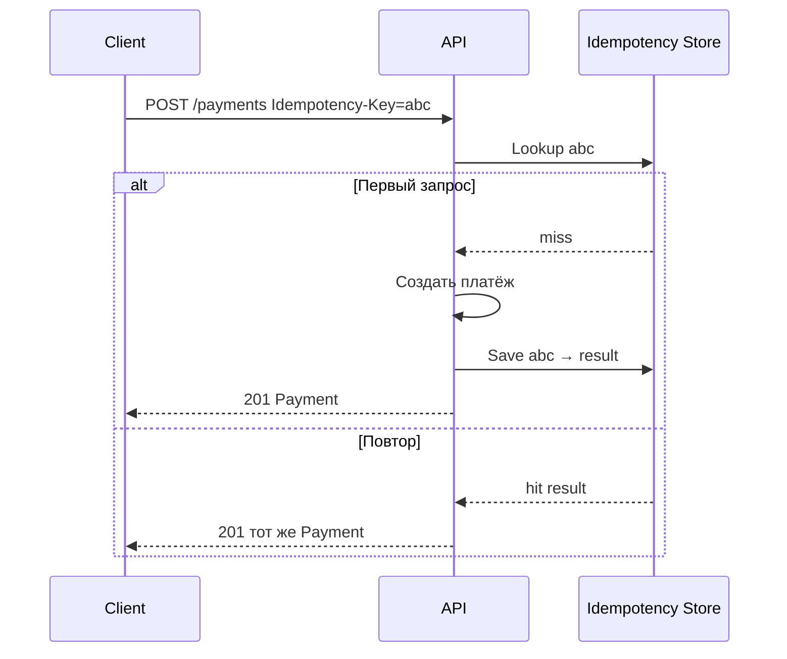

## Введение

Интеграции на собеседовании почти всегда сводят к вопросу: «синхронно или через очередь?». Middle СА должен объяснить разницу sync/async, когда ответ обязателен, зачем брокер, чем Kafka отличается от RabbitMQ, и что значат гарантии доставки и offset. Ниже — ответы на T4.1.1–4.1.5 и T4.4.1–4.4.5.

Sync/async и брокеры — проектирование интеграций (BABOK *Requirements Analysis*). **T4.1; T4.4.1–4.4.5** — индекс; первично — документация **Apache Kafka** и **RabbitMQ**, семантика доставки.

**REST продвинутый.** Базовые методы HTTP на junior уже «сданы». На middle спрашивают кэш, идемпотентность (в том числе как «починить» POST), допустимость POST для чтения, стратегию обратной совместимости и JSON Schema. Выпуск закрывает T4.2.5–4.2.6 и T4.2.15–4.2.20.

Версии API, идемпотентность и JSON Schema — контракт **OpenAPI 3.1** и HTTP semantics. **T4.2.5–6, T4.2.15–20** — индекс; Richardson level 2–3 и спецификация OpenAPI — первичные опоры.

## Раздел: Как отвечать одним блоком

Этот выпуск собрал соседние короткие темы трека: «Sync/Async и очереди», «REST продвинутый». Раньше каждая занимала отдельную карточку на несколько минут, а на собеседовании их спрашивают одним блоком. Ниже у каждой темы свой раздел, затем общие лабы, один тест и одна колода карточек. В ответе сначала назовите, какую тему спросили, потом определение и один пример. Не проговаривайте все разделы, если спросили один. Лабы можно пройти по порядку исходного трека. Если времени мало, сделайте первую и последнюю: первая ставит язык, последняя проверяет, что соседние темы вы не перепутали.

## Раздел: Sync/Async и очереди: Синхронное и асинхронное взаимодействие

**Синхронное** — вызывающая сторона ждёт завершения обработки (или таймаута): отправил запрос → блокируется/ждёт → получил ответ. Пример: HTTP REST `POST /orders` с телом результата или ошибкой.

**Асинхронное** — отправили работу и не держим клиента на всём цикле обработки: приняли, ответили «принято» (или вообще fire-and-forget в шину), результат придёт позже (callback, polling, событие, письмо).

**Всегда ли должен быть ответ?**
- В **синхронном** контракте ответ (успех/ошибка/таймаут) — часть взаимодействия: без него клиент не знает исход.
- В **асинхронном** «ответ» может быть: (а) техническое подтверждение приёма (ACK брокера, 202 Accepted); (б) бизнес-результат отдельным сообщением; (в) в чистом pub/sub издатель может не ждать бизнес-ответа. На собесе лучше сказать: «технический ACK часто есть; бизнес-ответ — по контракту».

**Пример только sync:** экран логина → `POST /auth/login` → JWT в ответе. Пользователь не может идти дальше без синхронного результата. То же: платёжный authorize в момент checkout, если UI обязан показать успех/отказ сразу.

**Зачем очереди в async:** сгладить пики, развязать сервисы по времени жизни, повторить обработку при падении consumer, маршрутизировать нескольким обработчикам, гарантировать буфер при недоступности получателя.

**Вызов БД / хранимой процедуры:** для приложения это обычно **синхронный** вызов: поток/корутина ждёт результат SQL. «Асинхронность» драйвера (asyncpg) не делает взаимодействие с БД бизнес-async: вы всё равно ждёте ответ СУБД в рамках запроса. Настоящий async-паттерн — отложить тяжёлую работу в очередь и сразу вернуть клиенту 202.

## Раздел: Sync/Async и очереди: Когда нужны очереди сообщений

Очереди уместны, когда:
- производитель быстрее или нестабильнее потребителя;
- нужна повторная доставка и изоляция сбоев;
- несколько независимых обработчиков одного события (заказ создан → склад, почта, аналитика);
- длинные процессы (генерация отчёта, видео) нельзя держать в HTTP-таймауте;
- важна пиковая устойчивость витрины/акций.

С какими брокерами «работали» на собесе: честно назовите стек проекта; если учебного опыта нет — разберите Kafka и RabbitMQ концептуально (этого часто достаточно middle).

## Раздел: Sync/Async и очереди: Kafka vs RabbitMQ, гарантии, offset, queue vs topic

**Kafka vs RabbitMQ (рабочая схема ответа):**
| | RabbitMQ | Kafka |
|--|----------|-------|
| Модель | брокер очередей, маршрутизация (exchange → queue) | распределённый лог, топики и партиции |
| Потребление | сообщение обычно забирается из очереди consumer'ом | читают offset в логе, можно перечитывать |
| Фокус | гибкая маршрутизация задач, низкая задержка команд | высокий throughput событий, replay, stream |
| Типично | команды, RPC-like задачи, сложный routing | event streaming, аудит, CDC, fan-out читателей |

**Гарантии доставки (общая терминология):**
- **at most once** — не более одного раза (можно потерять);
- **at least once** — хотя бы раз (возможны дубли → нужна идемпотентность);
- **exactly once** — ровно раз (дорого/ограничено; в Kafka — с транзакциями и идемпотентным producer в определённых сценариях).

Брокер «гарантирует» в рамках выбранного режима: persist на диск, ACK consumer, репликация партиций/очередей. Аналитик в постановке пишет требуемую семантику и идемпотентность обработчика.

**Перечитать два последних сообщения в Kafka:** consumer group хранит **offset**. Чтобы прочитать снова те же записи — сдвинуть (reset) offset назад на нужную позицию (например, `end-2` или конкретный timestamp/offset) и продолжить poll. Важно: это управление курсором читателя, а не «вернуть сообщения в очередь».

**Очередь vs топик:**
- **Очередь (queue)** — точка-точка: конкурирующие consumer'ы делят сообщения (одно сообщение — одному обработчику из группы).
- **Топик (pub/sub)** — публикация многим подписчикам; каждый подписчик (или каждая group в Kafka) видит свой поток. В Kafka «топик» — именованный лог; семантика competing consumers достигается consumer group.

В постановке ссылайтесь на официальные модели: Kafka — **log + consumer group + offset** ([документация](https://kafka.apache.org/documentation/)); RabbitMQ — **exchange, queue, binding, ACK** ([docs](https://www.rabbitmq.com/docs)). Гарантии at-least-once почти всегда требуют идемпотентного consumer.

## Раздел: Sync/Async и очереди: Частые вопросы с собеседования

**Вопрос.** Как на собесе отличить функциональное требование от нефункционального?

**Ответ.** FR — конкретное поведение: «можно оплатить картой». NFR — качество и ограничения: «p95 ответа API ≤ 300 мс при 500 RPS», «данные карты не в логах». NFR должны быть измеримы; «быстро и безопасно» без цифр — wish, не требование.

**Вопрос.** User story или use case — что выбрать на проекте?

**Ответ.** Story — короткий инкремент ценности для backlog и спринта. Use case — полный сценарий с актёром, основным и альтернативными потоками, когда важны ветки и исключения. На собесе: story для приоритизации, UC/sequence — когда согласуете интеграции и QA-покрытие.

**Вопрос.** BPMN и UML — конкуренты или разные задачи?

**Ответ.** Разные вопросы. BPMN — бизнес-процесс, шлюзы, роли людей. UML Use Case — граница системы и цели; Sequence — вызовы сервисов во времени. Ошибка: рисовать микросервисы на BPMN вместо бизнес-шагов.

**Вопрос.** ACID и CAP — про одно и то же?

**Ответ.** Нет. ACID — свойства транзакции в одной БД (атомарность, согласованность, изоляция, долговечность). CAP — компромисс распределённой системы при сбое сети: согласованность vs доступность. На собесе связывают с контекстом: баланс — строже ACID; лента лайков — чаще eventual consistency.

**Вопрос.** Зачем системному аналитику OpenAPI, если есть текст требований?

**Ответ.** OpenAPI — исполнимый контракт для Dev/QA/партнёров: методы, схемы, коды ошибок, версии. Меньше «договорились устно». Аналитик не обязан писать YAML руками, но обязан согласовать поля, обязательность, breaking vs optional изменения и примеры ошибок.

## Раздел: REST продвинутый: Кэширование — зачем и где

**Кэширование** — хранение результата дорогого чтения, чтобы отдать его повторно без полной пересчётки/похода в БД. Зачем: снизить латентность, разгрузить БД и бэкенд, сгладить пики публичных GET.

**Где реализуется — клиент или сервер?** Оба уровня, и это нормальный ответ:
- **клиент / браузер** — Cache-Control, ETag/If-None-Match, локальный кэш SPA;
- **промежуточные** — CDN, reverse proxy (nginx), API Gateway;
- **сервер** — application cache (Redis), query cache, HTTP-кэш ответов.

В постановке СА указывает: какие ресурсы кэшируемы, TTL, ключ кэша, что инвалидирует (смена статуса заказа), и что **нельзя** кэшировать (персональные балансы без ключа пользователя, чувствительные данные).

## Раздел: REST продвинутый: Идемпотентность методов

**Идемпотентный** запрос — многократное выполнение с теми же параметрами даёт тот же **эффект на ресурс** (не обязательно идентичное тело ответа). Важно при ретраях сети: клиент не должен создать 5 заказов из-за таймаута.

Классика HTTP:
- **GET, PUT, DELETE, HEAD, OPTIONS** — идемпотентны по семантике;
- **POST** — не идемпотентен (каждый вызов может создать новый ресурс);
- **PATCH** — зависит от семантики патча.

**DELETE идемпотентен?** Да: первый DELETE удаляет ресурс (200/204); повторный — ресурс уже отсутствует (часто 404 или снова 204 — политика API). Состояние «ресурса нет» стабильно, повтор не удаляет «ещё раз» другой объект.

**Как сделать POST идемпотентным:**
1. **Idempotency-Key** в заголовке: сервер сохраняет ключ → результат первого успеха и при повторе возвращает тот же ответ.
2. Клиентский **бизнес-ключ** (`external_order_id`) с UNIQUE в БД.
3. Перевести создание на **PUT** по известному URL `/orders/{id}`, если id задаёт клиент.

**Можно ли POST для получения данных?** Технически да (тело запроса с сложным фильтром, превышение лимита URL, RPC-стиль). Но это ломает кэшируемость GET и ожидания REST. На собесе: «можно, но лучше GET + query/body sparingly; если POST-search — явно задокументировать и не считать ресурс „созданием“».

## Раздел: REST продвинутый: Обратная совместимость и версии API

**Обратная совместимость** — старые клиенты продолжают работать после изменений сервера. Совместимые изменения: добавить опциональное поле в ответ, новый endpoint, новый опциональный query. Ломающие: удалить/переименовать поле, сменить тип, сделать поле обязательным во входе, изменить семантику кода ответа.

**Когда новая версия API:** накоплены breaking changes, смена модели безопасности, несовместимый редизайн ресурсов. Способы: `/v2/...`, заголовок `Accept-Version`, отдельный хост. Параллельно — deprecation policy (срок жизни v1).

Роль СА: в changelog интеграции помечать breaking/non-breaking; не «тихо» менять контракт шины/мобильного клиента.

## Раздел: REST продвинутый: JSON Schema

**JSON Schema** — формальное описание JSON-документа: типы, required, enum, format, вложенность, `$ref`. Зачем: валидация запросов/ответов, контракт для моков и тестов, генерация документации, единый язык фронта и бэка.

На практике аналитик пишет или ревьюит schema для тела `POST /orders`, ошибок `ErrorResponse`, событий. Даже если «сам не писал файлы» — важно читать schema и сверять с постановкой (обязательность, nullable, диапазоны).

## Раздел: REST продвинутый: Частые вопросы с собеседования

**Вопрос.** Как на собесе отличить функциональное требование от нефункционального?

**Ответ.** FR — конкретное поведение: «можно оплатить картой». NFR — качество и ограничения: «p95 ответа API ≤ 300 мс при 500 RPS», «данные карты не в логах». NFR должны быть измеримы; «быстро и безопасно» без цифр — wish, не требование.

**Вопрос.** User story или use case — что выбрать на проекте?

**Ответ.** Story — короткий инкремент ценности для backlog и спринта. Use case — полный сценарий с актёром, основным и альтернативными потоками, когда важны ветки и исключения. На собесе: story для приоритизации, UC/sequence — когда согласуете интеграции и QA-покрытие.

**Вопрос.** BPMN и UML — конкуренты или разные задачи?

**Ответ.** Разные вопросы. BPMN — бизнес-процесс, шлюзы, роли людей. UML Use Case — граница системы и цели; Sequence — вызовы сервисов во времени. Ошибка: рисовать микросервисы на BPMN вместо бизнес-шагов.

**Вопрос.** ACID и CAP — про одно и то же?

**Ответ.** Нет. ACID — свойства транзакции в одной БД (атомарность, согласованность, изоляция, долговечность). CAP — компромисс распределённой системы при сбое сети: согласованность vs доступность. На собесе связывают с контекстом: баланс — строже ACID; лента лайков — чаще eventual consistency.

## Лаба

**Sync/Async и очереди.**

**Цель.** Для сценария «создали заказ → уведомить склад и отправить письмо» выбрать sync/async и описать контракт с брокером.

**Шаги.**
1. Нарисуйте два варианта: всё в одном HTTP-запросе vs `202` + событие `OrderCreated`.
2. Решите: RabbitMQ или Kafka для уведомлений склада и почты — аргумент в 3 предложениях.
3. Зафиксируйте гарантию: at least once + идемпотентный ключ `order_id` у consumer.
4. Опишите, как QA/разработка «перечитает» событие в Kafka после бага в consumer (offset).
5. Ответьте письменно: «вызов stored procedure из API — sync или async?» и почему.

**В группу:** партнёр ломает consumer (медленный) — обсудите рост лага и влияние на SLA витрины.

**Готово, если…**
- [ ] Чётко отличаете sync HTTP от async через брокер
- [ ] Объясняете at least once и зачем идемпотентность
- [ ] Знаете, как в Kafka сдвинуть offset для повторного чтения

**REST продвинутый.**

**Цель.** Спроектировать идемпотентное создание платежа и политику версионирования каталога.

**Шаги.**
1. Опишите `POST /payments` с заголовком `Idempotency-Key` и таблицей поведения при повторе.
2. Перечислите 3 изменения контракта каталога: два совместимых, одно ломающее → нужна v2.
3. Решите: поиск товаров с фильтром на 30 полей — GET или POST, аргументы.
4. Набросайте JSON Schema объекта `Payment` (id, amount, currency, status enum) в 10–15 строках YAML/JSON.
5. Укажите Cache-Control для `GET /public/products/{id}` и почему `GET /me/balance` не кэшировать на CDN.

**В группу:** партнёр дважды шлёт один Idempotency-Key с разным телом — что должен ответить сервер (конфликт ключа).

**Готово, если…**
- [ ] Объясняете идемпотентность без путаницы с «одинаковым JSON ответа»
- [ ] Знаете, как сделать POST безопасным к ретраям
- [ ] Отличаете breaking change от добавления optional-поля

## Схема: Sync/Async и очереди: Заказ через очередь

## Схема: REST продвинутый: Идемпотентный POST

## Тест

### Вызов хранимой процедуры из сервиса — sync или async?

**Ответ:** обычно синхронный: вызывающий код ждёт результат СУБД

**Пояснение:** async-драйвер не меняет бизнес-смысл «запрос–ответ к БД»; отложенная обработка — это уже очередь вне транзакции ответа клиенту.

### Является ли DELETE идемпотентным?

**Ответ:** да — повторный DELETE не меняет итог «ресурса нет»

**Пояснение:** первый вызов удаляет; последующие остаются в том же финальном состоянии ресурса (код ответа может отличаться — 404 vs 204).

### Как в Kafka снова прочитать два последних сообщения?

**Ответ:** сдвинуть offset consumer group назад на две записи (или к нужному offset) и продолжить чтение

**Пояснение:** Kafka хранит лог; повторное чтение — управление курсором, а не возврат message в конец очереди как в классическом MQ.

### Как обеспечить обратную совместимость API?

**Ответ:** не ломать контракт старых клиентов: только аддитивные изменения; breaking — через новую версию и политику deprecation

**Пояснение:** удаление полей, смена типов и обязательности во входе — поводы для vN+1, а не «тихого» релиза.

### В чём отличие очереди от топика?

**Ответ:** очередь — конкурирующие потребители делят сообщения; топик — публикация нескольким подписчикам

**Пояснение:** в Kafka топик + consumer group даёт и log, и конкурирующее потребление внутри группы.

## Шпаргалка

<ul><li>Sync — ждём бизнес/транспортный ответ; async — развязка по времени</li><li>Очередь сглаживает пики и сбои потребителя</li><li>RabbitMQ — маршрутизация задач; Kafka — лог событий и replay</li><li>at least once ⇒ дубли ⇒ идемпотентность</li><li>Queue vs topic: point-to-point vs pub/sub</li><li>Кэш — на клиенте, CDN и сервере; в ТЗ — TTL и инвалидация</li><li>Идемпотентность = безопасные ретраи</li><li>DELETE идемпотентен; POST — через Idempotency-Key / business key / PUT</li><li>Breaking change → версия API</li><li>JSON Schema — контракт структуры JSON</li></ul>

## Anki

### Front: Зачем очереди в асинхронных интеграциях?

Back: буфер при пиках и простоях consumer, развязка сервисов, ретраи, fan-out обработчиков

### Front: Как сделать POST идемпотентным?

Back: Idempotency-Key, уникальный бизнес-ключ создания или PUT по клиентскому id

### Front: Kafka vs RabbitMQ — главное отличие модели

Back: Kafka — распределённый лог с offset и replay; RabbitMQ — брокер очередей с гибкой маршрутизацией сообщений

### Front: Где бывает HTTP-кэш?

Back: браузер/клиент, CDN/прокси, сервер приложения — часто комбинируют

### Front: at most / at least / exactly once

Back: не больше одного (можно потерять) / хотя бы раз (возможны дубли) / ровно раз (сложнее и дороже)

### Front: Когда плодить v2 API?

Back: когда нужны несовместимые изменения контракта или радикальный редизайн ресурсов

## Итоги

- Sync и async — про ожидание результата, не только про «есть ли HTTP»
- Очереди — инструмент развязки и надёжности; гарантии требуют идемпотентности
- Kafka и RabbitMQ отвечают на разные классы задач; queue и topic — разные семантики доставки
- Кэш и идемпотентность — про устойчивость интеграций, не «красоту REST»
- POST для чтения возможен, но осознанно; ретраи POST без ключа опасны
- Версии и JSON Schema — инструменты управляемой эволюции контракта

## Ссылки

- [Apache Kafka Documentation](https://kafka.apache.org/documentation/)
- [RabbitMQ Documentation](https://www.rabbitmq.com/docs)
- [BABOK Guide — интеграции (IIBA)](https://www.iiba.org/knowledgehub/business-analysis-body-of-knowledge-babok-guide/)
- [Топ-150 вопросов СА (Хабр) — индекс формулировок](https://habr.com/ru/articles/963708/)
- [Learn](/game/learn)
- [OpenAPI Specification 3.1](https://spec.openapis.org/oas/latest.html)
- [Richardson Maturity Model](https://martinfowler.com/articles/richardsonMaturityModel.html)
