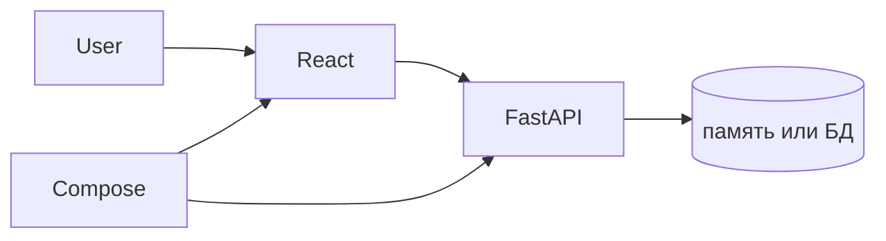
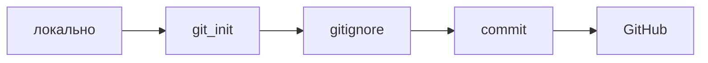
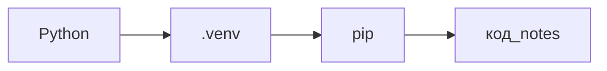
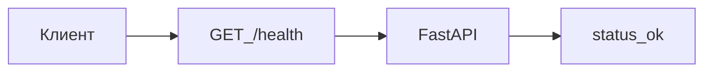

## Введение

B01 · Карта · первое приложение за серию

**Git: репозиторий за 15 минут.** B02 · Git · init, commit, .gitignore Тема выпуска: Git: репозиторий за 15 минут.

**Python: venv и первая.** B03 · Python · окружение Тема выпуска: Python: venv и первая команда.

**FastAPI: первый /health.** B04 · FastAPI · `/health` Тема выпуска: FastAPI: первый /health.

## Раздел: Как отвечать одним блоком

Этот выпуск собрал соседние короткие темы трека: «Карта», «Git: репозиторий за 15 минут», «Python: venv и первая», «FastAPI: первый /health». Раньше каждая занимала отдельную карточку на несколько минут, а на собеседовании их спрашивают одним блоком. Ниже у каждой темы свой раздел, затем общие лабы, один тест и одна колода карточек. В ответе сначала назовите, какую тему спросили, потом определение и один пример. Не проговаривайте все разделы, если спросили один. Лабы можно пройти по порядку исходного трека. Если времени мало, сделайте первую и последнюю: первая ставит язык, последняя проверяет, что соседние темы вы не перепутали.

## Раздел: Карта: Основная часть

Цель сезона B: быстро собрать своё первое приложение — **«Заметки»** (`notes`): API на Python, страница на React, упаковка в Docker. Не весь прод-стенд, а минимальный круг «кнопка → API → список».

Четыре кирпича, которые вы соберёте:

1. **Git** — где живёт код и история ([B02](/game/learn/b01-karta), [B06](/game/learn/b05-api-check)).
2. **Python / FastAPI** — HTTP и JSON ([B03](/game/learn/b01-karta)–[B07](/game/learn/b05-api-check)).
3. **React** — экран поверх готового API ([B08](/game/learn/b05-api-check), [B09](/game/learn/b05-api-check)).
4. **Docker / Compose** — одинаковый запуск у вас и у друга ([B10](/game/learn/b10-docker), [B11](/game/learn/b10-docker)).

Порядок важен: сначала API можно проверить без UI ([B05](/game/learn/b05-api-check)), потом уже React. Docker — когда код уже отвечает.

Зачем это на 9to18. Площадка про взаимное продвижение проектов: сначала учимся запускать своё, потом показывать его другим. CopyParse — пример «взрослого» стенда, не ДЗ на клон.

Граница. JWT, Kubernetes, Kafka и «красивый дизайн» в сезон B не входят. Финал — [склейка B12](/game/learn/b10-docker).

Следующий выпуск: [B02 · Git](/game/learn/b01-karta) — репозиторий до первой строки Python.

## Раздел: Карта: Частые вопросы с собеседования

Короткие ответы на вопросы, которые чаще всего звучат по теме выпуска. Развёрнутая проверка — в тесте ниже.

**Какие слои у учебного notes?** Позже БД; сначала карта границ.

**Зачем рисовать карту до кода?** Иначе UI лезет в детали сервера.

**Кто ходит в API из браузера?** Не напрямую в файловую систему сервера.

**Что обещает «одна команда запуска»?** Compose/README на 5 минут.

**Чем карта отличается от списка файлов?** Стрелки важнее имён каталогов.

## Раздел: Карта: Шпаргалка

### Сезон B — маршрут

| № | Тема | Ссылка |
|---|------|--------|
| B01 | Карта | этот выпуск |
| B02 | Git init | [открыть](/game/learn/b01-karta) |
| B03 | Python / venv | [открыть](/game/learn/b01-karta) |
| B04 | FastAPI `/health` | [открыть](/game/learn/b01-karta) |
| B05 | Проверка API | [открыть](/game/learn/b05-api-check) |
| B06 | Git ветка | [открыть](/game/learn/b05-api-check) |
| B07 | Notes API | [открыть](/game/learn/b05-api-check) |
| B08 | React список | [открыть](/game/learn/b05-api-check) |
| B09 | React форма | [открыть](/game/learn/b05-api-check) |
| B10 | Docker | [открыть](/game/learn/b10-docker) |
| B11 | Compose | [открыть](/game/learn/b10-docker) |
| B12 | Склейка | [открыть](/game/learn/b10-docker) |

### Не делать в B01

- Ставить Minikube «на вырост»
- Писать UI до API

## Раздел: Git: репозиторий за 15 минут: Основная часть

Код на Рабочем столе без истории — черновик. Git фиксирует *что* изменилось. GitHub — место, куда потом положите Docker-инструкции из [B11](/game/learn/b10-docker).

Сквозной проект сезона: репозиторий **`notes`**.

### 1. Создайте repo

На GitHub: New repository → `notes` (private ок) → **без** README, если делаете `git init` локально.

```bash
mkdir notes && cd notes
git init
git branch -M main
```

### 2. .gitignore до первого commit

Иначе `venv/` и `.env` уедут в историю навсегда (секреты понадобятся ближе к [B10](/game/learn/b10-docker)).

```
.env
venv/
.venv/
__pycache__/
*.pyc
node_modules/
dist/
.idea/
.vscode/
*.pem
```

### 3. Первый commit

```bash
# README: что за сервис (заметки), для кого, стек позже
git add .gitignore README.md
git status
git commit -m "init: notes app, gitignore"
```

Карта слоёв из [B01](/game/learn/b01-karta) можно положить в `docs/map.md` вторым commit — или оставить на [B06](/game/learn/b05-api-check).

Зачем это дальше. В [B03](/game/learn/b01-karta) в этот же repo появится Python. В [B08](/game/learn/b05-api-check) — папка `web/`. Один репозиторий на всё приложение.

Граница. Ветки и PR — в [B06](/game/learn/b05-api-check). Сейчас достаточно `main` + понятный commit.

Следующий: [B03 · Python](/game/learn/b01-karta).

## Раздел: Git: репозиторий за 15 минут: Частые вопросы с собеседования

Короткие ответы на вопросы, которые чаще всего звучат по теме выпуска. Развёрнутая проверка — в тесте ниже.

**Что положить в .gitignore сразу?** Секреты и зависимости не в git.

**Зачем осмысленный commit message?** init: notes app лучше, чем fix.

**Что делает git status?** Перед add/commit — привычка.

**Зачем remote origin?** push/pull одной командой.

**Почему README в первом commit?** Что за сервис и для кого.

## Раздел: Git: репозиторий за 15 минут: Шпаргалка

### Happy path

```bash
git init && git branch -M main
git add .gitignore README.md
git commit -m "init: notes app, gitignore"
git remote add origin https://github.com/<you>/notes.git
git push -u origin main
```

### Связи

- Карта приложения: [B01](/game/learn/b01-karta)
- Ветка и PR: [B06](/game/learn/b05-api-check)

## Раздел: Python: venv и первая: Основная часть

API сезона будет на **Python 3.12+**. Сначала — изолированное окружение, чтобы пакеты FastAPI из [B04](/game/learn/b01-karta) не смешались с системным Python.

Работайте **внутри** репозитория `notes` из [B02](/game/learn/b01-karta).

### 1. Проверьте Python

```bash
python --version
# или: python3 --version
```

Нужен 3.11+ (лучше 3.12).

### 2. venv

```bash
cd notes
python -m venv .venv
# Windows PowerShell:
.\.venv\Scripts\Activate.ps1
# macOS / Linux:
# source .venv/bin/activate
python -m pip install --upgrade pip
```

Папка `.venv/` уже в `.gitignore` из B02 — не коммитьте её.

### 3. Проверка

```bash
python -c "print('notes ok')"
```

Граница. Пока не ставьте FastAPI — это [B04](/game/learn/b01-karta). Не ставьте глобально без venv.

Следующий: [B04 · FastAPI `/health`](/game/learn/b01-karta).

## Раздел: Python: venv и первая: Частые вопросы с собеседования

Короткие ответы на вопросы, которые чаще всего звучат по теме выпуска. Развёрнутая проверка — в тесте ниже.

**Зачем venv?** Не засорять системный Python.

**Какая команда создать venv?** Затем активировать и pip install.

**Куда писать зависимости проекта?** Или pyproject; главное — зафиксировать.

**Почему не коммитить venv/?** Восстанавливается из requirements.

**Что проверить первой командой?** Согласовать версию ≥3.12 в проекте.

## Раздел: Python: venv и первая: Шпаргалка

```bash
python -m venv .venv
# Windows: .\.venv\Scripts\Activate.ps1
python -m pip install --upgrade pip
python -c "print('notes ok')"
```

Не коммитить: `.venv/`, `__pycache__/`.

Дальше: [B04 FastAPI](/game/learn/b01-karta).

## Раздел: FastAPI: первый /health: Основная часть

API начинается с контракта: путь, ответ, код. FastAPI это фиксирует типами и сразу даёт Swagger на `/docs`.

В репо `notes` (venv из [B03](/game/learn/b01-karta)):

```bash
pip install "fastapi[standard]"
```

Минимальный `api/main.py`:

```python
from fastapi import FastAPI

app = FastAPI(title="notes")

@app.get("/health")
def health():
    return {"status": "ok"}
```

Запуск:

```bash
uvicorn api.main:app --reload --port 8000
```

Откройте `http://127.0.0.1:8000/health` и `http://127.0.0.1:8000/docs`.

Зачем без React. В [B05](/game/learn/b05-api-check) научитесь проверять API до UI. В [B07](/game/learn/b05-api-check) добавите заметки. В [B10](/game/learn/b10-docker) этот же процесс попадёт в Docker.

Граница. Без БД, JWT и CORS-танцев. Один процесс, одна ручка.

Следующий: [B05 · проверка API](/game/learn/b05-api-check).

## Раздел: FastAPI: первый /health: Частые вопросы с собеседования

Короткие ответы на вопросы, которые чаще всего звучат по теме выпуска. Развёрнутая проверка — в тесте ниже.

**Зачем эндпоинт /health?** Compose/k8s и человек без UI.

**Какой метод обычно у health?** Без тела, быстрый ответ.

**Что вернуть в теле минимум?** Иногда версию/время — по договорённости.

**Почему health не должен ходить в тяжёлую БД всегда?** Liveness vs readiness разделяют.

**Где смотреть контракт FastAPI?** OpenAPI из кода.

## Раздел: FastAPI: первый /health: Шпаргалка

```bash
pip install "fastapi[standard]"
uvicorn api.main:app --reload --port 8000
```

| URL | Ожидание |
|-----|----------|
| `/health` | `{"status":"ok"}` |
| `/docs` | Swagger UI |

Связи: [B05](/game/learn/b05-api-check), [B07](/game/learn/b05-api-check), [B10](/game/learn/b10-docker).

## Лаба

**Карта.**

**20 минут.** На бумаге или в `docs/map.md` нарисуйте три коробки: **React**, **API (Python)**, **Git-репозиторий**. Стрелка: «добавить заметку».

**Проверка:** браузер не ходит в базу напрямую; API стоит между UI и данными (пока данные могут быть в памяти — это ок до Docker).

**Дальше:** [B02 · Git](/game/learn/b01-karta).

**Git: репозиторий за 15 минут.**

**25 минут.**

1. Создайте GitHub-репозиторий `notes` (без README).
2. Локально: `git init`, `.gitignore` из теории, `README.md` на 3 строки.
3. Commit `init: notes app, gitignore` и `git push -u origin main`.

**В группу / себе:** ссылка на репозиторий.

**Проверка:** в Files на GitHub нет `venv/`; в README есть слово «заметки».

**Тренажёр:** [init-commit](/game/git?task=init-commit) · дальше [GIT01](/game/learn/git-commit-anatomy).

**Дальше:** [B03 · Python](/game/learn/b01-karta). Назад: [B01](/game/learn/b01-karta).

**Python: venv и первая.**

**20 минут.** В репо `notes`:

1. Создайте и активируйте `.venv`.
2. Выполните `python -c "print('notes ok')"`.
3. Commit не нужен (venv не в git). Обновите README одной строкой: «Python 3.12, venv».

**Проверка:** в терминале видно `(.venv)`; `python -c` печатает `notes ok`.

**Дальше:** [B04](/game/learn/b01-karta). Назад: [B02](/game/learn/b01-karta).

**FastAPI: первый /health.**

**30 минут.**

1. `pip install "fastapi[standard]"` в venv.
2. Файл `api/main.py` с `GET /health`.
3. Запустите uvicorn, откройте `/docs`.
4. Commit: `feat: fastapi health endpoint`.

**Проверка:** `/health` → `{"status":"ok"}`; в `/docs` видна ручка.

**Дальше:** [B05](/game/learn/b05-api-check). Назад: [B03](/game/learn/b01-karta).

## Схема: Карта: Карта notes



## Схема: Git: репозиторий за 15 минут: Схема



## Схема: Python: venv и первая: Схема



## Схема: FastAPI: первый /health: Схема



## Тест

### Какие слои у учебного notes?

**Ответ:** UI API деплой

**Пояснение:** Позже БД; сначала карта границ.

### Что положить в .gitignore сразу?

**Ответ:** venv и .env

**Пояснение:** Секреты и зависимости не в git.

### Зачем venv?

**Ответ:** изолированные зависимости

**Пояснение:** Не засорять системный Python.

### Зачем эндпоинт /health?

**Ответ:** проверка живости

**Пояснение:** Compose/k8s и человек без UI.

### Зачем рисовать карту до кода?

**Ответ:** договориться о границах

**Пояснение:** Иначе UI лезет в детали сервера.

## Шпаргалка

<ul><li>### Сезон B — маршрут | № | Тема | Ссылка | |---|------|--------| | B01 | Карта | этот выпуск | | B02 | Git init | [открыть](/game/learn/b01-karta) | | B03 | Python / venv | [открыть](/game/learn/b01-karta) | | B04 | FastAPI `/health` | [отк</li><li>### Happy path ```bash git init && git branch -M main git add .gitignore README.md git commit -m "init: notes app, gitignore" git remote add origin https://github.com/ /notes.git git push -u origin main ``` ### Связи - Карта приложения: [B0</li><li>```bash python -m venv .venv # Windows: .\.venv\Scripts\Activate.ps1 python -m pip install --upgrade pip python -c "print('notes ok')" ``` Не коммитить: `.venv/`, `__pycache__/`. Дальше: [B04 FastAPI](/game/learn/b01-karta).</li><li>```bash pip install "fastapi[standard]" uvicorn api.main:app --reload --port 8000 ``` | URL | Ожидание | |-----|----------| | `/health` | `{"status":"ok"}` | | `/docs` | Swagger UI | Связи: [B05](/game/learn/b05-api-check), [B07](/game/lear</li></ul>

## Anki

### Front: Что такое «B02»?

Back: Git init

### Front: Карта приложения?

Back: [B01](/game/learn/b01-karta)

### Front: О чём выпуск «Python»?

Back: B03 · Python · окружение

### Front: Что такое «URL»?

Back: Ожидание

### Front: Что такое «B03»?

Back: Python / venv

### Front: Ветка и PR?

Back: [B06](/game/learn/b05-api-check)

## Мнемоника

### loci: Первый стенд

**Задание:** Комнаты пути от пустой папки до health.

**Элементы:**
- репозиторий
- venv
- ручка
- health

**Подсказка:** Health — проверка процесса, не бизнес-сценарий.

**Ответ:** git → venv → route → health

## Итоги

- № — Тема
- B01 — Карта
- B02 — Git init
- B03 — Python / venv
- B04 — FastAPI `/health`
- B05 — Проверка API
- B06 — Git ветка
- B07 — Notes API

## Ссылки

- [Оглавление Learn](/game/learn)
- [CopyParse (референс стенда)](https://www.copyparse.ru)
- [B06 · Ветка Git](/game/learn/b05-api-check)
- [Pro Git](https://git-scm.com/book/ru/v2)
- [Тренажёр Git](/game/git)
- [venv — docs.python.org](https://docs.python.org/3/library/venv.html)
- [B05 · Проверка API →](/game/learn/b05-api-check)
- [B07 · Notes API](/game/learn/b05-api-check)
- [FastAPI First Steps](https://fastapi.tiangolo.com/tutorial/first-steps/)
