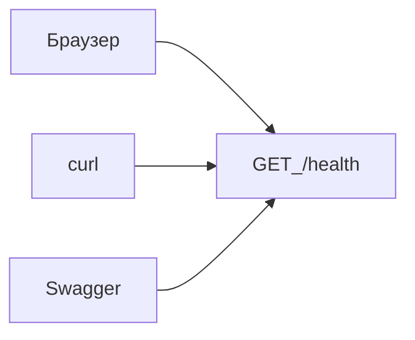
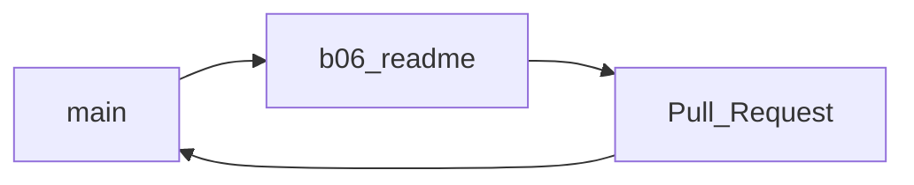
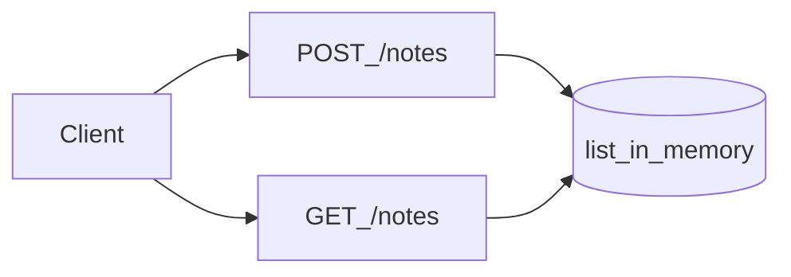
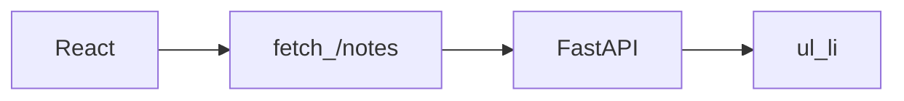
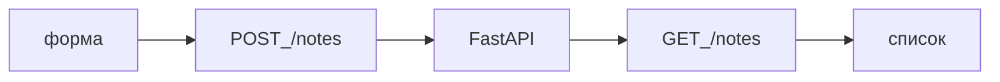

## Введение

B05 · Проверка · curl и браузер Тема выпуска: Как проверить API без React.

**Git ветка.** B06 · Git · ветка и README Тема выпуска: Git: ветка и понятный README.

**Notes API: список и создание.** B07 · FastAPI · заметки в памяти Тема выпуска: Notes API: список и создание.

**React список.** B08 · React · список Тема выпуска: React: список заметок с API.

**React форма.** B09 · React · POST из формы Тема выпуска: React: форма «добавить заметку».

## Раздел: Как отвечать одним блоком

Этот выпуск собрал соседние короткие темы трека: «Проверка API», «Git ветка», «Notes API: список и создание», «React список», «React форма». Раньше каждая занимала отдельную карточку на несколько минут, а на собеседовании их спрашивают одним блоком. Ниже у каждой темы свой раздел, затем общие лабы, один тест и одна колода карточек. В ответе сначала назовите, какую тему спросили, потом определение и один пример. Не проговаривайте все разделы, если спросили один. Лабы можно пройти по порядку исходного трека. Если времени мало, сделайте первую и последнюю: первая ставит язык, последняя проверяет, что соседние темы вы не перепутали.

## Раздел: Проверка API: Основная часть

Пока нет React ([B08](/game/learn/b05-api-check)), API из [B04](/game/learn/b01-karta) уже можно проверить тремя способами.

### 1. Браузер

`http://127.0.0.1:8000/health` — для GET достаточно.

### 2. Swagger `/docs`

Кнопка Try it out → Execute. Удобно видеть схему ответа.

### 3. curl / PowerShell

```bash
curl http://127.0.0.1:8000/health
```

PowerShell:

```powershell
Invoke-RestMethod http://127.0.0.1:8000/health
```

Зачем это. Когда в [B07](/game/learn/b05-api-check) появится `POST /notes`, вы сначала проверите его здесь, и только потом повесите кнопку в [B09](/game/learn/b05-api-check). Иначе отладка «не работает форма» смешивает UI и API.

Граница. Insomnia/Postman — по желанию; curl достаточно.

Следующий: [B06 · Git ветка](/game/learn/b05-api-check) — зафиксировать прогресс до усложнения API.

## Раздел: Проверка API: Частые вопросы с собеседования

Короткие ответы на вопросы, которые чаще всего звучат по теме выпуска. Развёрнутая проверка — в тесте ниже.

**Чем проверить API без React?** curl, Insomnia, httpx.

**Что считать успехом GET /health?** Не только «что-то ответило».

**Зачем фиксировать пример запроса в README?** Другой человек воспроизведёт за минуту.

**Как отличить баг сети от бага API?** Timeout vs 500 с traceback.

**Почему проверка API раньше UI экономит время?** Фронт строится на рабочих ответах.

## Раздел: Проверка API: Шпаргалка

```bash
curl http://127.0.0.1:8000/health
```

Порядок отладки: **API → потом UI**. См. [B09](/game/learn/b05-api-check).

## Раздел: Git ветка: Основная часть

Перед `POST /notes` ([B07](/game/learn/b05-api-check)) закрепим привычку: лаба не пишется прямо в `main`.

```bash
git switch -c b06-readme
# обновите README: как поднять venv и uvicorn (команды из B03–B04)
git add README.md
git commit -m "docs: how to run health API"
git push -u origin b06-readme
```

На GitHub: Pull Request `b06-readme` → `main`. Смотрите **Files changed**.

README минимум:

1. Что это (`notes`).
2. Как создать venv ([B03](/game/learn/b01-karta)).
3. Как запустить `uvicorn` ([B04](/game/learn/b01-karta)).

Позже в [B12](/game/learn/b10-docker) добавите Compose.

Граница. Rebase и monorepo-тулинг не нужны. Ветка + PR + читаемый commit.

Следующий: [B07 · Notes API](/game/learn/b05-api-check).

## Раздел: Git ветка: Частые вопросы с собеседования

Короткие ответы на вопросы, которые чаще всего звучат по теме выпуска. Развёрнутая проверка — в тесте ниже.

**Зачем ветка feature/*?** main остаётся зелёным.

**Что такое PR?** Diff + обсуждение + проверки.

**Когда merge в main?** Не пушить сырой WIP в main.

**Чем rebase отличается по смыслу от merge?** Оба доставляют коммиты; политика команды.

**Что не класть в PR?** .env, node_modules, огромные бинарники.

## Раздел: Git ветка: Шпаргалка

```bash
git switch -c b06-readme
git add README.md
git commit -m "docs: how to run health API"
git push -u origin b06-readme
```

Связи: [B02](/game/learn/b01-karta), финал README — [B12](/game/learn/b10-docker).

## Раздел: Notes API: список и создание: Основная часть

Расширяем [B04](/game/learn/b01-karta): ресурс заметок без БД. React в [B08](/game/learn/b05-api-check)–[B09](/game/learn/b05-api-check) будет бить именно сюда.

Пример моделей и ручек в `api/main.py`:

```python
from fastapi import FastAPI
from pydantic import BaseModel, Field

app = FastAPI(title="notes")
_notes: list[dict] = []
_next_id = 1

class NoteIn(BaseModel):
    title: str = Field(min_length=1, max_length=200)

class Note(NoteIn):
    id: int

@app.get("/health")
def health():
    return {"status": "ok"}

@app.get("/notes", response_model=list[Note])
def list_notes():
    return _notes

@app.post("/notes", response_model=Note)
def create_note(body: NoteIn):
    global _next_id
    note = {"id": _next_id, "title": body.title}
    _next_id += 1
    _notes.append(note)
    return note
```

Проверьте через приёмы [B05](/game/learn/b05-api-check):

```bash
curl -X POST http://127.0.0.1:8000/notes -H "Content-Type: application/json" -d "{\"title\":\"первая\"}"
curl http://127.0.0.1:8000/notes
```

Граница. Postgres подождёт сезона S01. После рестарта uvicorn список обнулится — это ожидаемо.

Следующий: [B08 · React список](/game/learn/b05-api-check).

## Раздел: Notes API: список и создание: Частые вопросы с собеседования

Короткие ответы на вопросы, которые чаще всего звучат по теме выпуска. Развёрнутая проверка — в тесте ниже.

**Какие методы у заметок минимум?** Список и создание; дальше PUT/DELETE.

**Где хранить notes на первом шаге?** Потом БД; важно зафиксировать контракт.

**Что вернуть после POST?** Часто 201 + тело с id.

**Зачем валидировать тело?** Pydantic отсекает мусор.

**Как проверить без UI?** Как в B05, но уже CRUD.

## Раздел: Notes API: список и создание: Шпаргалка

| Метод | Путь | Назначение |
|-------|------|------------|
| GET | `/health` | живость |
| GET | `/notes` | список |
| POST | `/notes` | создать |

Отладка: [B05](/game/learn/b05-api-check). UI: [B08](/game/learn/b05-api-check), [B09](/game/learn/b05-api-check).

## Раздел: React список: Основная часть

UI появляется **после** рабочего API ([B07](/game/learn/b05-api-check)). В том же репо `notes`:

```bash
npm create vite@latest web -- --template react-ts
cd web
npm install
npm run dev
```

На странице: `fetch("http://127.0.0.1:8000/notes")` → показать `title` списком.

CORS: в FastAPI добавьте (временно для учёбы):

```python
from fastapi.middleware.cors import CORSMiddleware
app.add_middleware(
    CORSMiddleware,
    allow_origins=["http://127.0.0.1:5173", "http://localhost:5173"],
    allow_methods=["*"],
    allow_headers=["*"],
)
```

Зачем так. В [B05](/game/learn/b05-api-check) вы уже знаете, что API отвечает; если список пустой — сначала curl, потом React.

Следующий: [B09 · форма](/game/learn/b05-api-check).

## Раздел: React список: Частые вопросы с собеседования

Короткие ответы на вопросы, которые чаще всего звучат по теме выпуска. Развёрнутая проверка — в тесте ниже.

**Откуда список заметок в UI?** fetch/axios к бэку.

**Зачем loading-состояние?** Пока запрос в полёте.

**Что показать при ошибке сети?** Не молчаливый пустой список.

**Зачем key у элементов списка?** id с бэка лучше индекса.

**Куда не класть токены в учебном UI?** localStorage — осознанно и осторожно.

## Раздел: React список: Шпаргалка

```bash
npm create vite@latest web -- --template react-ts
cd web && npm install && npm run dev
```

Порядок отладки: curl ([B05](/game/learn/b05-api-check)) → React.

Форма: [B09](/game/learn/b05-api-check).

## Раздел: React форма: Основная часть

Замыкаем круг: поле ввода → `POST /notes` → обновить список ([B07](/game/learn/b05-api-check), [B08](/game/learn/b05-api-check)).

```ts
await fetch("http://127.0.0.1:8000/notes", {
  method: "POST",
  headers: { "Content-Type": "application/json" },
  body: JSON.stringify({ title }),
})
```

После успеха — снова `GET /notes` или добавьте ответ POST в локальный state.

Это и есть «первое приложение» до Docker: человек жмёт кнопку, данные появляются в списке.

Дальше упакуем API в образ ([B10](/game/learn/b10-docker)) и поднимем Compose ([B11](/game/learn/b10-docker)).

Граница. Авторизация, редактирование, удаление — не в сезон B.

## Раздел: React форма: Частые вопросы с собеседования

Короткие ответы на вопросы, которые чаще всего звучат по теме выпуска. Развёрнутая проверка — в тесте ниже.

**Что делает форма заметок?** Создаёт запись и обновляет список.

**Зачем controlled input?** Значение из useState, onChange пишет назад.

**Когда дизейблить кнопку отправки?** Защита от двойного клика.

**Что сделать после успешного POST?** Или оптимистично добавить в state.

**Куда девать текст ошибки API?** Пользователь должен увидеть причину.

## Раздел: React форма: Шпаргалка

Круг: `форма → POST /notes → GET /notes → ul`.

Связи: [B07](/game/learn/b05-api-check), [B08](/game/learn/b05-api-check), Docker: [B10](/game/learn/b10-docker).

## Лаба

**Проверка API.**

**15 минут.** При запущенном uvicorn из [B04](/game/learn/b01-karta):

1. Откройте `/health` в браузере.
2. Выполните curl или `Invoke-RestMethod`.
3. В `/docs` нажмите Execute на `/health`.

**Проверка:** три способа показывают `status: ok`.

**Дальше:** [B06](/game/learn/b05-api-check). Назад: [B04](/game/learn/b01-karta).

**Git ветка.**

**25 минут.**

1. Ветка `b06-readme`, обновите README командами запуска.
2. Push и PR в `main`.
3. Merge после самопроверки диффа.

**Проверка:** в PR нет `.venv`; commit message не `fix`.

**Тренажёр:** [branch-switch](/game/git?task=branch-switch) · дальше [GIT02](/game/learn/git-commit-anatomy), [GIT04](/game/learn/git-commit-anatomy).

**Дальше:** [B07](/game/learn/b05-api-check). Назад: [B02](/game/learn/b01-karta), [B05](/game/learn/b05-api-check).

**Notes API: список и создание.**

**40 минут.** В ветке `b05-api-check`:

1. Добавьте `GET/POST /notes` как в теории (или эквивалент).
2. Проверьте curl/Swagger.
3. Commit + PR.

**Проверка:** после POST список на GET содержит новую заметку; `/health` жив.

**Дальше:** [B08](/game/learn/b05-api-check). Назад: [B04](/game/learn/b01-karta), [B05](/game/learn/b05-api-check).

**React список.**

**40 минут.**

1. Создайте Vite React-TS в `web/`.
2. На главной загрузите `/notes` и отрисуйте список.
3. Включите CORS на API, commit оба изменения.

**Проверка:** при запущенных API и `npm run dev` видны заметки, созданные через curl.

**Дальше:** [B09](/game/learn/b05-api-check). Назад: [B07](/game/learn/b05-api-check).

**React форма.**

**40 минут.**

1. Форма с `title`, кнопка «Добавить».
2. POST на API, обновление списка без перезагрузки страницы.
3. Commit + короткий скрин в PR (по желанию).

**Проверка:** заметка из UI видна и в curl `GET /notes`.

**Дальше:** [B10](/game/learn/b10-docker). Назад: [B08](/game/learn/b05-api-check).

## Схема: Проверка API: Схема



## Схема: Git ветка: Схема



## Схема: Notes API: список и создание: Схема



## Схема: React список: Схема



## Схема: React форма: Схема



## Тест

### Чем проверить API без React?

**Ответ:** HTTP-клиент

**Пояснение:** curl, Insomnia, httpx.

### Зачем ветка feature/*?

**Ответ:** изолировать работу

**Пояснение:** main остаётся зелёным.

### Какие методы у заметок минимум?

**Ответ:** GET и POST

**Пояснение:** Список и создание; дальше PUT/DELETE.

### Откуда список заметок в UI?

**Ответ:** GET API

**Пояснение:** fetch/axios к бэку.

### Что делает форма заметок?

**Ответ:** POST на API

**Пояснение:** Создаёт запись и обновляет список.

## Шпаргалка

<ul><li>```bash curl http://127.0.0.1:8000/health ``` Порядок отладки: **API → потом UI**. См. [B09](/game/learn/b05-api-check).</li><li>```bash git switch -c b06-readme git add README.md git commit -m "docs: how to run health API" git push -u origin b06-readme ``` Связи: [B02](/game/learn/b01-karta), финал README — [B12](/game/learn/b10-docker).</li><li>| Метод | Путь | Назначение | |-------|------|------------| | GET | `/health` | живость | | GET | `/notes` | список | | POST | `/notes` | создать | Отладка: [B05](/game/learn/b05-api-check). UI: [B08](/game/learn/b05-api-check), [B09](/gam</li><li>```bash npm create vite@latest web -- --template react-ts cd web && npm install && npm run dev ``` Порядок отладки: curl ([B05](/game/learn/b05-api-check)) → React. Форма: [B09](/game/learn/b05-api-check).</li><li>Круг: `форма → POST /notes → GET /notes → ul`. Связи: [B07](/game/learn/b05-api-check), [B08](/game/learn/b05-api-check), Docker: [B10](/game/learn/b10-docker).</li></ul>

## Anki

### Front: О чём выпуск «Проверка API»?

Back: B05 · Проверка · curl и браузер

### Front: О чём выпуск «Git ветка»?

Back: B06 · Git · ветка и README

### Front: Что такое «GET»?

Back: `/health`

### Front: О чём выпуск «React список»?

Back: B08 · React · список

### Front: О чём выпуск «React форма»?

Back: B09 · React · POST из формы

### Front: Ключевая идея: Проверка API

Back: Пока нет React ([B08](/game/learn/b05-api-check)), API из [B04](/game/learn/b01-karta) уже можно проверить тремя способами.

## Мнемоника

### peg: Проверка с клиента

**Задание:** Три взгляда на одну ручку.

**Элементы:**
- статус
- тело
- экран

**Подсказка:** Экран может нарисовать пустой список при 200.

**Ответ:** 1 status · 2 body · 3 UI

## Итоги

- Изучите выпуск B05: Проверка API
- Изучите выпуск B06: Git ветка
- Метод — Путь
- GET — `/health`
- GET — `/notes`
- POST — `/notes`
- Изучите выпуск B08: React список
- Изучите выпуск B09: React форма

## Ссылки

- [← B04 · FastAPI](/game/learn/b01-karta)
- [B02 · Git init](/game/learn/b01-karta)
- [GitHub Flow](https://docs.github.com/ru/get-started/using-github/github-flow)
- [Тренажёр Git](/game/git)
- [Pydantic / Body](https://fastapi.tiangolo.com/tutorial/body/)
- [Vite Guide](https://vite.dev/guide/)
- [B10 · Docker →](/game/learn/b10-docker)
